# 🎬 Anthropic Just Dropped Claude Haiku 5.5 (Major Upgrade)

> **Chaîne** : [Brock Mesarich | AI for Non Techies](https://www.youtube.com/@BrockMesarich)  
> **Lien YouTube** : [https://www.youtube.com/watch?v=PjCL8nsBsMc](https://www.youtube.com/watch?v=PjCL8nsBsMc)  
> **Date de publication** : 20261007  
> **Durée** : 00:06:39  
> **Identifiant vidéo** : `PjCL8nsBsMc`  
> **Transcription & Analyse** : `whisper-v3-large-turbo+gemini-3.5-flash-lite`  

---

## 📌 Synthèse Exécutive & Outils

### 💡 Résumé
Dans cette vidéo intitulée **Anthropic vient de lancer Claude Haiku 5.5 (Mise à niveau majeure)**, Alex Carter détaille une approche stratégique et pratique du trading et de l'automatisation par agents IA.

### 🛠️ Outils, Modèles & Logiciels Présentés
- **TradingView & Claude Code** : Analyse technique avancée et automatisation algorithmique.

### 🔑 Points Clés & Enseignements Stratégiques
- Respect rigoureux du ratio risque/rendement et du money management.
- Automatisation méthodique des déclencheurs d'ordres via des agents intelligents.

---

## ⏱️ Chronologie & Transcription Complète Audio & Visuelle (Mot pour Mot)

### ⏱️ `[00:00:00 - 00:00:26]` | Segment #01

**🔊 Audio (Transcription Intégrale Mot pour Mot en Français) :**
> Anthropic vient de lancer son modèle le plus économique de la famille Claude 3.5, et cela pourrait bien changer le modèle que vous utilisez pour une grande partie de votre travail quotidien. Il s'appelle Haiku 3.5, et il arrive juste après la sortie d'Opus 3.5 et de Sonnet 3.5, qui ont été extrêmement impressionnants. Or, Haiku a toujours été le modèle petit et économique, et franchement, il n'a pas été très performant par le passé. Donc, si celui-ci a bénéficié du même type de mise à niveau qu'Opus et Sonnet, alors cela peut devenir vraiment intéressant.

**👁️ Analyse Visuelle d'Écran (gemini-3.5-flash-lite) :**
**Interface & Outils** : Présentation vidéo avec infographie intégrée affichant les cartes des modèles d'IA.

**Contenu textuel & Code** : Texte affichant "The Claude 5.5 family", "Opus, then Sonnet, now Haiku", ainsi que les cartes individuelles "Opus 5.5 (Released Sep 22)", "Sonnet 5.5 (Released Sep 28)", et "Haiku 5.5 (Released Oct 7)" étiquetée comme "The cheapest".

**Action / Démonstration** : Le présentateur présente et compare visuellement la chronologie et le positionnement tarifaire des différents modèles de la famille Claude.

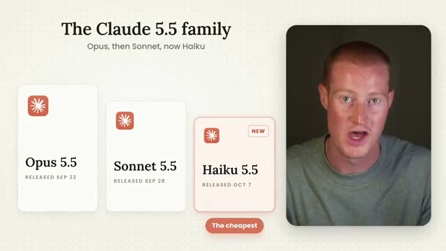
*⏱️ 00:00:13 — Présentation graphique de la famille de modèles Claude avec l'apparition des cartes Opus 5.5, Sonnet 5.5 et Haiku 5.5, avec le présentateur visible dans un cadre sur le côté.*

---

### ⏱️ `[00:00:26 - 00:00:46]` | Segment #02

**🔊 Audio (Transcription Intégrale Mot pour Mot en Français) :**
> Donc, dans cette vidéo, je vais vous expliquer exactement à quel point c'est bon marché, à quel point c'est rapide et à quel point c'est performant. Je vous donnerai même des exemples du moment où vous devriez utiliser Haiku plutôt que Sonnet ou Opus, parce qu'un modèle moins cher ne signifie pas toujours meilleur. Alors, sans plus attendre, plongeons directement dans le vif du sujet. Très bien, alors ce que je vais faire, c'est parcourir l'article qu'Anthropic nous a fourni et simplement vous donner les principaux points de discussion qui vous importent.

**👁️ Analyse Visuelle d'Écran (gemini-3.5-flash-lite) :**
**Interface & Outils** : Présentation vidéo avec diapositives graphiques et encadré vidéo du présentateur.

**Contenu textuel & Code** : Texte présentant le plan de la vidéo sur Claude Haiku 5.5 (How cheap it is, How fast it is, How capable it is).

**Action / Démonstration** : Présentation du plan et introduction du sujet par le présentateur.

---

### ⏱️ `[00:00:46 - 00:01:08]` | Segment #03

**🔊 Audio (Transcription Intégrale Mot pour Mot en Français) :**
> Si vous voulez le lire vous-même, il y terá un lien dans la description pour le faire. Maintenant, première chose importante, Anthropic appelle Haiku 3.5 le modèle compact le plus économique, le plus rapide et le plus performant qu'ils n'aient jamais sorti. Si vous n'êtes pas familier avec la gamme, Opus est leur plus grand modèle, puis nous avons Sonnet, et Haiku est le plus petit et le moins cher. Anthropic affirme qu'il est conçu pour les tâches à haut volume et sensibles aux coûts.

**👁️ Analyse Visuelle d'Écran (gemini-3.5-flash-lite) :**
**Interface & Outils** : Navigateur web affichant un tweet (X / Twitter) avec incrustation vidéo du présentateur.

**Contenu textuel & Code** : Texte du tweet annonçant le modèle compact d'Anthropic : 'Introducing Claude Haiku 3.5: the cheapest, fastest, and most capable small model we've ever released.'

**Action / Démonstration** : Présentation du nouveau modèle d'intelligence artificielle Haiku 3.5 par le créateur de contenu.

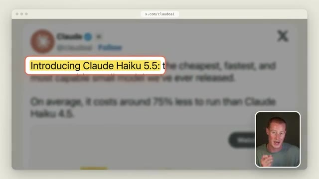
*⏱️ 00:00:51 — Capture d'écran montrant un tweet flouté d'Anthropic sur x.com/claudeai avec une mise en avant surlignée en jaune du texte 'Introducing Claude Haiku 3.5' et le présentateur dans un encadré en bas à droite.*

---

### ⏱️ `[00:01:08 - 00:01:27]` | Segment #04

**🔊 Audio (Transcription Intégrale Mot pour Mot en Français) :**
> Pensez donc au travail rapide et répétitif comme les résumés, le tri d'e-mails ou l'extraction d'un chiffre d'un rapport. Ils disent aussi que c'est leur modèle le plus rapide à ce jour, donc il fonctionne vraiment très bien pour des choses comme le support client en direct et l'utilisation du navigateur. Et le dernier modèle Haiku est sorti il y a environ un an, donc celui-ci se faisait attendre depuis longtemps. Passons maintenant à la chose la plus importante ici, et c'est le prix.

**👁️ Analyse Visuelle d'Écran (gemini-3.5-flash-lite) :**
**Interface & Outils** : Navigateur web affichant des pages de documentation et d'annonces d'Anthropic.

**Contenu textuel & Code** : Texte descriptif sur le modèle Claude Haiku et ses capacités ("fastest model to date", "live customer support and browser use").

**Action / Démonstration** : Présentation visuelle du texte officiel d'Anthropic pour illustrer les performances et la vitesse du modèle discuté.

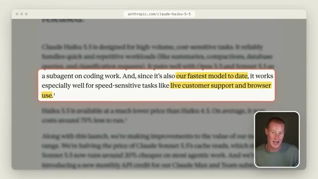
*⏱️ 00:01:18 — Capture d'écran d'une page web d'Anthropic montrant un texte surligné concernant les performances de Claude Haiku 5.5, avec une incrustation vidéo du présentateur en bas à droite.*

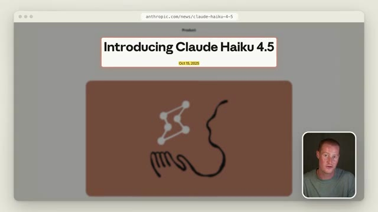
*⏱️ 00:01:23 — Capture d'écran d'une page web présentant "Introducing Claude Haiku 4.5" datée du 15 octobre 2025, avec une incrustation vidéo du présentateur en bas à droite.*

---

### ⏱️ `[00:01:28 - 00:01:47]` | Segment #05

**🔊 Audio (Transcription Intégrale Mot pour Mot en Français) :**
> Anthropic affirme qu'en moyenne, Haiku 5.5 coûte environ 75 % de moins que l'utilisation de Haiku 4.5. Voici donc la comparaison côte à côte. Pour les jetons d'entrée, l'ancien Haiku coûtait 1 dollar par million, et Haiku 5.5 est à 10 cents. Pour les jetons de sortie, on est passés de 5 dollars à 50 cents.

**👁️ Analyse Visuelle d'Écran (gemini-3.5-flash-lite) :**
**Interface & Outils** : Navigateur web affichant la documentation d'Anthropic et interface vidéo avec le présentateur en incrustation.

**Contenu textuel & Code** : Texte extrait de la documentation officielle d'Anthropic sur les réductions de coûts de Claude Haiku 5.5.

**Action / Démonstration** : Présentation des données textuelles et des graphiques comparatifs de tarification des modèles d'IA par le présentateur.

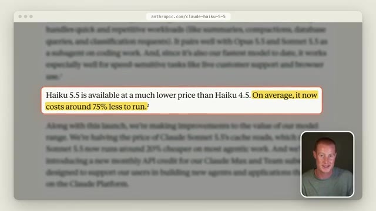
*⏱️ 00:01:32 — Capture d'écran du site d'Anthropic montrant la phrase soulignant que Haiku 5.5 coûte environ 75 % de moins à exécuter que Haiku 4.5.*

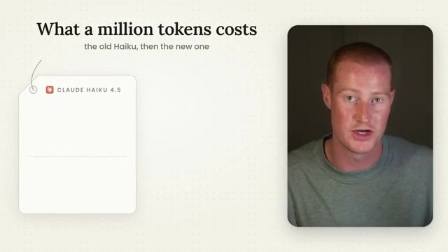
*⏱️ 00:01:37 — Écran de présentation titré 'What a million tokens costs' introduisant la comparaison des coûts entre l'ancien et le nouveau modèle Haiku.*

---

### ⏱️ `[00:01:47 - 00:02:10]` | Segment #06

**🔊 Audio (Transcription Intégrale Mot pour Mot en Français) :**
> Donc, si on fait le calcul ici, c'est 90 % de moins. Et si vous le comparez à Sonnet 5.5, c'est 2 dollars en entrée et 10 dollars en sortie. Donc Haiku est 20 fois moins cher que celui-là. Maintenant, il y a un piège et c'est cette partie-là. Ce prix de 10 centimes s'applique uniquement aux invites allant jusqu'à 100 000 jetons. Une fois que vous dépassez ce seuil, c'est 50 centimes en entrée et 2 dollars et 50 centimes en sortie, ce qui ne représente toujours que la moitié du coût de l'ancien Haiku.

**👁️ Analyse Visuelle d'Écran (gemini-3.5-flash-lite) :**
**Interface & Outils** : Page web de documentation de tarification et infographie explicative avec incrustation vidéo du présentateur.

**Contenu textuel & Code** : Tarifs par million de tokens pour les entrées ($2.00) et les sorties ($10.00) de Sonnet 5.5, et seuil de 100 000 tokens pour les prompts.

**Action / Démonstration** : Le présentateur explique et compare les coûts des différents modèles d'IA d'Anthropic en illustrant les grilles tarifaires et les subtilités de prix.

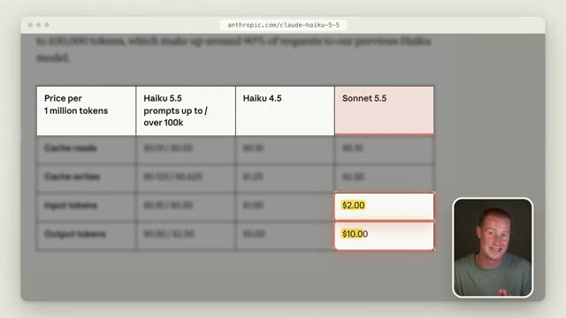
*⏱️ 00:01:53 — Un tableau comparatif des prix des modèles Anthropic (Haiku 5.5, Haiku 4.5, Sonnet 5.5) avec des cellules surlignées pour le Sonnet 5.5.*

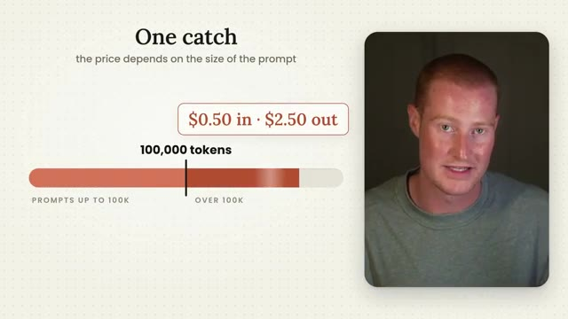
*⏱️ 00:02:04 — Une infographie expliquant les conditions de tarification (« One catch ») selon la taille du prompt, avec une barre de progression à 100 000 tokens.*

---

### ⏱️ `[00:02:10 - 00:02:30]` | Segment #07

**🔊 Audio (Transcription Intégrale Mot pour Mot en Français) :**
> Et pour mettre cela en perspective, 100 000 jetons représentent environ 55 000 mots. C'est donc à peu près un livre court dans une seule invite. Anthropic affirme qu'environ 90 % des requêtes adressées à l'ancien Haiku étaient inférieures à cette taille, donc la plupart du temps, vous bénéficiez du tarif le moins cher. Maintenant, si l'on en juge par le prix seul, cela ouvre la voie à de nombreux emplois qui étaient probablement trop coûteux à automatiser auparavant.

**👁️ Analyse Visuelle d'Écran (gemini-3.5-flash-lite) :**
**Interface & Outils** : Graphique explicatif animé ou infographie intégrée à la vidéo.

**Contenu textuel & Code** : Texte "One catch", barres de progression des jetons, "100,000 tokens", "about 55,000 words", tarification "$0.50 in $2.50 out" et mention "50% lower than Haiku 4.5".

**Action / Démonstration** : Explication visuelle de la tarification et de la taille des prompts par le présentateur.

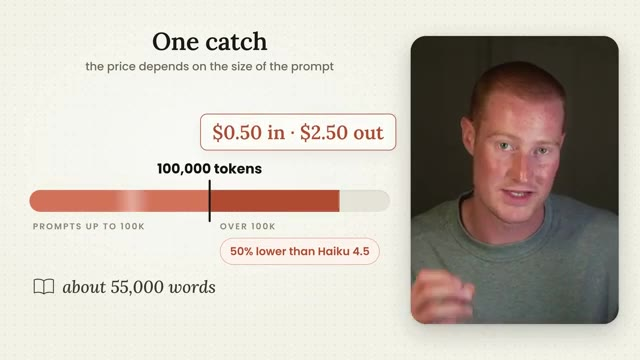
*⏱️ 00:02:15 — Un graphique explicatif montrant le coût en fonction de la taille du prompt, avec le présentateur incrusté à droite.*

---

### ⏱️ `[00:02:30 - 00:02:51]` | Segment #08

**🔊 Audio (Transcription Intégrale Mot pour Mot en Français) :**
> Maintenant, bien sûr, le coût est très important, mais cela ne veut pas dire grand-chose si le modèle n'est pas très performant. Et comme je l'ai dit, les anciens modèles Haiku n'ont pas été très impressionnants, c'est donc la partie qui m'intriguait le plus personnellement. Voici exactement comment il se compare à Haiku 4.5, au petit modèle d'OpenAI et à Sonnet 5.5. Et ce qui ressort vraiment pour moi ici, c'est l'utilisation de l'ordinateur.

**👁️ Analyse Visuelle d'Écran (gemini-3.5-flash-lite) :**
**Interface & Outils** : Navigateur web affichant une page d'évaluation de modèles d'IA sur le site d'Anthropic (anthropic.com/claude-haiku-5-5).

**Contenu textuel & Code** : Tableau comparatif chiffré des performances de différents modèles d'intelligence artificielle sur des critères tels que Knowledge work, Computer use, Multidisciplinary reasoning et Agents coding.

**Action / Démonstration** : Présentation et analyse comparative des performances des modèles Haiku par rapport à d'autres IA du marché.

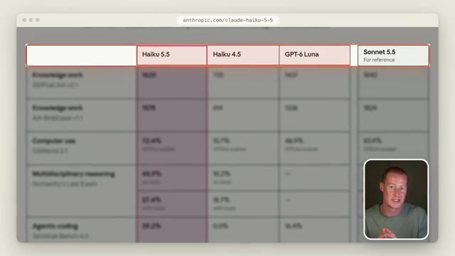
*⏱️ 00:02:46 — Capture d'écran d'un tableau comparatif de performances de modèles d'IA (Haiku 5.5, Haiku 4.5, GPT-6 Luna, Sonnet 5.5) affiché dans un navigateur web, avec la vidéo du présentateur en médaillon.*

---

### ⏱️ `[00:02:51 - 00:03:19]` | Segment #09

**🔊 Audio (Transcription Intégrale Mot pour Mot en Français) :**
> L'ancien Haiku a obtenu 15,7 % à ce test et Haiku 5,5 a obtenu 72,4 %. Et en passant au travail de connaissance, qui correspond fondamentalement à des tâches de bureau de la vie réelle, il a plus que doublé l'ancien Haiku et il a également obtenu un score supérieur au petit modèle d'OpenAI. Et en matière de codage agentique, l'ancien Haiku a obtenu zéro et Haiku 5,5 est à 39,2 %. Maintenant, si vous regardez du côté de Sonnet 5,5, il est toujours en avance sur absolument chacun d'entre eux.

**👁️ Analyse Visuelle d'Écran (gemini-3.5-flash-lite) :**
**Interface & Outils** : Page web de documentation de modèle Anthropic montrant un tableau de benchmarks.

**Contenu textuel & Code** : Scores comparatifs entre Haiku 5.5, Haiku 4.5, GPT-6 Luna et Sonnet 5.5 sur différents benchmarks (OSWorld 2.1, GDPval-AA v2.1, Terminal-Bench 4.0).

**Action / Démonstration** : Présentation et mise en avant des résultats de performance des modèles d'IA par le présentateur.

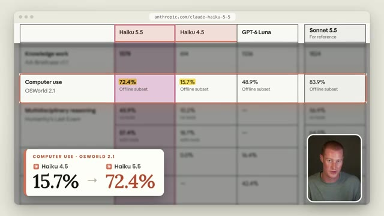
*⏱️ 00:02:58 — Tableau comparatif des performances de Claude Haiku 5.5 sur le test 'Computer use' montrant 72.4%.*

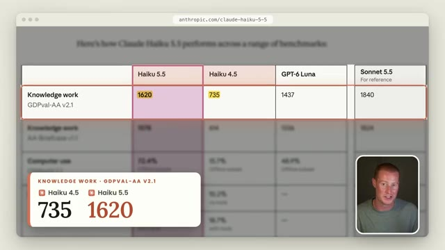
*⏱️ 00:03:05 — Tableau comparatif des performances de Claude Haiku 5.5 sur le travail de connaissance ('Knowledge work') affichant un score de 1620.*

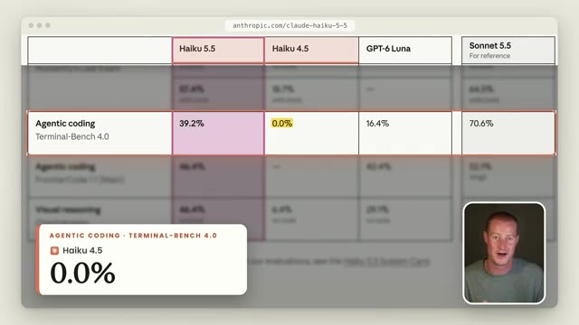
*⏱️ 00:03:12 — Tableau comparatif des performances sur le codage agentique ('Agentic coding') affichant 39.2% pour Haiku 5.5.*

---

### ⏱️ `[00:03:19 - 00:03:56]` | Segment #10

**🔊 Audio (Transcription Intégrale Mot pour Mot en Français) :**
> Et Anthropic le dit directement dans l'article. Sonnet et Opus restent évidemment le meilleur choix pour le codage complexe. Une chose que je veux souligner ici, c'est que c'est le premier modèle Haiku qui est doté d'un réglage d'effort ajustable, donc vous pouvez l'augmenter ou le diminuer et décider si vous le voulez moins cher ou plus intelligent. Très bien, maintenant qu'on a vu le prix et les scores, parlons de ce pour quoi vous devriez réellement utiliser Haiku. Ce n'est pas parce que c'est le modèle le moins cher que vous devez forcément tout basculer dessus. Commençons par le sommet. Fable est pour le travail le plus difficile, comme la recherche approfondie ou un agent qui tourne pendant des heures et vous rend un document finalisé ou une présentation. Opus est ce que j'utiliserais pour de grands projets complexes.

**👁️ Analyse Visuelle d'Écran (gemini-3.5-flash-lite) :**
**Interface & Outils** : Diapositives de présentation vidéo avec incrustation du présentateur.

**Contenu textuel & Code** : Texte explicatif sur l'utilisation des modèles IA ("WHEN TO USE IT", "ONE MODEL PER KIND OF JOB", "Fable 5.1 - The hardest work").

**Action / Démonstration** : Présentation des cas d'usage et de la sélection des modèles selon leur complexité.

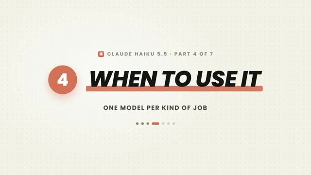
*⏱️ 00:03:38 — Diapositive de présentation titrée "CLAUDE HAIKU 5.5 - PART 4 OF 7" avec le titre principal "WHEN TO USE IT" et le sous-titre "ONE MODEL PER KIND OF JOB".*

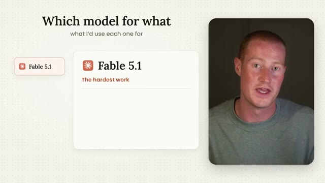
*⏱️ 00:03:47 — Diapositive montrant le titre "Which model for what" et "what I'd use each one for", avec une carte interactive sur la gauche présentant "Fable 5.1" et "The hardest work", et la vidéo du présentateur sur la droite.*

---

### ⏱️ `[00:03:56 - 00:04:31]` | Segment #11

**🔊 Audio (Transcription Intégrale Mot pour Mot en Français) :**
> comme construire une application complète ou faire en sorte que Claude utilise votre ordinateur. Sonnet est celui que vous devriez utiliser tous les jours. Donc des choses comme l'écriture, le contenu, l'analyse de vos données et la plupart de vos codages de base normaux. Et Haiku est pour les tâches qui sont petites, claires et que vous exécutez souvent. Pensez donc au tri de chaque e-mail qui arrive dans votre boîte de réception, à l'étiquetage des tickets de support, à la synthèse de transcriptions d'appels, ou à l'extraction des totaux d'une pile de factures. Il est évidemment aussi idéal pour tout ce où la vitesse importe, comme un chat de support en direct sur votre site web. Maintenant, là où je ne l'utiliserais pas, c'est pour tout ce qui comporte beaucoup d'étapes ou tout ce où une erreur va coûter cher. Et si nous retournons au

**👁️ Analyse Visuelle d'Écran (gemini-3.5-flash-lite) :**
**Interface & Outils** : Diapositive de présentation et vidéo du présentateur.

**Contenu textuel & Code** : Texte "Which model for what" et détails sur le modèle Sonnet 5.5 ("Your everyday model", "Writing content", "Analyzing your data").

**Action / Démonstration** : Présentation orale des cas d'usage des différents modèles d'intelligence artificielle.

---

### ⏱️ `[00:04:31 - 00:05:06]` | Segment #12

**🔊 Audio (Transcription Intégrale Mot pour Mot en Français) :**
> repères, Haiku a obtenu 39 % à ce test de codage et Sonnet a obtenu 70 %. Donc, sur les tâches plus dures et plus difficiles, cet écart est assez important. Mais d'après le reste des scores, je pense que Haiku 3.5 est en fait assez bon pour qu'on puisse lui faire confiance pour des tâches simples. Et je ne pouvais vraiment pas dire cela à propos du précédent. Voici donc la règle que je suivrais : si la tâche est simple et que vous l'exécutez encore et encore, commencez par Haiku, testez-le, et ne passez à Sonnet que s'il commet des erreurs. Et si la tâche est complexe, commencez par le plus grand modèle. Maintenant, le meilleur, c'est que vous n'avez pas à en choisir un seul. Anthropic dit que Haiku s'associe très bien avec Opus et Sonnet en tant que sous-agent,

**👁️ Analyse Visuelle d'Écran (gemini-3.5-flash-lite) :**
**Interface & Outils** : Présentation vidéo avec infographie de comparaison de modèles d'IA.

**Contenu textuel & Code** : Schéma en escalier : "Haiku 5.5 - Start here", "Sonnet 5.5 - Simple job, on repeat (only if Haiku gets it wrong)", "The biggest model - Complex job". Titre : "Start small, then move up: the rule I'd follow".

**Action / Démonstration** : Explication de la stratégie de sélection des modèles d'IA en fonction de la complexité des tâches, en commençant par les plus petits et rapides.

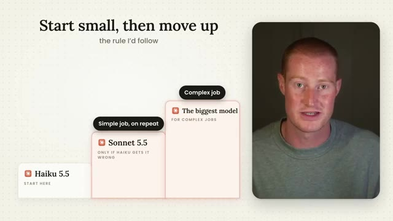
*⏱️ 00:04:58 — Diapositive illustrant la règle "Start small, then move up" avec les modèles Haiku 3.5, Sonnet 3.5 et le plus grand modèle pour les tâches complexes, aux côtés du présentateur.*

---

### ⏱️ `[00:05:07 - 00:05:41]` | Segment #13

**🔊 Audio (Transcription Intégrale Mot pour Mot en Français) :**
> qui est fondamentalement un assistant auquel le modèle plus grand confie les tâches plus petites. Et l'une des entreprises qui a eu un accès anticipé pour tester cela a un excellent exemple à ce sujet. Elles ont dit que pendant qu'un modèle plus grand élabore une présentation, Haiku va dans le rapport financier et extrait l'unique chiffre dont la présentation a besoin. De cette façon, le modèle coûteux fait seulement le travail de réflexion difficile et le modèle bon marché fait tout le travail de terrain comme le scraping. Parlons maintenant rapidement de ce que certains des premiers testeurs ont eu à dire. Asana a déclaré avoir constaté une réduction de la latence de plus de 30 % par rapport au modèle qu'ils utilisent aujourd'hui, et la latence, c'est fondamentalement juste le temps qu'on attend pour obtenir une réponse. Et Box a déclaré que Haiku

**👁️ Analyse Visuelle d'Écran (gemini-3.5-flash-lite) :**
**Interface & Outils** : Navigateur web affichant la page de documentation ou de présentation d'Anthropic (anthropic.com/claude-haiku-5-5).

**Contenu textuel & Code** : Texte en surbrillance détaillant l'utilisation de Haiku 3.5 comme sous-agent pour récupérer des données financières (10-K) pendant qu'un modèle plus grand élabore une présentation, ainsi que des métriques de réduction de latence (30%).

**Action / Démonstration** : Le présentateur explique l'utilisation de Claude Haiku 3.5 comme assistant pour des tâches secondaires déléguées par un modèle plus grand.

---

### ⏱️ `[00:05:41 - 00:06:13]` | Segment #14

**🔊 Audio (Transcription Intégrale Mot pour Mot en Français) :**
> 5.5 a obtenu 11 points de plus que Haiku 4.5 pour environ moitié moins de latence. Maintenant, Anthropic a également placé quelques autres mises à jour tout au long du bas de cet article dont je veux parler dès maintenant. La première est que Sonnet 5.5 vient de devenir moins cher. Dans une précédente vidéo que j'ai faite en analysant Sonnet 5.5 lors de sa sortie, je vous ai dit que les lectures en cache sur Sonnet 5.5 étaient de 0,20 dollar par million de jetons. Eh bien, ils viennent de diviser cela par deux pour atteindre 0,10 dollar, et Anthropic affirme que cela rend Sonnet 5.5 environ 20 % moins cher sur la plupart des tâches d'agents. Et je pense que c'est une partie que la plupart des gens vont

**👁️ Analyse Visuelle d'Écran (gemini-3.5-flash-lite) :**
**Interface & Outils** : Navigateur web affichant la page d'annonce d'Anthropic (anthropics.com/claude-haiku-5-5).

**Contenu textuel & Code** : Texte surligné en jaune indiquant : "Cache reads now cost 50% less: $0.10 per million tokens rather than $0.20."

**Action / Démonstration** : Le présentateur commente les baisses de prix d'Anthropic concernant les lectures en cache de Claude Sonnet 5.5.

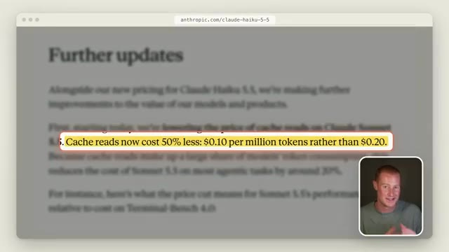
*⏱️ 00:06:05 — Capture d'écran du site d'Anthropic montrant les mises à jour et les réductions de prix pour Claude Sonnet 5.5, avec une pastille surlignée en jaune sur les coûts de lecture en cache.*

---

### ⏱️ `[00:06:13 - 00:06:32]` | Segment #15

**🔊 Audio (Transcription Intégrale Mot pour Mot en Français) :**
> passer à côté. Anthropic offre désormais aux abonnés des formules Max et Team un crédit API mensuel. Donc si vous êtes sur le forfait Max 5x, vous obtenez 100 dollars de crédits chaque mois. Si vous êtes sur le Max 20x, vous obtenez 200 dollars et les formules d'équipe obtiennent jusqu'à 500 dollars partagés au sein de l'équipe. Quoi qu'il en soit, j'espère que vous avez apprécié cette très rapide analyse.

**👁️ Analyse Visuelle d'Écran (gemini-3.5-flash-lite) :**
**Interface & Outils** : Navigateur web affichant des pages de documentation et d'articles officiels d'Anthropic (support.claude.com).

**Contenu textuel & Code** : Tableaux et texte explicatif sur les crédits API mensuels offerts selon les abonnements Anthropic Max et Team ($100, $200, $500).

**Action / Démonstration** : Le présentateur commente et illustre les différents paliers de crédits API offerts par Anthropic pour chaque type d'abonnement.

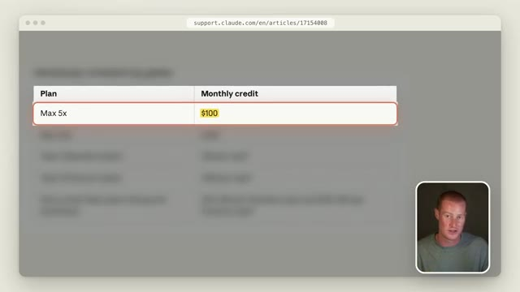
*⏱️ 00:06:23 — Une page web de support Anthropic montre un tableau comparatif avec le forfait Max 5x et un crédit mensuel de 100 dollars.*

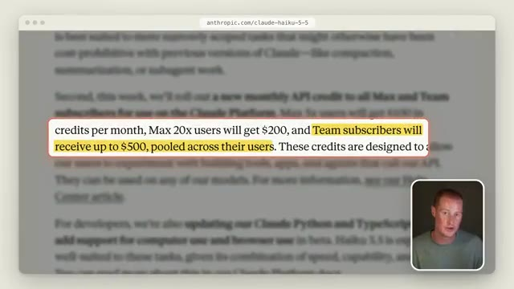
*⏱️ 00:06:27 — Un article d'Anthropic met en surbrillance jaune les crédits API mensuels : 100 dollars pour Max 5x, 200 dollars pour Max 20x et jusqu'à 500 dollars pour les abonnés Team.*

---

### ⏱️ `[00:06:32 - 00:06:39]` | Segment #16

**🔊 Audio (Transcription Intégrale Mot pour Mot en Français) :**
> La course à l'intelligence artificielle s'accélère. Alors, si vous souhaitez rester à jour en tant que non-technophile, abonnez-vous pour plus de contenu. Et je vous vois dans la prochaine vidéo. À la vôtre.

**👁️ Analyse Visuelle d'Écran (gemini-3.5-flash-lite) :**
**Interface & Outils** : Aucun logiciel, terminal ou graphique affiché.

**Contenu textuel & Code** : Aucun indicateur technique, code source ou donnée chiffrée.

**Action / Démonstration** : Aucune action technique ou analyse effectuée.

---

