# 🎬 Grok Bot Now Uses Claude Opus 5.5 + More (MASSIVE Update)

> **Chaîne** : [Brock Mesarich | AI for Non Techies](https://www.youtube.com/@BrockMesarich)  
> **Lien YouTube** : [https://www.youtube.com/watch?v=Z8H3MvLJwfs](https://www.youtube.com/watch?v=Z8H3MvLJwfs)  
> **Date de publication** : 20261007  
> **Durée** : 00:07:10  
> **Identifiant vidéo** : `Z8H3MvLJwfs`  
> **Transcription & Analyse** : `whisper-v3-large-turbo+gemini-3.5-flash-lite`  

---

## 📌 Synthèse Exécutive & Outils

### 💡 Résumé
Dans cette vidéo intitulée **Grok Bot Now Uses Claude Opus 5.5 + More (MASSIVE Update)**, Alex Carter détaille une approche stratégique et pratique du trading et de l'automatisation par agents IA.

### 🛠️ Outils, Modèles & Logiciels Présentés
- **TradingView & Claude Code** : Analyse technique avancée et automatisation algorithmique.

### 🔑 Points Clés & Enseignements Stratégiques
- Respect rigoureux du ratio risque/rendement et du money management.
- Automatisation méthodique des déclencheurs d'ordres via des agents intelligents.

---

## ⏱️ Chronologie & Transcription Complète Audio & Visuelle (Mot pour Mot)

### ⏱️ `[00:00:00 - 00:00:20]` | Segment #01

**🔊 Audio (Transcription Intégrale Mot pour Mot en Français) :**
> GrokBot vient de recevoir une mise a jour massive qui change complètement le paysage des agents d'intelligence artificielle. Elon vient d'annoncer que GrokBot ne sera plus limité aux propres modèles de Grok, et qu'il va commencer a utiliser d'autres modèles d'intelligence artificielle de premier plan comme Claude Opus 5.5. Donc, cela donne a GrokBot accès au meilleur modèle pour n'importe quelle tâche que vous lui confiez, et il choisit ce modèle pour vous automatiquement.

**👁️ Analyse Visuelle d'Écran (gemini-3.5-flash-lite) :**
**Interface & Outils** : Interface du réseau social X (Twitter) affichant un tweet officiel.

**Contenu textuel & Code** : Publication d'Elon Musk annonçant l'utilisation des meilleurs modèles back-end pour Grok @Bot (notamment Claude Opus 5.5, MidJourney, Suno, etc.).

**Action / Démonstration** : Affichage et lecture à l'écran du tweet d'Elon Musk pour illustrer l'annonce de la mise à jour majeure des agents IA.

*⏱️ 00:00:10 — Capture d'un post X (Twitter) d'Elon Musk concernant la mise à jour de Grok @Bot, avec une incrustation vidéo du présentateur en bas à droite.*

---

### ⏱️ `[00:00:20 - 00:00:38]` | Segment #02

**🔊 Audio (Transcription Intégrale Mot pour Mot en Français) :**
> Et il y a trois raisons pour lesquelles je pense que c'est si important, et la troisième est la plus importante. Il y a aussi quelques choses importantes que nous ne savons toujours pas, et je vais aborder cela à la fin de cette vidéo. Donc, sans plus attendre, plongeons-nous directement dedans. Très bien, voici exactement ce qui s'est passé. Ce matin, Elon a publié ceci sur X, et je vais vous le lire mot pour mot, et ensuite nous allons analyser tout ça.

**👁️ Analyse Visuelle d'Écran (gemini-3.5-flash-lite) :**
**Interface & Outils** : Interface du réseau social X (Twitter).

**Contenu textuel & Code** : Publication textuelle d'Elon Musk du 7 octobre 2026 mentionnant @SpaceX et l'utilisation de modèles comme Claude Opus 5.5, MidJourney et Suno.

**Action / Démonstration** : Affichage et lecture à l'écran d'un tweet illustrant les annonces sur l'IA abordées dans la vidéo.

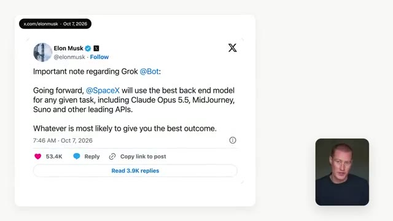
*⏱️ 00:00:34 — Capture d'écran d'une publication X (Twitter) d'Elon Musk concernant l'utilisation de différents modèles d'IA par SpaceX et Grok, avec le présentateur incrusté en bas à droite.*

---

### ⏱️ `[00:00:38 - 00:01:01]` | Segment #03

**🔊 Audio (Transcription Intégrale Mot pour Mot en Français) :**
> À l'avenir, SpaceX utilisera le meilleur modèle de backend pour toute tâche donnée, y compris Cloud Opus 5.5, MidJourney, Suno et d'autres API de premier plan, tout ce qui est le plus susceptible de donner le meilleur résultat. Maintenant, si vous n'avez jamais utilisé GrokBot auparavant, c'est fondamentalement une plateforme d'agents d'IA à qui vous pouvez envoyer des SMS comme à un ami ou un employé. Vous pouvez créer plusieurs agents qui travaillent ensemble et déléguer des tâches à des agents spécifiques.

**👁️ Analyse Visuelle d'Écran (gemini-3.5-flash-lite) :**
**Interface & Outils** : Interface web de présentation avec visuels de tweets et schémas d'intelligence artificielle.

**Contenu textuel & Code** : Texte de tweet attribué à Elon Musk concernant l'utilisation de modèles d'IA de pointe et illustration d'un bot de routage de tâches.

**Action / Démonstration** : Présentation visuelle de l'architecture multi-modèle et des fonctionnalités de routage des requêtes par un bot.

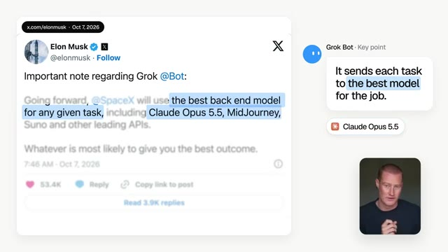
*⏱️ 00:00:44 — Capture montrant un faux tweet d'Elon Musk sur Grok Bot et l'utilisation du meilleur modèle backend, avec le présentateur en médaillon.*

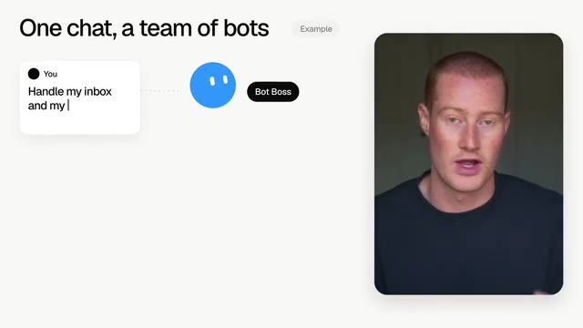
*⏱️ 00:00:55 — Illustration du concept "One chat, a team of bots" avec un exemple de prompt utilisateur et le présentateur en encadré.*

---

### ⏱️ `[00:01:01 - 00:01:21]` | Segment #04

**🔊 Audio (Transcription Intégrale Mot pour Mot en Français) :**
> Donc vous pouvez lui envoyer des messages comme à un employé, il peut se connecter à vos outils et continue de travailler même quand votre ordinateur est fermé. Et cette plateforme a été incroyable. J'ai absolument adoré. Je l'ai utilisée tous les jours au cours des deux derniers mois comme mon outil principal au quotidien, mais il y avait certaines limites à cela. Jusqu'à aujourd'hui, elle ne fonctionnait qu'avec les propres modèles de Grok et vous ne pouviez pas choisir un modèle différent si vous le vouliez.

**👁️ Analyse Visuelle d'Écran (gemini-3.5-flash-lite) :**
**Interface & Outils** : Application de messagerie de gestion d'agents IA (panneau latéral avec des agents comme Video Agent, Chief of Staff, Content Bot).

**Contenu textuel & Code** : Interface utilisateur textuelle avec des interactions de type chat, des aperçus de fichiers vidéo et des listes d'agents conversationnels.

**Action / Démonstration** : Démonstration de l'interface de la plateforme d'agents IA et de la conversation textuelle avec l'assistant.

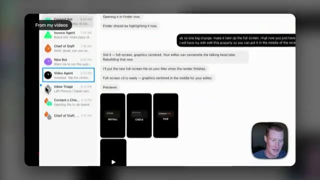
*⏱️ 00:01:11 — Interface de la plateforme montrant une liste de bots sur le panneau latéral gauche et une conversation textuelle avec des aperçus vidéo et des instructions de montage.*

---

### ⏱️ `[00:01:21 - 00:01:42]` | Segment #05

**🔊 Audio (Transcription Intégrale Mot pour Mot en Français) :**
> Eh bien, maintenant Grokbot va examiner la tâche que vous lui donnez, puis l'envoyer à l'intelligence artificielle qui convient le mieux à ce travail spécifique. Et je pense que cela résout le seul problème qui retenait vraiment GrokBot en arrière. La première raison pour laquelle c'est important, c'est donc le modèle lui-même. Les modèles de Grok ont toujours eu une ou deux ou trois étapes de retard sur Claude et ChatGPT, et même Elon l'a dit.

**👁️ Analyse Visuelle d'Écran (gemini-3.5-flash-lite) :**
**Interface & Outils** : Présentation vidéo / Schéma graphique explicatif de modèles d'IA.

**Contenu textuel & Code** : Texte "Best model per task" et icônes des modèles d'IA (Claude, Midjourney, Suno, Grok).

**Action / Démonstration** : Présentation et explication de la sélection du meilleur modèle d'intelligence artificielle selon la tâche demandée.

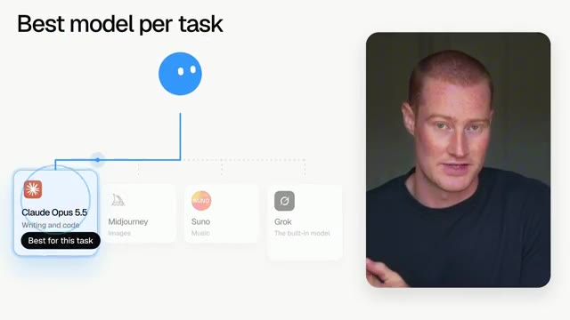
*⏱️ 00:01:27 — Schéma explicatif montrant le concept "Best model per task" avec différentes IA (Claude Opus 5.5, Midjourney, Suno, Grok) et le présentateur à droite.*

---

### ⏱️ `[00:01:42 - 00:02:05]` | Segment #06

**🔊 Audio (Transcription Intégrale Mot pour Mot en Français) :**
> Il y a quelques semaines, il a dit dans une interview que Grok n'est pas aussi bon qu'Opus 5.5 et qu'ils rattraperaient probablement leur retard dans le courant de l'année prochaine. Et donc, au lieu d'attendre l'année prochaine, il a simplement décidé d'intégrer Opus 5.5 et les meilleurs modèles de pointe directement dans GrokBot. Personnellement, je pense qu'Opus 5.5 est le modèle le plus puissant que vous puissiez utiliser en ce moment, de loin, et j'ai construit des choses incroyables avec au cours de la semaine dernière.

**👁️ Analyse Visuelle d'Écran (gemini-3.5-flash-lite) :**
**Interface & Outils** : Réseau social X (anciennement Twitter) affichant un tweet officiel.

**Contenu textuel & Code** : Publication d'Elon Musk mentionnant l'utilisation de modèles externes comme Claude Opus 5.5 et MidJourney pour les tâches de Grok et SpaceX.

**Action / Démonstration** : Affichage et mise en surbrillance d'un tweet illustrant la décision d'intégrer d'autres modèles d'IA.

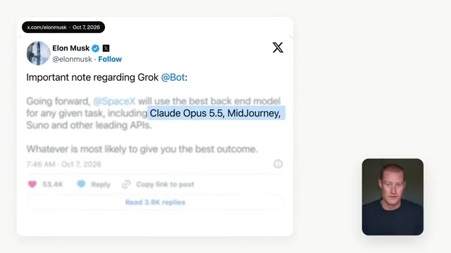
*⏱️ 00:01:54 — Capture d'écran montrant un tweet d'Elon Musk sur X avec une mise en avant du texte "Claude Opus 5.5, MidJourney" et le présentateur incrusté en bas à droite.*

---

### ⏱️ `[00:02:05 - 00:02:38]` | Segment #07

**🔊 Audio (Transcription Intégrale Mot pour Mot en Français) :**
> Mais personnellement, j'aime vraiment la façon dont GrokBot communique avec moi. Je trouve que c'est beaucoup plus facile à utiliser et adapté aux débutants. J'ai vraiment l'impression d'envoyer un SMS à un collègue ou à un ami, et il se souvient réellement de ma façon de travailler. Donc, jusqu'à présent, je devais en quelque sorte faire un choix. J'allais sur Claude pour les choses difficiles comme la programmation ou des flux de travail plus spécifiques et complexes, et ensuite j'allais sur GrokBot pour toutes les différentes tâches administratives et tout le reste qui était plus facile à gérer pour ce modèle. Maintenant, voici un rapide exemple de ce à quoi cela pourrait ressembler à l'avenir. Disons que j'envoie un SMS à mon GrokBot et que je lui demande de me créer un tableau de bord qui suit tous mes

**👁️ Analyse Visuelle d'Écran (gemini-3.5-flash-lite) :**
**Interface & Outils** : Interface de présentation graphique, interface de chat textuel.

**Contenu textuel & Code** : Texte comparatif sur les outils d'IA (Claude vs Grok Bot) et exemples de messages professionnels.

**Action / Démonstration** : Illustration visuelle du mode de communication conversationnel et comparaison des assistants d'IA.

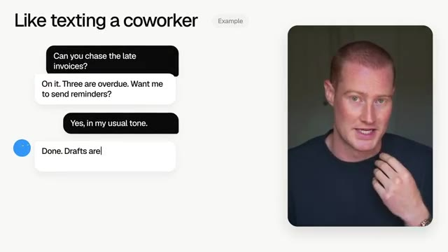
*⏱️ 00:02:13 — Capture montrant un exemple d'interface de messagerie textuelle avec une bulle de dialogue illustrant une conversation de type 'Like texting a coworker' et le présentateur en médaillon vidéo.*

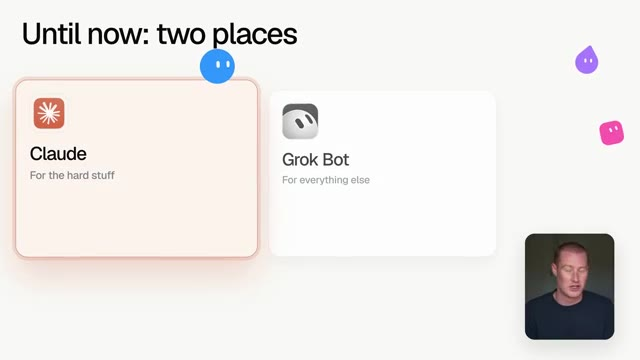
*⏱️ 00:02:22 — Capture montrant un comparatif visuel entre 'Claude (For the hard stuff)' et 'Grok Bot (For everything else)' avec le présentateur en médaillon vidéo.*

---

### ⏱️ `[00:02:38 - 00:02:59]` | Segment #08

**🔊 Audio (Transcription Intégrale Mot pour Mot en Français) :**
> différentes factures. Je parle toujours au même agent dans la même discussion, mais dans les coulisses, c'est Opus 5.5 qui pourrait écrire le code puisque c'est bien meilleur pour cela. De cette façon, j'obtiens l'agent avec qui j'aime parler dans le modèle en qui j'ai confiance pour le travail difficile, qui est Opus 5.5. Très bien, passons à la deuxième raison pour laquelle je pense que c'est si important, et c'est que vous n'avez plus besoin de choisir un modèle.

**👁️ Analyse Visuelle d'Écran (gemini-3.5-flash-lite) :**
**Interface & Outils** : Interface de présentation graphique / diaporama.

**Contenu textuel & Code** : Texte explicatif sur les modèles d'IA (Claude Opus 5.5, Midjourney, Suno, Grok) et le choix automatique par l'assistant.

**Action / Démonstration** : Présentation des avantages de l'utilisation de différents modèles d'IA sous-jacents au sein d'une même interface de discussion.

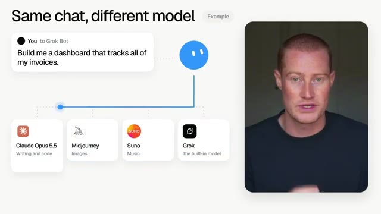
*⏱️ 00:02:43 — Capture d'écran montrant le présentateur à droite et une infographie explicative à gauche intitulée « Same chat, different model » avec des options de modèles d'IA.*

---

### ⏱️ `[00:02:59 - 00:03:21]` | Segment #09

**🔊 Audio (Transcription Intégrale Mot pour Mot en Français) :**
> En ce moment, si vous voulez les meilleurs résultats, vous devez en quelque sorte savoir quel type d'IA est doué pour quoi. Donc, vous iriez sur Claude pour la rédaction et le code, puis sur Midjourney pour les images, et Suno pour la musique, et vous voyez le genre. Et comme vous le savez probablement déjà, cela représente une application différente et un abonnement différent pour tous ces différents outils et plateformes d'IA. Mais de la façon dont Elon a formulé cela dans ce tweet, GrokBot fait ce choix pour vous.

**👁️ Analyse Visuelle d'Écran (gemini-3.5-flash-lite) :**
**Interface & Outils** : 

**Contenu textuel & Code** : 

**Action / Démonstration** : 

---

### ⏱️ `[00:03:21 - 00:03:43]` | Segment #10

**🔊 Audio (Transcription Intégrale Mot pour Mot en Français) :**
> Vous pourriez donc demander à un bot d'écrire un message de lancement, de créer l'image associée, et même de composer une petite chanson publicitaire pour l'accompagner. Et ensuite, chaque élément de cette tâche spécifique est confié au modèle spécifique qui est le plus adapté pour le réaliser. Maintenant, il est également possible que cela nous fasse faire des économies. Si Claude, ChatGPT et Suno finissent tous par être inclus dans l'abonnement à GrokBot, cela pourrait représenter un seul abonnement au lieu d'avoir à payer pour les quatre.

**👁️ Analyse Visuelle d'Écran (gemini-3.5-flash-lite) :**
**Interface & Outils** : Présentation vidéo avec animations graphiques explicatives et incrustation vidéo du présentateur.

**Contenu textuel & Code** : Texte explicatif et icônes d'outils d'IA (Claude, Midjourney, Suno, Grok, ChatGPT).

**Action / Démonstration** : Illustration visuelle du concept de multi-modèles et d'abonnements groupés.

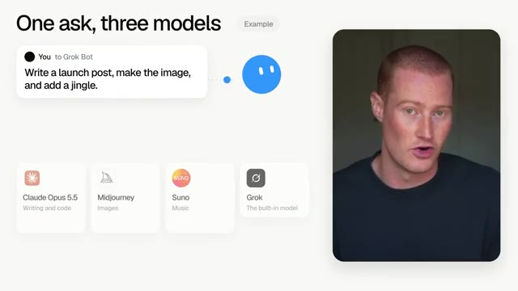
*⏱️ 00:03:27 — Présentation graphique montrant le texte 'One ask, three models' avec un exemple de prompt de bot et les logos de Claude Opus, Midjourney, Suno et Grok.*

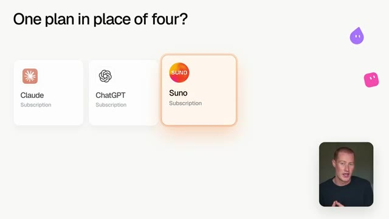
*⏱️ 00:03:38 — Présentation graphique montrant le texte 'One plan in place of four?' avec les abonnements de Claude, ChatGPT et Suno.*

---

### ⏱️ `[00:03:43 - 00:04:06]` | Segment #11

**🔊 Audio (Transcription Intégrale Mot pour Mot en Français) :**
> Maintenant, je tiens à préciser et à dire que les tarifs n'ont pas encore été annoncés, donc je n'irais pas tout annuler aujourd'hui, évidemment. Mais c'est quelque chose auquel je pense vraiment et qui m'enthousiasme pour l'avenir. Et cela m'amène à la troisième raison, qui est selon moi la plus importante, et c'est ce que cela implique pour tout le monde. Car au cours des derniers mois, pratiquement toutes les grandes entreprises d'IA ont lancé leur propre version de Grokbot.

**👁️ Analyse Visuelle d'Écran (gemini-3.5-flash-lite) :**
**Interface & Outils** : Présentation vidéo avec diapositives graphiques et incrustation du présentateur.

**Contenu textuel & Code** : Texte à l'écran concernant les tarifs ('Pricing not announced') et la structure des plans ('One plan in place of four?').

**Action / Démonstration** : Présentation orale des raisons et des perspectives d'avenir par le créateur.

---

### ⏱️ `[00:04:06 - 00:04:25]` | Segment #12

**🔊 Audio (Transcription Intégrale Mot pour Mot en Français) :**
> Meta a lancé sa plateforme appelée Muse, qui fait fureur dans le monde entier depuis ces deux dernières semaines. Et puis la semaine dernière, OpenAI a lancé ChatGPT Dots. Et j'étais personnellement extrêmement enthousiaste à l'idée de l'essayer. Et des tonnes d'autres personnes aussi, mais c'est honnêtement extrêmement décevant jusqu'à présent. Mais voici ce que tout cela a en commun.

**👁️ Analyse Visuelle d'Écran (gemini-3.5-flash-lite) :**
**Interface & Outils** : Interface graphique de présentation d'agents IA.

**Contenu textuel & Code** : Logos et dates de lancement de Meta Muse et Grok Bot.
[DESC_IMAGE_3] Aucun graphique ou élément visuel technique pertinent.

**Action / Démonstration** : Explications face caméra et analyse conceptuelle des marchés.

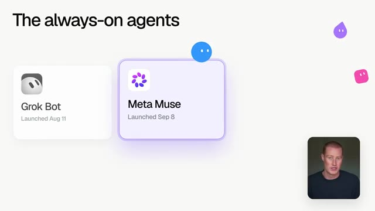
*⏱️ 00:04:11 — Présentation des agents intelligents avec les cartes Meta Muse et Grok Bot.*

---

### ⏱️ `[00:04:25 - 00:04:45]` | Segment #13

**🔊 Audio (Transcription Intégrale Mot pour Mot en Français) :**
> Chachabiti Dots fonctionne sur les modèles d'OpenAI et Muse fonctionne sur les modèles de Meta, qui sont très limités. Donc, vous pariez en quelque sorte que l'entreprise qui a construit votre agent est aussi celle qui a le meilleur modèle. Et cela change presque chaque semaine, car ces entreprises publient de nouveaux modèles chaque semaine. Et GrokBot était exactement pareil jusqu'à aujourd'hui. Mais je veux que vous réfléchissiez à ce qu'est réellement GrokBot.

**👁️ Analyse Visuelle d'Écran (gemini-3.5-flash-lite) :**
**Interface & Outils** : Schéma graphique explicatif de type présentation.

**Contenu textuel & Code** : Texte "one agent, one model", blocs représentant "ChatGPT Dots" (GPT-6 Astra) et "Meta Muse" (Muse Spark 1.3).

**Action / Démonstration** : Le présentateur explique la relation entre les agents conversationnels et les modèles sous-jacents.

---

### ⏱️ `[00:04:45 - 00:05:05]` | Segment #14

**🔊 Audio (Transcription Intégrale Mot pour Mot en Français) :**
> C'est un ordinateur dans le cloud qui est connecté à tous vos différents outils et qui exécute vos routines et vos tâches planifiées pendant que vous dormez. Et après ce changement, le modèle derrière tout cela n'est plus qu'une pièce qui peut être remplacée. Ainsi, lorsqu'un meilleur modèle sort, GrokBot peut simplement l'intégrer et vous n'avez rien à changer. Et si vous êtes un peu comme moi, cela vous facilitera tellement la vie que vous n'aurez pas à changer constamment de plateforme.

**👁️ Analyse Visuelle d'Écran (gemini-3.5-flash-lite) :**
**Interface & Outils** : Schéma didactique animé et incrustation vidéo du présentateur.

**Contenu textuel & Code** : Texte schématique expliquant l'architecture des agents IA ("what Grok Bot actually is", "its own computer in the cloud", "swap the part, keep the agent").

**Action / Démonstration** : Explication visuelle et schématique de l'architecture modulaire des agents conversationnels et des bots cloud.

---

### ⏱️ `[00:05:05 - 00:05:34]` | Segment #15

**🔊 Audio (Transcription Intégrale Mot pour Mot en Français) :**
> Et selon moi, je pense que cela met une vraie pression sur toutes les autres entreprises d'IA. Anthropic a déjà Cloud Cowork et je parie qu'ils ont une version plus grande de ceci qui arrive aussi en lançant un concurrent à GrokBot, Metamuse, Chachaput, Dots, etc. Donc la grande question est de savoir si l'une de ces différentes plateformes d'IA va suivre et ouvrir ses agents à d'autres modèles. Je devine qu'ils ne le feront probablement pas de sitôt parce que leurs modèles sont la chose qu'ils vendent. Et c'est exactement pourquoi je pense que c'est une si grande douve à l'avenir pour GrokBot.

**👁️ Analyse Visuelle d'Écran (gemini-3.5-flash-lite) :**
**Interface & Outils** : Interface graphique de présentation avec des cartes d'applications d'IA (ChatGPT Dots, Meta Muse, Claude Cowork).

**Contenu textuel & Code** : Noms des modèles d'IA concurrents et icônes de cadenas indiquant des fonctionnalités verrouillées.

**Action / Démonstration** : Présentation des différents acteurs du marché de l'IA et de leurs produits respectifs par l'animateur.

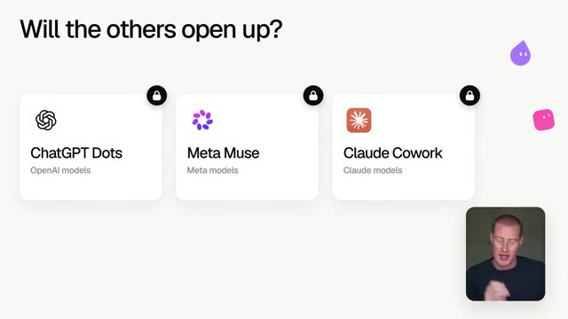
*⏱️ 00:05:19 — Image 2 : Diapositive montrant les différentes fonctionnalités d'IA des concurrents avec le titre "Will the others open up?".*

---

### ⏱️ `[00:05:34 - 00:06:06]` | Segment #16

**🔊 Audio (Transcription Intégrale Mot pour Mot en Français) :**
> Maintenant, avant de vous emballer trop vite, il y a quatre choses que nous ne savons toujours pas et quelques-unes d'entre elles sont vraiment importantes. La première est de savoir quand cela sera réellement en ligne, car tout ce qu'Elon a dit dans ce tweet, c'est que ce serait le cas à l'avenir. Cela pourrait donc signifier aujourd'hui, cette semaine, ou cela pourrait signifier d'ici un mois. Nous ne le savons pas nécessairement. Espérons que plus tard dans aujourd'hui, nous obtiendrons quelques éclaircissements, mais à l'heure actuelle, nous ne savons pas quand cela sera mis en ligne. La seconde est de savoir si vous pouvez choisir le modèle vous-même ou voir lequel a fait le travail. La façon dont ce tweet est rédigé suggère que GrokBot va choisir pour vous. Et nous ne savons pas non plus quelles tâches vont réellement vers

**👁️ Analyse Visuelle d'Écran (gemini-3.5-flash-lite) :**
**Interface & Outils** : Interface de publication X (Twitter) et présentation graphique animée.

**Contenu textuel & Code** : Texte du tweet d'Elon Musk sur les API (Claude Opus 5.5, MidJourney, Suno) et chronologie illustrant l'incertitude sur la date de lancement.

**Action / Démonstration** : Le présentateur commente le tweet d'Elon Musk et détaille les quatre inconnues, en commençant par la date de sortie.

*⏱️ 00:05:42 — Capture d'écran d'un tweet d'Elon Musk concernant Grok @Bot et l'utilisation de différents modèles back-end.*

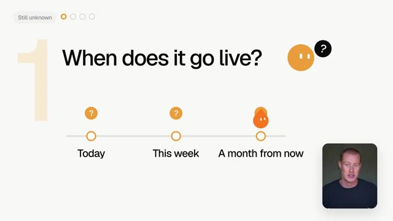
*⏱️ 00:05:50 — Infographie posant la question "When does it go live?" avec une ligne chronologique comportant des points d'interrogation ("Today", "This week", "A month from now").*

---

### ⏱️ `[00:06:06 - 00:06:38]` | Segment #17

**🔊 Audio (Transcription Intégrale Mot pour Mot en Français) :**
> quel modèle spécifique. Comment prend-il ces décisions ? Il est donc possible qu'Opus ne soit utilisé que pour les tâches vraiment difficiles et que tout le reste fonctionne sur les modèles Grok. Nous ne le savons tout simplement pas. Et si une tâche revient erronée, vous ne savez pas forcément quel modèle a fait cela. Et le troisième point, c'est le prix. Actuellement, l'utilisation supplémentaire sur GrokBot est facturée au coût par jeton, et Opus est un modèle plus coûteux à faire tourner que Grok. Il y a donc une chance que votre utilisation ne dure pas aussi longtemps lorsqu'Opus fait une plus grande partie de votre travail. Nous ne savons pas non plus si chaque formule aura accès à cela ou seulement les formules GrokBot les plus chères. Et le quatrième point important ici, c'est vos données.

**👁️ Analyse Visuelle d'Écran (gemini-3.5-flash-lite) :**
**Interface & Outils** : Navigateur web affichant la FAQ officielle de Grok Bot (x.ai).

**Contenu textuel & Code** : Texte explicatif concernant les abonnements Grok Bot, incluant l'utilisation hebdomadaire et la tarification basée sur les tokens.

**Action / Démonstration** : Le présentateur illustre ses propos sur le fonctionnement et les coûts des différents modèles d'IA en affichant la FAQ correspondante.

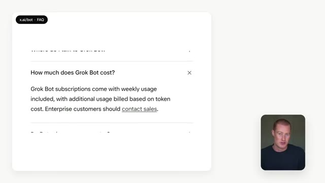
*⏱️ 00:06:22 — Capture d'écran d'une page FAQ (x.ai/bot - FAQ) affichant des informations sur le coût de Grok Bot, avec la vidéo du présentateur en médaillon.*

---

### ⏱️ `[00:06:39 - 00:07:09]` | Segment #18

**🔊 Audio (Transcription Intégrale Mot pour Mot en Français) :**
> Your GrokBots are logged into your emails, your files, and all of your other tools that it's working across. So if a task gets sent to another company's model, some of that information could be going with it. And right now, we don't know if you'll be able to turn that off. I'm going to be testing this the second it shows up in my account, and I'll make a full video on it because I am extremely excited for this. So if you enjoyed this video, make sure to subscribe for more content like this. And then let me know in the comments if you think OpenAI, Anthropic, and all these other different AI companies are going to follow in GrokBot's shoes. Cheers, and I'll see you in the next video.

**👁️ Analyse Visuelle d'Écran (gemini-3.5-flash-lite) :**
**Interface & Outils** : Présentation ou face-caméra explicatif du trader sans interface logicielle partagée.

**Contenu textuel & Code** : Explications orales des stratégies et mise en contexte méthodologique du marché.

**Action / Démonstration** : Explications face caméra et analyse conceptuelle des marchés.

---

