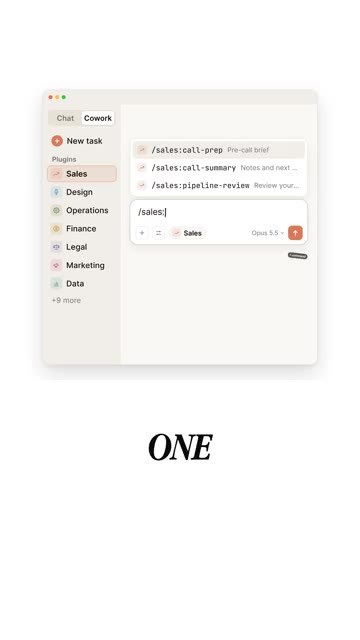
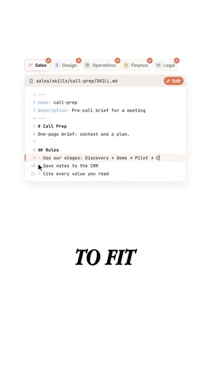

# ?? Anthropic Put Eleven Work Plugins on GitHub

> **Cha?ne** : [Brock Mesarich | AI for Non Techies](https://www.youtube.com/@BrockMesarich)  
> **Lien YouTube** : [https://www.youtube.com/watch?v=_GtKSQj4eVo](https://www.youtube.com/watch?v=_GtKSQj4eVo)  
> **Date de publication** : 20261008  
> **Dur?e** : 00:00:30  
> **Identifiant vid?o** : `_GtKSQj4eVo`  
> **Transcription & Analyse** : `whisper-v3-large-turbo+gemini-3.5-flash-lite`  

---

## ?? Synth?se Ex?cutive & Outils

### 🛠️ Résumé
Anthropic franchit une étape majeure dans l'intégration de l'intelligence artificielle au sein des organisations en publiant un dépôt GitHub gratuit regroupant 11 plugins professionnels conçus pour doter *Claude Cowork* de véritables compétences métiers. Ces « plugins de travail de la connaissance » couvrent des départements stratégiques variés tels que la vente, le design ou les opérations, en encodant directement la manière dont ces métiers s'exercent concrètement au quotidien. Plutôt que de partir d'une feuille blanche, l'IA intègre les processus opérationnels standardisés de l'entreprise.

La force de cette mise à jour réside dans son ultra-personnalisation et son immédiateté d'exécution. À l'aide de commandes textuelles uniques, l'utilisateur peut automatiser des tâches complexes — comme la préparation de documents stratégiques avant un appel commercial — en évitant la perte de contexte récurrente. Cette approche hybride entre ingénierie de prompt avancée et standardisation des workflows offre aux équipes non techniques un moyen direct d'adapter l'outil à leurs méthodologies internes sans compétences en codage lourd.

---

### 🧩 Outils, Modèles & Logiciels Présentés
* **Claude (par Anthropic)** : Assistant conversationnel et agent IA avancé, enrichi ici de compétences métiers spécialisées via des plugins de travail de la connaissance.
* **GitHub** : Plateforme de développement collaborative utilisée par Anthropic pour héberger et distribuer gratuitement le dépôt open-source contenant les 11 plugins professionnels.
* **Claude Cowork** : Environnement de travail collaboratif de Claude, optimisé par ces nouveaux plugins pour exécuter des tâches métiers complexes.
* **n8n** : Solution d'automatisation no-code/low-code de premier plan pour connecter les flux de travail entre différentes applications et agents IA.
* **Make** : Plateforme visuelle d'intégration et d'automatisation no-code permettant de concevoir des workflows complexes sans coder.
* **Zapier** : Pionnier de l'automatisation no-code, facilitant la connectivité rapide entre des milliers d'applications cloud et les outils d'IA.
* **ChatGPT (par OpenAI)** : Modèle conversationnel concurrent, souvent comparé à Claude sur le terrain de l'assistance à la productivité générale.
* **Gemini (par Google)** : Écosystème d'IA multimodal de Google, positionné sur le marché de l'intelligence artificielle générative et de l'assistance professionnelle.
* **Grok (par xAI)** : Modèle d'intelligence artificielle conversationnelle axé sur l'accès en temps réel à l'information et l'actualité.

---

### 💡 Points Clés & Enseignements Stratégiques
* **Démocratisation des agents métiers** : Le passage de simples prompts textuels à des plugins structurés permet à Claude d'agir comme un collaborateur spécialisé ayant une réelle compréhension des processus d'entreprise.
* **Élimination de la page blanche** : Les commandes uniques permettent d'initialiser instantanément des livrables (comme la préparation d'appels de vente), réduisant drastiquement la friction cognitive et le temps de démarrage des tâches.
* **Personnalisation open-source** : L'utilisation de GitHub permet aux équipes de modifier, auditer et adapter chaque plugin pour qu'il reflète fidèlement leur culture d'entreprise et leurs méthodologies internes.
* **Focus sur le travail de la connaissance (*Knowledge Work*)** : Les plugins ciblent les tâches intellectuelles à forte valeur ajoutée (vente, opérations, design) plutôt que les simples automatisations de données basiques.
* **Approche incitative à l'adoption** : La stratégie recommandée consiste à identifier la tâche hebdomadaires la plus chronophage pour l'automatiser en premier lieu, garantissant un ROI rapide.
* **Synergie avec l'écosystème No-Code** : Bien que natifs à l'écosystème Anthropic, ces cas d'usage s'articulent parfaitement avec des outils d'orchestration comme *n8n* ou *Make* pour industrialiser les processus.
* **Réduction de la perte de contexte** : En structurant les interactions autour de processus métiers standardisés, les équipes évitent de repartir de zéro à chaque nouvelle session de travail avec l'IA.
* **Accessibilité pour les non-initiés (*Non-Techies*)** : La simplicité d'utilisation via des commandes en langage naturel rend ces technologies de pointe immédiatement actionnables par des équipes opérationnelles non techniques.
* **Gain d'efficacité commerciale** : Le cas d'usage de la vente illustre comment l'IA peut consolider l'historique et préparer le terrain relationnel, garantissant des interactions clients plus pertinentes et mieux informées.
* **Évolution de l'ingénierie de prompt** : Le prompt engineering évolue d'un art textuel isolé vers une architecture de workflows packagés, réutilisables et partageables à l'échelle d'une organisation.

---

## ?? Chronologie & Transcription Compl?te Audio & Visuelle (Mot pour Mot)

### ?? `[00:00:00 - 00:00:20]` | Segment #01

**?? Audio (Transcription Int?grale Mot pour Mot en Fran?ais) :**
> Anthropic vient de publier un dépôt GitHub gratuit qui donne à Claude Cowork de véritables compétences professionnelles. On les appelle des plugins de travail de la connaissance. Il y en a un pour la vente, le design, les opérations, et bien plus encore. Chacun d'eux apprend à Claude comment ce travail est réellement effectué. Par exemple, prenons la vente. Vous tapez une seule commande et Claude vous prépare pour le prochain appel, afin que vous ne repartiez pas d'une discussion vide à chaque fois.

**??? Analyse Visuelle d'?cran (gemini-3.5-flash-lite) :**
**Interface & Outils** : Application Claude Cowork (interface de bureau).

**Contenu textuel & Code** : Menu latéral avec les plugins "Sales", "Design", "Operations", "Finance", "Legal", "Marketing", "Data" et des commandes comme "/sales:call-prep".

**Action / D?monstration** : Présentation visuelle de l'interface et des différents plugins de travail de la connaissance de Claude Cowork.

*?? 00:00:15 ? Interface de l'application Claude Cowork affichant la liste des plugins (Sales, Design, Operations, etc.) avec le mot "ONE" en bas.*

---

### ?? `[00:00:20 - 00:00:29]` | Segment #02

**?? Audio (Transcription Int?grale Mot pour Mot en Fran?ais) :**
> Le meilleur, c'est que vous pouvez modifier n'importe quel plugin pour qu'il corresponde exactement à la façon dont votre équipe travaille. Commencez simplement par la tâche que vous effectuez chaque semaine. Si vous voulez l'essayer, commentez « Workspace » et je vous enverrai le dépôt.

**??? Analyse Visuelle d'?cran (gemini-3.5-flash-lite) :**
**Interface & Outils** : Éditeur de code / interface markdown de configuration de skills.

**Contenu textuel & Code** : Fichier de configuration Markdown nommé « call-prep/SKILL.md » définissant des règles pour la préparation d'appels commerciaux (« Sales »).

**Action / D?monstration** : Le présentateur illustre la configuration d'un plugin ou d'une compétence (skill) adaptée à l'équipe commerciale.

*?? 00:00:23 ? Un éditeur de texte affichant un fichier de configuration « call-prep/SKILL.md » avec des onglets contextuels (Sales, Design, Operations, etc.).*

---

