# 🎬 Anthropic Just Dropped Claude Motion, Dashboards + More (AI News)

> **Chaîne** : [Brock Mesarich | AI for Non Techies](https://www.youtube.com/@BrockMesarich)  
> **Lien YouTube** : [https://www.youtube.com/watch?v=LlwhNla5eQg](https://www.youtube.com/watch?v=LlwhNla5eQg)  
> **Date de publication** : 20261009  
> **Durée** : 00:25:36  
> **Identifiant vidéo** : `LlwhNla5eQg`  
> **Transcription & Analyse** : `whisper-v3-large-turbo+gemini-3.5-flash-lite`  

---

## 📌 Synthèse Exécutive & Outils

### 💡 Résumé

Cette vidéo, présentée par Brock Mesarich sur la chaîne *AI for Non Techies*, analyse en profondeur les dernières avancées majeures d'Anthropic avec le lancement de **Claude Motion** et des **Dashboards interactifs**, ainsi que l'intégration poussée d'écosystèmes tiers via les **Model Context Protocols (MCP)**. L'analyse met en lumière un changement de paradigme fondamental dans la génération de contenu visuel et analytique : plutôt que de s'appuyer sur des modèles de génération vidéo probabilistes sujets aux artefacts visuels, Claude conçoit l'intégralité des animations, graphiques de performance et tableaux de bord sous forme de code structuré (exécutable et modifiable à la volée). 

Au-delà des fonctionnalités natives de Claude, la démonstration technique s'oriente vers l'utilisation d'outils d'automatisation avancés et d'architectures modulaires. En combinant Claude avec des solutions spécialisées comme **Higgsfield Katana** via MCP ou des connecteurs de données marketing (tels que Blotato), le flux de travail de l'analyste ou du créateur se trouve entièrement automatisé. Qu'il s'agisse de transformer des jeux de données quantitatifs bruts (fichiers CSV de rétention ou de croissance) en visualisations dynamiques prêtes pour la production, ou de concevoir des tableaux de bord financiers et opérationnels actualisés en temps réel, l'intelligence artificielle générative s'impose comme un véritable moteur d'exécution et de Business Intelligence.

Cette approche systémique redéfinit la productivité analytique. En éliminant la complexité des logiciels de montage traditionnels (absence de chronologie lourde ou d'images clés manuelles) et en garantissant une traçabilité totale des données sous-jacentes (requêtes sources, horodatage, modification granulaire du code), ces nouveaux outils offrent aux professionnels un gain de temps considérable, une précision accrue dans le traitement des métriques et une agilité opérationnelle inégalée pour le pilotage de stratégies orientées data.

---

### 🛠️ Outils, Modèles & Logiciels Présentés

* **Claude (Anthropic)** : Modèle de langage de pointe intégrant désormais des artefacts avancés de type *Motion* et *Dashboards*, permettant de coder et d'exécuter des animations et des interfaces analytiques directement dans le chat.
* **Claude Motion** : Fonctionnalité native d'Anthropic permettant de convertir des données tabulaires (CSV) ou des rapports textuels en animations fluides entièrement pilotées par du code exportable en MP4.
* **Dashboards Claude** : Outil natif de Business Intelligence permettant de générer dynamiquement des tableaux de bord interactifs basés sur des requêtes en langage naturel, avec mise à jour en temps réel des données connectées.
* **Higgsfield Katana** : Outil de génération de graphiques animés avancés connectable à Claude via MCP, permettant de produire des visuels haut de gamme sans passer par des suites logicielles complexes comme After Effects.
* **Model Context Protocol (MCP)** : Protocole d'interopérabilité permettant de connecter des sources de données et des applications tierces (comme Higgsfield ou Blotato) directement aux flux de travail de Claude.
* **Blotato** : Plateforme d'automatisation marketing et de publication sociale connectée via MCP pour alimenter les tableaux de bord analytiques en données de performance en direct.
* **Make & n8n** : Outils d'automatisation de workflows no-code/low-code mentionnés dans l'écosystème global pour orchestrer le transfert de données entre différentes applications.
* **Zapier** : Solution classique d'automatisation et de connectivité entre API tierces pour rationaliser les flux de données.
* **ChatGPT (OpenAI)** : Modèle conversationnel concurrent utilisé comme référence comparative dans l'écosystème des assistants IA.
* **Grok (xAI)** : Modèle d'intelligence artificielle doté de capacités d'intégration élargies (GrokBot) pour le traitement des requêtes et flux d'actualités.
* **Gemini (Google)** : Modèle multimodal de Google, concurrent direct sur le segment des intégrations bureautiques (Google Workspace).

---

### 🔑 Points Clés & Enseignements Stratégiques

* **Paradigme du code vs IA générative visuelle** : Claude Motion ne génère pas des pixels via un modèle vidéo probabiliste, mais écrit l'intégralité de l'animation sous forme de code, garantissant une modifiabilité absolue de chaque mot, chiffre ou minutage sans altérer le reste de la séquence.
* **Traçabilité et auditabilité des Dashboards** : Les nouveaux tableaux de bord d'Anthropic affichent la requête exacte (prompt) derrière chaque graphique, permettant à l'analyste de cliquer sur n'importe quelle métrique pour auditer la provenance de la donnée brute.
* **Transparence temporelle des métriques** : Chaque module analytique intégré aux tableaux de bord indique précisément l'horodatage de sa dernière actualisation, offrant une visibilité immédiate sur la fraîcheur et la pertinence des indicateurs suivis.
* **Architecture modulaire via MCP** : L'utilisation des connecteurs MCP (Model Context Protocol) permet d'abolir les barrières entre l'assistant IA et les plateformes externes spécialisées, centralisant l'analyse de données sans quitter l'interface de travail de Claude.
* **Affranchissement des logiciels lourds de motion design** : L'intégration de Higgsfield Katana à Claude permet de s'affranchir des chronologies complexes et de la gestion manuelle des images clés (*Keyframes*), réduisant drastiquement la courbe d'apprentissage pour produire des visuels de qualité professionnelle.
* **Optimisation des flux de données quantitatives** : La transformation immédiate de fichiers CSV bruts (métriques de rétention, taux de conversion, croissance d'abonnés) en visualisations interactives fluidifie la communication des performances au sein d'une équipe technique ou marketing.
* **Mise à jour en temps réel des bases connectées** : Les tableaux de bord construits par Claude maintiennent une synchronisation active avec les sources de données sous-jacentes, garantissant un suivi dynamique des KPIs à mesure que les métriques évoluent.
* **Accessibilité hiérarchisée des fonctionnalités** : À leur lancement, les capacités avancées de *Motion* requièrent des abonnements d'équipe ou d'entreprise, tandis que les *Dashboards* interactifs sont déployés plus largement sur l'ensemble des forfaits payants (Pro, Max, Team, Enterprise).
* **Agilité dans le prototypage visuel** : La capacité à itérer rapidement sur un prompt simple (génération d'une animation en une vingtaine de minutes avec un niveau de détail satisfaisant) permet de valider des concepts visuels avant d'engager des ressources de production lourdes.
* **Automatisation du reporting marketing** : L'interconnexion entre des outils de gestion des réseaux sociaux (comme Blotato) et les artefacts de Claude permet d'automatiser à la fois la génération de contenu et le suivi analytique consolidé.
* **Richesse contextuelle du prompt engineering** : Pour des résultats optimaux avec des outils tiers complexes comme Katana, il est stratégique de fournir à la fois une vidéo de référence et une décomposition textuelle étape par étape des attentes visuelles.
* **Convergence de la Business Intelligence et du Chatbot** : L'évolution de Claude vers un hub analytique interactif confirme la transition des LLMs d'assistants textuels conversationnels vers de véritables stations de travail autonomes capables de traiter, visualiser et piloter des données métiers complexes.

---

## ⏱️ Chronologie & Transcription Complète Audio & Visuelle (Mot pour Mot)

### ⏱️ `[00:00:00 - 00:00:19]` | Segment #01

**🔊 Audio (Transcription Intégrale Mot pour Mot en Français) :**
> Nous avons encore une autre grande semaine de sorties dans le domaine de l'IA, et dans cette vidéo, je vais toutes vous les détailler. Anthropic vient de lancer deux nouveaux produits appelés Cloud Motion et Dashboards. En plus de cela, Cloud pour Google Workspace a été publié, et GrokBot n'est plus limité aux propres modèles de Grok, et il y a trois raisons pour lesquelles je pense que c'est un événement si considérable.

**👁️ Analyse Visuelle d'Écran (gemini-3.5-flash-lite) :**
**Interface & Outils** : Navigateur web affichant un tweet (X/Twitter) et présentation graphique d'icônes logicielles.

**Contenu textuel & Code** : Publication officielle d'Elon Musk mentionnant l'utilisation des meilleurs modèles back-end (Claude Opus 5.5, MidJourney, Suno, etc.) pour Grok Bot.

**Action / Démonstration** : Illustration visuelle des nouveautés logicielles et affichage d'un communiqué sur les réseaux sociaux.

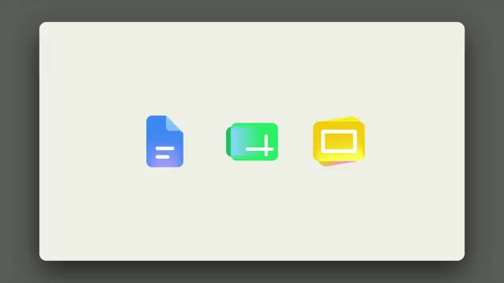
*⏱️ 00:00:10 — Trois icônes colorées représentant des applications de bureautique ou d'outils cloud.*

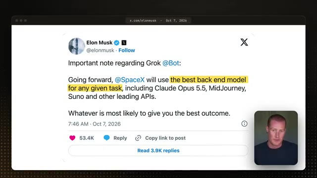
*⏱️ 00:00:15 — Capture d'un tweet d'Elon Musk concernant Grok Bot, avec le présentateur visible en incrustation dans le coin inférieur droit.*

---

### ⏱️ `[00:00:20 - 00:00:41]` | Segment #02

**🔊 Audio (Transcription Intégrale Mot pour Mot en Français) :**
> De plus, ChatShabiti dispose désormais d'une toute nouvelle façon d'interagir avec lui appelée Intelligence UI. Je veux que cette vidéo soit rapide et directe, alors entrons-y sans plus attendre. La première chose que je veux aborder dans cet épisode est Claude Motion. En gros, vous pouvez donner à Claude quelque chose comme un rapport, un graphique, ou même une présentation de produit, et il le transformera en une courte animation qui se lit exactement comme une vidéo.

**👁️ Analyse Visuelle d'Écran (gemini-3.5-flash-lite) :**
**Interface & Outils** : Navigateur web, interface X (Twitter), interface vidéo Claude Motion.

**Contenu textuel & Code** : Texte explicatif sur Claude Motion convertissant des rapports et graphiques en animations textuelles modifiables.

**Action / Démonstration** : Présentation de la fonctionnalité Claude Motion et de son mode d'utilisation par commande textuelle.

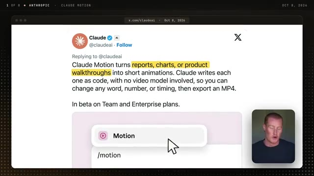
*⏱️ 00:00:35 — Capture d'un tweet officiel de Claude sur X présentant la fonctionnalité Claude Motion avec la commande /motion.*

---

### ⏱️ `[00:00:41 - 00:01:15]` | Segment #03

**🔊 Audio (Transcription Intégrale Mot pour Mot en Français) :**
> La partie intéressante là-dedans, c'est que ça n'utilise pas de modèle vidéo. Claude écrit en fait toute l'animation sous forme de code, il n'y a donc aucune séquence générée par IA. Et comme tout est du code, vous pouvez aller modifier n'importe quel mot, n'importe quel chiffre, ou même le minutage, et le reste de l'animation reste exactement le même. Ensuite, une fois que vous en êtes satisfait, vous pouvez même l'exporter au format de fichier MP4. À l'heure actuelle, Motion est uniquement disponible avec les abonnements d'équipe ou d'entreprise. J'ai donc pris les devants et souscrit à un abonnement d'équipe juste pour pouvoir tester ça pour vous dans cette vidéo. Mais je suppose qu'ils vont sans doute étendre cela aux autres abonnements dans les jours ou les semaines à venir.

**👁️ Analyse Visuelle d'Écran (gemini-3.5-flash-lite) :**
**Interface & Outils** : Lecteur vidéo / interface de visualisation d'animation sans outil de trading ou de programmation affiché.

**Contenu textuel & Code** : Aucun code source, graphique financier, indicateur technique ou prompt visible à l'écran.

**Action / Démonstration** : Présentation orale par le conférencier sans manipulation technique ou démonstration de code en direct.

---

### ⏱️ `[00:01:15 - 00:01:48]` | Segment #04

**🔊 Audio (Transcription Intégrale Mot pour Mot en Français) :**
> Très bien. Donc, première chose, je suis dans mon compte Cloud en ce moment. Et ce que je vais faire, c'est que je vais venir sur le côté gauche, là où il y a écrit « artefacts », juste ici. Et maintenant, nous allons voir quelques nouveautés. Donc, à l'intérieur des artefacts, nous allons voir des tableaux de bord, que je vais vous montrer dans un instant. Et ensuite, nous avons aussi « motion ». Ce sont deux nouveaux types d'artefacts que nous pouvons créer directement à l'intérieur de Claude. Donc, si je clique sur celui-ci, « motion », je peux maintenant aller et commencer à créer une animation vidéo avec mes données spécifiques. Maintenant, ce que je vais faire, c'est que je vais lui donner cette consigne et je vais expliquer exactement ce que sont ces fichiers CSV en ce moment.

**👁️ Analyse Visuelle d'Écran (gemini-3.5-flash-lite) :**
**Interface & Outils** : Interface web Claude.ai (onglet Artifacts, Motion)

**Contenu textuel & Code** : Options de création d'artefacts (Docs, Slides, Design, Dashboard, Motion) et interface d'animation Motion.

**Action / Démonstration** : Navigation dans l'interface des artefacts de Claude.ai et sélection de l'outil Motion.

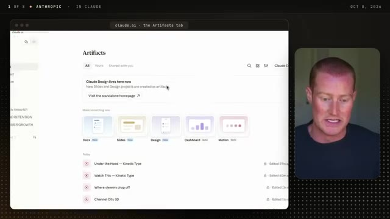
*⏱️ 00:01:23 — Vue générale de l'interface des artefacts sur Claude.ai montrant les différentes options disponibles.*

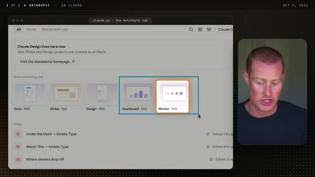
*⏱️ 00:01:31 — Gros plan sur les options « Dashboard » et « Motion » dans les artefacts de Claude.ai.*

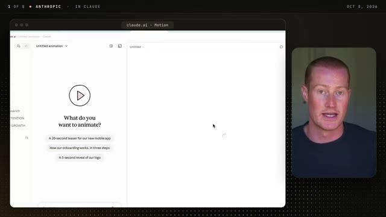
*⏱️ 00:01:40 — Interface de l'outil « Motion » sur Claude.ai avec la question « What do you want to animate? ».*

---

### ⏱️ `[00:01:48 - 00:02:10]` | Segment #05

**🔊 Audio (Transcription Intégrale Mot pour Mot en Français) :**
> En gros, ce que c'est, c'est mes données de rétention d'audience pour l'une de mes vidéos YouTube. Ce que je vais lui demander de faire, c'est de transformer ça en une explication de 30 secondes où je pourrais essentiellement voir où les gens quittent mes vidéos. Et je peux aller partager ça avec mon équipe, par exemple, si on veut optimiser la rétention. Donc je vais juste cliquer sur envoyer. Et comme vous pouvez le voir juste ici, il analyse le schéma d'abandon via ce fichier CSV.

**👁️ Analyse Visuelle d'Écran (gemini-3.5-flash-lite) :**
**Interface & Outils** : Claude.ai (interface web d'Anthropic)

**Contenu textuel & Code** : Fichiers CSV joints ("Detailed activity.csv", "All.csv") et prompt : "This is the audience retention data for one of my YouTube videos. Turn it into a 30 second animated explainer for other creators, 16:9. Draw the retention line from the start of the video to the end, slow down at the three biggest drops and label how far into the video each one happened and how many viewers left, then end on what percent of people made it to the end."

**Action / Démonstration** : Saisie d'un prompt complet dans l'interface de Claude pour analyser des données CSV de rétention YouTube et créer une animation explicative sur mesure.

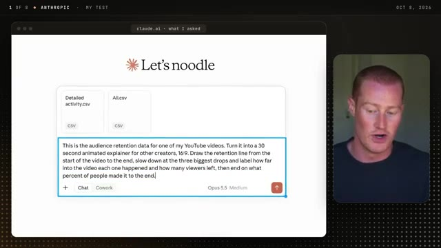
*⏱️ 00:01:53 — Capture d'écran montrant l'interface de claude.ai avec deux fichiers CSV importés ("Detailed activity.csv" et "All.csv") et un prompt textuel détaillé destiné à générer une explication animée de la rétention d'audience YouTube.*

---

### ⏱️ `[00:02:10 - 00:02:47]` | Segment #06

**🔊 Audio (Transcription Intégrale Mot pour Mot en Français) :**
> Donc nous pourrions télécharger n'importe quelles données que nous voulons utiliser afin de créer l'un de ces tableaux de bord interactifs, mais aussi des motion designs qui pourraient nous aider à expliquer des données plus complexes. Maintenant, quelques minutes plus tard, nous avons effectivement obtenu ce résultat juste ici. Allons-y donc et lisons ceci. Il est dit là où les spectateurs partent. Il montre le graphique réel. Il montre quand les gens décrochent, quel pourcentage de gens regarde encore. Et ensuite il montre le graphique de rétention entier juste ici. Auparavant, c'était juste un fichier CSV. Il a donc pris ces données ennuyeuses au format CSV et les a transformées en cette vidéo interactive que je peux aller partager avec mon équipe lors d'une réunion, par exemple.

**👁️ Analyse Visuelle d'Écran (gemini-3.5-flash-lite) :**
**Interface & Outils** : Claude.ai (Interface web d'Anthropic).

**Contenu textuel & Code** : Fichiers 'Detailed activity.csv' et 'All.csv', prompt textuel concernant la rétention d'audience YouTube, et graphique interactif 'VIEWERS STILL WATCHING'.

**Action / Démonstration** : Importation de données CSV et génération d'un graphique animé pour expliquer la rétention d'audience.

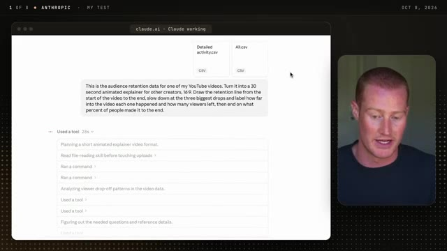
*⏱️ 00:02:19 — Interface Claude.ai montrant le prompt avec des fichiers CSV importés et l'historique des actions d'analyse de données.*

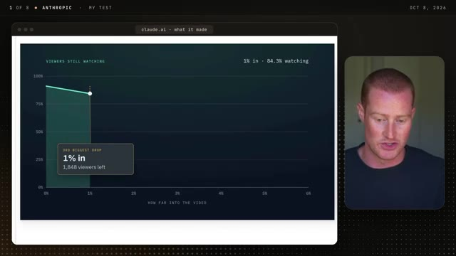
*⏱️ 00:02:28 — Interface Claude.ai affichant un graphique animé de rétention d'audience YouTube généré à partir des données.*

---

### ⏱️ `[00:02:47 - 00:03:07]` | Segment #07

**🔊 Audio (Transcription Intégrale Mot pour Mot en Français) :**
> Maintenant, voici un autre exemple. En gros, je lui ai fourni ce fichier CSV de suivi suivant où je suis fondamentalement tous mes abonnés et ma croissance sur YouTube et mes autres chaînes. Et je lui ai dit de créer une ville. Et ce qu'il a fait, c'est qu'il a créé ce visuel entièrement animé de cette ville montrant à quoi cela ressemble en termes de croissance sur YouTube.

**👁️ Analyse Visuelle d'Écran (gemini-3.5-flash-lite) :**
**Interface & Outils** : Interface web de Claude.ai

**Contenu textuel & Code** : Fichier CSV de suivi des abonnés, prompt utilisateur et rendu visuel isométrique animé d'une ville (nombre d'abonnés : 57,496 en décembre 2025).

**Action / Démonstration** : Présentation de la génération d'un visuel animé complexe à partir de données brutes via l'intelligence artificielle.

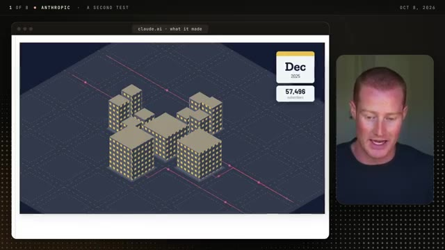
*⏱️ 00:03:02 — Visualisation animée d'une ville isométrique générée par IA représentant la croissance des abonnés YouTube en décembre 2025.*

---

### ⏱️ `[00:03:07 - 00:03:32]` | Segment #08

**🔊 Audio (Transcription Intégrale Mot pour Mot en Français) :**
> Donc vous pouvez voir mois après mois, ça montre à quel point ma chaîne a grandi. Et ça me donne ce petit visuel sympa qui en quelque sorte l'explique dans un cas d'utilisation de la vie réelle. Ça montre à quel point cette ville a grandi, sachant que la ville est évidemment juste ma chaîne YouTube. Je pense que c'est un visuel plutôt sympa qu'on peut désormais créer avec ça. Ce ne sont que deux cas d'utilisation que j'utilise personnellement, mais je suis sûr que vous avez plein de données différentes que vous pourriez utiliser pour visualiser avec Claude Motion.

**👁️ Analyse Visuelle d'Écran (gemini-3.5-flash-lite) :**
**Interface & Outils** : Présentation ou face-caméra explicatif du trader sans interface logicielle partagée.

**Contenu textuel & Code** : Explications orales des stratégies et mise en contexte méthodologique du marché.

**Action / Démonstration** : Explications face caméra et analyse conceptuelle des marchés.

---

### ⏱️ `[00:03:32 - 00:03:54]` | Segment #09

**🔊 Audio (Transcription Intégrale Mot pour Mot en Français) :**
> Maintenant, comme vous pouvez le voir, le mouvement à lui seul est vraiment bien pour les cas d'utilisation basiques, comme expliquer vos données. Mais si vous voulez créer des graphiques animés bien meilleurs, vous pourriez en fait le faire avec un tout nouvel outil de Higgsfield appelé Katana. HiggsField dit qu'il est alimenté par Claude Motion et qu'il fonctionne directement à l'intérieur de Claude grâce au MCP de HiggsField, qui est fondamentalement juste une connexion à la plateforme HiggsField.

**👁️ Analyse Visuelle d'Écran (gemini-3.5-flash-lite) :**
**Interface & Outils** : Présentation ou face-caméra explicatif du trader sans interface logicielle partagée.

**Contenu textuel & Code** : Explications orales des stratégies et mise en contexte méthodologique du marché.

**Action / Démonstration** : Explications face caméra et analyse conceptuelle des marchés.

---

### ⏱️ `[00:03:54 - 00:04:15]` | Segment #10

**🔊 Audio (Transcription Intégrale Mot pour Mot en Français) :**
> Donc tout ce que vous avez à faire, c'est de connecter HiggsField à votre compte Claude, de taper slash Katana dans le chat. Laissez-moi donc vous montrer exactement comment cela fonctionne. Très bien, je veux donc vous montrer cette démo rapide que je veux réellement utiliser comme vidéo de référence que nous allons utiliser avec Claude Motion dans le modèle Katana de HiggsField. Donc comme vous pouvez le voir juste ici, il y a cette vidéo de lancement vraiment cool que Higgsfield avait sur Twitter.

**👁️ Analyse Visuelle d'Écran (gemini-3.5-flash-lite) :**
**Interface & Outils** : Navigateur web affichant la plateforme X (Twitter)

**Contenu textuel & Code** : Publication de réseau social présentant HiggsField Katana et Claude Motion avec une vidéo intégrée et des suggestions de tendances à droite.

**Action / Démonstration** : Présentation d'une publication de démonstration sur les réseaux sociaux illustrant l'utilisation conjointe de HiggsField et Claude.

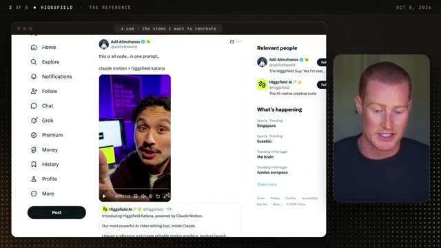
*⏱️ 00:04:05 — Capture d'écran montrant le site X.com (Twitter) avec une vidéo de démonstration de HiggsField et Claude Motion intégrée, tandis que le présentateur apparaît dans une petite fenêtre à droite.*

---

### ⏱️ `[00:04:15 - 00:04:42]` | Segment #11

**🔊 Audio (Transcription Intégrale Mot pour Mot en Français) :**
> Et cela a apparemment été entièrement généré avec le Higgsfield Katana MCP. Et je veux voir si je pourrais réellement recréer quelque chose comme ça. Je veux dire, ça a l'air vraiment cool. Ça a l'air beaucoup mieux que les graphismes animés normaux de Claude. Donc ce que je vais faire, c'est que je vais fournir cette vidéo comme référence à Claude et essayer de recréer quelque chose de similaire. Maintenant, la première chose que nous devons faire pour générer cela à l'intérieur de Claude est de connecter le Higgsfield MCP, ce qui nous permet de générer ces visuels et graphismes animés sans quitter la plateforme Claude.

**👁️ Analyse Visuelle d'Écran (gemini-3.5-flash-lite) :**
**Interface & Outils** : Navigateur web (X / Twitter et site web Higgsfield.ai)

**Contenu textuel & Code** : Page du site web Higgsfield.ai affichant l'option "GENERATE IMAGES & VIDEOS IN CHATGPT WITH HIGGSFIELD" avec des boutons d'installation.

**Action / Démonstration** : Navigation sur le site web de Higgsfield pour consulter la documentation et les options d'intégration du MCP.

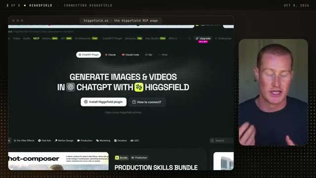
*⏱️ 00:04:35 — Capture d'écran du site web de Higgsfield montrant la page de téléchargement et d'intégration du plugin MCP pour ChatGPT et Claude.*

---

### ⏱️ `[00:04:43 - 00:05:02]` | Segment #12

**🔊 Audio (Transcription Intégrale Mot pour Mot en Français) :**
> Donc ce que je vais faire, c'est venir ici. Il y aura un lien dans la description pour que vous veniez sur cette page exacte. Nous allons simplement cliquer sur connecter Higgsfield. Je vais cliquer sur ajouter un connecteur personnalisé. Cliquez sur continuer ici. J'ai déjà configuré le mien, mais vous allez simplement suivre ce processus de configuration très simple. Cliquez sur continuer, et ensuite vous devrez aller approuver votre compte à l'intérieur de Higgsfield, et cela vous ramènera sur Claude.

**👁️ Analyse Visuelle d'Écran (gemini-3.5-flash-lite) :**
**Interface & Outils** : Navigateur web, interface de configuration de connecteurs personnalisés (MCP).

**Contenu textuel & Code** : URL du serveur mcp.higgsfield.ai/mcp et avertissements de configuration de connecteur.

**Action / Démonstration** : Configuration et ajout d'un connecteur personnalisé pour lier Higgsfield à l'outil d'IA.

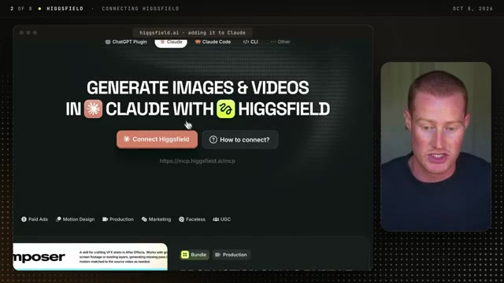
*⏱️ 00:04:48 — Page web présentant l'intégration de Higgsfield avec Claude pour générer des images et vidéos, avec un bouton "Connect Higgsfield".*

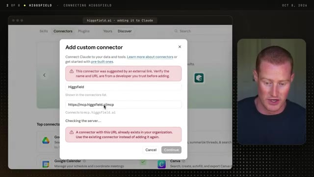
*⏱️ 00:04:52 — Fenêtre modale "Add custom connector" affichant le nom Higgsfield et l'URL du serveur MCP.*

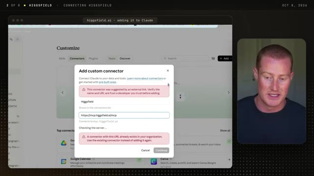
*⏱️ 00:04:57 — Vue similaire de la modale d'ajout de connecteur personnalisé sur l'interface de configuration.*

---

### ⏱️ `[00:05:02 - 00:05:22]` | Segment #13

**🔊 Audio (Transcription Intégrale Mot pour Mot en Français) :**
> Ensuite, ce que je vais faire, c'est coller ce prompt juste ici à l'intérieur de mon chat Claude. En gros, j'ai simplement dit d'utiliser la fonctionnalité Katana à l'intérieur du MCP Higgsfield. Utiliser la vidéo jointe comme style de référence. Et puis j'ai en fait demandé à Claude de décomposer exactement étape par étape à quoi je veux que cette vidéo ressemble aussi au cas où il ne serait pas capable de récupérer la vidéo de référence complète.

**👁️ Analyse Visuelle d'Écran (gemini-3.5-flash-lite) :**
**Interface & Outils** : Interface web Claude (claude.ai) et vue de la webcam du présentateur.

**Contenu textuel & Code** : Un prompt complet demandant d'utiliser la fonctionnalité Katana du MCP Higgsfield, avec des instructions de style (fond noir, accents vert néon, typographie sans-serif) et le texte exact à afficher (1. WATCH THIS, 2. THIS IS NOT AFTER EFFECTS, etc.).

**Action / Démonstration** : Le présentateur présente et commente le prompt textuel collé dans l'interface de Claude.

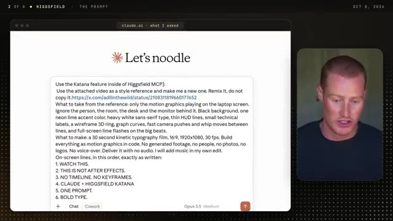
*⏱️ 00:05:07 — Capture d'écran montrant l'interface de Claude avec un prompt détaillé pour la génération de vidéo, ainsi que le présentateur à droite.*

---

### ⏱️ `[00:05:22 - 00:05:56]` | Segment #14

**🔊 Audio (Transcription Intégrale Mot pour Mot en Français) :**
> Donc, je viens juste de lier la vidéo de référence ici même. Et allons-y, cliquons sur envoyer. Très bien. Nous avons donc maintenant le résultat de Higgsfield et Claude. Et je ne vais pas mentir, cela a pris pas mal de temps. Ça a pris environ 20 minutes pour générer ce visuel, mais jetons-y un œil dès maintenant. Très bien, c'est parti. Il est écrit : regardez ça. Ce n'est pas After Effects. Je veux dire, ça a vraiment l'air plutôt bien. Pas de chronologie, pas d'images clés, en connectant Claude à Higgsfield Katana. Ouais. Je veux dire, je pense que ça a vraiment l'air très solide, bien mieux que n'importe quel résultat que j'ai obtenu jusqu'à présent en utilisant uniquement le motion design de Claude. Je veux dire, ouais.

**👁️ Analyse Visuelle d'Écran (gemini-3.5-flash-lite) :**
**Interface & Outils** : Claude.ai, navigateur web et interface de lecture vidéo.

**Contenu textuel & Code** : Interface utilisateur affichant un contenu vidéo généré par IA et des messages textuels explicatifs.
[DESC_IMAGE_3] Visualisation du résultat vidéo généré automatiquement par l'IA.

**Action / Démonstration** : Explications face caméra et analyse conceptuelle des marchés.

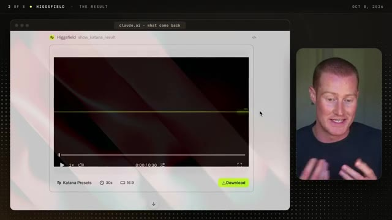
*⏱️ 00:05:30 — Interface Claude.ai affichant le résultat de Higgsfield avec le présentateur à droite.*

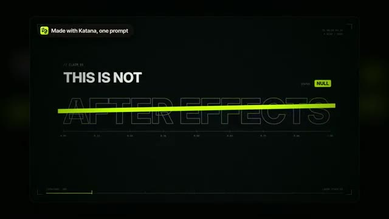
*⏱️ 00:05:39 — Visuel généré avec le texte « THIS IS NOT AFTER EFFECTS » créé via l'outil Katana en un seul prompt.*

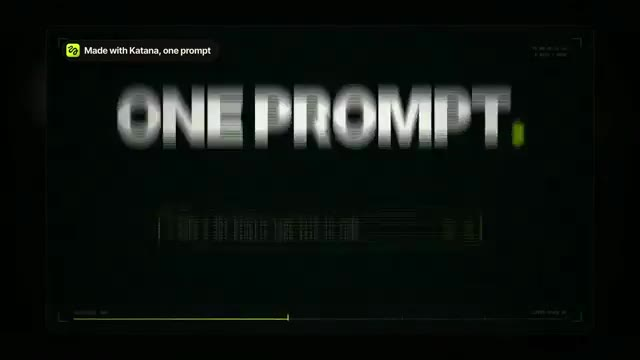
*⏱️ 00:05:47 — Visuel animé affichant le texte « ONE PROMPT » avec des effets visuels générés par IA.*

---

### ⏱️ `[00:05:56 - 00:06:30]` | Segment #15

**🔊 Audio (Transcription Intégrale Mot pour Mot en Français) :**
> c'est très bien sous le capot. C'est entièrement du code. Ça montre même ce fond de code. Et je suppose qu'on aurait pu y ajouter des voix off également, mais pour l'instant, ce ne sont que les visuels. C'est donc plutôt bien. Je suis très satisfait du résultat ici. Et encore une fois, cela a été généré en environ 20 minutes, mais je ne lui ai donné qu'un seul prompt très simple. Donc si je veux lui donner un prompt encore plus amélioré, ou si je veux faire des allers-retours avec ceci pas mal de fois, je suis sûr qu'on pourrait affiner encore plus, mais je suis très satisfait de ce résultat initial. Maintenant, parlons des tableaux de bord Claude. Et c'est disponible sur chaque forfait payant. Donc pour les utilisateurs pro, max, team et les forfaits entreprise,

**👁️ Analyse Visuelle d'Écran (gemini-3.5-flash-lite) :**
**Interface & Outils** : Navigateur web (Claude.ai) et interface vidéo.

**Contenu textuel & Code** : Texte d'un prompt détaillé décrivant des spécifications techniques pour générer un film de typographie cinétique en code.

**Action / Démonstration** : Présentation et explication d'un prompt utilisé pour générer du contenu visuel par IA.

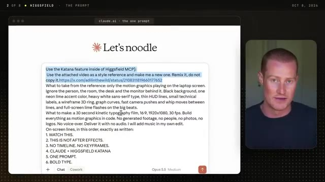
*⏱️ 00:06:13 — Interface de type Claude.ai affichant un prompt détaillé pour le développement de graphismes en mouvement, avec la vidéo du présentateur en incrustation à droite.*

---

### ⏱️ `[00:06:30 - 00:07:04]` | Segment #16

**🔊 Audio (Transcription Intégrale Mot pour Mot en Français) :**
> contrairement à Claude Motion. Donc la façon dont cela fonctionne, c'est en gros que vous connectez simplement vos données, vous posez une question en anglais simple et Claude va construire un tableau de bord complet pour vous. Et Anthropic dit qu'il reste à jour à mesure que vos données changent. Donc cela signifie que toutes les données de fond qui sont connectées se mettront à jour sur le tableau de bord en temps réel. Maintenant, je ne vais pas mentir, quand j'ai vu cette sortie pour la première fois, j'étais un peu confus parce que ça ressemble pas mal à Claude Artifacts, que nous avons depuis assez longtemps, où Claude pouvait déjà vous construire un tableau de bord à l'intérieur d'un artéfact. Donc je suis allé me pencher sur la question et un tableau de bord est en fait un

**👁️ Analyse Visuelle d'Écran (gemini-3.5-flash-lite) :**
**Interface & Outils** : Interface de tableau de bord interactif et page web de support Claude.

**Contenu textuel & Code** : Graphiques de courses par jour, par heure, indicateurs clés de performance (KPI) et texte explicatif sur les capacités des artefacts de Claude.

**Action / Démonstration** : Présentation visuelle d'un tableau de bord généré automatiquement et explication des fonctionnalités d'Anthropic.

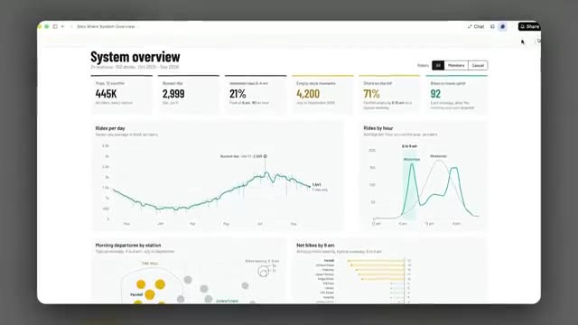
*⏱️ 00:06:38 — Capture d'écran montrant un tableau de bord analytique complet de gestion de vélos (Bike Share System Overview).*

---

### ⏱️ `[00:07:04 - 00:07:38]` | Segment #17

**🔊 Audio (Transcription Intégrale Mot pour Mot en Français) :**
> artefacts et Anthropic le dit eux-mêmes dans leur centre d'aide. C'est simplement construit à partir d'un nouveau modèle de tableau de bord. La vraie différence est donc ce qu'un modèle ajoute en plus. Chaque graphique vous montre la requête derrière lui. Vous pouvez donc cliquer sur n'importe quel chiffre et voir exactement comment Claude a obtenu ces données. Et chaque graphique vous indique également quand les données ont été actualisées pour la dernière fois. Vous savez ainsi à quel point ces chiffres sont récents. Tout cela a l'air formidable, mais je voulais aller le tester moi-même. Laissez-moi donc vous montrer exactement comment cela fonctionne. Et si nous venons dans les artefacts, nous allons également voir les tableaux de bord de Claude ici même, que je peux activer directement ici, ou je peux simplement aller dans une nouvelle discussion et

**👁️ Analyse Visuelle d'Écran (gemini-3.5-flash-lite) :**
**Interface & Outils** : Documentation Web d'Anthropic (support.claude.com).

**Contenu textuel & Code** : Texte explicatif sur le fonctionnement des tableaux de bord Claude et la génération de requêtes SQL.

**Action / Démonstration** : Présentation théorique et lecture de la documentation d'aide sans manipulation logicielle directe.

---

### ⏱️ `[00:07:38 - 00:08:15]` | Segment #18

**🔊 Audio (Transcription Intégrale Mot pour Mot en Français) :**
> dis, hé, je veux que tu me génères un tableau de bord. Donc ce que je vais faire, c'est juste venir ici. Je vais juste dire, hé, je veux que tu génères un tableau de bord qui visualise toutes mes données Instagram en utilisant le MCP Blatato. Je veux pouvoir suivre les publications que j'ai, leurs analyses, combien de vues elles ont obtenues, combien de commentaires, et cetera. Donc je vais envoyer ça à Claude maintenant et il va aller générer ce tableau de bord sous forme d'artefact juste ici. Et si tu ne sais pas ce qu'est Blatato, c'est une plateforme que j'utilise pour m'aider à publier et à configurer des automatisations de messages directs pour mon Instagram. Donc je pourrais venir ici et jeter un œil à l'intérieur de mon compte,

**👁️ Analyse Visuelle d'Écran (gemini-3.5-flash-lite) :**
**Interface & Outils** : Interface web de Claude.ai

**Contenu textuel & Code** : Texte affiché : "What should this dashboard show?" et "Write a visual analysis of why signups dropped", avec la zone de saisie "Reply" en bas.

**Action / Démonstration** : Le présentateur explique comment formuler une requête pour générer un tableau de bord à l'aide de l'intelligence artificielle.

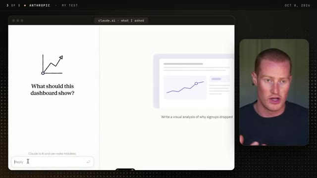
*⏱️ 00:07:47 — Capture d'écran montrant l'interface de claude.ai avec une question sur un tableau de bord et le présentateur dans un encadré à droite.*

---

### ⏱️ `[00:08:15 - 00:08:40]` | Segment #19

**🔊 Audio (Transcription Intégrale Mot pour Mot en Français) :**
> ou je pourrais simplement demander à Claude de me créer un tableau de bord où je peux voir toutes ces informations sans avoir nécessairement à quitter la plateforme Claude. Donc si vous voulez essayer Blatato et configurer cela vous-même, il y aura un lien dans la description pour le faire. Comme vous pouvez le voir, cela crée ces publications Instagram pour moi automatiquement, où je demande à Claude de générer les visuels ici même et cela va les publier automatiquement et configurer les automatisations de messages privés pour moi.

**👁️ Analyse Visuelle d'Écran (gemini-3.5-flash-lite) :**
**Interface & Outils** : Interface web Blatato (blotato.com) avec le présentateur incrusté à droite.

**Contenu textuel & Code** : Métriques d'audience (vues, commentaires, likes, taux de succès de publication, requêtes API) et aperçu de posts Instagram.

**Action / Démonstration** : Présentation des fonctionnalités analytiques et du tableau de bord de la plateforme Blatato.

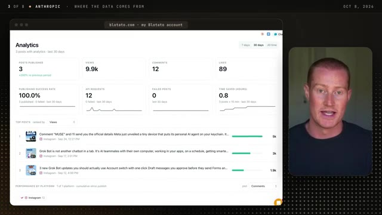
*⏱️ 00:08:21 — Capture montrant le tableau de bord analytique de la plateforme Blatato avec des statistiques de publication et de vues.*

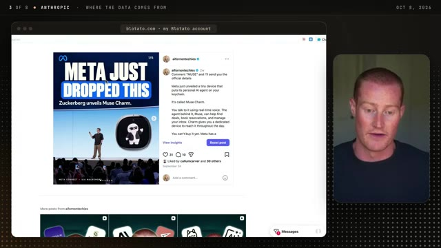
*⏱️ 00:08:34 — Capture montrant un aperçu de publication de réseau social sur Blatato avec un visuel Meta et sa description textuelle.*

---

### ⏱️ `[00:08:40 - 00:09:14]` | Segment #20

**🔊 Audio (Transcription Intégrale Mot pour Mot en Français) :**
> Maintenant, juste comme ça, quelques minutes plus tard, nous avons ce tableau de bord des réseaux sociaux ici même, qui rassemble fondamentalement toutes les informations que je viens de vous montrer à l'intérieur de Blotato. Il montre donc le nombre de vues que j'ai eues au cours des 30 derniers jours sur les publications spécifiques que j'ai programmées via Blotato. Il montre les meilleures publications par vues et comme vous pouvez le voir ici, il y a un tableau de toutes ces informations et la principale partie que je veux souligner ici est tout en haut à droite de celui-ci, il est indiqué mis à jour il y a trois minutes. Nous pourrions cliquer sur actualiser, il va maintenant extraire des données en direct de ce tableau de bord et nous pourrions aller partager cela avec un membre de l'équipe ou nous pourrions également l'exporter sous forme de code. Donc je pense que c'est un

**👁️ Analyse Visuelle d'Écran (gemini-3.5-flash-lite) :**
**Interface & Outils** : Navigateur web affichant une application web minimaliste (Claude.ai - what it built) et un retour vidéo du présentateur.

**Contenu textuel & Code** : Statistiques de réseaux sociaux : 9 857 vues, 5 938 comptes atteints (Reach), 165 interactions, un taux d'engagement de 2,8 % et 5 nouveaux abonnés, ainsi que le titre du post gagnant.

**Action / Démonstration** : Présentation du tableau de bord consolidé regroupant les statistiques des réseaux sociaux.

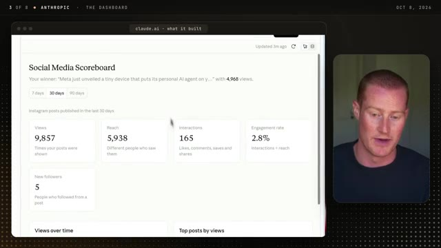
*⏱️ 00:08:48 — Capture d'écran montrant le tableau de bord des réseaux sociaux ("Social Media Scoreboard") avec des métriques de performance sur les 30 derniers jours, tandis que le présentateur apparaît dans un encadré à droite.*

---

### ⏱️ `[00:09:14 - 00:09:43]` | Segment #21

**🔊 Audio (Transcription Intégrale Mot pour Mot en Français) :**
> plutôt une fonctionnalité sympa mais on a vraiment l'impression que c'est un artéfact de cloud ce qui est le cas mais maintenant c'est presque juste un modèle que vous pouvez utiliser pour créer des tableaux de bord pour vous automatiquement. Anthropic vient de lancer Claude pour Google Workspace. Donc Claude vit désormais directement à l'intérieur de Google Docs, Sheets et Slides. Il s'ouvre dans une barre latérale juste à côté de votre fichier et travaille sur le fichier que vous avez déjà ouvert. Donc pensez rapidement à la façon dont vous auriez fait ça normalement avant. Vous auriez copié votre tableur, l'auriez collé dans Claude, obtenu une réponse, et auriez ensuite dû tout recoller.

**👁️ Analyse Visuelle d'Écran (gemini-3.5-flash-lite) :**
**Interface & Outils** : Présentation ou face-caméra explicatif du trader sans interface logicielle partagée.

**Contenu textuel & Code** : Explications orales des stratégies et mise en contexte méthodologique du marché.

**Action / Démonstration** : Explications face caméra et analyse conceptuelle des marchés.

---

### ⏱️ `[00:09:43 - 00:10:17]` | Segment #22

**🔊 Audio (Transcription Intégrale Mot pour Mot en Français) :**
> Maintenant, vous pourriez le lui demander directement et il fait simplement les modifications pour vous. Dans Google Docs, Anthropic dit qu'il peut corriger une phrase ou modifier le style d'un titre sur place sans toucher au formatage qui l'entoure. Dans Sheets, il pourrait rédiger des formules, créer des tableaux croisés dynamiques et des graphiques, et même ajouter de nouveaux onglets. Et dans Google Slides, il pourrait créer de nouvelles diapos qui correspondent au reste de votre présentation. Ensuite, il vérifie son propre travail et signale le texte difficile à lire ou tout ce qui dépasse de la diapositive. J'ai donc pris les devants et j'ai testé cela moi-même. Pour configurer cela, vous allez simplement sur la page de Claude pour Google Workspace, vous cliquez sur essayer Google Workspace et vous l'installez.

**👁️ Analyse Visuelle d'Écran (gemini-3.5-flash-lite) :**
**Interface & Outils** : Google Docs, Google Slides, extensions Claude.

**Contenu textuel & Code** : Document de planification de capacité et présentation avec l'assistant Claude intégré.

**Action / Démonstration** : Présentation des fonctionnalités de Claude directement dans les applications Google Docs et Slides.

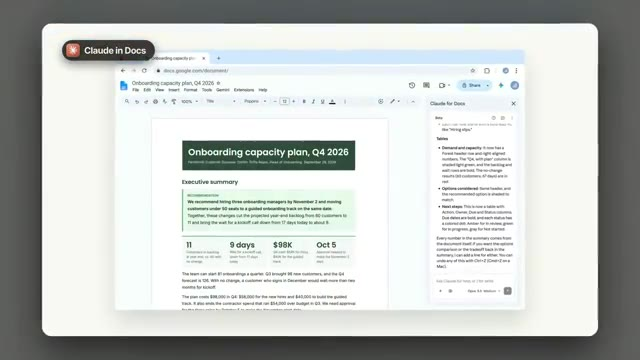
*⏱️ 00:09:52 — Interface Google Docs avec un panneau latéral Claude for Docs actif.*

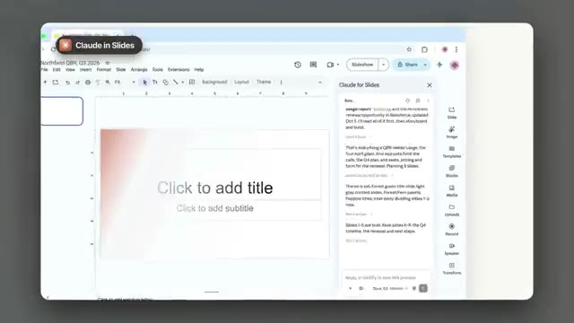
*⏱️ 00:10:00 — Interface Google Slides avec un panneau latéral Claude for Slides actif.*

---

### ⏱️ `[00:10:17 - 00:10:48]` | Segment #23

**🔊 Audio (Transcription Intégrale Mot pour Mot en Français) :**
> Then inside of any Google Sheet, you go to extensions, then Claude, then open up Claude. And from here, it opens right on the side of your sheet. You can even pick which model you want to use. And on top of this, we can even choose the effort level we want to use. So I opened up a Google spreadsheet where I track my followers and I asked it what my growth of my YouTube channel has been since I started tracking this. It read through all the data and it told me the channel is up about 82,792 subscribers since I started tracking, which is about two and a half times.

**👁️ Analyse Visuelle d'Écran (gemini-3.5-flash-lite) :**
**Interface & Outils** : Google Sheets avec l'extension Claude pour Google Workspace.

**Contenu textuel & Code** : Un tableau de données avec des colonnes sur les abonnés et la croissance (IG Followers, TikTok Followers), et le panneau latéral de Claude affichant les options de compétences et de modèle.

**Action / Démonstration** : Ouverture et affichage du panneau latéral de l'extension Claude dans un document Google Sheets pour l'analyse de données.

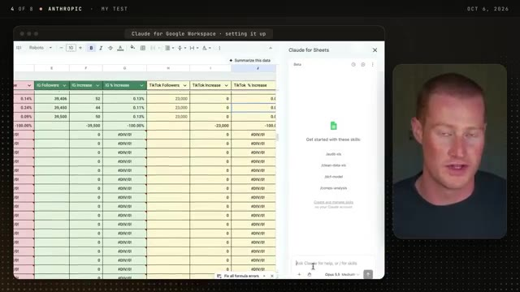
*⏱️ 00:10:25 — Vue d'un tableur Google Sheets avec le panneau latéral de l'extension Claude for Sheets ouvert, et le présentateur visible dans un encadré à droite.*

---

### ⏱️ `[00:10:48 - 00:11:07]` | Segment #24

**🔊 Audio (Transcription Intégrale Mot pour Mot en Français) :**
> Et il a même fait le calcul et a trouvé que cela fait environ 333 nouveaux abonnés chaque jour. Et il m'a dit qu'il avait seulement répondu dans le chat et qu'il n'avait pas modifié ma feuille, mais il a proposé d'ajouter un résumé avec les formules si je voulais l'ajouter à ma feuille de calcul Google. Maintenant, c'est comme ça qu'on l'utilise dans Google Sheets, mais cela fonctionne exactement de la même manière à l'intérieur de Google Docs.

**👁️ Analyse Visuelle d'Écran (gemini-3.5-flash-lite) :**
**Interface & Outils** : Claude for Google Workspace, Google Sheets

**Contenu textuel & Code** : Texte indiquant "333 new subscribers a day, or roughly 11.6% compounded growth per month", ainsi qu'une vue sur une feuille de calcul avec des erreurs #DIV/0!

**Action / Démonstration** : Le présentateur explique les résultats d'analyse générés par l'IA concernant les données de sa feuille de calcul.

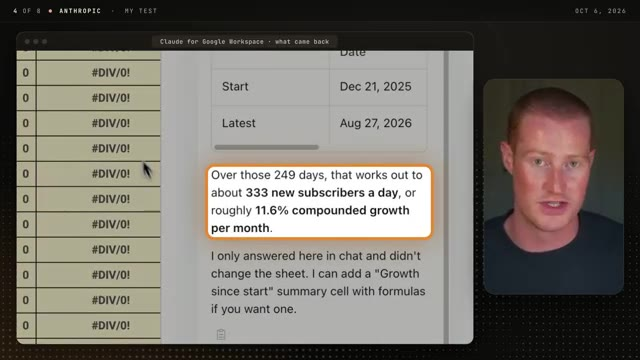
*⏱️ 00:10:53 — Interface Claude pour Google Workspace affichant une feuille de calcul en arrière-plan et une réponse textuelle avec une info-bulle sur l'analyse des abonnés YouTube.*

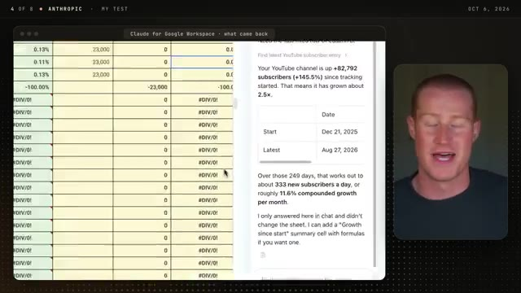
*⏱️ 00:11:02 — Vue légèrement décalée de l'interface Claude montrant les calculs de croissance des abonnés YouTube (+82 792 abonnés, 333 par jour).*

---

### ⏱️ `[00:11:07 - 00:11:32]` | Segment #25

**🔊 Audio (Transcription Intégrale Mot pour Mot en Français) :**
> Maintenant, la partie que j'aime, c'est la façon dont il gère les modifications. Par défaut, il est dans un mode appelé demander avant les modifications. Donc, chaque changement apparaît sur une carte avec un résumé et attend que vous l'approuviez, parce que vous ne voulez pas apporter ces modifications à votre tableur ou à vos documents Google sans, vous savez, les approuver. Il pourrait aller faire de mauvais changements. Et si vous ne voulez pas avoir à tout accepter, vous pouvez le basculer sur accepter toutes les modifications et il effectue simplement toute la tâche sans s'arrêter, tout comme votre Claude normal le ferait.

**👁️ Analyse Visuelle d'Écran (gemini-3.5-flash-lite) :**
**Interface & Outils** : Interface web de Claude.com et flux vidéo du présentateur.

**Contenu textuel & Code** : Texte explicatif concernant le mode "Ask before edits" et les cartes d'approbation.

**Action / Démonstration** : Le présentateur explique le fonctionnement du mode de validation des modifications par l'IA.

---

### ⏱️ `[00:11:32 - 00:11:51]` | Segment #26

**🔊 Audio (Transcription Intégrale Mot pour Mot en Français) :**
> Maintenant, la question est de savoir qui y a accès ? À l'heure actuelle, c'est inclus dans tous les abonnements payants à Claude. Il s'agit donc des utilisateurs pro, Max, team et enterprise. Ensuite, cette semaine, nous avons une nouvelle sortie de la part d'Anthropic, à savoir Claude Haiku 5.5. Anthropic le présente comme le petit modèle le plus économique, le plus rapide et le plus performant qu'ils aient jamais publié.

**👁️ Analyse Visuelle d'Écran (gemini-3.5-flash-lite) :**
**Interface & Outils** : Diapositive de présentation vidéo (slides).

**Contenu textuel & Code** : Texte de présentation du modèle Claude Haiku 5.5, tarification et positionnement.

**Action / Démonstration** : Présentation visuelle de la nouvelle sortie d'Anthropic (Claude Haiku 5.5).

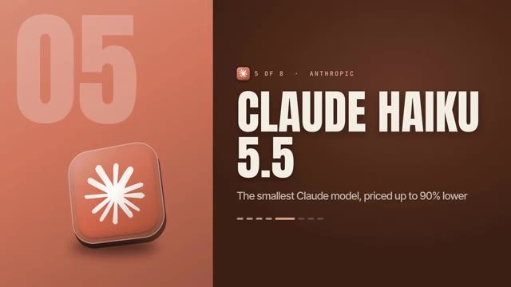
*⏱️ 00:11:41 — Diapositive de présentation marron et orange annonçant le modèle "Claude Haiku 5.5" avec le texte explicatif "The smallest Claude model, priced up to 90% lower".*

---

### ⏱️ `[00:11:51 - 00:12:16]` | Segment #27

**🔊 Audio (Transcription Intégrale Mot pour Mot en Français) :**
> Et si vous n'êtes pas familier avec la gamme, Haiku est le modèle Claude le plus petit et le moins cher. Et cela arrive juste après qu'Anthropic a lancé à la fois Opus 3.5 et Sonnet 3.5, qui se sont tous deux avérés extrêmement impressionnants après les tests, alors j'étais plutôt impatient d'essayer Haiku 3.5 moi-même. Maintenant, le plus important ici, c'est le prix. Pour les tokens d'entrée, l'ancien Haiku coûtait 1 dollar par million et Haiku 3.5 ne coûte que 10 cents.

**👁️ Analyse Visuelle d'Écran (gemini-3.5-flash-lite) :**
**Interface & Outils** : Interface de terminal/éditeur de code et infographie de présentation de prix.

**Contenu textuel & Code** : Texte de prompt concernant la correction d'un bug de code ("Fix #418: refunds on orders...") et tableau comparatif de coûts de tokens ("Cost per million tokens").

**Action / Démonstration** : Présentation des spécificités et des mises à jour tarifaires des modèles d'intelligence artificielle de la gamme Anthropic.

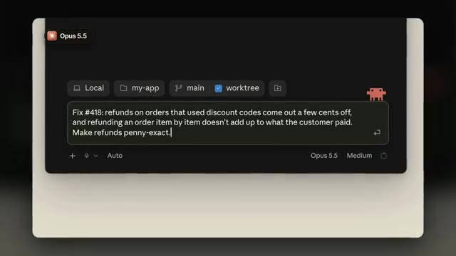
*⏱️ 00:11:57 — Interface sombre affichant une ligne de commande ou un prompt sur le modèle Opus 5.5 avec un bug de remboursement à corriger.*

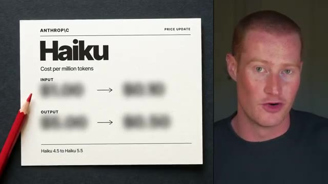
*⏱️ 00:12:10 — Visuel illustrant les prix par million de tokens pour le modèle Haiku (passant de Haiku 4.5 à Haiku 5.5) avec un crayon rouge à gauche, et le présentateur à droite.*

---

### ⏱️ `[00:12:16 - 00:12:39]` | Segment #28

**🔊 Audio (Transcription Intégrale Mot pour Mot en Français) :**
> Pour les jetons de sortie, c'est passé de 5 $ à 50 centimes. Donc, si vous faites le calcul, c'est 90 % de moins. Maintenant, il y a un piège que je tiens à signaler. Ce prix de 10 centimes s'applique uniquement aux invites allant jusqu'à 100 000 jetons. Une fois que vous dépassez ce seuil, c'est 50 centimes en entrée et 2,50 $ en sortie. C'est évidemment un point positif que ce soit beaucoup moins cher, mais c'est aussi devenu nettement plus performant.

**👁️ Analyse Visuelle d'Écran (gemini-3.5-flash-lite) :**
**Interface & Outils** : Page web de tarification d'Anthropic et support visuel explicatif.

**Contenu textuel & Code** : Coûts des jetons d'entrée et de sortie, comparaisons de prix (0,10 $ / 0,50 $), et seuils de jetons (jusqu'à / plus de 100k).

**Action / Démonstration** : Le présentateur explique les variations de coûts des jetons et met en évidence les seuils de tarification.

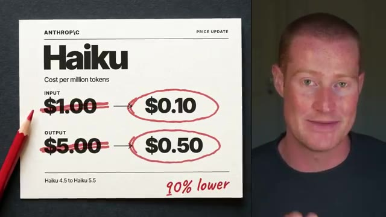
*⏱️ 00:12:22 — Un graphique montrant la mise à jour des prix d'Anthropic Haiku, passant de 1,00 $ à 0,10 $ pour l'entrée et de 5,00 $ à 0,50 $ pour la sortie.*

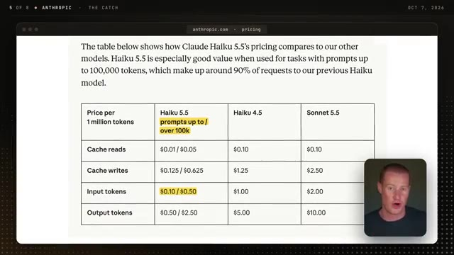
*⏱️ 00:12:28 — Une capture d'écran d'un tableau de tarification d'Anthropic comparant les coûts par million de jetons pour Haiku 5.5, Haiku 4.5 et Sonnet 5.5.*

---

### ⏱️ `[00:12:39 - 00:13:01]` | Segment #29

**🔊 Audio (Transcription Intégrale Mot pour Mot en Français) :**
> Sur l'utilisation de l'ordinateur, l'ancien Haiku a obtenu un score de 15,7 % et Haiku 3.5 a obtenu 72,4 %. Maintenant, Sonnet et Opus restent le meilleur choix pour les tâches plus difficiles, et Anthropropic le dit eux-mêmes, mais Haiku 3.5 est bon pour ces tâches que vous exécutez encore et encore et qui ne nécessitent pas nécessairement un haut niveau d'intelligence de la part de ces différents modèles comme vous l'obtenez d'Opus ou de Sonnet.

**👁️ Analyse Visuelle d'Écran (gemini-3.5-flash-lite) :**
**Interface & Outils** : Interface de présentation web (Anthropic).

**Contenu textuel & Code** : Tableau de benchmarks affichant des scores de performance pour Haiku 5.5 (72,4% en Computer use, 1620 et 1578 en Knowledge work).

**Action / Démonstration** : Présentation des résultats de performance des modèles d'IA par le présentateur.

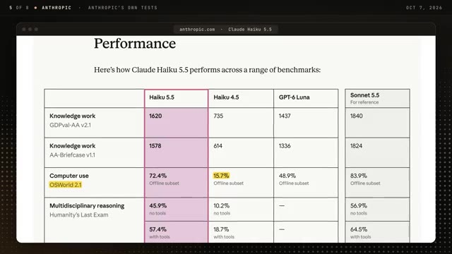
*⏱️ 00:12:45 — Un tableau comparatif des performances de Claude Haiku 5.5, montrant les scores pour différentes tâches (Knowledge work, Computer use, Multidisciplinary reasoning).*

---

### ⏱️ `[00:13:01 - 00:13:24]` | Segment #30

**🔊 Audio (Transcription Intégrale Mot pour Mot en Français) :**
> Maintenant, il y a une partie de cette version que, je pense, la plupart des gens vont rater. Si vous êtes sur un forfait Max ou Team, vous obtenez désormais un crédit API mensuel. Cela signifie que vous obtenez maintenant 100 $ par mois sur le forfait Max 5x, 200 $ par mois sur le Max 20x, et jusqu'à 500 $ sur le forfait Team. Maintenant, si vous voulez y avoir accès, vous devez le réclamer dans vos paramètres, sous l'onglet facturation, et il ne se reporte pas d'un mois à l'autre.

**👁️ Analyse Visuelle d'Écran (gemini-3.5-flash-lite) :**
**Interface & Outils** : Page web de support (support.claude.com) affichant un tableau récapitulatif des crédits.

**Contenu textuel & Code** : Tableau indiquant les crédits API mensuels : 100 $ pour Max 5x, 200 $ pour Max 20x, et des tarifs par siège pour les forfaits Team.

**Action / Démonstration** : Présentation et explication des différents forfaits et de leurs crédits API mensuels correspondants.

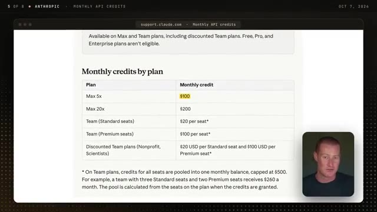
*⏱️ 00:13:13 — Capture d'écran d'une page de documentation d'Anthropic montrant un tableau des crédits API mensuels par forfait (Max 5x, Max 20x, Team), avec le présentateur visible en incrustation.*

---

### ⏱️ `[00:13:24 - 00:13:46]` | Segment #31

**🔊 Audio (Transcription Intégrale Mot pour Mot en Français) :**
> De plus, si vous êtes un utilisateur pro, vous n'aurez pas accès à cela. Si vous voulez une analyse approfondie complète du modèle Claude Haiku 5.5, j'ai fait une vidéo à ce sujet, donc il y aura un lien dans la description pour aller y jeter un œil. Très bien, passons à notre prochaine sortie, et celle-ci vient de GrokBot, et c'est l'une des plus grandes mises à jour qu'ils aient déployées depuis son lancement. Et je ne vais pas mentir, je suis extrêmement enthousiaste à ce sujet. Je pense que cela résout le plus grand problème de GrokBot.

**👁️ Analyse Visuelle d'Écran (gemini-3.5-flash-lite) :**
**Interface & Outils** : Diapositive de présentation graphique.

**Contenu textuel & Code** : Texte affichant "06", "GROK BOT OPENS UP" et "It is no longer limited to Grok's own models".

**Action / Démonstration** : Présentation du sixième point de la vidéo concernant Grok Bot et l'ouverture à d'autres modèles.

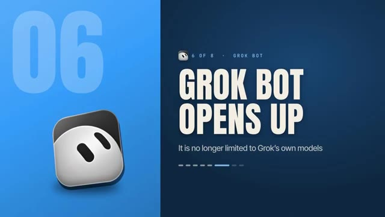
*⏱️ 00:13:41 — Diapositive de présentation avec le chiffre 06 et le titre "GROK BOT OPENS UP".*

---

### ⏱️ `[00:13:46 - 00:14:09]` | Segment #32

**🔊 Audio (Transcription Intégrale Mot pour Mot en Français) :**
> Cette décision de SpaceX met une pression considérable sur les autres entreprises d'IA comme OpenAI, Meta et Anthropic, alors décortiquons tout cela dès maintenant. Elon a annoncé que GrokBot n'est plus limité aux propres modèles de Grok. Cela signifie qu'il va commencer à utiliser les meilleurs modèles d'IA comme Claude Opus 5.5. Donc, en gros, la façon dont cela fonctionne, c'est qu'il obtient le meilleur modèle pour n'importe quelle tâche que vous lui confiez, et il va choisir ce modèle pour vous automatiquement.

**👁️ Analyse Visuelle d'Écran (gemini-3.5-flash-lite) :**
**Interface & Outils** : Navigateur web / application X (Twitter) avec capture de tweet.

**Contenu textuel & Code** : Texte du tweet d'Elon Musk daté du 7 octobre 2026 : "Important note regarding Grok @Bot: Going forward, @SpaceX will use the best back end model for any given task, including Claude Opus 5.5, MidJourney, Suno and other leading APIs. Whatever is most likely to give you the best outcome."

**Action / Démonstration** : Affichage et lecture à l'écran du tweet officiel d'Elon Musk illustrant l'annonce sur GrokBot.

*⏱️ 00:13:57 — Capture d'écran d'un tweet d'Elon Musk sur X (anciennement Twitter) concernant l'utilisation par SpaceX des meilleurs modèles de back-end (Claude Opus 5.5, MidJourney, Suno, etc.) pour GrokBot, avec la petite incrustation vidéo du présentateur en bas à droite.*

---

### ⏱️ `[00:14:09 - 00:14:33]` | Segment #33

**🔊 Audio (Transcription Intégrale Mot pour Mot en Français) :**
> Maintenant, il y a trois raisons pour lesquelles je pense que c'est une affaire si importante, et la troisième est la plus importante. En plus de cela, il y a aussi quelques choses importantes que nous ne savons pas encore, et je vais y venir juste après. Voici donc exactement ce qu'Elon a posté. Et je vais vous le lire mot pour mot, et ensuite nous allons décortiquer cela. À l'avenir, SpaceX utilisera le meilleur modèle de backend pour toute tâche donnée, y compris Cloud Opus 5.5, MidJourney, Suno, et d'autres API de premier plan.

**👁️ Analyse Visuelle d'Écran (gemini-3.5-flash-lite) :**
**Interface & Outils** : Interface du réseau social X (Twitter) affichée à l'écran.

**Contenu textuel & Code** : Publication textuelle d'Elon Musk (« Important note regarding Grok @Bot... ») avec une partie du texte (« the best back end model ») surlignée en bleu.

**Action / Démonstration** : Le présentateur illustre ses propos en affichant à l'écran la publication d'Elon Musk qu'il commente.

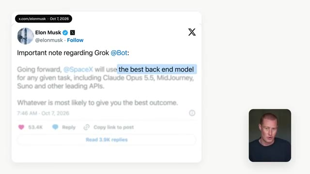
*⏱️ 00:14:27 — Capture d'écran d'une publication sur le réseau social X (Twitter) d'Elon Musk concernant une mise à jour sur Grok et SpaceX, avec le présentateur visible en médaillon dans le coin inférieur droit.*

---

### ⏱️ `[00:14:33 - 00:14:52]` | Segment #34

**🔊 Audio (Transcription Intégrale Mot pour Mot en Français) :**
> Tout ce qui est le plus susceptible de donner le meilleur résultat. Maintenant, si vous n'avez jamais utilisé GrokBot auparavant, c'est en gros une plateforme d'agents d'IA à qui vous pouvez envoyer des SMS comme à un ami ou un employé. Vous pouvez créer plusieurs agents qui travaillent ensemble et déléguer des tâches à des agents spécifiques. Vous pouvez donc lui envoyer des SMS comme à un employé, il peut se connecter à vos outils et continue de fonctionner même lorsque votre ordinateur est éteint.

**👁️ Analyse Visuelle d'Écran (gemini-3.5-flash-lite) :**
**Interface & Outils** : Interface utilisateur de GrokBot / Application web d'agents d'IA.

**Contenu textuel & Code** : Schéma d'agents d'IA interactifs ('Bot Boss', 'Inbox Manager', 'Calendar EA') avec un exemple de prompt utilisateur.

**Action / Démonstration** : Présentation de la plateforme d'agents d'IA GrokBot et de son fonctionnement multi-agents.

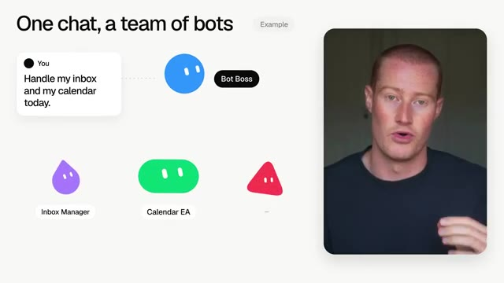
*⏱️ 00:14:42 — Capture montrant l'interface graphique de GrokBot avec plusieurs agents illustrés par des icônes colorées et le titre 'One chat, a team of bots'.*

---

### ⏱️ `[00:14:52 - 00:15:13]` | Segment #35

**🔊 Audio (Transcription Intégrale Mot pour Mot en Français) :**
> Et cette plateforme a été incroyable. J'ai absolument adoré. Je l'ai utilisée tous les jours au cours des deux derniers mois comme mon outil principal au quotidien, mais il y avait certaines limites à cela. Jusqu'à aujourd'hui, elle ne fonctionnait qu'avec les propres modèles de Grok, et on ne pouvait pas choisir un autre modèle si on le voulait. Eh bien maintenant, Grokbot va examiner la tâche que vous lui confiez, puis l'envoyer à l'intelligence artificielle la mieux adaptée à ce travail spécifique.

**👁️ Analyse Visuelle d'Écran (gemini-3.5-flash-lite) :**
**Interface & Outils** : Interface de chat/agent IA et diapositive de présentation.

**Contenu textuel & Code** : Textes de discussion et mention du modèle Grok intégré.

**Action / Démonstration** : Présentation de l'outil et de ses limitations initiales.

---

### ⏱️ `[00:15:13 - 00:15:35]` | Segment #36

**🔊 Audio (Transcription Intégrale Mot pour Mot en Français) :**
> Et je pense que cela résout le seul problème qui freinait vraiment GrokBot. La première raison pour laquelle c'est important, c'est le modèle en lui-même. Les modèles de Grok ont toujours eu une longueur de retard, ou deux ou trois longueurs de retard, par rapport à Claude et ChatGPT, et même Elon l'a dit. Il y a quelques semaines, il a déclaré dans une interview que Grok n'est pas aussi bon qu'Opus 5.5 et qu'ils finiraient probablement par rattraper leur retard l'année prochaine.

**👁️ Analyse Visuelle d'Écran (gemini-3.5-flash-lite) :**
**Interface & Outils** : Diapositive graphique de présentation et vue webcam du présentateur.

**Contenu textuel & Code** : Texte explicatif de la diapositive introduisant la première raison concernant le modèle et Grok.

**Action / Démonstration** : Présentation du premier point clé de l'argumentation sur l'évolution du modèle de Grok.

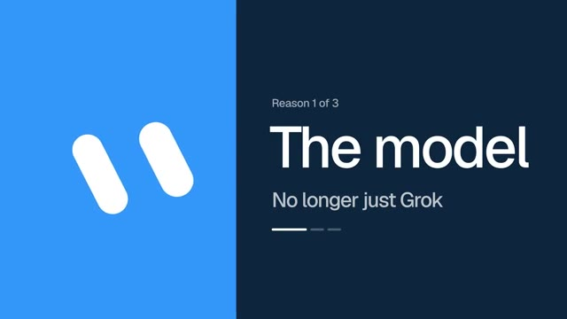
*⏱️ 00:15:18 — Diapositive de présentation affichant 'Reason 1 of 3: The model - No longer just Grok'.*

---

### ⏱️ `[00:15:35 - 00:15:54]` | Segment #37

**🔊 Audio (Transcription Intégrale Mot pour Mot en Français) :**
> Et donc au lieu d'attendre l'année prochaine, il a simplement décidé d'intégrer Opus 5.5 et les principaux modèles de pointe directement dans GrokBot. Maintenant, personnellement, je pense qu'Opus 5.5 est le modèle le plus puissant que vous puissiez utiliser en ce moment, de loin, et j'ai construit des choses incroyables avec au cours de la semaine dernière. Mais j'aime personnellement beaucoup la façon dont Grokbot communique avec moi.

**👁️ Analyse Visuelle d'Écran (gemini-3.5-flash-lite) :**
**Interface & Outils** : Capture de post Twitter / X simulé.

**Contenu textuel & Code** : Texte du tweet d'Elon Musk mentionnant l'utilisation de modèles de pointe tels que Claude Opus 5.5, MidJourney et Suno.

**Action / Démonstration** : Le présentateur commente une annonce ou un tweet fictif illustrant l'intégration de nouveaux modèles d'IA.

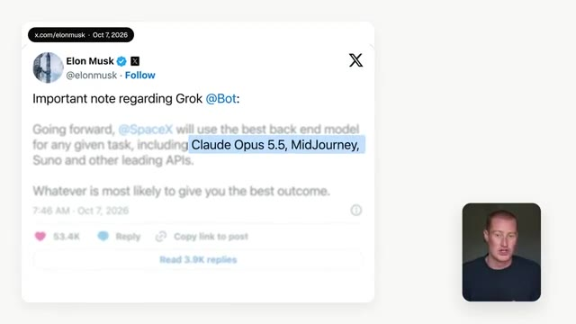
*⏱️ 00:15:40 — Capture d'écran montrant un faux tweet d'Elon Musk concernant l'intégration de Claude Opus 5.5 dans Grok Bot, avec le présentateur incrusté en bas à droite.*

---

### ⏱️ `[00:15:54 - 00:16:16]` | Segment #38

**🔊 Audio (Transcription Intégrale Mot pour Mot en Français) :**
> Je pense que c'est beaucoup plus facile à utiliser et adapté aux débutants. J'ai honnêtement l'impression d'envoyer un message à un collègue ou à un ami, et en fait, il se souvient de la façon dont j'aime travailler. Donc, jusqu'à présent, je devais en quelque sorte choisir. J'allais vers Claude pour les choses difficiles comme le code ou des flux de travail plus spécifiques et complexes, et ensuite j'allais vers GrokBot pour toutes les différentes tâches administratives et tout le reste qui était plus facile à gérer pour ce modèle.

**👁️ Analyse Visuelle d'Écran (gemini-3.5-flash-lite) :**
**Interface & Outils** : Interface de présentation graphique et illustrations de flux de discussion textuels.

**Contenu textuel & Code** : Texte « Like texting a coworker » et « Until now: two places » avec les options Claude (« For the hard stuff », « Coding », « Complex workflows ») et Grok Bot.
[DESC_IMAGE_3] Explication comparative des outils d'IA utilisés selon la complexité des tâches.

**Action / Démonstration** : Explications face caméra et analyse conceptuelle des marchés.

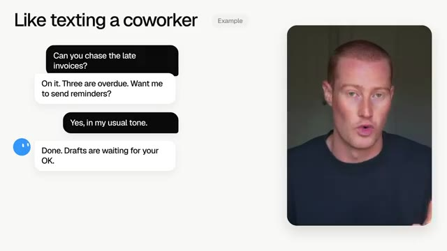
*⏱️ 00:15:59 — Illustration montrant une conversation textuelle avec une IA comparée à l'envoi d'un message à un collègue, avec le présentateur à droite.*

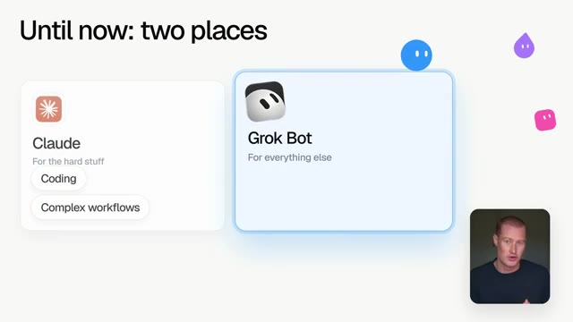
*⏱️ 00:16:11 — Schéma comparatif montrant deux options d'IA : Claude (pour les tâches complexes) et Grok Bot, avec le présentateur en médaillon.*

---

### ⏱️ `[00:16:16 - 00:16:39]` | Segment #39

**🔊 Audio (Transcription Intégrale Mot pour Mot en Français) :**
> Voici un exemple rapide de ce à quoi cela pourrait ressembler à l'avenir. Disons que j'envoie un SMS à mon GrokBot et que je lui demande de me créer un tableau de bord qui suit toutes mes différentes factures. Je parle toujours au même agent dans la même discussion, mais en arrière-plan, Opus 5.5 pourrait être celui qui écrit le code puisqu'il est bien meilleur pour cela. De cette façon, j'obtiens l'agent avec qui j'aime parler et le modèle en qui j'ai confiance pour le travail difficile, qui est Opus 5.5.

**👁️ Analyse Visuelle d'Écran (gemini-3.5-flash-lite) :**
**Interface & Outils** : Interface de démonstration conceptuelle montrant des interactions avec différents modèles d'IA.

**Contenu textuel & Code** : Texte « Same chat, different model », une bulle de message « Build me a dashboard tha... » et les vignettes des modèles Claude Opus 5.5, Midjourney, Suno et Grok.

**Action / Démonstration** : Le présentateur explique comment un même chat peut faire appel à différents modèles d'IA en arrière-plan selon la tâche demandée.

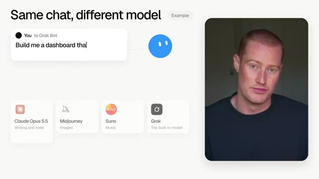
*⏱️ 00:16:22 — L'écran montre une interface de discussion avec un chatbot et différentes options de modèles d'IA (Claude Opus 5.5, Midjourney, Suno, Grok), tandis que le présentateur apparaît à droite.*

---

### ⏱️ `[00:16:39 - 00:17:02]` | Segment #40

**🔊 Audio (Transcription Intégrale Mot pour Mot en Français) :**
> Très bien, passons à la deuxième raison pour laquelle je pense que c'est une si grande affaire, et c'est que vous n'avez plus besoin de choisir un modèle. À l'heure actuelle, si vous voulez les meilleurs résultats, vous devez en quelque sorte savoir quelle IA est bonne en quoi. Vous iriez donc sur Claude pour l'écriture et le code, puis sur Midjourney pour les images, et sur Suno pour la musique, et vous comprenez l'idée. Et comme vous le savez sans doute, c'ذest une application différente et un abonnement différent pour tous ces différents outils et plateformes d'IA.

**👁️ Analyse Visuelle d'Écran (gemini-3.5-flash-lite) :**
**Interface & Outils** : Présentation visuelle (diapositive animée/logiciel de présentation).

**Contenu textuel & Code** : Texte "Three jobs, three apps" et icône de l'application Claude avec la mention "Writing and code".

**Action / Démonstration** : Illustration visuelle du concept de multiplicité des applications d'IA évoqué dans l'audio.

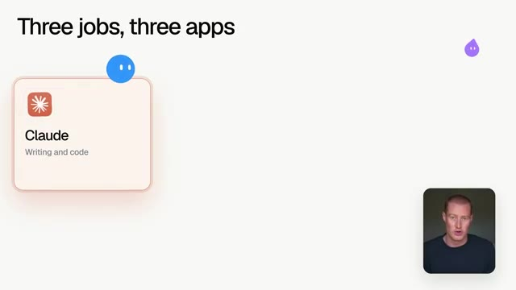
*⏱️ 00:16:50 — Diapositive illustrant le concept "Three jobs, three apps" avec une vignette représentant l'application Claude et le présentateur en médaillon.*

---

### ⏱️ `[00:17:02 - 00:17:21]` | Segment #41

**🔊 Audio (Transcription Intégrale Mot pour Mot en Français) :**
> Mais de la manière dont Elon a formulé cela dans ce tweet, GrokBot fait ce choix pour vous. Vous pourriez donc demander à un bot d'écrire une publication de lancement, d'en créer l'image et même de composer une petite chanson publicitaire pour l'accompagner. Et ensuite, chaque élément de cette tâche spécifique est confié à chaque modèle spécifique qui est le mieux adapté pour le faire. Maintenant, il y a aussi une chance que cela puisse nous faire économiser un peu d'argent.

**👁️ Analyse Visuelle d'Écran (gemini-3.5-flash-lite) :**
**Interface & Outils** : Présentation vidéo standard (pas de terminal, graphique ou code).

**Contenu textuel & Code** : Texte "One ask, three models" et interface de chat vide "You to Grok Bot".

**Action / Démonstration** : Le présentateur s'exprime sur l'utilisation des bots d'IA sans manipulation technique visible.

---

### ⏱️ `[00:17:21 - 00:17:40]` | Segment #42

**🔊 Audio (Transcription Intégrale Mot pour Mot en Français) :**
> Si Claude, Chachabiti et Suno finissent tous par être inclus dans le forfait de GrokBot, cela pourrait faire un seul abonnement au lieu de devoir payer pour les quatre. Maintenant, je tiens à préciser d'avance que les prix n'ont pas encore été annoncés, alors je n'irais pas tout annuler dès aujourd'hui, évidemment. Mais c'est quelque chose auquel je pense sincèrement et qui me réjouit pour l'avenir.

**👁️ Analyse Visuelle d'Écran (gemini-3.5-flash-lite) :**
**Interface & Outils** : Interface graphique de présentation avec des cartes d'abonnements logicielles.

**Contenu textuel & Code** : Comparaison des abonnements de quatre IA différentes (Claude, ChatGPT, Suno, Grok Bot) regroupées sous une même interrogation de tarification.

**Action / Démonstration** : Le présentateur explique et illustre visuellement la comparaison entre les abonnements multiples et une éventuelle offre groupée.

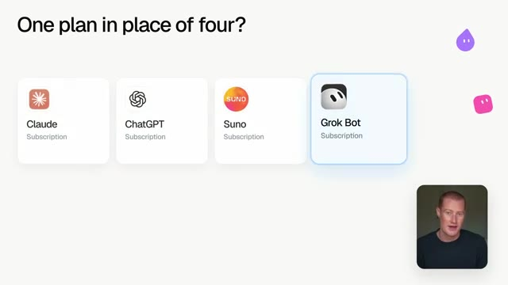
*⏱️ 00:17:25 — Illustration graphique avec le titre "One plan in place of four?" montrant quatre icônes d'abonnements : Claude, ChatGPT, Suno et Grok Bot, avec la vidéo du présentateur en incrustation.*

---

### ⏱️ `[00:17:40 - 00:18:00]` | Segment #43

**🔊 Audio (Transcription Intégrale Mot pour Mot en Français) :**
> Et cela m'amène à la troisième raison, qui est selon moi la plus importante. Et c'est ce que cela implique pour tout le monde. Car ces derniers mois, pratiquement toutes les grandes entreprises d'IA ont lancé leur propre version de Grokbot. Meta a sorti sa plateforme appelée Muse, qui fait sensation dans le monde entier depuis quelques semaines. Et puis la semaine dernière, OpenAI a lancé Shachabiti Dots.

**👁️ Analyse Visuelle d'Écran (gemini-3.5-flash-lite) :**
**Interface & Outils** : Diapositive de présentation avec éléments graphiques épurés et vignette vidéo.

**Contenu textuel & Code** : Texte "The always-on agents" et bloc d'application "Grok Bot / Launched Aug 11".

**Action / Démonstration** : Présentation visuelle du concept d'agents IA autonomes et continus par l'intervenant.

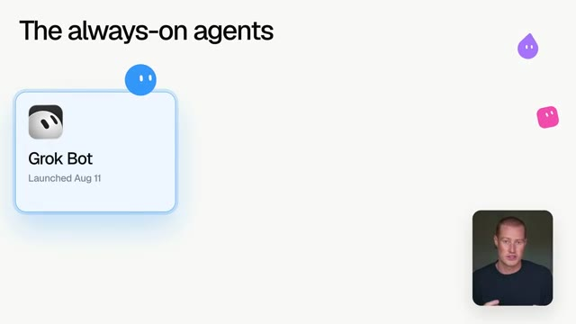
*⏱️ 00:17:50 — Diapositive de présentation illustrant le concept des agents IA permanents, affichant une carte pour "Grok Bot" (lancé le 11 août) et une petite incrustation vidéo du présentateur en bas à droite.*

---

### ⏱️ `[00:18:00 - 00:18:25]` | Segment #44

**🔊 Audio (Transcription Intégrale Mot pour Mot en Français) :**
> Et j'étais personnellement extrêmement excité de l'essayer. Et des tonnes d'autres personnes aussi, mais c'ha été honnêtement extrêmement décevant jusqu'à présent. Mais voici le point commun de tout cela. Chachapiti Dots fonctionne sur les modèles d'OpenAI, et Muse fonctionne sur les modèles de Meta, qui sont très limités. Vous pariez donc en quelque sorte que l'entreprise qui a construit votre agent est aussi celle qui possède le meilleur modèle, et cela change presque chaque semaine alors que ces entreprises sortent de nouveaux modèles chaque semaine.

**👁️ Analyse Visuelle d'Écran (gemini-3.5-flash-lite) :**
**Interface & Outils** : Présentation vidéo avec diapositive explicative schématique.

**Contenu textuel & Code** : Texte "one agent, one model", bloc "ChatGPT Dots" contenant "GPT-6 Astra".

**Action / Démonstration** : Explication conceptuelle sur l'architecture des agents IA et des modèles sous-jacents.

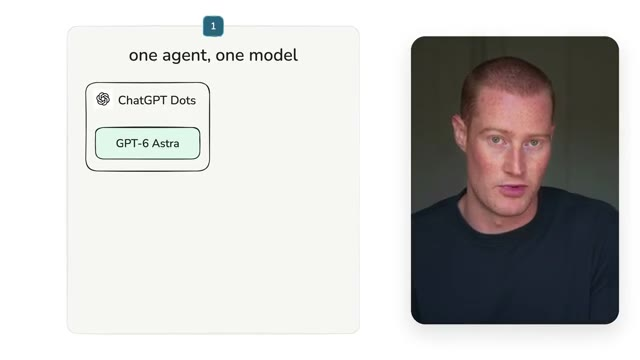
*⏱️ 00:18:13 — Diapositive illustrant le concept "one agent, one model" avec un schéma montrant ChatGPT Dots propulsé par GPT-6 Astra, aux côtés de la vidéo du présentateur.*

---

### ⏱️ `[00:18:25 - 00:18:45]` | Segment #45

**🔊 Audio (Transcription Intégrale Mot pour Mot en Français) :**
> Et GrokBot était exactement pareil jusqu'à aujourd'hui. Mais je veux que vous réfléchissiez à ce qu'est réellement GrokBot. C'est un ordinateur dans le cloud qui est connecté à tous vos différents outils et exécute vos routines et vos tâches programmées pendant que vous dormez. Et après ce changement, le modèle derrière tout cela n'est qu'une pièce qui peut être remplacée. Ainsi, lorsqu'un meilleur modèle sortira, GrokBot pourra simplement le brancher et vous n'aurez rien à changer.

**👁️ Analyse Visuelle d'Écran (gemini-3.5-flash-lite) :**
**Interface & Outils** : Présentation vidéo avec schéma explicatif intégré.

**Contenu textuel & Code** : Texte et schémas conceptuels illustrant le fonctionnement de Grok Bot.

**Action / Démonstration** : Le présentateur explique le concept de Grok Bot à l'aide d'un schéma visuel.

---

### ⏱️ `[00:18:45 - 00:19:03]` | Segment #46

**🔊 Audio (Transcription Intégrale Mot pour Mot en Français) :**
> Et si vous êtes un peu comme moi, cela va vous rendre la vie tellement plus facile pour ne pas avoir à changer constamment de plateforme. Et à mon avis, je pense que cela met une réelle pression sur toutes les autres entreprises d'IA. Anthropic a déjà Claude Cowork, et je parie qu'ils préparent également une version plus importante de ceci en lançant un concurrent à GrokBot, Metamuse, ChatDBT, Dots, et cetera.

**👁️ Analyse Visuelle d'Écran (gemini-3.5-flash-lite) :**
**Interface & Outils** : Aucune interface technique ou de trading visible.

**Contenu textuel & Code** : Aucun code source, graphique ou indicateur affiché.

**Action / Démonstration** : Le présentateur s'exprime verbalement sans manipulation technique.

---

### ⏱️ `[00:19:04 - 00:19:25]` | Segment #47

**🔊 Audio (Transcription Intégrale Mot pour Mot en Français) :**
> La grande question est donc de savoir si l'une de ces différentes plates-formes d'IA va suivre et ouvrir ses agents à d'autres modèles. À mon avis, elles ne le feront probablement pas de sitôt, car leurs modèles sont précisément ce qu'elles vendent. Et c'est exactement pourquoi je pense que cela constitue un si grand fossé défensif pour l'avenir de GrokBot. Maintenant, avant de vous emballer trop, il y a quatre choses que nous ne savons toujours pas, et quelques-unes d'entre elles sont vraiment importantes.

**👁️ Analyse Visuelle d'Écran (gemini-3.5-flash-lite) :**
**Interface & Outils** : Présentation graphique / Diapositive explicative.

**Contenu textuel & Code** : Texte "Will the others open up?" et cartes représentant ChatGPT Dots, Meta Muse, Claude Cowork avec des cadenas symbolisant des modèles fermés.

**Action / Démonstration** : Explication théorique sur l'ouverture des différentes plateformes d'IA aux modèles tiers.

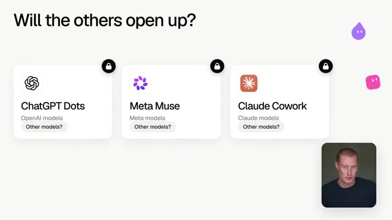
*⏱️ 00:19:09 — Schéma explicatif intitulé "Will the others open up?" montrant trois plateformes d'IA (ChatGPT Dots, Meta Muse, Claude Cowork) avec des icônes de cadenas et une incrustation vidéo du présentateur en bas à droite.*

---

### ⏱️ `[00:19:25 - 00:19:46]` | Segment #48

**🔊 Audio (Transcription Intégrale Mot pour Mot en Français) :**
> Le premier point est de savoir quand cela sera réellement mis en ligne, car tout ce qu'Elon a dit dans ce tweet, c'est que ce serait le cas à l'avenir. Cela pourrait donc signifier aujourd'hui, cette semaine, ou dans un mois. Nous ne le savons pas nécessairement. Mais à l'heure actuelle, nous ne savons pas quand cela sera mis en ligne. Le second point est de savoir si vous pouvez choisir le modèle vous-même ou voir lequel a fait le travail. La façon dont ce tweet est rédigé suggère que GrokBot va choisir pour vous.

**👁️ Analyse Visuelle d'Écran (gemini-3.5-flash-lite) :**
**Interface & Outils** : Interface X (Twitter) et diapositive de présentation graphique épurée.

**Contenu textuel & Code** : Texte d'un tweet de @elonmusk et chronologie avec points d'interrogation sur les délais de déploiement.

**Action / Démonstration** : Le présentateur analyse le tweet d'Elon Musk et discute des incertitudes sur la date de mise en ligne effective.

*⏱️ 00:19:30 — Capture d'écran montrant un tweet d'Elon Musk concernant Grok @Bot et l'utilisation future de différents modèles backend.*

*⏱️ 00:19:36 — Diapositive animée illustrant le premier point avec la question 'When does it go live?' et une chronologie comprenant 'Today', 'This week' et 'A month from now'.*

---

### ⏱️ `[00:19:47 - 00:20:11]` | Segment #49

**🔊 Audio (Transcription Intégrale Mot pour Mot en Français) :**
> Et nous ne savons pas non plus quelles tâches vont réellement vers quel modèle spécifique. Comment prend-il ces décisions ? Il est donc possible qu'Opus ne soit utilisé que pour les trucs vraiment difficiles et que tout le reste tourne sur les modèles Grok. Nous ne savons tout simplement pas. Et si une tâche revient avec une erreur, vous ne savez pas forcément quel modèle a fait ça. Et la troisième chose, c'est le prix. Actuellement, l'utilisation supplémentaire sur GrokBot est facturée au coût par token, et Opus est un modèle plus coûteux à faire tourner que Grok.

**👁️ Analyse Visuelle d'Écran (gemini-3.5-flash-lite) :**
**Interface & Outils** : Interface de présentation graphique animée et page FAQ web (x.ai/bot).

**Contenu textuel & Code** : Questions sur la sélection des modèles d'IA (« Who picks the model? », « Which task goes here? », « How does it decide? ») et texte de tarification de la FAQ concernant Grok Bot et la facturation par token.

**Action / Démonstration** : Présentation conceptuelle et questionnement sur le fonctionnement du routage des modèles d'IA par le robot.

*⏱️ 00:19:59 — Schéma explicatif animé intitulé « Who picks the model? » montrant les options « You » et « Grok Bot » avec des bulles de questions associées comme « Which task goes here? » et « How does it decide? », ainsi qu'une incrustation vidéo du présentateur en bas à droite.*

*⏱️ 00:20:05 — Capture d'écran d'une page de FAQ (x.ai/bot - FAQ) abordant la tarification de Grok Bot (« How much does Grok Bot cost? ») avec une incrustation vidéo du présentateur en bas à droite.*

---

### ⏱️ `[00:20:11 - 00:20:32]` | Segment #50

**🔊 Audio (Transcription Intégrale Mot pour Mot en Français) :**
> Il y a donc une chance que votre utilisation ne s'étende pas aussi loin lorsqu'Opus fait une plus grande partie de votre travail. Nous ne savons pas non plus si chaque forfait va bénéficier de cela ou seulement les forfaits GrokBot les plus chers. Et la quatrième chose importante ici, c'est vos données. Vos Grokbots sont connectés à vos e-mails, à vos fichiers et à tous vos autres outils sur lesquels il travaille. Donc, si une tâche est envoyée au modèle d'une autre entreprise, une partie de ces informations pourrait l'accompagner.

**👁️ Analyse Visuelle d'Écran (gemini-3.5-flash-lite) :**
**Interface & Outils** : Présentation vidéo avec diapositives graphiques explicatives au format épuré.

**Contenu textuel & Code** : Schémas comparatifs d'utilisation hebdomadaire ("Weekly usage") et schémas de gestion des données personnelles et professionnelles connectées au bot.

**Action / Démonstration** : Explication par le présentateur des aspects liés au coût d'utilisation des différents modèles d'IA et à la sécurité des données.

*⏱️ 00:20:16 — Diapositive montrant les coûts et l'utilisation hebdomadaire comparée entre Grok et Claude Opus 5.5, avec une incrustation vidéo du présentateur.*

*⏱️ 00:20:26 — Diapositive intitulée "Your data" illustrant la connexion entre Your Grok Bot et les outils personnels (Email, Files, Other tools) par rapport à un modèle tiers.*

---

### ⏱️ `[00:20:32 - 00:20:54]` | Segment #51

**🔊 Audio (Transcription Intégrale Mot pour Mot en Français) :**
> Et pour l'instant, nous ne savons pas si vous pourrez désactiver cela. Je vais tester cela dès qu'il apparaîtra sur mon compte, et je ferai une vidéo complète à ce sujet parce que je suis extrêmement enthousiaste à ce sujet. Nous avons également eu une autre grosse mise à jour de Grokbot, et ils ont annoncé qu'il peut désormais rechercher, lire et surveiller la plateforme X. En août dernier, lorsqu'ils ont lancé GrokBot, ils ont ajouté un connecteur X, mais vous deviez vous connecter et relier votre compte pour pouvoir l'utiliser.

**👁️ Analyse Visuelle d'Écran (gemini-3.5-flash-lite) :**
**Interface & Outils** : Diapositive de présentation graphique (slide de mise à jour logicielle).

**Contenu textuel & Code** : Texte affiché : "07", "GROK BOT READS X", et "It can now search, read and monitor posts" avec le logo de Grok Bot.

**Action / Démonstration** : Présentation des nouvelles fonctionnalités de Grok Bot relatives à la lecture et surveillance de la plateforme X.

*⏱️ 00:20:43 — Diapositive de présentation illustrant la mise à jour "Grok Bot Reads X", indiquant qu'il peut maintenant chercher, lire et surveiller des posts.*

---

### ⏱️ `[00:20:54 - 00:21:13]` | Segment #52

**🔊 Audio (Transcription Intégrale Mot pour Mot en Français) :**
> Eh bien, maintenant vous n'avez plus besoin de le connecter à quoi que ce soit. Il peut tout simplement extraire automatiquement des données en direct de la plateforme X. J'ai donc pris les devants et j'ai testé cela moi-même. J'ai pour ainsi dire demandé à mon GrokBot d'aller extraire les principales réactions sur X concernant la nouvelle interface Chachabiti qui venait d'être annoncée, puis de me donner le top 10 des réactions. Il est allé chercher cela pour moi et il est revenu avec ceci.

**👁️ Analyse Visuelle d'Écran (gemini-3.5-flash-lite) :**
**Interface & Outils** : Interface de Grok Bot et lecteur vidéo avec incrustation du présentateur.

**Contenu textuel & Code** : Texte de conversation avec le prompt demandant d'analyser les réactions sur X et la réponse synthétisée du bot.

**Action / Démonstration** : Démonstration de l'extraction et de l'analyse automatique de données en direct depuis la plateforme X par le Grok Bot.

*⏱️ 00:21:03 — Capture d'écran montrant l'interface d'un Grok Bot avec une conversation textuelle, illustrant une requête demandant d'extraire les réactions des utilisateurs sur X concernant Grok Bot.*

---

### ⏱️ `[00:21:13 - 00:21:34]` | Segment #53

**🔊 Audio (Transcription Intégrale Mot pour Mot en Français) :**
> D'abord, cela m'a donné un résumé rapide de l'annonce elle-même. Et ensuite, j'obtiens un tableau des 10 principales réactions avec qui l'a dit, ce qu'ils ont dit, et combien de J'aime et de vues chacun de ces posts a obtenus. C'est donc un moyen très rapide de pouvoir désormais examiner ce qui se passe sur la plateforme X sans avoir à faire défiler pendant des heures, sachant que personnellement, je tire une grande partie de mes actualités sur l'IA de cette plateforme.

**👁️ Analyse Visuelle d'Écran (gemini-3.5-flash-lite) :**
**Interface & Outils** : Interface logicielle de type rapport textuel ou tableau de bord "Grok Bot".

**Contenu textuel & Code** : Résumé d'une annonce OpenAI et tableau d'analyse des 10 principales réactions comprenant les colonnes "Handle", "What they said" et "Engagement" (ex: likes et vues).

**Action / Démonstration** : Le présentateur commente le tableau de synthèse des réactions généré par l'outil.

*⏱️ 00:21:18 — L'écran affiche une interface de navigateur ou de rapport intitulé "Grok Bot - what came back", présentant un résumé textuel et un tableau des 10 principales réactions avec les handles, les commentaires et l'engagement (J'aime et vues). Le présentateur apparaît dans un encadré sur le côté droit.*

---

### ⏱️ `[00:21:34 - 00:21:55]` | Segment #54

**🔊 Audio (Transcription Intégrale Mot pour Mot en Français) :**
> Donc cela va me faire gagner beaucoup de temps. Un exemple parfait d'une façon dont je vais utiliser ceci est de demander à GrokBot de surveiller X et de m'envoyer un SMS chaque fois qu'il y a un nouveau tweet à la fois d'Anthropic et d'OpenAI. De cette façon, je pourrais être l'une des premières personnes à voir toutes leurs nouvelles sorties de produits afin de pouvoir les couvrir sur cette chaîne YouTube. Très bien, passons à la dernière sortie dont je veux parler ici, et celle-ci vient d'OpenAI.

**👁️ Analyse Visuelle d'Écran (gemini-3.5-flash-lite) :**
**Interface & Outils** : Présentation vidéo avec diapositives graphiques et incrustation de la webcam du présentateur.

**Contenu textuel & Code** : Texte de présentation "A text the moment they post" et aperçus de tweets d'Anthropic/Claude et OpenAI.

**Action / Démonstration** : Le présentateur explique comment il utilise GrokBot pour recevoir des notifications textuelles lors de publications d'entreprises d'IA.

*⏱️ 00:21:44 — Diapositive affichant deux exemples de posts de réseaux sociaux (de Claude et OpenAI) pour illustrer la notification instantanée, avec le présentateur en incrustation.*

---

### ⏱️ `[00:21:55 - 00:22:14]` | Segment #55

**🔊 Audio (Transcription Intégrale Mot pour Mot en Français) :**
> Ils viennent de déployer GPT-6 à l'intérieur de ChatGPT, ainsi qu'une toute nouvelle fonctionnalité appelée Interface Utilisateur Intelligente. Et tout le monde y a accès, même les utilisateurs de la version gratuite. Voici exactement ce que signifie l'Interface Utilisateur Intelligente. Jusqu'à présent, lorsque vous posiez une question à ChatGPT, vous obteniez principalement un énorme paragraphe que vous deviez lire en entier, et cela pouvait être extrêmement ennuyeux.

**👁️ Analyse Visuelle d'Écran (gemini-3.5-flash-lite) :**
**Interface & Outils** : Application mobile sur smartphone

**Contenu textuel & Code** : Interface utilisateur affichant des instructions de jardinage, du texte explicatif et des images illustratives.

**Action / Démonstration** : Présentation visuelle d'une interface mobile intelligente associée à GPT-6.

*⏱️ 00:22:00 — Un smartphone tenu en main affichant une application mobile avec du texte et des images, accompagné du texte "GPT-6 with Intel".*

---

### ⏱️ `[00:22:14 - 00:22:34]` | Segment #56

**🔊 Audio (Transcription Intégrale Mot pour Mot en Français) :**
> Eh bien, maintenant il peut répondre avec une interface avec laquelle vous pouvez réellement interagir. Il va continuer et créer des formulaires, des graphiques interactifs et même de petits outils directement à l'intérieur du chat. Et la partie que j'aime vraiment, c'est que vous n'avez pas besoin de demander tout cela. ChatGPT examine votre question et décide à quoi la réponse devrait ressembler, qu'il s'agisse de texte ou d'un formulaire interactif, et il le construira pour vous.

**👁️ Analyse Visuelle d'Écran (gemini-3.5-flash-lite) :**
**Interface & Outils** : Interface web ChatGPT

**Contenu textuel & Code** : Prompt utilisateur concernant l'investissement de 2500 $ dans le S&P 500 tous les deux mois et explication textuelle des intérêts composés.

**Action / Démonstration** : Présentation de la réponse interactive de ChatGPT sur les intérêts composés.

*⏱️ 00:22:29 — Interface ChatGPT affichant une conversation sur les intérêts composés et un graphique en cours de chargement, aux côtés de la vidéo du présentateur.*

---

### ⏱️ `[00:22:34 - 00:22:58]` | Segment #57

**🔊 Audio (Transcription Intégrale Mot pour Mot en Français) :**
> Et je pense que c'est pour cela qu'ils appellent cela une interface utilisateur intelligente. La partie intelligente, c'est qu'elle fait le choix pour vous. Elle décide donc quand un visuel aiderait réellement à expliquer quelque chose, et ensuite elle construit toute l'expérience interactive par elle-même, au lieu que vous ayez à demander de visualiser quelque chose. Maintenant, voici l'exemple que OpenAI nous a donné dans cet article de sortie. Quelqu'un demande un plan pour un rôti d'agneau du dimanche, et il est dit qu'il ne sait toujours pas combien de personnes vont venir.

**👁️ Analyse Visuelle d'Écran (gemini-3.5-flash-lite) :**
**Interface & Outils** : Interface utilisateur de ChatGPT / OpenAI.

**Contenu textuel & Code** : Texte de prompt concernant les intérêts composés et simulation de croissance financière (S&P 500, 2 500 $ tous les deux mois, rendement de 8 %).

**Action / Démonstration** : Présentation d'une interface intelligente générant automatiquement une estimation financière basée sur un prompt textuel.

*⏱️ 00:22:40 — Interface ChatGPT affichant une estimation de la valeur d'un portefeuille d'investissement et la croissance du capital.*

---

### ⏱️ `[00:22:58 - 00:23:19]` | Segment #58

**🔊 Audio (Transcription Intégrale Mot pour Mot en Français) :**
> Eh bien, l'ancien modèle vous aurait donné une longue réponse textuelle qu'il vous aurait fallu trier. Eh bien, GPT-6 vous donne maintenant un petit compteur pour le nombre de personnes, et quand vous le changez, toute la liste de courses change avec. Ensuite, il y a même un bouton pour copier la liste de courses et les listes de contrôle de cuisine que vous pouvez cocher au fur et à mesure. Ils ont également montré un voyage en voiture où les arrêts apparaissent sur une carte, et vous pourriez simplement lui demander de vous construire n'importe quel outil que vous voulez.

**👁️ Analyse Visuelle d'Écran (gemini-3.5-flash-lite) :**
**Interface & Outils** : Présentation ou face-caméra explicatif du trader sans interface logicielle partagée.

**Contenu textuel & Code** : Explications orales des stratégies et mise en contexte méthodologique du marché.

**Action / Démonstration** : Explications face caméra et analyse conceptuelle des marchés.

---

### ⏱️ `[00:23:19 - 00:23:38]` | Segment #59

**🔊 Audio (Transcription Intégrale Mot pour Mot en Français) :**
> Maintenant, ceux-ci sont super, mais je voulais aller de l'avant et tester cela moi-même, alors voici ce que je lui ai fait faire. D'abord, je lui ai demandé de m'aider à comprendre comment les intérêts composés fonctionneraient si j'investissais 2 500 dollars par mois dans le S&P 500. Et au lieu de se contenter de m'expliquer cela, il m'a construit ceci. J'obtiens un graphique de ce que mon argent pourrait devenir avec le montant que j'ai investi et ce qu'il a rapporté en plus de cela.

**👁️ Analyse Visuelle d'Écran (gemini-3.5-flash-lite) :**
**Interface & Outils** : Interface web de ChatGPT (OpenAI) affichée dans une fenêtre de navigateur aux côtés du flux vidéo du présentateur.

**Contenu textuel & Code** : Texte de salutation « Good to see you, Brock. » et une barre de recherche contenant le début d'un prompt : « help me understand how compi ».

**Action / Démonstration** : Saisie en cours d'un prompt dans l'intelligence artificielle pour calculer les intérêts composés.

*⏱️ 00:23:24 — Une capture d'écran montrant l'interface d'une application de type ChatGPT avec une barre de saisie de texte, et le présentateur à droite.*

---

### ⏱️ `[00:23:39 - 00:23:57]` | Segment #60

**🔊 Audio (Transcription Intégrale Mot pour Mot en Français) :**
> À un rendement de 8 % sur 30 ans, il indique que cela pourrait atteindre environ 1,75 million de dollars. Et puis, comme vous pouvez le voir juste ici, il me donne le curseur. Je peux donc modifier des éléments comme le rendement moyen ou le nombre d'années pendant lesquelles j'investis, et le tout se met à jour immédiatement. Ensuite, j'ai essayé cela sur un deuxième cas d'usage et je pense que celui-ci est vraiment plutôt cool.

**👁️ Analyse Visuelle d'Écran (gemini-3.5-flash-lite) :**
**Interface & Outils** : Interface web personnalisée (ChatGPT - what it built) avec graphique interactif de projection financière.

**Contenu textuel & Code** : Valeur de portefeuille projetée de 1 755 042 $, contributions de 450 000 $, rendement de 8 % sur 30 ans, et graphique comparant la valeur du portefeuille à l'argent investi.

**Action / Démonstration** : Le présentateur commente les résultats de la simulation financière et montre les curseurs interactifs permettant de modifier les paramètres de rendement et d'investissement.

*⏱️ 00:23:43 — Interface d'une application web générée par ChatGPT montrant une projection de portefeuille d'investissement sur 30 ans avec une valeur estimée à 1 755 042 $.*

*⏱️ 00:23:48 — Même interface de simulation d'investissement montrant le curseur de réglage pour le rendement moyen annuel avec les options de scénarios de 4 % à 12 %.*

---

### ⏱️ `[00:23:57 - 00:24:19]` | Segment #61

**🔊 Audio (Transcription Intégrale Mot pour Mot en Français) :**
> Alors je lui ai demandé de m'apprendre à jouer au Texas Hold'em et il a commencé à m'expliquer les règles et m'a effectivement montré les différentes cartes du jeu. Il me distribue ensuite une main d'entraînement directement dans le chat. Et comme vous pouvez le voir juste ici, il m'a donné un as-roi et me donne trois boutons, qui sont se coucher, suivre, ou relancer. J'ai personnellement cliqué sur relancer et il me dit que c'était une excellente décision, puis il distribue un flop et demande ce que je veux faire ensuite.

**👁️ Analyse Visuelle d'Écran (gemini-3.5-flash-lite) :**
**Interface & Outils** : Interface web de ChatGPT et interface graphique de jeu de poker interactive.

**Contenu textuel & Code** : Explications des règles du Texas Hold'em, cartes As-Roi de pique (Ace-King suited), configuration des blinds ($1/$2) et options de jeu (Fold, Call, Raise).
[DESC_ACTION_1] Présentation des règles et de la main initiale distribuée par ChatGPT dans le chat.

**Action / Démonstration** : Explications face caméra et analyse conceptuelle des marchés.

*⏱️ 00:24:03 — Interface ChatGPT affichant les règles du Texas Hold'em avec les cartes du joueur (As-Roi de pique) et les cartes communes.*

*⏱️ 00:24:08 — Interface de poker interactive dans ChatGPT montrant une main d'entraînement avec l'As-Roi (Ace-King suited) et un pot de 3 $.*

*⏱️ 00:24:14 — Interface de jeu montrant les options de mise (Fold, Call $1, Raise to $6) pour la main d'entraînement As-Roi.*

---

### ⏱️ `[00:24:19 - 00:24:41]` | Segment #62

**🔊 Audio (Transcription Intégrale Mot pour Mot en Français) :**
> Le truc fou ici, c'est que ça m'apprend des choses en même temps dans cette expérience interactive qui est personnalisée selon la discussion initiale que j'ai eue avec lui. Et c'est pourquoi je pense que c'est bien plus important que ça en a l'air en surface. Pendant ces dernières années, chaque IA donnait exactement la même chose à tout le monde, c'est-à-dire un texte de sortie. Vous deviez prendre cette réponse et aller faire quelque chose avec vous-même ou la digérer et la lire entièrement.

**👁️ Analyse Visuelle d'Écran (gemini-3.5-flash-lite) :**
**Interface & Outils** : Navigateur web affichant une interface d'intelligence artificielle OpenAI ("openai.com - the old answer").

**Contenu textuel & Code** : Interface utilisateur avec des boutons de suggestions ("Planning a Sunday roast", "Building a wardrobe", "Planning a road trip"), des sélecteurs de modèles ("GPT-5.6 Instant", "GPT-6 Instant"), une boîte de dialogue avec un prompt utilisateur ("Give me a plan for a sunday lamb roast...") et une réponse générée détaillée structurée en menu.

**Action / Démonstration** : Présentation et démonstration d'une interface conversationnelle interactive personnalisable générant des recommandations textuelles.

*⏱️ 00:24:36 — Interface d'une application web OpenAI montrant une démonstration interactive d'un modèle d'IA avec un prompt concernant la planification d'un rôti d'agneau et la webcam du présentateur dans un encadré à droite.*

---

### ⏱️ `[00:24:41 - 00:25:00]` | Segment #63

**🔊 Audio (Transcription Intégrale Mot pour Mot en Français) :**
> And OpenAI actually said this in the announcement. They said, instead of people adapting to software, software will adapt to people. And it feels like we're moving into a world where software is built for us all the time and customized to each individual person. And I personally think this is where all of AI is heading, where it feels a lot more personal to you and how you like to work.

**👁️ Analyse Visuelle d'Écran (gemini-3.5-flash-lite) :**
**Interface & Outils** : Navigateur web affichant une annonce textuelle.

**Contenu textuel & Code** : Citation surlignée : "Instead of people adapting to software, software will adapt to people."

**Action / Démonstration** : Le présentateur commente une annonce officielle d'OpenAI sur l'évolution future des logiciels.

---

### ⏱️ `[00:25:00 - 00:25:25]` | Segment #64

**🔊 Audio (Transcription Intégrale Mot pour Mot en Français) :**
> Maintenant, la question est de savoir qui a accès à cela. Donc, à l'heure actuelle, c'est disponible pour tout le monde, y compris le plan gratuit, ce qui est plutôt cool. Vous pouvez donc aller tester cela, même si vous n'êtes pas sur un abonnement ChatGPT. Les utilisateurs payants obtiennent GPT-6 Sol et les utilisateurs gratuits obtiennent un modèle plus léger appelé GPT-6 Luna. Et à l'heure actuelle, c'est uniquement dans le chat normal, donc rien ne change à l'intérieur de ChatGPT Work ou de Codex, mais je suppose qu'ils vont déployer cela au cours des prochains jours ou des prochaines semaines peut-être.

**👁️ Analyse Visuelle d'Écran (gemini-3.5-flash-lite) :**
**Interface & Outils** : Navigateur web affichant un article ou une documentation officielle d'OpenAI.

**Contenu textuel & Code** : Texte descriptif sur le déploiement de GPT-6 et sa disponibilité selon les différents plans d'abonnement (Plus, Pro, Business, Enterprise, Free, Go).

**Action / Démonstration** : Le présentateur commente le texte affiché à l'écran concernant la disponibilité et les conditions d'accès aux différentes versions de ChatGPT.

---

### ⏱️ `[00:25:25 - 00:25:36]` | Segment #65

**🔊 Audio (Transcription Intégrale Mot pour Mot en Français) :**
> Anyways, if you enjoyed this episode, subscribe for more as I make these episodes every single week so you could stay up to date with AI without being overwhelmed. Anyways, thanks for staying to the end and I'll see you in the next video. Cheers.

**👁️ Analyse Visuelle d'Écran (gemini-3.5-flash-lite) :**
**Interface & Outils** : Aucun (caméra web / enregistrement vidéo standard).

**Contenu textuel & Code** : Aucun élément textuel, graphique ou technique affiché à l'écran.

**Action / Démonstration** : Le présentateur s'adresse directement aux spectateurs pour conclure l'épisode.

---

