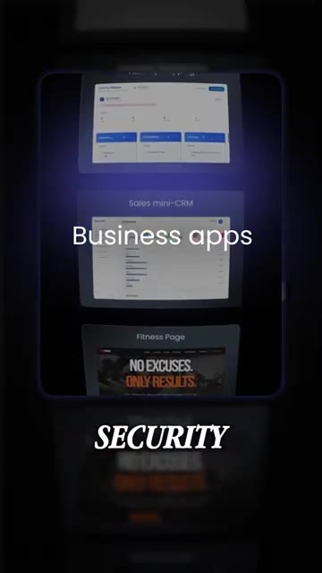

# ?? I Built a Real Website in 20 Minutes (No Code)

> **Cha?ne** : [Brock Mesarich | AI for Non Techies](https://www.youtube.com/@BrockMesarich)  
> **Lien YouTube** : [https://www.youtube.com/watch?v=W9PjBPXNNAg](https://www.youtube.com/watch?v=W9PjBPXNNAg)  
> **Date de publication** : 20261009  
> **Dur?e** : 00:00:29  
> **Identifiant vid?o** : `W9PjBPXNNAg`  
> **Transcription & Analyse** : `whisper-v3-large-turbo+gemini-3.5-flash-lite`  

---

## ?? Synth?se Ex?cutive & Outils

### ?? R?sum?
Dans cette vid?o intitul?e **J'ai créé un vrai site web en 20 minutes (No-Code)**, Brock Mesarich pr?sente des solutions d'intelligence artificielle et d'automatisation accessibles et pratiques.

### ??? Outils, Mod?les & Logiciels Pr?sent?s
- **Outils IA & Automatisation** : D?monstration pratique et prise en main ?tape par ?tape.

### ?? Points Cl?s & Enseignements Strat?giques
- Adoption pragmatique des agents et outils IA pour booster sa productivit? quotidienne.
- M?thodes de prompting et flux de travail sans comp?tences avanc?es en programmation.

---

## ?? Chronologie & Transcription Compl?te Audio & Visuelle (Mot pour Mot)

### ?? `[00:00:00 - 00:00:19]` | Segment #01

**?? Audio (Transcription Int?grale Mot pour Mot en Fran?ais) :**
> Je suis passé d'une simple phrase à un site web fonctionnel en direct en 20 minutes. Le tout grâce à une IA appelée Coderic, qui se construit directement sur sa propre plateforme d'hébergement. Il vous suffit de décrire ce que vous voulez en anglais simple, comme une page de réservation pour vos clients, une vitrine ou une application avec de véritables connexions d'utilisateurs. Ensuite, elle construit un site web prêt pour le marché, et pas seulement une maquette.

**??? Analyse Visuelle d'?cran (gemini-3.5-flash-lite) :**
**Interface & Outils** : Pr?sentation ou face-cam?ra explicatif de Brock Mesarich sans interface logicielle partag?e.

**Contenu textuel & Code** : Explications orales des concepts IA, m?thodologie et cas d'usage pratiques.

**Action / D?monstration** : Explications face cam?ra et mise en contexte des outils IA.

---

### ?? `[00:00:19 - 00:00:29]` | Segment #02

**?? Audio (Transcription Int?grale Mot pour Mot en Fran?ais) :**
> Et comme l'entreprise derrière s'occupe de l'hébergement, la sécurité et le développement sont déjà pris en charge. Vous appuyez sur publier et c'est en ligne. Donc si vous voulez l'essayer, commentez Coderic et je vous enverrai le lien.

**??? Analyse Visuelle d'?cran (gemini-3.5-flash-lite) :**
**Interface & Outils** : Interface de présentation d'applications web (dashboards, mini-CRM, pages de fitness) et branding SiteGround / Coderick AI.

**Contenu textuel & Code** : Exemples d'applications d'entreprise (« Business apps », « Sales mini-CRM », « Fitness Page ») et mentions textuelles relatives à la sécurité et à l'hébergement.
[DESC_IMAGE_1]

**Action / D?monstration** : Le présentateur illustre visuellement la diversité des applications créables sur la plateforme.

*?? 00:00:22 ? Aperçu visuel d'exemples d'applications professionnelles (« Business apps », « Fitness Page ») générées et hébergées sur la plateforme.*

---

