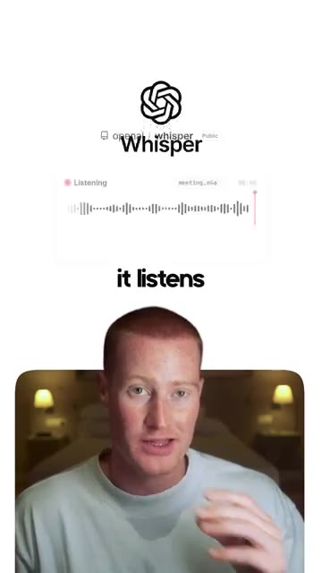
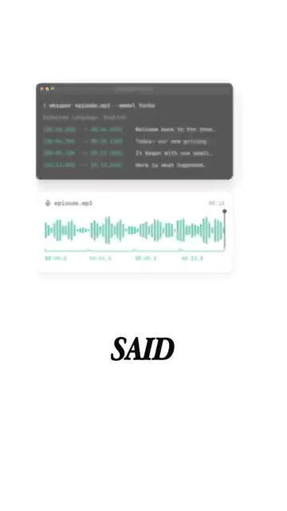
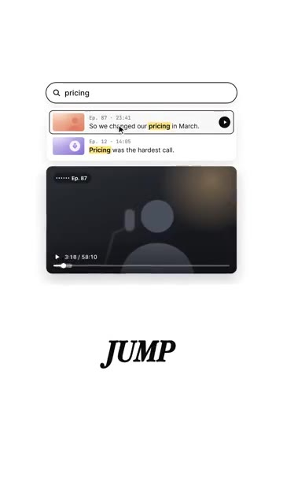
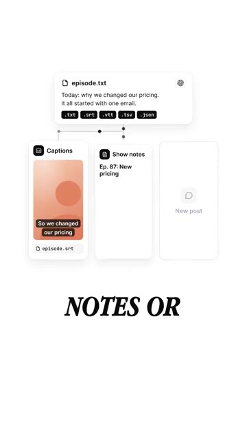

# ?? OpenAI's Free Tool That Turns Long Videos Into Searchable Text

> **Cha?ne** : [Brock Mesarich | AI for Non Techies](https://www.youtube.com/@BrockMesarich)  
> **Lien YouTube** : [https://www.youtube.com/watch?v=YGW6GJUWmWA](https://www.youtube.com/watch?v=YGW6GJUWmWA)  
> **Date de publication** : 20261010  
> **Dur?e** : 00:00:32  
> **Identifiant vid?o** : `YGW6GJUWmWA`  
> **Transcription & Analyse** : `whisper-v3-large-turbo+gemini-3.5-flash-lite`  

---

## ?? Synth?se Ex?cutive & Outils

### 🚀 Résumé

Cette vidéo de la chaîne *Brock Mesarich | AI for Non Techies* met en lumière une solution open-source majeure développée par OpenAI pour valoriser les archives audiovisuelles. L'outil central présenté est **Whisper**, un dépôt GitHub gratuit capable d'analyser n'importe quel enregistrement audio ou vidéo pour le transcrire intégralement avec une précision temporelle millimétrée. En transformant des flux multimédias en données textuelles indexables, il permet de naviguer à l'intérieur d'un catalogue de podcasts ou de vidéos exactement comme on le ferait dans un document bureautique, offrant la possibilité de rechercher un mot-clé pour être redirigé instantanément vers la séquence correspondante.

Au-delà de la simple transcription brute, la solution s'intègre dans une chaîne de valeur éditoriale plus large. Le texte généré multilingue — qui peut également être traduit directement en anglais — sert de matière première pour automatiser la création de sous-titres, la rédaction de notes d'émissions (*show notes*) et la production de nouveaux formats de publications textuelles. Cette approche permet aux créateurs de contenu et aux entreprises d'exploiter pleinement des heures de *legacy media* qui restaient jusqu'alors inactives, en transformant de vagues archives en une base de connaissances consultable et réutilisable.

### 🛠️ Outils, Modèles & Logiciels Présentés

* **Whisper** : Modèle de transcription vocale open-source d'OpenAI disponible sur GitHub, capable d'écouter, transcrire, horolorer et traduire des enregistrements audio en texte consultable.
* **ChatGPT** : Modèle conversationnel d'OpenAI évoqué dans l'écosystème global de traitement textuel et d'assistance à la création de contenu.
* **Claude** : Modèle d'intelligence artificielle conversationnelle d'Anthropic spécialisé dans l'analyse de documents complexes et la rédaction.
* **Gemini** : Modèle multimodal de Google capable de traiter de larges contextes textuels, audio et vidéo.
* **Grok** : Modèle d'intelligence artificielle développé par xAI pour l'analyse en temps réel et la génération de contenu.
* **Make** : Plateforme d'automatisation no-code avancée permettant de connecter des applications et de concevoir des flux de travail complexes.
* **n8n** : Outil d'automatisation de flux de travail open-source et no-code/low-code axé sur la souveraineté des données et les intégrations techniques.
* **Zapier** : Logiciel pionnier d'automatisation no-code facilitant le transfert de données entre des milliers d'applications cloud de manière intuitive.

### 💡 Points Clés & Enseignements Stratégiques

* **Valorisation des archives dormantes** : Transformer d'anciens podcasts ou vidéos en texte permet d'éviter que le contenu historique ne perde de sa valeur et de lui redonner une utilité opérationnelle immédiate.
* **Indexation et recherche textuelle** : Le passage de la vidéo au format textuel permet de parcourir des heures d'enregistrement via une simple recherche par mots-clés, abolissant la contrainte de l'écoute linéaire.
* **Précision temporelle granulaire** : Whisper fournit l'instant exact où chaque ligne a été prononcée, facilitant la navigation directe vers la séquence vidéo pertinente sans tâtonnement.
* **Capacités de traduction multilingue** : L'outil gère nativement de nombreuses langues et intègre des fonctionnalités de traduction directe vers l'anglais, élargissant instantanément l'audience potentielle du contenu.
* **Génération automatisée de sous-titres** : La transcription horodatée constitue la base idéale pour produire des sous-titres précis et synchronisés pour les plateformes de diffusion.
* **Repurposing de contenu multi-canal** : La transcription textuelle sert de fondation pour rédiger automatiquement des notes d'émission, des articles de blog ou des publications pour les réseaux sociaux.
* **Accessibilité et gratuité de l'open-source** : En s'appuyant sur un dépôt GitHub gratuit, les utilisateurs peuvent accéder à des technologies de pointe sans s'abonner à des logiciels propriétaires onéreux.
* **Gain de productivité éditoriale** : L'automatisation de la phase de retranscription et de résumé libère un temps précieux pour les créateurs, leur permettant de se concentrer sur la stratégie de diffusion.
* **Stratégie d'engagement communautaire** : L'appel à l'action formulé dans la vidéo (commenter un mot-clé pour recevoir le dépôt) illustre une méthode efficace pour stimuler l'algorithme d'engagement tout en qualifiant les prospects intéressés par l'IA.
* **Convergence des technologies d'automatisation** : Bien que Whisper soit l'outil vedette, son intégration dans des écosystèmes no-code (Make, Zapier, n8n) ouvre la voie à des pipelines de production entièrement automatisés de la vidéo brute au post publié.

---

## ?? Chronologie & Transcription Compl?te Audio & Visuelle (Mot pour Mot)

### ?? `[00:00:00 - 00:00:22]` | Segment #01

**?? Audio (Transcription Int?grale Mot pour Mot en Fran?ais) :**
> OpenAI a un dépôt GitHub gratuit qui transforme vos anciennes vidéos en texte consultable. Il s'appelle Whisper. Il écoute n'importe quel enregistrement et écrit chaque mot. Et il indique l'exact moment où chaque ligne a été prononcée. Donc, si vous avez des centaines de vieux podcasts ou vidéos, vous pouvez les parcourir comme un document. Tapez un sujet, allez directement au moment où vous l'avez dit. Et cela fonctionne dans de nombreuses langues différentes. Cela peut même les traduire en anglais.

**??? Analyse Visuelle d'?cran (gemini-3.5-flash-lite) :**
**Interface & Outils** : Navigateur web, terminal de commande et interface de lecteur multimédia.

**Contenu textuel & Code** : Texte transcrit horodaté, graphique d'onde audio et barre de recherche avec des extraits surlignés.

**Action / D?monstration** : Présentation du fonctionnement de l'outil Whisper d'OpenAI pour transcrire et rechercher dans des fichiers audio ou vidéo.

*?? 00:00:05 ? Le présentateur en bas et un visuel montrant le nom de l'outil Whisper d'OpenAI et une interface d'enregistrement audio en haut.*

*?? 00:00:11 ? Une interface de terminal affichant la transcription textuelle avec des horodatages associés à un fichier audio représenté par une onde sonore.*

*?? 00:00:16 ? Une interface de recherche textuelle montrant les résultats d'une recherche par mot-clé (« pricing ») dans des épisodes de podcast avec lecture vidéo.*

---

### ?? `[00:00:22 - 00:00:32]` | Segment #02

**?? Audio (Transcription Int?grale Mot pour Mot en Fran?ais) :**
> Ensuite, il peut utiliser cette transcription pour les sous-titres, les notes d'émission ou de nouvelles publications. Ainsi, vos anciens épisodes ne prennent plus la poussière. Si vous voulez redonner vie à vos anciennes vidéos, commentez Whisper et je vous enverrai le dépôt.

**??? Analyse Visuelle d'?cran (gemini-3.5-flash-lite) :**
**Interface & Outils** : Graphique explicatif animé / Schéma conceptuel.

**Contenu textuel & Code** : Texte montrant 'episode.txt', les formats de fichiers (.srt, .vtt, etc.) et les options 'Captions' et 'Show notes'.

**Action / D?monstration** : Illustration visuelle du processus de transformation de transcription audio en contenu textuel et sous-titres.

*?? 00:00:24 ? Schéma explicatif montrant la transcription d'un fichier audio transformée en plusieurs formats (sous-titres, notes d'émission).*

---

