# 🎬 Meta Just Dropped Muse Wonder (Better Than Opus 5.5?)

> **Chaîne** : [Brock Mesarich | AI for Non Techies](https://www.youtube.com/@BrockMesarich)  
> **Lien YouTube** : [https://www.youtube.com/watch?v=d_UgqLKUZHY](https://www.youtube.com/watch?v=d_UgqLKUZHY)  
> **Date de publication** : 20261012  
> **Durée** : 00:09:32  
> **Identifiant vidéo** : `d_UgqLKUZHY`  
> **Transcription & Analyse** : `whisper-v3-large-turbo+gemini-3.5-flash-lite`  

---

## 📌 Synthèse Exécutive & Outils

### 💡 Résumé
Meta redéfinit le paysage des agents d'intelligence artificielle autonomes avec le lancement de sa toute nouvelle architecture de modèles : **Meta Muse Wonder** et **Muse Wonderful**. Conçus spécifiquement pour opérer en tant qu'agents personnels et professionnels capables d'exécuter des flux de travail complexes de bout en bout (comme la gestion de baux, les requêtes juridiques ou le développement applicatif), ces modèles marquent une rupture radicale, se positionnant directement face aux poids lourds du secteur tels que Claude Opus 5.5 et GPT-6 Astra. Cette avancée technique repose sur une refonte totale de l'infrastructure d'IA de Meta menée sur ces quatorze derniers mois, cherchant à combler le fossé historique de l'entreprise sur le segment des grands modèles de langage (LLM).

L'analyse comparative et quantitative des performances révèle des scores impressionnants, notamment sur des tâches exigeantes telles que le droit ou l'automatisation des processus d'entreprise, où Muse Wonderful surpasse parfois ses rivaux directs. Cependant, les benchmarks indépendants et les tests de création de programmes montrent des résultats nuancés, rappelant la nécessité de conserver un esprit critique face aux métriques publiées par les éditeurs. L'intérêt stratégique de cette sortie réside moins dans de simples gains de puissance brute que dans l'introduction de fonctionnalités fondamentales pour l'automatisation : une **mémoire active** persistante à long terme et une **focalisation active** permettant au modèle de s'adapter dynamiquement aux erreurs et de persister face à la complexité sans abandonner sa tâche.

Du point de vue de l'écosystème et de l'intégration, la tarification agressive de l'API (alignée sur celle d'Opus 5.5 avec un million de jetons de contexte sans frais additionnels) contraste avec les restrictions d'accès initiales aux versions les plus puissantes, réservées aux outils de programmation propriétaires de Meta. Pour les praticiens de l'automatisation, des écosystèmes low-code/no-code et de l'intelligence artificielle appliquée, ces évolutions ouvrent la voie à des architectures multi-agents hybrides, où les meilleures briques technologiques de chaque acteur (Meta, OpenAI, Anthropic) pourraient à terme être combinées dynamiquement selon la nature des tâches à exécuter.

### 🛠️ Outils, Modèles & Logiciels Présentés
* **Meta Muse Wonder** : Le nouveau modèle amiral de Meta, optimisé pour servir d'agent d'IA personnel et professionnel doté d'une grande efficacité contextuelle.
* **Muse Wonderful** : La variante haut de gamme et ultra-performante de la nouvelle architecture de Meta, affichant des scores de pointe sur les flux de travail complexes.
* **Claude Opus 5.5** : Le modèle de référence d'Anthropic, réputé pour sa puissance en programmation et ses performances globales sur l'indice d'intelligence d'Artificial Analysis.
* **GPT-6 Astra** : Le modèle d'OpenAI alimentant les assistants intelligents, concurrent direct de Muse sur le marché des agents personnels.
* **Claude Fable 5.1** : Autre itération de la gamme Anthropic utilisée comme mètre étalon dans les benchmarks comparatifs de Meta.
* **GrokBot** : L'agent d'intelligence artificielle personnel d'Elon Musk/xAI, apprécié pour son intégration multi-modèles potentielle.
* **Make & Zapier** : Plateformes d'automatisation de flux de travail interconnectant différentes applications et API, mentionnées pour situer l'écosystème d'exécution des agents.
* **n8n** : Outil d'automatisation open-source avancé pour orchestrer des workflows complexes et des agents autonomes.
* **ChatGPT & Gemini** : Écosystèmes conversationnels et génératifs de référence servant à contextualiser le positionnement concurrentiel de Meta.

### 🔑 Points Clés & Enseignements Stratégiques
* **Refonte architecturale majeure** : Meta abandonne ses anciennes bases pour lancer une nouvelle génération de modèles construits à partir de zéro, marquant son entrée crédible sur le marché haut de gamme des LLM face à OpenAI et Anthropic.
* **Supériorité sur les flux d'entreprise** : Muse Wonderful atteint 45,4 % sur l'automatisation de tâches d'entreprise de bout en bout, devançant légèrement les scores combinés de ses rivaux directs (environ 41 %).
* **Performance en droit et finance** : Le modèle démontre une supériorité notable sur les benchmarks juridiques, affichant des scores tricolores supérieurs à ceux d'Opus 5.5, ce qui valide son aptitude à traiter des domaines à fort enjeu de conformité.
* **Nuance sur la programmation pure** : Bien que performant sur les projets de codage longs, Opus 5.5 conserve l'avantage sur la génération intégrale de programmes à partir d'une feuille blanche et sur l'utilisation directe de l'ordinateur.
* **Innovation avec la « Mémoire Active »** : Le système conserve et extrait contextuellement les préférences et données clés de l'utilisateur sur de longues périodes (semaines, mois), résolvant le problème de l'amnésie conversationnelle chronique des IA.
* **Résilience via la « Focalisation Active »** : Face à une erreur, le modèle adopte une démarche itérative, change d'approche, demande des clarifications et valide ses actions intermédiaires avant d'agir pour éviter les impasses.
* **Stratégie tarifaire agressive** : L'API de Muse Wonder est fixée à 4 dollars par million de jetons d'entrée et 20 dollars en sortie, s'alignant sur Opus 5.5 tout en offrant une fenêtre de contexte d'un million de jetons sans surcoût pour les prompts longs.
* **Segmentation et accessibilité** : Si la version standard est accessible via l'API et l'écosystème mobile, la version la plus puissante (Wonderful) est initialement restreinte à l'outil de programmation *Muse Code* et aux abonnements premium de Meta.
* **Perspectives d'intégration multi-modèles** : Dans une optique d'optimisation des architectures d'agents (comme l'approche envisagée par SpaceX/GrokBot), l'ouverture de l'API de Meta permet d'envisager le routage dynamique des tâches vers le meilleur modèle disponible selon le cas d'usage.
* **Vigilance critique sur les benchmarks** : Les tests internes publiés par Meta affichant des paramètres d'effort maximaux doivent être pris avec recul en attendant des évaluations tierces et indépendantes.
* **Gestion des risques de sécurité** : Avec un taux de mauvaise gestion des informations personnelles évalué à 3,4 % (et jusqu'à 6,8 % pour certains concurrents), la connexion d'un agent autonome à des données sensibles (e-mails, agendas) requiert des garde-fous stricts.

---

## ⏱️ Chronologie & Transcription Complète Audio & Visuelle (Mot pour Mot)

### ⏱️ `[00:00:00 - 00:00:19]` | Segment #01

**🔊 Audio (Transcription Intégrale Mot pour Mot en Français) :**
> Meta vient de lancer un tout nouveau type de modèle d'intelligence artificielle et ils affirment qu'il est désormais le meilleur au monde pour la seule chose que tout le monde veut réellement que l'intelligence artificielle fasse pour lui. Il s'appelle Muse Wonder et c'est leur modèle le plus grand et le plus performant à ce jour. Maintenant, ce qui rend celui-ci différent, c'est qu'il a été conçu spécifiquement pour être un agent d'intelligence artificielle personnel comme MetaMuse ou GrokBot.

**👁️ Analyse Visuelle d'Écran (gemini-3.5-flash-lite) :**
**Interface & Outils** : Interface vidéo standard de présentation YouTube avec incrustation du présentateur.

**Contenu textuel & Code** : Texte de présentation et publication de réseau social (Twitter/X) introduisant Muse Wonder.
[DESC_IMAGE_3] Présentation d'une annonce textuelle concernant la sortie d'un nouveau modèle d'intelligence artificielle.

**Action / Démonstration** : Explications face caméra et analyse conceptuelle des marchés.

---

### ⏱️ `[00:00:19 - 00:00:44]` | Segment #02

**🔊 Audio (Transcription Intégrale Mot pour Mot en Français) :**
> Et il y a deux choses qui sont totalement nouvelles avec ce modèle, qui le distinguent vraiment des autres meilleurs modèles sur le marché, et je vais décortiquer ces deux aspects dans cette vidéo. Je vais également analyser comment il se positionne par rapport aux meilleurs modèles comme Claude Opus 5.5 et GPT-6 Astra, ce que ça coûte, et qui peut réellement l'utiliser aujourd'hui. Et si vous utilisez GrokBot tous les jours comme moi, il y a une raison pour laquelle ce modèle pourrait finir par compter pour vous, même si vous n'utilisez pas l'application de Meta, donc je aborderai cela vers la fin de la vidéo.

**👁️ Analyse Visuelle d'Écran (gemini-3.5-flash-lite) :**
**Interface & Outils** : Interface web de benchmark d'IA (research.meta.ai).

**Contenu textuel & Code** : Tableau comparatif évaluant divers modèles (Muse Wonder, Claude Fable 5.1, GPT-6 Astra, Claude Opus 5.5) à travers des critères professionnels et de recherche (Personal Superintelligence Index, Harvey LAB-AA, Vals Finance Agent V2, HealthBench Pro).

**Action / Démonstration** : Présentation comparative des performances des modèles d'intelligence artificielle phares du marché.

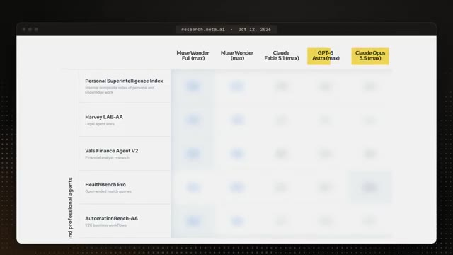
*⏱️ 00:00:32 — Un tableau comparatif de performances entre différents modèles d'IA (Muse Wonder, Claude Fable, GPT-6 Astra, Claude Opus 5.5) sur des benchmarks tels que Personal Superintelligence Index et Harvey LAB-AA.*

---

### ⏱️ `[00:00:44 - 00:01:22]` | Segment #03

**🔊 Audio (Transcription Intégrale Mot pour Mot en Français) :**
> Alors, sans plus attendre, plongeons-nous dedans. Très bien, donc ce que je vais faire, c'est décortiquer l'article que Meta a publié et vous donner simplement les points principaux qui vous importent et laisser un lien dans la description si vous voulez le lire vous-même. Maintenant, première chose, il y a deux modèles ici. Nous avons Meta Muse Wonder et nous avons Muse Wonderful. Et Meta les qualifie de modèles les plus performants à ce jour. Si vous n'êtes pas familiarisé avec les différents modèles d'IA de Meta, jusqu'à présent, leur modèle s'appelait Muse Spark. Et c'est ce qui fait tourner Meta Muse, qui est l'application d'agent personnel de Meta. Maintenant, Muse est la réponse de Meta à GrokBot et ChatGPT Dots. Ce sont donc les trois plus grands agents d'IA personnels en ce moment. J'utilise personnellement

**👁️ Analyse Visuelle d'Écran (gemini-3.5-flash-lite) :**
**Interface & Outils** : Vidéo YouTube de présentation des recherches de Meta.

**Contenu textuel & Code** : Aucun graphique, indicateur technique, code source ou terminal n'est affiché.
[DESC_ACTION] Le présentateur introduit l'article de Meta tout en diffusant des extraits de la vidéo originale.

**Action / Démonstration** : Explications face caméra et analyse conceptuelle des marchés.

---

### ⏱️ `[00:01:22 - 00:01:57]` | Segment #04

**🔊 Audio (Transcription Intégrale Mot pour Mot en Français) :**
> GrokBot chaque jour et c'est de loin mon agent IA préféré, donc ce que je veux vraiment savoir, c'est si ce nouveau modèle suffit à me faire passer à Muse. Alexander Wang, qui dirige l'IA chez Meta, a déclaré que c'est comparable aux rivaux d'OpenAI et d'Anthropic. Meta affirme avoir commencé à reconstruire l'ensemble de ses efforts en matière d'IA à partir de zéro il y a 14 mois, et c'est le premier modèle issu de cette reconstruction qu'ils placent directement aux côtés des meilleurs modèles d'Anthropic et d'OpenAI. Et ce pour quoi Meta dit qu'il est le meilleur, c'est en tant qu'agent personnel et professionnel. Donc en gros, une IA qui sort et fait le travail pour vous, comme régler une demande d'indemnisation d'assurance,

**👁️ Analyse Visuelle d'Écran (gemini-3.5-flash-lite) :**
**Interface & Outils** : Navigateur web affichant une page de recherche Meta Research.

**Contenu textuel & Code** : Extrait de texte souligné et mis en surbrillance jaune : 'Fourteen months ago, we began a ground-up overhaul of our artificial intelligence efforts.'

**Action / Démonstration** : Le présentateur commente un article officiel de Meta Research affiché à l'écran pour illustrer ses propos sur l'IA.

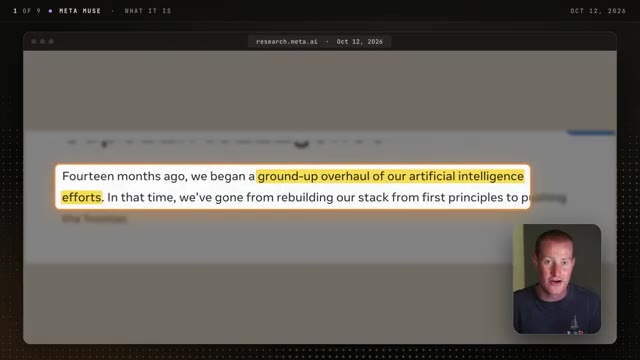
*⏱️ 00:01:39 — Capture d'écran d'un article de recherche Meta Research (research.meta.ai) avec le texte en surbrillance 'ground-up overhaul of our artificial intelligence efforts', et une incrustation vidéo du présentateur en bas à droite.*

---

### ⏱️ `[00:01:57 - 00:02:31]` | Segment #05

**🔊 Audio (Transcription Intégrale Mot pour Mot en Français) :**
> comprendre un bail, ou créer une application pour votre entreprise. Ils ont également indiqué que cela s'applique au droit, à la finance et à la santé, qui sont des domaines où une mauvaise réponse peut vraiment vous coûter cher. Maintenant, passons à la partie que tout le monde veut voir, et c'est la façon dont il se compare aux autres meilleurs modèles. Voici donc le tableau de Meta, et ils comparent les deux modèles Wonder à Claude Fable 5.1, Claude Opus 5.5 et GPT-6 Astra. Et GPT-6 Astra est un modèle sur lequel tournent les Chachabiti Dots, et Opus 5.5 est l'un des modèles que GrokBot peut désormais utiliser, c'est donc à peu près le nouveau de Meta

**👁️ Analyse Visuelle d'Écran (gemini-3.5-flash-lite) :**
**Interface & Outils** : Interface web de benchmark (Meta Muse) et interface mobile/application ChatGPT.

**Contenu textuel & Code** : Scores de performance sur des benchmarks spécialisés : Personal Superintelligence Index, Harvey LAB-AA (légal), Vals Finance Agent V2 (finance), HealthBench Pro (santé) et AutomationBench-AA.

**Action / Démonstration** : Présentation des résultats comparatifs des modèles d'IA et de leurs scores de précision dans des domaines sensibles (finance, santé, droit).

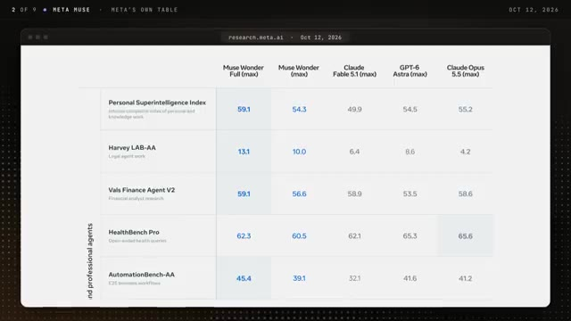
*⏱️ 00:02:14 — Un tableau comparatif des performances de différents modèles d'IA (Muse Wonder, Claude Fable, GPT-6, Claude Opus) sur divers benchmarks spécialisés.*

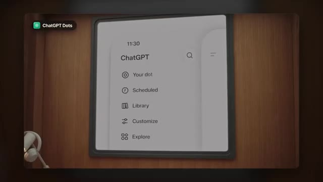
*⏱️ 00:02:23 — Une interface d'application ChatGPT affichant un menu épuré avec les options Your dot, Scheduled, Library, Customize et Explore.*

---

### ⏱️ `[00:02:31 - 00:03:09]` | Segment #06

**🔊 Audio (Transcription Intégrale Mot pour Mot en Français) :**
> modèle contre les autres modèles derrière les deux autres agents IA. La première chose qui me saute aux yeux, c'est le travail juridique, car sur ce test d'agent juridique, Wonder Full a obtenu 13,1 %, tandis que GPT-6 Astra a obtenu 8,6 %, et Opus 5,5 a obtenu 4,2. Maintenant, ces chiffres sont bas dans l'ensemble parce que le travail doit répondre à chaque exigence pour être validé, mais Wonder Full est quand même environ trois fois plus élevé qu'Opus ici. Maintenant, en passant aux flux de travail d'entreprise, qui consistent fondamentalement en un agent effectuant une tâche du début à la fin dans des applications d'entreprise, Wonder Full est à 45,4 % et Opus et Astra sont tous les deux autour de 41 %.

**👁️ Analyse Visuelle d'Écran (gemini-3.5-flash-lite) :**
**Interface & Outils** : Interface de présentation de recherche en IA (Meta Muse - Legal Agent Test).

**Contenu textuel & Code** : Graphique à barres comparant les scores (en pourcentage) de cinq modèles d'IA : Muse Wonder Full (13,1 %), Muse Wonder (10,0 %), GPT-6 Astra (8,6 %), Claude Fable 5,1 (6,4 %) et Claude Opus 5,5 (4,2 %).

**Action / Démonstration** : Analyse comparative des performances des différents agents d'intelligence artificielle sur un test juridique spécialisé.

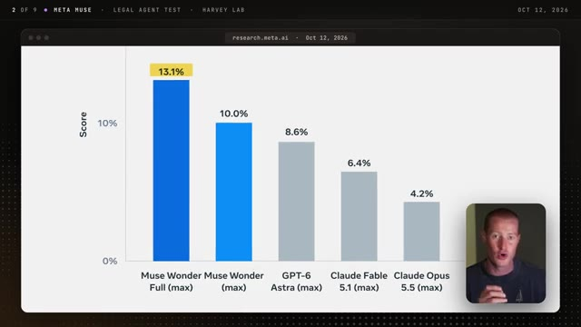
*⏱️ 00:02:41 — Graphique en barres montrant les scores de performance de différents agents IA pour un test juridique (Meta Muse / Harvey Lab).*

---

### ⏱️ `[00:03:09 - 00:03:30]` | Segment #07

**🔊 Audio (Transcription Intégrale Mot pour Mot en Français) :**
> Ce qui, si l'on y réfléchit vraiment, est assez important parce que Opus 5.5 est incroyablement capable. J'ai vraiment été époustouflé par ce qu'il peut faire à l'intérieur de CloudCode, donc c'est plutôt intéressant. Et sur de très longs projets de codage, Wonder Full a obtenu 57,5 % et Opus 5.5 a obtenu 46,3 %.

**👁️ Analyse Visuelle d'Écran (gemini-3.5-flash-lite) :**
**Interface & Outils** : Interface de présentation graphique, graphiques de benchmarks de modèles d'IA.

**Contenu textuel & Code** : Graphique à barres montrant les scores de performance de modèles comme Muse Wonder Full (57,5 %), Muse Wonder (53,1 %), Claude Opus 5.5 (46,3 %), Claude Fable 5.1 (45,6 %) et GPT-6 Astra (42,5 %).

**Action / Démonstration** : Présentation et analyse des résultats comparatifs des performances des modèles d'intelligence artificielle sur des projets de codage longs.

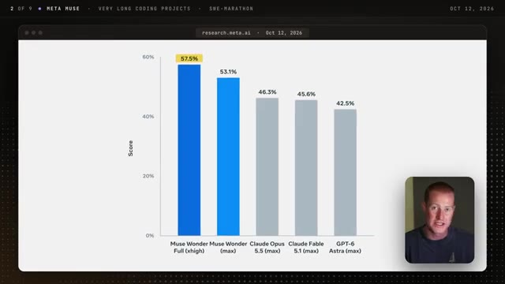
*⏱️ 00:03:25 — Graphique en barres comparant les performances de différents modèles d'IA sur de très longs projets de codage (SWE-marathon), avec en médaillon le présentateur en bas à droite.*

---

### ⏱️ `[00:03:30 - 00:03:48]` | Segment #08

**🔊 Audio (Transcription Intégrale Mot pour Mot en Français) :**
> Maintenant, pour être juste, ça ne l'emporte pas sur tout et Meta le montre directement dans les tableaux de cet article de sortie. Sur le test où le modèle doit construire un programme entier à partir de zéro, Opus 5.5 a obtenu 70,5 % et Wonderful a obtenu 59, et à la fois Opus et Fable sont toujours en avance sur l'utilisation de l'ordinateur.

**👁️ Analyse Visuelle d'Écran (gemini-3.5-flash-lite) :**
**Interface & Outils** : Capture d'écran d'un article de recherche ou d'un site web (research.meta.ai) montrant un tableau de métriques.

**Contenu textuel & Code** : Tableau de benchmarks affichant des scores pour des tests comme Terminal-Bench 4.0-AA, DeepSWE 1.1, SWE-Marathon, et ProgramBench (sur lequel la ligne est surlignée en jaune avec 59.0 pour Muse Wonder et 70.5 pour Claude Opus 5.5), ainsi que l'Artificial Analysis Index.

**Action / Démonstration** : Présentation et analyse des résultats comparatifs des performances de codage des différents modèles d'intelligence artificielle par le présentateur.

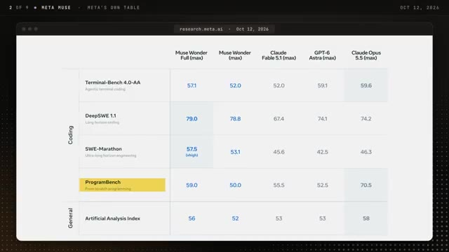
*⏱️ 00:03:39 — Tableau comparatif des performances de différents modèles d'IA (Muse Wonder, Claude Fable 5.1, GPT-6 Astra, Claude Opus 5.5) sur divers benchmarks de programmation.*

---

### ⏱️ `[00:03:49 - 00:04:21]` | Segment #09

**🔊 Audio (Transcription Intégrale Mot pour Mot en Français) :**
> Et sur l'indice d'intelligence global d'Artificial Analysis, qui est une entreprise indépendante qui teste tous ces différents modèles, Opus 5.5 est à 58 et Wonderful est à 56. Gardez également à l'esprit qu'il s'agit du tableau de Meta, donc chaque score est au paramètre d'effort le maximal et quelques-uns de ces tests ont été créés par Meta eux-mêmes, donc j'attendrais un testeur plus indépendant avant de déclarer un gagnant. Mais l'élément principal ici, c'est le fait que le modèle de Meta se trouve même sur le même tableau qu'Opus et Fable, ce qui est assez important car, historiquement, ils n'ont pas eu le

**👁️ Analyse Visuelle d'Écran (gemini-3.5-flash-lite) :**
**Interface & Outils** : Tableau comparatif web (Meta Muse research)

**Contenu textuel & Code** : Scores de performance des modèles d'IA sur Terminal-Bench, DeepSWE, SWE-Marathon, ProgramBench et l'indice Artificial Analysis.

**Action / Démonstration** : Présentation et analyse comparative des scores des modèles d'IA par le présentateur.

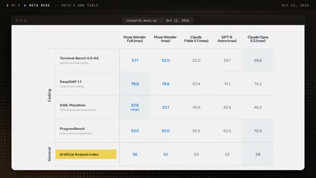
*⏱️ 00:03:57 — Tableau comparatif des performances de différents modèles d'IA (Muse Wonder, Claude, GPT-6) sur divers benchmarks de programmation et sur l'indice Artificial Analysis.*

---

### ⏱️ `[00:04:21 - 00:04:56]` | Segment #10

**🔊 Audio (Transcription Intégrale Mot pour Mot en Français) :**
> meilleurs modèles en ce qui concerne les LLM. Maintenant, passons à deux fonctionnalités que Meta met vraiment en avant avec ce modèle, et la première s'appelle la Mémoire Active. Donc en gros, Meta dit que le modèle conserve le contexte important vous concernant à travers vos différentes conversations, puis il extrait activement les détails qui comptent pour tout ce sur quoi vous travaillez. Donc par exemple, si vous lui avez indiqué votre budget pour un voyage il y a quelques semaines, l'idée est qu'il le remémore de lui-même lorsque vous lui demandez de trouver un hôtel afin que vous n'ayez pas à vous répéter. L'un des chercheurs dans la vidéo de lancement a déclaré qu'ils voulaient qu'il se souvienne de ce qui est important pour vous sur des jours, des semaines, des mois,

**👁️ Analyse Visuelle d'Écran (gemini-3.5-flash-lite) :**
**Interface & Outils** : Interface vidéo de présentation/diaporama avec animations graphiques.

**Contenu textuel & Code** : Texte 'ACTIVE MEMORY' et schémas conceptuels de réseau de données.

**Action / Démonstration** : Présentation visuelle de la nouvelle fonctionnalité de mémoire active.

---

### ⏱️ `[00:04:56 - 00:05:29]` | Segment #11

**🔊 Audio (Transcription Intégrale Mot pour Mot en Français) :**
> et au-delà, ce qui est logique puisque la plupart des intelligences artificielles oublient fondamentalement tout ce que vous leur avez dit après un certain temps. Et au test de mémoire de Meta, Muse Wonder a obtenu 85,6 % et Opus 5.5 et GPT-6 Astra étaient tous les deux autour de 81. Encore une fois, ce test a été conçu par Meta, donc à prendre avec des pincettes, mais je pense sincèrement que la mémoire est l'une des choses les plus importantes qui rend réellement un agent IA personnel réellement utile. Maintenant, la deuxième grande nouveauté ici qui diffère des modèles précédents s'appelle la focalisation active. Et cela concerne ce que fait le modèle lorsqu'une tâche devient vraiment difficile.

**👁️ Analyse Visuelle d'Écran (gemini-3.5-flash-lite) :**
**Interface & Outils** : Interface web de recherche Meta affichant des graphiques de performance.

**Contenu textuel & Code** : Scores de test de mémoire : Muse Wonder (85,6 %), Muse Wonder Full (85,5 %), Claude Opus 5.5 (81,5 %), GPT-6 Astra (81,4 %) et Claude Fable 5.1 (79 %).

**Action / Démonstration** : Présentation des résultats comparatifs des performances de mémoire des différents modèles d'intelligence artificielle.

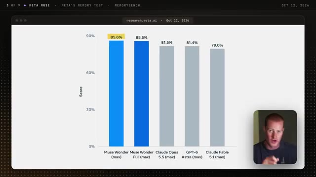
*⏱️ 00:05:04 — Graphique à barres comparant les scores de différents modèles d'IA au test de mémoire de Meta (Memorybench), avec le présentateur en médaillon en bas à droite.*

---

### ⏱️ `[00:05:29 - 00:05:47]` | Segment #12

**🔊 Audio (Transcription Intégrale Mot pour Mot en Français) :**
> Meta affirme qu'il continue de travailler vers votre objectif en essayant une approche différente, en surmontant tout ce qui le bloque et en s'adaptant lorsque de nouvelles informations arrivent. Il vous demande également des clarifications lorsqu'il en a besoin, et Meta affirme qu'il fait le point avec vous avant de prendre toute action importante, ce qui est exactement ce que vous attendez d'un modèle qui agit en votre nom.

**👁️ Analyse Visuelle d'Écran (gemini-3.5-flash-lite) :**
**Interface & Outils** : Interface de navigateur web affichant un article de recherche Meta (research.meta.ai).

**Contenu textuel & Code** : Texte surligné en jaune : "it asks for clarification when needed and checks in before taking important actions. We evaluate focus through FocusBench...".

**Action / Démonstration** : Présentation d'un extrait de recherche textuel sur les capacités de l'IA de Meta.

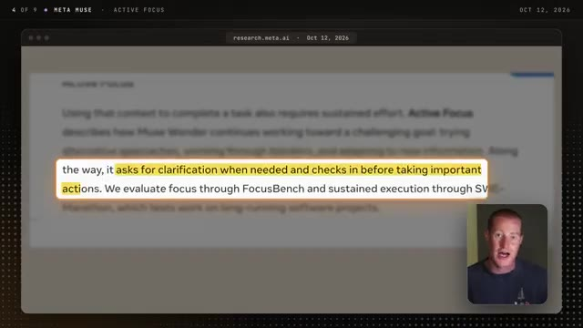
*⏱️ 00:05:38 — Une page de recherche Meta montrant du texte surligné concernant l'IA et l'évaluation FocusBench, avec le présentateur en médaillon.*

---

### ⏱️ `[00:05:47 - 00:06:23]` | Segment #13

**🔊 Audio (Transcription Intégrale Mot pour Mot en Français) :**
> Maintenant, si vous avez déjà utilisé des agents IA auparavant, vous savez probablement que, la plupart du temps, ils rencontrent une erreur et soit abandonnent, soit vous disent que le travail est fait alors qu'il ne l'est pas. Cette mise à jour du modèle est donc la façon dont Meta s'attaque précisément à ce problème. Meta a également présenté quelques démos dans l'article, et je pense qu'elles donnent une bonne idée de ce que doit faire un agent IA personnel. Dans la première, il planifie une course du samedi en travaillant directement dans un navigateur et à travers plusieurs applications, et il élabore un plan en fonction des préférences propres à la personne. Dans une autre, il conçoit et commande des cadeaux personnalisés en utilisant de vraies photos provenant du profil Instagram de quelqu'un. Et du côté du codage, il a construit un jeu de cuisine 3D jouable à partir d'images. Maintenant,

**👁️ Analyse Visuelle d'Écran (gemini-3.5-flash-lite) :**
**Interface & Outils** : Interface web de recherche Meta (research.meta.ai) et lecteur de démonstration.

**Contenu textuel & Code** : Texte descriptif "Muse Wonder designs and orders custom swag based on real photos taken from a personal Instagram profile." avec une interface de personnalisation de t-shirt (Coco) et une fenêtre de terminal ou de code à côté.

**Action / Démonstration** : Présentation d'une démo vidéo montrant les capacités d'agents IA autonomes pour la conception et la commande de produits personnalisés.

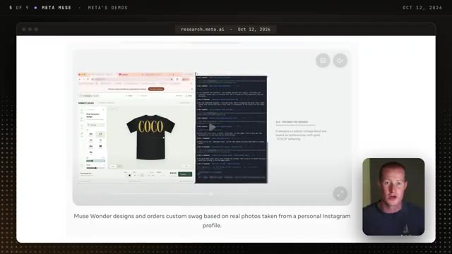
*⏱️ 00:06:14 — Capture d'écran montrant l'interface de recherche Meta avec une vidéo de démonstration de "Muse Wonder" concevant et commandant des articles personnalisés.*

---

### ⏱️ `[00:06:23 - 00:07:00]` | Segment #14

**🔊 Audio (Transcription Intégrale Mot pour Mot en Français) :**
> Ce sont les propres démonstrations de Meta, donc bien sûr, elles vont avoir l'air bien, mais elles vous montrent où tout cela nous mène, c'est-à-dire un agent d'IA qui fonctionne à travers vos applications et vos comptes. Mais je vais être transparent et dire que vous pouvez faire des choses comme ça à l'intérieur de GrokBot, ChatGPT, et ces autres agents d'IA. Très bien, passons au prix. Et il y a un piège ici que je pense que la plupart des gens vont rater. Pour les développeurs utilisant l'API, Muse Wonder coûte 4 dollars par million de jetons d'entrée et 20 dollars par million de jetons de sortie. C'est exactement le même prix que Opus 5.5, et c'est beaucoup moins cher que Fable 5.1, qui est à 10 et 50 dollars. Il a également une fenêtre de contexte d'un million de jetons,

**👁️ Analyse Visuelle d'Écran (gemini-3.5-flash-lite) :**
**Interface & Outils** : Page web de tarification Anthropic (platform.claude.com/pricing) montrant les différents modèles de Claude.

**Contenu textuel & Code** : Tableau des prix par million de tokens pour les modèles Claude Fable 5.1, Claude Opus 5.5 et Claude Sonnet 5.5, avec des coûts d'entrée/sortie et de mise en cache.

**Action / Démonstration** : Présentation des différents modèles et de leurs grilles tarifaires respectives pour les tâches d'IA et de codage.

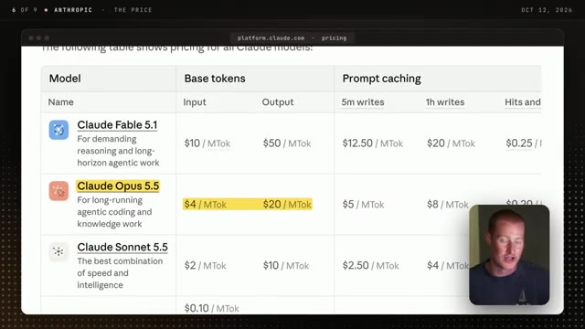
*⏱️ 00:06:51 — Capture d'écran d'une page Web affichant un tableau tarifaire (pricing) pour les modèles Claude, avec le présentateur en médaillon dans le coin inférieur droit.*

---

### ⏱️ `[00:07:00 - 00:07:19]` | Segment #15

**🔊 Audio (Transcription Intégrale Mot pour Mot en Français) :**
> et Meta ne facture pas de frais supplémentaires pour les longs prompts. Maintenant, voici le hic, et c'est pour le modèle appelé Wonder Full. À l'heure actuelle, il n'est pas du tout disponible via l'API. La seule façon d'y accéder est d'utiliser Muse Code, qui est l'outil de programmation de Meta, et c'est uniquement disponible avec le forfait à 50 dollars par mois ou à 200 dollars par mois. Bon, alors qui peut réellement l'utiliser aujourd'hui ?

**👁️ Analyse Visuelle d'Écran (gemini-3.5-flash-lite) :**
**Interface & Outils** : Navigateur web affichant la page de tarification des abonnements de Meta Muse Code.

**Contenu textuel & Code** : Offres d'abonnement "Power Usage" (50.00 $/mois) et "Maximum Usage" (200.00 $/mois) avec leurs fonctionnalités respectives (accès à Muse Wonder Full, limites d'utilisation, etc.).

**Action / Démonstration** : Navigation sur la page web présentant les plans tarifaires de l'outil de programmation de Meta.

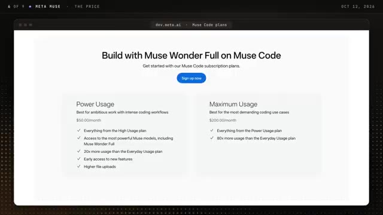
*⏱️ 00:07:14 — Capture d'écran montrant la page web "dev.meta.ai - Muse Code plans" détaillant les abonnements "Power Usage" à 50 $/mois et "Maximum Usage" à 200 $/mois pour utiliser Muse Wonder Full.*

---

### ⏱️ `[00:07:19 - 00:07:43]` | Segment #16

**🔊 Audio (Transcription Intégrale Mot pour Mot en Français) :**
> À l'heure actuelle, Muse Wonder est disponible dans l'API mobile de Meta et au sein de Muse Code, et Wonderful est disponible pour les abonnés de Muse Code sur ces deux forfaits supérieurs. Maintenant, si vous n'êtes pas technique comme moi et que vous voulez simplement ceci dans l'application Muse, ce n'y est pas encore. Meta indique que Muse Wonder alimentera bientôt des expériences au sein de Muse, et cela sera déployé d'abord pour les abonnés ping, mais ils n'ont pas donné de date exacte.

**👁️ Analyse Visuelle d'Écran (gemini-3.5-flash-lite) :**
**Interface & Outils** : Aucune interface de trading, de code ou d'outil technique n'est affichée dans ce segment.

**Contenu textuel & Code** : Texte de documentation technique sur la disponibilité des modèles Meta Muse et visages des intervenants.

**Action / Démonstration** : Présentation orale et affichage d'un article de recherche informatif sans démonstration pratique.

---

### ⏱️ `[00:07:43 - 00:08:08]` | Segment #17

**🔊 Audio (Transcription Intégrale Mot pour Mot en Français) :**
> Donc, à l'heure actuelle, je ne peux pas vous dire comment il se compare à GrokBot au jour le jour, car la seule façon de vraiment le savoir est de l'utiliser à l'intérieur de Muse. Maintenant, l'autre chose qui m'intéresse vraiment de voir, c'est si ce modèle finit par se retrouver à l'intérieur de GrokBot. Si vous avez vu ma vidéo à ce sujet la semaine dernière, Elon a dit qu'à l'avenir, SpaceX allait utiliser le meilleur modèle pour une tâche donnée à l'intérieur de GrokBot, et cela inclut d'autres modèles provenant d'entreprises comme Anthropic avec Claude Opus 3.5.

**👁️ Analyse Visuelle d'Écran (gemini-3.5-flash-lite) :**
**Interface & Outils** : Navigateur web affichant une interface de type réseau social X (Twitter) avec incrustation vidéo.

**Contenu textuel & Code** : Un post de Elon Musk concernant l'utilisation du meilleur modèle de backend pour chaque tâche (mentionnant Claude Opus 5.5, MidJourney, Suno, etc.) avec certaines portions surlignées en jaune.

**Action / Démonstration** : Le présentateur commente une publication ou un article d'actualité concernant l'intégration de différents modèles d'IA par xAI/SpaceX.

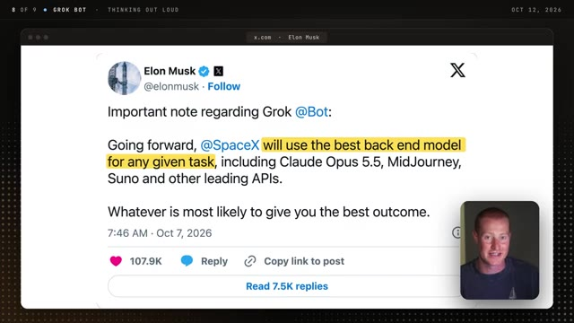
*⏱️ 00:08:02 — Capture d'écran affichant un tweet fictif d'Elon Musk sur Grok Bot, avec le présentateur en médaillon vidéo incrusté dans le coin inférieur droit.*

---

### ⏱️ `[00:08:08 - 00:08:32]` | Segment #18

**🔊 Audio (Transcription Intégrale Mot pour Mot en Français) :**
> Et puisque ce modèle Muse Wonder est disponible via l'API de Meta, il est au moins possible pour SpaceX de l'intégrer pour différentes tâches où il obtient de meilleurs résultats sur des aspects comme la mémoire. Et pour être clair, personne n'a annoncé rien de tel, donc c'est juste moi qui réfléchis à voix haute. Mais si cela se produit, j'obtiens le modèle de Meta à l'intérieur de l'agent IA que j'utilise personnellement déjà tous les jours sans avoir à basculer sur MetaMuse du tout, ce qui fait que vous pensez peut-être la même chose.

**👁️ Analyse Visuelle d'Écran (gemini-3.5-flash-lite) :**
**Interface & Outils** : Interface graphique minimale avec le badge "Grok Bot".

**Contenu textuel & Code** : Animation d'une icône sphérique représentant une entité ou un bot d'intelligence artificielle.

**Action / Démonstration** : Affichage graphique illustratif accompagnant les réflexions du présentateur sur les modèles d'IA.

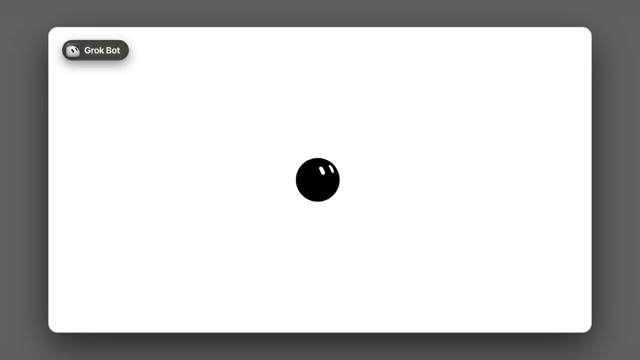
*⏱️ 00:08:26 — Une illustration animée sur fond blanc montrant une sphère noire avec des yeux stylisés et le logo "Grok Bot" dans le coin supérieur gauche.*

---

### ⏱️ `[00:08:32 - 00:08:52]` | Segment #19

**🔊 Audio (Transcription Intégrale Mot pour Mot en Français) :**
> Est-ce que ça vaut le coup pour moi de passer maintenant à Meta, ou est-ce que je devrais continuer dans GrokBot ? Maintenant, la dernière chose dans l'article est la sécurité. Meta le dit lui-même, un agent IA personnel peut gérer vos messages, votre calendrier et vos documents privés, donc la façon dont il traite ces informations a beaucoup d'importance. Meta a donc testé cela et a publié la fréquence à laquelle chaque modèle a mal géré des informations personnelles.

**👁️ Analyse Visuelle d'Écran (gemini-3.5-flash-lite) :**
**Interface & Outils** : Navigateur web affichant un article de recherche officiel Meta (research.meta.ai).

**Contenu textuel & Code** : Extrait de texte surligné en jaune : "A personal agent takes actions on a user's behalf and might handle context such as messages, calendars, and private documents."

**Action / Démonstration** : Le présentateur commente et analyse un extrait de document officiel de recherche Meta portant sur la confidentialité des agents IA.

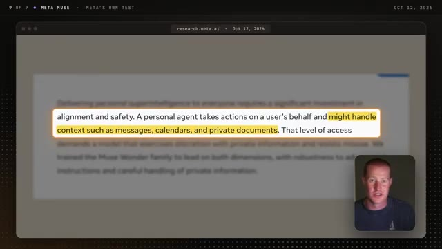
*⏱️ 00:08:42 — Article de recherche Meta affiché à l'écran avec un paragraphe surligné concernant la sécurité et les agents personnels gérant des messages, agendas et documents privés, avec une vignette du présentateur en bas à droite.*

---

### ⏱️ `[00:08:52 - 00:09:15]` | Segment #20

**🔊 Audio (Transcription Intégrale Mot pour Mot en Français) :**
> Muse Wonder l'a fait 3,4 % du temps, et Wonder Full l'a fait 2,2 % du temps. Maintenant, pour être juste, c'étaient les meilleurs scores sur le graphique, avec GBT6 Astra à 4,6 % et Claude Fable 5,1 % à 6,8 %. Mais 3,4 %, c'est quand même environ une fois sur 30 dans le test. Donc, si vous avez l'intention de connecter un agent IA à votre e-mail, je garderais cela à l'esprit, peu importe le modèle que vous utilisez.

**👁️ Analyse Visuelle d'Écran (gemini-3.5-flash-lite) :**
**Interface & Outils** : Graphique statistique web (research.meta.ai) affichant des taux de violation par modèle d'IA.

**Contenu textuel & Code** : Barres verticales comparatives avec les étiquettes de modèles : Muse Wonder Full (max) à 2.2%, Muse Wonder (max) à 3.4%, GPT-6 Astra (max) à 4.6%, et Claude Fable 5.1 (max) à 6.8%.

**Action / Démonstration** : Présentation et analyse comparative des performances et des taux de violation des différents modèles d'IA.

*⏱️ 00:09:04 — Graphique à barres comparant les taux de violation (Violation Rate) de différents modèles d'IA : Muse Wonder Full (2.2%), Muse Wonder (3.4%), GPT-6 Astra (4.6%), et Claude Fable 5.1 (6.8%), avec une petite incrustation vidéo du présentateur en bas à droite.*

---

### ⏱️ `[00:09:16 - 00:09:32]` | Segment #21

**🔊 Audio (Transcription Intégrale Mot pour Mot en Français) :**
> Meta affirme également qu'un rapport de sécurité complet sera bientôt publié, nous devrions donc obtenir plus de détails à ce sujet dès sa sortie. Quoi qu'il en soit, j'espère que vous avez apprécié cette analyse. N'oubliez pas de vous abonnez si vous avez aimé la vidéo et dites-moi dans les commentaires : utilisez-vous MetaMuse, GrokBot ou ChachapitiDots ? Quoi qu'il en soit, merci d'avoir regardé jusqu'à la fin et je vous dis à la prochaine vidéo. Salut.

**👁️ Analyse Visuelle d'Écran (gemini-3.5-flash-lite) :**
**Interface & Outils** : Navigateur web affichant un document de recherche Meta (research.meta.ai).

**Contenu textuel & Code** : Texte extrait d'un rapport mentionnant : "A full report with additional safety evaluations will be available soon."

**Action / Démonstration** : Le présentateur commente le rapport de sécurité de Meta tout en affichant l'extrait textuel à l'écran.

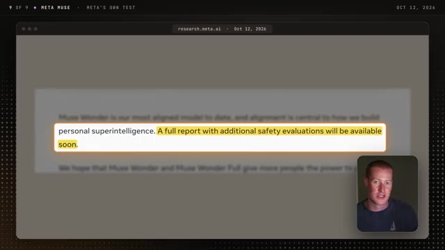
*⏱️ 00:09:20 — Capture d'écran montrant un extrait de document de recherche Meta avec une phrase surlignée en jaune mentionnant un rapport de sécurité à venir, avec une incrustation vidéo du présentateur en bas à droite.*

---

