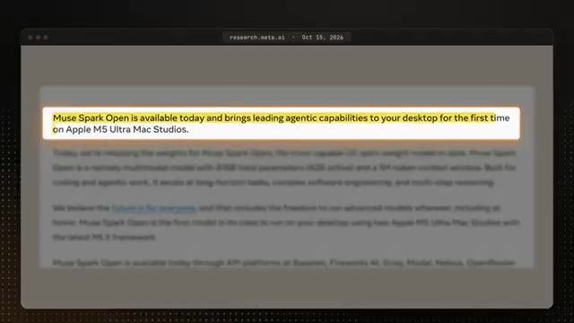
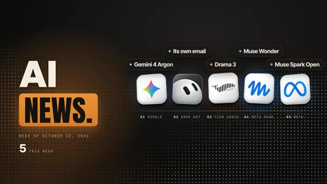
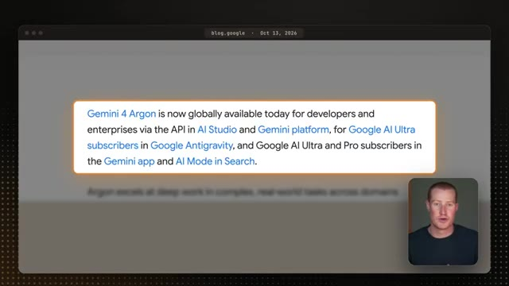
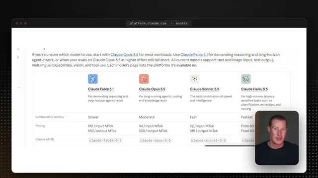
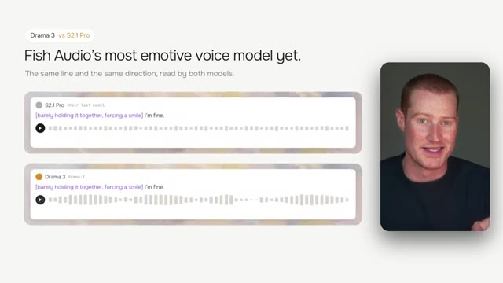
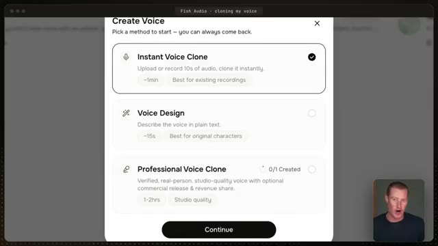
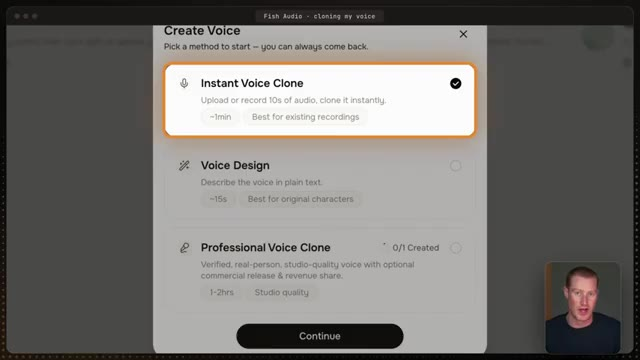

# 🎬 Claude Fable 5.5 is Coming + More (AI News)

> **Chaîne** : [Brock Mesarich | AI for Non Techies](https://www.youtube.com/@BrockMesarich)  
> **Lien YouTube** : [https://www.youtube.com/watch?v=8htNqGGxlDo](https://www.youtube.com/watch?v=8htNqGGxlDo)  
> **Date de publication** : 20261016  
> **Durée** : 00:19:24  
> **Identifiant vidéo** : `8htNqGGxlDo`  
> **Transcription & Analyse** : `whisper-v3-large-turbo+gemini-3.5-flash-lite`  

---

## 📌 Synthèse Exécutive & Outils

### 💡 Résumé
Dans cette vidéo intitulée **Claude Fable 5.5 is Coming + More (AI News)**, Alex Carter détaille une approche stratégique et pratique du trading et de l'automatisation par agents IA.

### 🛠️ Outils, Modèles & Logiciels Présentés
- **TradingView & Claude Code** : Analyse technique avancée et automatisation algorithmique.

### 🔑 Points Clés & Enseignements Stratégiques
- Respect rigoureux du ratio risque/rendement et du money management.
- Automatisation méthodique des déclencheurs d'ordres via des agents intelligents.

---

## ⏱️ Chronologie & Transcription Complète Audio & Visuelle (Mot pour Mot)

### ⏱️ `[00:00:00 - 00:00:22]` | Segment #01

**🔊 Audio (Transcription Intégrale Mot pour Mot en Français) :**
> Une nouvelle semaine et encore des mises à jour sur l'IA, et certaines de ces nouveautés pourraient bien changer votre manière d'utiliser l'IA au quotidien. Et nous avons également de grandes nouvelles concernant Cloudfable 5.5, qui pourrait arriver dès la semaine prochaine, alors je vais vous dire tout ce que nous savons jusqu'à présent. Google vient tout juste de sortir un nouveau modèle de pointe au sein de Gemini, et Gemini peut désormais exécuter des tâches pour vous, même lorsque vous n'êtes pas devant votre ordinateur.

**👁️ Analyse Visuelle d'Écran (gemini-3.5-flash-lite) :**
**Interface & Outils** : Présentation ou face-caméra explicatif du trader sans interface logicielle partagée.

**Contenu textuel & Code** : Explications orales des stratégies et mise en contexte méthodologique du marché.

**Action / Démonstration** : Explications face caméra et analyse conceptuelle des marchés.

---

### ⏱️ `[00:00:22 - 00:00:44]` | Segment #02

**🔊 Audio (Transcription Intégrale Mot pour Mot en Français) :**
> Votre GrokBot peut désormais avoir sa propre adresse e-mail. Et il y a un nouveau modèle de voix IA qui a l'air tellement réel que j'en suis réellement époustouflé. Et Meta vient de passer en open source l'un de ses meilleurs modèles d'IA, et ils se sont réellement associés avec Apple pour que vous puissiez le faire tourner directement sur votre propre bureau. Il y a donc cinq annonces majeures cette semaine que je veux aborder, et je vais détailler ce qui a changé pour chacune d'elles et en tester quelques-unes.

**👁️ Analyse Visuelle d'Écran (gemini-3.5-flash-lite) :**
**Interface & Outils** : Navigateur web affichant un article de recherche Meta / Interface graphique de présentation d'actualités IA.

**Contenu textuel & Code** : Texte sur Muse Spark Open, puces Apple M5 Ultra Mac Studios, et liste de 5 nouveautés IA de la semaine.

**Action / Démonstration** : Présentation des actualités et des partenariats technologiques entre Meta et Apple.

*⏱️ 00:00:33 — Capture d'un article de recherche Meta montrant le texte sur l'intégration de Muse Spark Open avec les puces Apple M5 Ultra Mac Studios.*

*⏱️ 00:00:38 — Capture graphique récapitulative 'AI NEWS' présentant 5 actualités de la semaine du 12 octobre 2026, incluant Gemini 4 Argon, Grok Bot, Drama 3, Meta Muse et Muse Spark Open.*

---

### ⏱️ `[00:00:44 - 00:01:05]` | Segment #03

**🔊 Audio (Transcription Intégrale Mot pour Mot en Français) :**
> Et honnêtement, l'IA évolue si vite en ce moment que se tenir au courant de tout cela pourrait être le travail à temps plein de quelqu'un. C' je publie ces épisodes chaque vendredi, pour que vous puissiez obtenir tout ce qui compte vraiment pour vous en une seule vidéo rapide sans passer toute la semaine à fouiller dans tout vous-même. Alors sans plus tarder, plongeons-y directement. Google vient de sortir son tout nouveau modèle de frontière appelé Gemini 4 Argon.

**👁️ Analyse Visuelle d'Écran (gemini-3.5-flash-lite) :**
**Interface & Outils** : Présentation ou face-caméra explicatif du trader sans interface logicielle partagée.

**Contenu textuel & Code** : Explications orales des stratégies et mise en contexte méthodologique du marché.

**Action / Démonstration** : Explications face caméra et analyse conceptuelle des marchés.

---

### ⏱️ `[00:01:05 - 00:01:26]` | Segment #04

**🔊 Audio (Transcription Intégrale Mot pour Mot en Français) :**
> It also added a new way to have Gemini go and do tasks for you. Now, Google first announced it at the end of September, but only a small group of security partners could use it. And now it's open to anyone paying for Google AI Pro or Ultra, both inside of the Gemini app and inside of AI mode in Google search. So the question is, what is actually different about it?

**👁️ Analyse Visuelle d'Écran (gemini-3.5-flash-lite) :**
**Interface & Outils** : Navigateur web affichant un article de blog officiel de Google.

**Contenu textuel & Code** : Texte surligné expliquant la disponibilité de Gemini 4 Argon via l'API AI Studio, Google Antigravity, l'application Gemini et AI Mode in Search pour les abonnés Google AI Pro et Ultra.

**Action / Démonstration** : Présentation des détails de disponibilité et des conditions d'accès aux nouvelles fonctionnalités et abonnements de Gemini.

*⏱️ 00:01:16 — Une capture d'écran d'un article de blog de Google montrant une mise en avant textuelle sur la disponibilité mondiale de 'Gemini 4 Argon' pour les développeurs, abonnés Google AI Pro et Ultra, avec une vignette du présentateur en bas à droite.*

---

### ⏱️ `[00:01:26 - 00:01:59]` | Segment #05

**🔊 Audio (Transcription Intégrale Mot pour Mot en Français) :**
> Google says Argonne answers more directly with less hedging. So basically, you're going to get a few of those answers where it says it depends five different times before it actually tells you anything. Google also says it's a lot better at coding and keeps you updated on its progress during longer tasks. And in Google's own posts, you can see some pretty examples right here, like one where it learned how to throw a cornhole bag just by watching a video, and then a humanoid robot made seven shots in a row. But I'm honestly more excited about the other part of this release, which is a new feature called Tasks. And this is a

**👁️ Analyse Visuelle d'Écran (gemini-3.5-flash-lite) :**
**Interface & Outils** : Présentation ou face-caméra explicatif du trader sans interface logicielle partagée.

**Contenu textuel & Code** : Explications orales des stratégies et mise en contexte méthodologique du marché.

**Action / Démonstration** : Explications face caméra et analyse conceptuelle des marchés.

---

### ⏱️ `[00:01:59 - 00:02:19]` | Segment #06

**🔊 Audio (Transcription Intégrale Mot pour Mot en Français) :**
> fonctionnalité que, si vous êtes un utilisateur de longue date de Gemini, vous allez adorer. Donc, directement dans la fenêtre de discussion principale, nous avons maintenant un interrupteur qui fait passer Gemini de la simple discussion à l'exécution de tâches pour vous. Et Google affirme que Gemini peut désormais travailler pour vous même lorsque vous n'êtes pas à votre ordinateur, à travers vos applications Google et plus de 40 autres comme Instacart et OpenTable.

**👁️ Analyse Visuelle d'Écran (gemini-3.5-flash-lite) :**
**Interface & Outils** : Présentation ou face-caméra explicatif du trader sans interface logicielle partagée.

**Contenu textuel & Code** : Explications orales des stratégies et mise en contexte méthodologique du marché.

**Action / Démonstration** : Explications face caméra et analyse conceptuelle des marchés.

---

### ⏱️ `[00:02:19 - 00:02:40]` | Segment #07

**🔊 Audio (Transcription Intégrale Mot pour Mot en Français) :**
> Les propres exemples de Google sont des choses comme commander vos courses ou réserver une table dans un restaurant. Et si cela vous semble familier, c'est parce que c'est fondamentalement la version de Google de Claude Cowork, où Claude va accomplir des tâches pour vous à travers vos différentes applications et continue de travailler même lorsque votre ordinateur est fermé. Ce n'est donc rien de révolutionnaire ou d'inédit, mais nous pouvons désormais y accéder directement au sein de l'écosystème Gemini.

**👁️ Analyse Visuelle d'Écran (gemini-3.5-flash-lite) :**
**Interface & Outils** : Présentation ou face-caméra explicatif du trader sans interface logicielle partagée.

**Contenu textuel & Code** : Explications orales des stratégies et mise en contexte méthodologique du marché.

**Action / Démonstration** : Explications face caméra et analyse conceptuelle des marchés.

---

### ⏱️ `[00:02:40 - 00:03:01]` | Segment #08

**🔊 Audio (Transcription Intégrale Mot pour Mot en Français) :**
> And I think this is probably Google's foot in the door to building a full personal AI agent like GrokBot or Metamuse, Chachabiti Dots, and all these personal agents, all these companies are building. It honestly feels like Google's been on the sidelines for a while, but maybe this is a start of them getting back into the AI race. Now, there is one catch with this release, and that is who actually gets access to tasks.

**👁️ Analyse Visuelle d'Écran (gemini-3.5-flash-lite) :**
**Interface & Outils** : Présentation ou face-caméra explicatif du trader sans interface logicielle partagée.

**Contenu textuel & Code** : Explications orales des stratégies et mise en contexte méthodologique du marché.

**Action / Démonstration** : Explications face caméra et analyse conceptuelle des marchés.

---

### ⏱️ `[00:03:02 - 00:03:25]` | Segment #09

**🔊 Audio (Transcription Intégrale Mot pour Mot en Français) :**
> L'annonce de Google indique que c'est pour Pro et Ultra, mais sur la propre page des abonnements de Google, c'est uniquement répertorié sous Ultra dans certains pays. Personnellement, je vais m'en tenir à GrokBot, mais je pense sincèrement que Google a un énorme avantage ici parce que tant de personnes vivent déjà au sein de toutes les applications Google. Ensuite, GrokBot vient de donner à vos bots leur propre adresse e-mail, et c'est une mise à niveau majeure qui change réellement la façon dont nous allons utiliser nos agents IA.

**👁️ Analyse Visuelle d'Écran (gemini-3.5-flash-lite) :**
**Interface & Outils** : Présentation ou face-caméra explicatif du trader sans interface logicielle partagée.

**Contenu textuel & Code** : Explications orales des stratégies et mise en contexte méthodologique du marché.

**Action / Démonstration** : Explications face caméra et analyse conceptuelle des marchés.

---

### ⏱️ `[00:03:26 - 00:03:46]` | Segment #10

**🔊 Audio (Transcription Intégrale Mot pour Mot en Français) :**
> This is a big step toward truly autonomous AI agents, and I'm going to explain exactly why. Your GrokBot no longer has to work out of your own inbox so it could sign up for services, contact businesses, or book time with someone all on its own. The simple way to think about this is it's like hiring an assistant and giving them their own work email instead of handing them the password to yours.

**👁️ Analyse Visuelle d'Écran (gemini-3.5-flash-lite) :**
**Interface & Outils** : Présentation ou face-caméra explicatif du trader sans interface logicielle partagée.

**Contenu textuel & Code** : Explications orales des stratégies et mise en contexte méthodologique du marché.

**Action / Démonstration** : Explications face caméra et analyse conceptuelle des marchés.

---

### ⏱️ `[00:03:46 - 00:04:04]` | Segment #11

**🔊 Audio (Transcription Intégrale Mot pour Mot en Français) :**
> For example, I could give my brand partnership bot its own email address and hand that out to brands and it reads those emails and works on them for me without ever touching my personal inbox. I've already set this up inside of one of my own GrokBots. Now, one thing I do want to point out is that it can't just go and send emails on its own if you don't want it to.

**👁️ Analyse Visuelle d'Écran (gemini-3.5-flash-lite) :**
**Interface & Outils** : Présentation ou face-caméra explicatif du trader sans interface logicielle partagée.

**Contenu textuel & Code** : Explications orales des stratégies et mise en contexte méthodologique du marché.

**Action / Démonstration** : Explications face caméra et analyse conceptuelle des marchés.

---

### ⏱️ `[00:04:04 - 00:04:25]` | Segment #12

**🔊 Audio (Transcription Intégrale Mot pour Mot en Français) :**
> XAI says any email it sends from that address awaits for your approval on a draft card. So you're going to see the recipients and the message right here, and then you choose to send it or discard it. Next up, we have some news about Fable 5.5 potentially releasing next week. Now, when Fable 5.1 dropped back in September, it was already an incredibly powerful model.

**👁️ Analyse Visuelle d'Écran (gemini-3.5-flash-lite) :**
**Interface & Outils** : Présentation ou face-caméra explicatif du trader sans interface logicielle partagée.

**Contenu textuel & Code** : Explications orales des stratégies et mise en contexte méthodologique du marché.

**Action / Démonstration** : Explications face caméra et analyse conceptuelle des marchés.

---

### ⏱️ `[00:04:25 - 00:04:50]` | Segment #13

**🔊 Audio (Transcription Intégrale Mot pour Mot en Français) :**
> But since then, we've seen the entire Claude 5.5 family come out. And honestly, these models are incredibly good. Claude Opus 5.5 is by far the best model I've personally ever used, and that's exactly why I'm so excited about this, because it set the bar very high. And since Fable is the most intelligent model in the Claude family, odds are Fable 5.5 is going to be incredibly powerful and capable.

**👁️ Analyse Visuelle d'Écran (gemini-3.5-flash-lite) :**
**Interface & Outils** : Présentation ou face-caméra explicatif du trader sans interface logicielle partagée.

**Contenu textuel & Code** : Explications orales des stratégies et mise en contexte méthodologique du marché.

**Action / Démonstration** : Explications face caméra et analyse conceptuelle des marchés.

---

### ⏱️ `[00:04:50 - 00:05:28]` | Segment #14

**🔊 Audio (Transcription Intégrale Mot pour Mot en Français) :**
> It showed up on October 13th in Microsoft's list of models on Azure, which is one of the places businesses use Claude and it was marked as generally available. And Fable is now the only one of the 5.5 models that isn't out yet since Haiku 5.5 just came out on October 7th. So it really does feel like this is the next model to drop. Now, to be clear, Anthropic hasn't announced anything yet, so there's no official release date, no price or any benchmarks. But when a model starts showing up in a place like this, it usually means a release isn't that far away. And honestly, I'm very excited about this one because I think Claude has made a huge comeback since the 5.5 models came

**👁️ Analyse Visuelle d'Écran (gemini-3.5-flash-lite) :**
**Interface & Outils** : Page web de documentation officielle (platform.claude.com/models).

**Contenu textuel & Code** : Tableau comparatif des modèles d'IA Claude (Fable 5.1, Opus 5.5, Sonnet 5.5, Haiku 5.5) incluant la latence, la tarification (prix par million de tokens d'entrée/sortie) et les identifiants d'API.

**Action / Démonstration** : Présentation et comparaison des différentes versions de modèles d'IA par le narrateur.

*⏱️ 00:05:00 — Capture d'écran montrant la page web de documentation des modèles Claude avec un tableau comparatif des versions (Fable 5.1, Opus 5.5, Sonnet 5.5, Haiku 5.5) et le présentateur en médaillon.*

---

### ⏱️ `[00:05:28 - 00:05:48]` | Segment #15

**🔊 Audio (Transcription Intégrale Mot pour Mot en Français) :**
> et j'utilise en fait Opus 5.5 pour monter mes vidéos YouTube en entier du début à la fin, y compris tous les graphismes et animations que vous voyez dans cette vidéo tout au long. Donc si Fable 5.5 représente un progrès par rapport à ça, j'ai vraiment hâte de voir ce qu'il peut faire. Et une chose qui m'a vraiment impressionné avec Opus 5.5, c'est son efficacité d'utilisation.

**👁️ Analyse Visuelle d'Écran (gemini-3.5-flash-lite) :**
**Interface & Outils** : Présentation ou face-caméra explicatif du trader sans interface logicielle partagée.

**Contenu textuel & Code** : Explications orales des stratégies et mise en contexte méthodologique du marché.

**Action / Démonstration** : Explications face caméra et analyse conceptuelle des marchés.

---

### ⏱️ `[00:05:48 - 00:06:13]` | Segment #16

**🔊 Audio (Transcription Intégrale Mot pour Mot en Français) :**
> Je suis sur le forfait à 200 dollars par mois, et je l'utilise constamment pour des travaux vraiment complexes comme celui-ci, et je n'utilise pratiquement jamais la moitié de ma limite hebdomadaire. Maintenant, juste pour vous donner une idée de la différence de coût en ce moment, Opus 5,5 coûte 4 dollars par million de jetons d'entrée et 20 dollars par million de jetons de sortie. Alors que Fable 5,1 coûte 10 dollars à l'entrée et 50 dollars à la sortie, donc Fable est deux fois et demie plus cher.

**👁️ Analyse Visuelle d'Écran (gemini-3.5-flash-lite) :**
**Interface & Outils** : Présentation ou face-caméra explicatif du trader sans interface logicielle partagée.

**Contenu textuel & Code** : Explications orales des stratégies et mise en contexte méthodologique du marché.

**Action / Démonstration** : Explications face caméra et analyse conceptuelle des marchés.

---

### ⏱️ `[00:06:13 - 00:06:32]` | Segment #17

**🔊 Audio (Transcription Intégrale Mot pour Mot en Français) :**
> So the big thing I'm curious about is whether the jump in capability with Fable 5.5 is going to be worth the extra cost, especially since Fable models use up your limits a lot faster. And Opus 5.5 can already do pretty much everything I need it to. Now, as soon as this comes out, I'm going to be making a video breaking it down. So make sure that you're subscribed so you don't miss that.

**👁️ Analyse Visuelle d'Écran (gemini-3.5-flash-lite) :**
**Interface & Outils** : Présentation ou face-caméra explicatif du trader sans interface logicielle partagée.

**Contenu textuel & Code** : Explications orales des stratégies et mise en contexte méthodologique du marché.

**Action / Démonstration** : Explications face caméra et analyse conceptuelle des marchés.

---

### ⏱️ `[00:06:32 - 00:06:51]` | Segment #18

**🔊 Audio (Transcription Intégrale Mot pour Mot en Français) :**
> Next up, Phish Audio just released a new AI voice model called Drama 3. And honestly, it takes AI voice to a completely new level. And I'm genuinely blown away at how good it sounds. If you've never heard of Phish Audio before, they make AI voices. So you could basically type in text and it reads it out loud in a voice that sounds like a real person.

**👁️ Analyse Visuelle d'Écran (gemini-3.5-flash-lite) :**
**Interface & Outils** : Présentation ou face-caméra explicatif du trader sans interface logicielle partagée.

**Contenu textuel & Code** : Explications orales des stratégies et mise en contexte méthodologique du marché.

**Action / Démonstration** : Explications face caméra et analyse conceptuelle des marchés.

---

### ⏱️ `[00:06:51 - 00:07:11]` | Segment #19

**🔊 Audio (Transcription Intégrale Mot pour Mot en Français) :**
> I actually use Phish Audio myself for some of my video voiceovers. Now, Phish Audio says this is their most emotional voice model yet with far more feeling than their last one. And the way it works is that you just tell it how you want each line to feel in your own words, the same way you direct a real actor. And here's the part that is a really big deal.

**👁️ Analyse Visuelle d'Écran (gemini-3.5-flash-lite) :**
**Interface & Outils** : Présentation vidéo avec démonstration comparative de modèles de synthèse vocale (Fish Audio).

**Contenu textuel & Code** : Comparaison des modèles Drama 3 et S2.1 Pro avec visualisation de formes d'onde audio et instructions textuelles d'émotion ("[barely holding it together, forcing a smile] I'm fine.").

**Action / Démonstration** : Comparaison visuelle et auditive des performances émotionnelles entre l'ancien et le nouveau modèle vocal.

*⏱️ 00:06:56 — Comparaison entre deux modèles audio (S2.1 Pro et Drama 3) affichant des ondes sonores et le texte avec des consignes émotionnelles, avec le présentateur en encadré.*

---

### ⏱️ `[00:07:11 - 00:07:34]` | Segment #20

**🔊 Audio (Transcription Intégrale Mot pour Mot en Français) :**
> Drama 3 is open weight. That basically means that Phish Audio released the actual model for free so anyone with a powerful enough computer can download it and run it themselves instead of being able to use it only through Phish Audio's website. With an open model, developers can build their own voice apps on top of it, you're not stuck paying per use, and your audio never has to leave your own computer.

**👁️ Analyse Visuelle d'Écran (gemini-3.5-flash-lite) :**
**Interface & Outils** : Présentation ou face-caméra explicatif du trader sans interface logicielle partagée.

**Contenu textuel & Code** : Explications orales des stratégies et mise en contexte méthodologique du marché.

**Action / Démonstration** : Explications face caméra et analyse conceptuelle des marchés.

---

### ⏱️ `[00:07:34 - 00:07:55]` | Segment #21

**🔊 Audio (Transcription Intégrale Mot pour Mot en Français) :**
> Maintenant, en ce qui concerne qui l'obtient, c'est en ligne dès maintenant dans la synthèse vocale de Phish Audio, leur application iPhone et leur API. Maintenant, je veux réellement vous montrer comment cela fonctionne avec ma propre voix, et vous pouvez voir que vous avez réellement trois options juste ici. Le clonage de voix instantané est l'endroit où vous téléchargez ou enregistrez un court extrait et il le clone immédiatement. La conception de voix est l'endroit où vous décrivez simplement une voix en texte brut et il en crée une pour vous.

**👁️ Analyse Visuelle d'Écran (gemini-3.5-flash-lite) :**
**Interface & Outils** : Interface web de Fish Audio (clonage de voix).

**Contenu textuel & Code** : Options de clonage de voix : Instant Voice Clone, Voice Design, Professional Voice Clone, avec les options de durée et de description associées.

**Action / Démonstration** : Le présentateur présente et sélectionne les différentes options de clonage vocal disponibles sur la plateforme.

*⏱️ 00:07:44 — Interface de création vocale affichant trois options : Instant Voice Clone, Voice Design et Professional Voice Clone.*

*⏱️ 00:07:49 — Gros plan sur l'interface de création vocale avec l'option 'Instant Voice Clone' mise en surbrillance par un cadre orange.*

---

### ⏱️ `[00:07:55 - 00:08:20]` | Segment #22

**🔊 Audio (Transcription Intégrale Mot pour Mot en Français) :**
> Et le clonage de voix professionnel est une version vérifiée de qualité studio qui nécessite une ou deux heures d'audio. Pour cela, je vais simplement opter pour le clonage de voix instantané, car cela ne prend qu'une minute environ. À partir d'ici, vous pouvez soit télécharger un fichier, soit vous enregistrer directement sur cette page, et cela accepte pratiquement n'importe quel type de fichier audio ou vidéo. Donc, ce que je vais faire, c'est simplement télécharger un extrait d'environ trente secondes de ma propre voix, et voici à quoi ressemble l'audio de référence.

**👁️ Analyse Visuelle d'Écran (gemini-3.5-flash-lite) :**
**Interface & Outils** : Présentation ou face-caméra explicatif du trader sans interface logicielle partagée.

**Contenu textuel & Code** : Explications orales des stratégies et mise en contexte méthodologique du marché.

**Action / Démonstration** : Explications face caméra et analyse conceptuelle des marchés.

---

### ⏱️ `[00:08:20 - 00:08:45]` | Segment #23

**🔊 Audio (Transcription Intégrale Mot pour Mot en Français) :**
> Let's say I have a meeting with someone on my team, or I'm even just doing a voice brain dump of everything I need to get done over the next week. And you can see right here that it says 30 seconds is enough for most voices, but giving it more audio can always help. Once it analyzes the audio, it actually fills in all of the details for you, So it wrote a description of my voice, picked a name, and tagged it as a young male and good for narration in social media.

**👁️ Analyse Visuelle d'Écran (gemini-3.5-flash-lite) :**
**Interface & Outils** : Présentation ou face-caméra explicatif du trader sans interface logicielle partagée.

**Contenu textuel & Code** : Explications orales des stratégies et mise en contexte méthodologique du marché.

**Action / Démonstration** : Explications face caméra et analyse conceptuelle des marchés.

---

### ⏱️ `[00:08:45 - 00:09:04]` | Segment #24

**🔊 Audio (Transcription Intégrale Mot pour Mot en Français) :**
> And you can change any of these if you want. Now, this part is important because you get to choose who can use your voice. Public means anyone on Phish Audio can find it and use it. Unlisted means that it won't show up in search, but you can share it with someone using a link. And private means only you can use it. Personally, I'm just going to set mine to private.

**👁️ Analyse Visuelle d'Écran (gemini-3.5-flash-lite) :**
**Interface & Outils** : Présentation ou face-caméra explicatif du trader sans interface logicielle partagée.

**Contenu textuel & Code** : Explications orales des stratégies et mise en contexte méthodologique du marché.

**Action / Démonstration** : Explications face caméra et analyse conceptuelle des marchés.

---

### ⏱️ `[00:09:04 - 00:09:26]` | Segment #25

**🔊 Audio (Transcription Intégrale Mot pour Mot en Français) :**
> and Phish Audio actually makes you confirm that you have permission to clone the voice, which makes sense so you can't just clone anyone's voice without their consent. I'm just going to rename mine to Brock Voice, and just like that I have my own voice clone and here's exactly what it sounds like. Our new platform streamlines your entire workflow by automatically organizing your meeting notes and action items.

**👁️ Analyse Visuelle d'Écran (gemini-3.5-flash-lite) :**
**Interface & Outils** : Présentation ou face-caméra explicatif du trader sans interface logicielle partagée.

**Contenu textuel & Code** : Explications orales des stratégies et mise en contexte méthodologique du marché.

**Action / Démonstration** : Explications face caméra et analyse conceptuelle des marchés.

---

### ⏱️ `[00:09:26 - 00:09:47]` | Segment #26

**🔊 Audio (Transcription Intégrale Mot pour Mot en Français) :**
> Now in order to actually use it with Drama 3, I go over to text-to-speech, pick my voice on the right side, and then just pick the model I want to use. And you could see that drama 3 is right at the top. Then if I open up the tags, this is where you tell it how to say things. So up top, you have tags that only change the words you highlight, like whisper, emphasis, faster or slower.

**👁️ Analyse Visuelle d'Écran (gemini-3.5-flash-lite) :**
**Interface & Outils** : Présentation ou face-caméra explicatif du trader sans interface logicielle partagée.

**Contenu textuel & Code** : Explications orales des stratégies et mise en contexte méthodologique du marché.

**Action / Démonstration** : Explications face caméra et analyse conceptuelle des marchés.

---

### ⏱️ `[00:09:48 - 00:10:09]` | Segment #27

**🔊 Audio (Transcription Intégrale Mot pour Mot en Français) :**
> And then below, you have emotions like angry, sad or excited, and even sound effects like laughing or clearing your throat. And you can write these directions in English or whatever language you use. But the easiest way is just to hit auto tag, and it reads your script and adds the directions for you. So right here, it added a clear, confident, persuasive tone and put emphasis on the most important words.

**👁️ Analyse Visuelle d'Écran (gemini-3.5-flash-lite) :**
**Interface & Outils** : Présentation ou face-caméra explicatif du trader sans interface logicielle partagée.

**Contenu textuel & Code** : Explications orales des stratégies et mise en contexte méthodologique du marché.

**Action / Démonstration** : Explications face caméra et analyse conceptuelle des marchés.

---

### ⏱️ `[00:10:09 - 00:10:33]` | Segment #28

**🔊 Audio (Transcription Intégrale Mot pour Mot en Français) :**
> And here's exactly what it sounds like. Our new platform streamlines your entire workflow by automatically organizing your meeting notes and action items. And I could still add my own tags on top of that, like a pause right here. So that way we get full control over exactly how it reads your script. And this is where it actually gets really interesting because I'm personally using Phish Audio to make short form videos for me on autopilot.

**👁️ Analyse Visuelle d'Écran (gemini-3.5-flash-lite) :**
**Interface & Outils** : Présentation ou face-caméra explicatif du trader sans interface logicielle partagée.

**Contenu textuel & Code** : Explications orales des stratégies et mise en contexte méthodologique du marché.

**Action / Démonstration** : Explications face caméra et analyse conceptuelle des marchés.

---

### ⏱️ `[00:10:33 - 00:10:57]` | Segment #29

**🔊 Audio (Transcription Intégrale Mot pour Mot en Français) :**
> So basically I have a system that scans GitHub and everything that's trending in the AI space every morning and it finds the best ideas for that day. Then Claude writes a script for each one in my style and it sends that script to Phish Audio's API which reads it out loud in my clone voice. From there, my editing system builds the whole video for me with all the animations, captions, and the music and then sends it to me over email every single day.

**👁️ Analyse Visuelle d'Écran (gemini-3.5-flash-lite) :**
**Interface & Outils** : Présentation ou face-caméra explicatif du trader sans interface logicielle partagée.

**Contenu textuel & Code** : Explications orales des stratégies et mise en contexte méthodologique du marché.

**Action / Démonstration** : Explications face caméra et analyse conceptuelle des marchés.

---

### ⏱️ `[00:10:57 - 00:11:20]` | Segment #30

**🔊 Audio (Transcription Intégrale Mot pour Mot en Français) :**
> All I have to do is reply to that email, approve the ones I like, then it posts them for me automatically. And now that Drama 3 is out, I just switched my entire system over to it. So I'm gonna show you how to connect Phish Audio to Cloud Code or any of these other AI platforms yourself. Inside of Phish Audio, I'm just gonna click on where it says developer and this is where you set up the API, which basically just means you pay as you go so you could only pay for what you actually generate.

**👁️ Analyse Visuelle d'Écran (gemini-3.5-flash-lite) :**
**Interface & Outils** : Présentation ou face-caméra explicatif du trader sans interface logicielle partagée.

**Contenu textuel & Code** : Explications orales des stratégies et mise en contexte méthodologique du marché.

**Action / Démonstration** : Explications face caméra et analyse conceptuelle des marchés.

---

### ⏱️ `[00:11:21 - 00:11:40]` | Segment #31

**🔊 Audio (Transcription Intégrale Mot pour Mot en Français) :**
> Then click on create API key, give it a name and pick when it expires and I personally just selected seven days. It only shows you the key once So you're going to need to copy it and save it somewhere safe and never share this with anybody. Next, I'm going to come over to Cloud Code and just say, help me implement my phish audio API into our .env file.

**👁️ Analyse Visuelle d'Écran (gemini-3.5-flash-lite) :**
**Interface & Outils** : Présentation ou face-caméra explicatif du trader sans interface logicielle partagée.

**Contenu textuel & Code** : Explications orales des stratégies et mise en contexte méthodologique du marché.

**Action / Démonstration** : Explications face caméra et analyse conceptuelle des marchés.

---

### ⏱️ `[00:11:40 - 00:12:00]` | Segment #32

**🔊 Audio (Transcription Intégrale Mot pour Mot en Français) :**
> The .env file is basically a private file on your computer where all these different API keys live. And you could see right here that Cloud Code made a spot for the key and told me to paste it in myself. Then I just need to go back to my voices inside of phish audio, click on the three dots next to my voice and copy the model ID. I paste that inside of Cloud Code so it knows exactly which voice to use.

**👁️ Analyse Visuelle d'Écran (gemini-3.5-flash-lite) :**
**Interface & Outils** : Présentation ou face-caméra explicatif du trader sans interface logicielle partagée.

**Contenu textuel & Code** : Explications orales des stratégies et mise en contexte méthodologique du marché.

**Action / Démonstration** : Explications face caméra et analyse conceptuelle des marchés.

---

### ⏱️ `[00:12:01 - 00:12:20]` | Segment #33

**🔊 Audio (Transcription Intégrale Mot pour Mot en Français) :**
> And now that it's all connected, I'm just going to say create a faceless short form video with my new voice and recreate it with this specific short form video. And here is the output that it made and it's pretty crazy. This free GitHub repo lets you reverse engineer and recreate any software you want. It's called REA, which is short for Reverse Engineer Anything.

**👁️ Analyse Visuelle d'Écran (gemini-3.5-flash-lite) :**
**Interface & Outils** : Présentation ou face-caméra explicatif du trader sans interface logicielle partagée.

**Contenu textuel & Code** : Explications orales des stratégies et mise en contexte méthodologique du marché.

**Action / Démonstration** : Explications face caméra et analyse conceptuelle des marchés.

---

### ⏱️ `[00:12:21 - 00:12:49]` | Segment #34

**🔊 Audio (Transcription Intégrale Mot pour Mot en Français) :**
> And it already has over 130,000 stars on GitHub. If you guys want to try out Phish Audio, there will be a link in the description to sign up and test it out yourself. Next up, Meta just announced Muse Wonder, which they are officially calling its new frontier model, and it's a pretty big deal. That basically means that Meta says they're now up there with the best models in the world like Claude and Chachapiti, and it was built specifically for a personal AI agent, kind of like GrokBot or Chachapiti Dots.

**👁️ Analyse Visuelle d'Écran (gemini-3.5-flash-lite) :**
**Interface & Outils** : Présentation ou face-caméra explicatif du trader sans interface logicielle partagée.

**Contenu textuel & Code** : Explications orales des stratégies et mise en contexte méthodologique du marché.

**Action / Démonstration** : Explications face caméra et analyse conceptuelle des marchés.

---

### ⏱️ `[00:12:49 - 00:13:17]` | Segment #35

**🔊 Audio (Transcription Intégrale Mot pour Mot en Français) :**
> Now, moving on to the part that everybody wants to see, and that is how it compares to other top models. So here's the table from Meta, and they're comparing both Wonder models against Claude Fable 5.1, Claude Opus 5.5, and GPT-6 Astra. And GPT-6 Astra is the model that Chachabiti Dots run on, and Opus 5.5 is one of the models that Grokbot can now use, so this is pretty much Meta's new model against the other models behind the other two AI agents.

**👁️ Analyse Visuelle d'Écran (gemini-3.5-flash-lite) :**
**Interface & Outils** : Présentation ou face-caméra explicatif du trader sans interface logicielle partagée.

**Contenu textuel & Code** : Explications orales des stratégies et mise en contexte méthodologique du marché.

**Action / Démonstration** : Explications face caméra et analyse conceptuelle des marchés.

---

### ⏱️ `[00:13:17 - 00:13:39]` | Segment #36

**🔊 Audio (Transcription Intégrale Mot pour Mot en Français) :**
> The first thing that stands out to me is legal work, because on this legal agent test, Wonder Full scored 13.1%, while GPT-6 Astra got 8.6%, and Opus 5.5 got 4.2. Now those numbers are low across the board because the work has to meet every single requirement to count, but Wonder Full is still about three times higher than Opus here.

**👁️ Analyse Visuelle d'Écran (gemini-3.5-flash-lite) :**
**Interface & Outils** : Présentation ou face-caméra explicatif du trader sans interface logicielle partagée.

**Contenu textuel & Code** : Explications orales des stratégies et mise en contexte méthodologique du marché.

**Action / Démonstration** : Explications face caméra et analyse conceptuelle des marchés.

---

### ⏱️ `[00:13:39 - 00:13:57]` | Segment #37

**🔊 Audio (Transcription Intégrale Mot pour Mot en Français) :**
> Now to be fair, it doesn't win on everything, and Meta shows that right inside of the tables from this release article. On the test where the model has to build an entire program from scratch, Opus 5.5 got 70.5% and Wonderful got 59 and both Opus and Fable are still ahead on computer use.

**👁️ Analyse Visuelle d'Écran (gemini-3.5-flash-lite) :**
**Interface & Outils** : Présentation ou face-caméra explicatif du trader sans interface logicielle partagée.

**Contenu textuel & Code** : Explications orales des stratégies et mise en contexte méthodologique du marché.

**Action / Démonstration** : Explications face caméra et analyse conceptuelle des marchés.

---

### ⏱️ `[00:13:57 - 00:14:33]` | Segment #38

**🔊 Audio (Transcription Intégrale Mot pour Mot en Français) :**
> Now moving on to two features that Meta is really pushing with this model and the first one is called Active Memory. So basically Meta says the model carries the important context about you across your different conversations and then it actively pulls up the details that matter for whatever you're working on. Now the second big thing here that is different from previous models is called active focus and this is all about what the model does when a task gets really hard. Meta says it keeps working toward your goal by trying a different approach, working through whatever is blocking it, and adapting when new information comes in. It also asks you for clarification

**👁️ Analyse Visuelle d'Écran (gemini-3.5-flash-lite) :**
**Interface & Outils** : Présentation ou face-caméra explicatif du trader sans interface logicielle partagée.

**Contenu textuel & Code** : Explications orales des stratégies et mise en contexte méthodologique du marché.

**Action / Démonstration** : Explications face caméra et analyse conceptuelle des marchés.

---

### ⏱️ `[00:14:33 - 00:15:07]` | Segment #39

**🔊 Audio (Transcription Intégrale Mot pour Mot en Français) :**
> when it needs it and Meta says it checks in with you before it takes any important action which is exactly what you want from a model that is acting on your behalf. Alright moving on to price and there's a catch here that I think most people are going to miss. For developers using the API, Muse Wonder is $4 per million input tokens and $20 per million output tokens. That's the exact price as Opus 5.5, and it's a lot cheaper than Fable 5.1, which is $10 and $50. It also has a 1 million token context window, and Meta doesn't charge extra for long prompts. Now here's the

**👁️ Analyse Visuelle d'Écran (gemini-3.5-flash-lite) :**
**Interface & Outils** : Présentation ou face-caméra explicatif du trader sans interface logicielle partagée.

**Contenu textuel & Code** : Explications orales des stratégies et mise en contexte méthodologique du marché.

**Action / Démonstration** : Explications face caméra et analyse conceptuelle des marchés.

---

### ⏱️ `[00:15:07 - 00:15:38]` | Segment #40

**🔊 Audio (Transcription Intégrale Mot pour Mot en Français) :**
> catch, and this is for the model called Wonder Full. As of right now, it's not available through the API at all. The only way that you could get access to this is through MuseCode, which is Meta's coding tool, and it's only on the $50 a month or the $200 a month plan. Alright, so who can actually use this today? As of right now, MuseWonder is live in the MetaMobile API and inside of MuseCode, and Wonderful is live for MuseCode subscribers on those two higher plans. Now, if you're not technical like me and you just want this inside of the Muse app, it's not inside of there yet.

**👁️ Analyse Visuelle d'Écran (gemini-3.5-flash-lite) :**
**Interface & Outils** : Présentation ou face-caméra explicatif du trader sans interface logicielle partagée.

**Contenu textuel & Code** : Explications orales des stratégies et mise en contexte méthodologique du marché.

**Action / Démonstration** : Explications face caméra et analyse conceptuelle des marchés.

---

### ⏱️ `[00:15:38 - 00:16:14]` | Segment #41

**🔊 Audio (Transcription Intégrale Mot pour Mot en Français) :**
> Meta says Muse Wonder will soon power experiences inside of Muse and it's going to roll out to paying subscribers first, but they didn't give an exact date. So as of right now, I can't tell you how it compares to GrokBot day-to-day because the only way to really know is to use it inside of Muse. And Meta wasn't done with releases for the week because they also just open sourced one of their best AI models so you could download it for free and run it right on your own desk. It's called Muse Spark Open, and Meta says it's the most capable American open-weight model yet. And just like we talked about earlier with Phish Audio, open-weight basically means that Meta released

**👁️ Analyse Visuelle d'Écran (gemini-3.5-flash-lite) :**
**Interface & Outils** : Présentation ou face-caméra explicatif du trader sans interface logicielle partagée.

**Contenu textuel & Code** : Explications orales des stratégies et mise en contexte méthodologique du marché.

**Action / Démonstration** : Explications face caméra et analyse conceptuelle des marchés.

---

### ⏱️ `[00:16:14 - 00:16:48]` | Segment #42

**🔊 Audio (Transcription Intégrale Mot pour Mot en Français) :**
> the actual model itself, so anyone with a powerful enough computer can download it and run it themselves instead of only using it right inside of Meta's own apps. Now the part that I think is really interesting is that Meta actually teamed up with Apple on this, which is kind of surprising because these two companies don't usually work together. And you can see right here it's running on two of the new Mac studios connected together. But I'm going to be honest with you, you're going to be spending well over $20,000 in order to run it at home exactly like this setup right here. But genuinely, I think this is a look into the future of how we're going to be using AI.

**👁️ Analyse Visuelle d'Écran (gemini-3.5-flash-lite) :**
**Interface & Outils** : Présentation ou face-caméra explicatif du trader sans interface logicielle partagée.

**Contenu textuel & Code** : Explications orales des stratégies et mise en contexte méthodologique du marché.

**Action / Démonstration** : Explications face caméra et analyse conceptuelle des marchés.

---

### ⏱️ `[00:16:48 - 00:17:19]` | Segment #43

**🔊 Audio (Transcription Intégrale Mot pour Mot en Français) :**
> Right now, pretty much everything we do with AI runs on some company's servers, so you have to pay every single time that you use it. Along with that, they have all of our information, but with a local model, it's running on your actual computer so you own all this information. So that way your files never leave your computer and there's no bill for every message or paying monthly subscriptions. I know $20,000 is a lot of money today, but I think this kind of setup is only going to keep getting cheaper, especially once better models are more accessible via open source. Meta already has a smaller model called Muse Glimmer that runs on a computer.

**👁️ Analyse Visuelle d'Écran (gemini-3.5-flash-lite) :**
**Interface & Outils** : Présentation ou face-caméra explicatif du trader sans interface logicielle partagée.

**Contenu textuel & Code** : Explications orales des stratégies et mise en contexte méthodologique du marché.

**Action / Démonstration** : Explications face caméra et analyse conceptuelle des marchés.

---

### ⏱️ `[00:17:20 - 00:17:53]` | Segment #44

**🔊 Audio (Transcription Intégrale Mot pour Mot en Français) :**
> I think right now the easiest way for most of us to try Muse Spark Open is through a site like Open Router without having to buy any of that hardware. And the reason this is such a big deal is that most of the best open source models over the last year have been coming out of China, for example, Kimmy and Quinn. So this is basically America's answer to that. Now, to be fair, it doesn't win on everything. In Meta's own comparison, Kimmy K3 still beats it on a couple of the coding tests. But personally, I genuinely think this is a really good thing for all of us because having more good open source models is what keeps pushing the price of AI down.

**👁️ Analyse Visuelle d'Écran (gemini-3.5-flash-lite) :**
**Interface & Outils** : Présentation ou face-caméra explicatif du trader sans interface logicielle partagée.

**Contenu textuel & Code** : Explications orales des stratégies et mise en contexte méthodologique du marché.

**Action / Démonstration** : Explications face caméra et analyse conceptuelle des marchés.

---

### ⏱️ `[00:17:54 - 00:18:27]` | Segment #45

**🔊 Audio (Transcription Intégrale Mot pour Mot en Français) :**
> And the last big thing this week is that people are now using AI agents to rebuild entire apps from scratch, including Photoshop. One developer used Claude Opus 5.5 to rebuild seven of Adobe's apps, including Photoshop, Illustrator, and Premiere, and he released all of them free as open source. Adobe has been building Photoshop for over 30 years and one person just rebuilt an early version of it with AI. To be fair, he did say it's still early and not ready to replace Photoshop for professional work yet, and he built it without any of Adobe's actual code. And it's not just

**👁️ Analyse Visuelle d'Écran (gemini-3.5-flash-lite) :**
**Interface & Outils** : Présentation ou face-caméra explicatif du trader sans interface logicielle partagée.

**Contenu textuel & Code** : Explications orales des stratégies et mise en contexte méthodologique du marché.

**Action / Démonstration** : Explications face caméra et analyse conceptuelle des marchés.

---

### ⏱️ `[00:18:27 - 00:19:00]` | Segment #46

**🔊 Audio (Transcription Intégrale Mot pour Mot en Français) :**
> Adobe because there is also a free GitHub repo called REA, which is short for Reverse Engineer Anything. And it plugs into tools like Cloud Code and Codex. And it lets your AI open up an app you don't have the code for and figure out exactly how it works. This GitHub repo is now already at over 224,000 stars. Now the question is, why does this even matter? I personally think this is genuinely one of the clearest signs of how fast AI is moving. Because one person with a few AI agents is now doing what used to take a whole team of experts. And the way to think about it is if

**👁️ Analyse Visuelle d'Écran (gemini-3.5-flash-lite) :**
**Interface & Outils** : Présentation ou face-caméra explicatif du trader sans interface logicielle partagée.

**Contenu textuel & Code** : Explications orales des stratégies et mise en contexte méthodologique du marché.

**Action / Démonstration** : Explications face caméra et analyse conceptuelle des marchés.

---

### ⏱️ `[00:19:00 - 00:19:23]` | Segment #47

**🔊 Audio (Transcription Intégrale Mot pour Mot en Français) :**
> anyone can now figure out how an app works and rebuild it, the software alone won't protect the company anymore. This is just one of the first tangible examples of how much AI is going to change businesses and specifically software businesses in the future. Anyways, that is it for this week's AI News episode. So make sure you're subscribed so you don't miss next week's episode. Thank you for saying the end. I appreciate you and I'll see you in the next video. Cheers.

**👁️ Analyse Visuelle d'Écran (gemini-3.5-flash-lite) :**
**Interface & Outils** : Présentation ou face-caméra explicatif du trader sans interface logicielle partagée.

**Contenu textuel & Code** : Explications orales des stratégies et mise en contexte méthodologique du marché.

**Action / Démonstration** : Explications face caméra et analyse conceptuelle des marchés.

---

