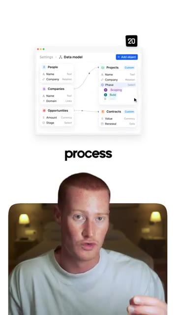
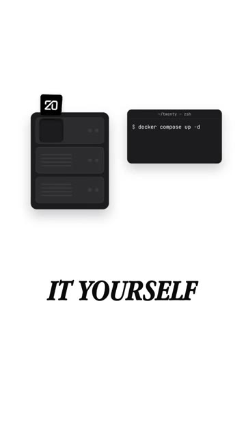

# 🎬 Stop Paying for Salesforce With This Free GitHub Repo

> **Chaîne** : [Brock Mesarich | AI for Non Techies](https://www.youtube.com/@BrockMesarich)  
> **Lien YouTube** : [https://www.youtube.com/watch?v=FMaimEaappM](https://www.youtube.com/watch?v=FMaimEaappM)  
> **Date de publication** : 20261019  
> **Durée** : 00:00:34  
> **Identifiant vidéo** : `FMaimEaappM`  
> **Transcription & Analyse** : `whisper-v3-large-turbo+gemini-3.5-flash-lite`  

---

## 📌 Synthèse Exécutive & Outils

### 💡 Résumé

Dans cette vidéo incisive, la chaîne *Brock Mesarich | AI for Non Techies* attaque frontalement les coûts exorbitants et la rigidité des logiciels SaaS traditionnels en proposant une alternative open-source disruptive : **Twenty**. Présenté comme un CRM moderne doté de plus de 40 000 étoiles sur GitHub, cet outil rivalise directement avec les mastodontes du marché tels que Salesforce et HubSpot. L'analyse met en lumière un basculement stratégique majeur pour les entreprises : abandonner les abonnements logiciels lourds et onéreux au profit d'infrastructures souveraines, hautement personnalisables et auto-hébergées. 

Au-delà de la simple gestion des contacts et des pipelines de vente, la démonstration insiste sur la flexibilité structurelle de la plateforme. Contrairement aux solutions propriétaires qui imposent un cadre rigide et forcent les équipes commerciales à contourner le système avec des outils parallèles, Twenty permet d'adapter l'architecture logicielle aux processus métiers réels (comme la gestion complexe de réseaux de partenaires). Cette approche s'inscrit dans une tendance globale d'automatisation et d'optimisation des coûts opérationnels, où l'intelligence artificielle et les dépôts open-source se combinent pour redonner le contrôle total des données et des flux de travail aux utilisateurs, qu'ils soient technophiles ou non.

---

### 🛠️ Outils, Modèles & Logiciels Présentés

* **Twenty** : CRM open-source hautement personnalisable et auto-hégrable, alternative directe et gratuite à Salesforce et HubSpot, cumulant plus de 40 000 étoiles sur GitHub.
* **GitHub** : Plateforme de développement collaborative utilisée pour héberger, partager et auditer le code source du CRM open-source présenté.
* **Salesforce** : Logiciel CRM propriétaire de référence, mentionné comme solution coûteuse et rigide subissant l'alternative open-source.
* **HubSpot** : Plateforme CRM et inbound marketing de premier plan, servant de point de comparaison standard face à la flexibilité de Twenty.
* **ChatGPT** : Modèle de langage de grande taille d'OpenAI évoqué dans l'écosystème global d'automatisation et d'assistance technique pour les non-techniciens.
* **Claude** : Assistant conversationnel avancé d'Anthropic, utilisé pour la génération de code, l'analyse stratégique et l'ingénierie de prompts.
* **Grok** : Modèle d'intelligence artificielle conversationnelle développé par xAI, intégré dans les flux de recherche et d'optimisation de processus.
* **Gemini** : Intelligence artificielle multimodale de Google, mobilisable pour le traitement de données et l'optimisation des architectures logicielles.
* **n8n** : Plateforme d'automatisation de flux de travail (workflow automation) orientée open-source et auto-hébergement, idéale pour connecter les applications entre elles.
* **Zapier** : Solution SaaS leader d'automatisation no-code permettant de relier rapidement des applications tierces au nouveau CRM.
* **Make** : Plateforme avancée d'intégration et d'automatisation visuelle (anciennement Integromat) pour concevoir des scénarios complexes de synchronisation de données.

---

### 🔑 Points Clés & Enseignements Stratégiques

* **Affranchissement des coûts SaaS récurrents** : Remplacer des abonnements CRM lourds (Salesforce, HubSpot) par un dépôt open-source gratuit élimine les frais fixes et améliore immédiatement la marge opérationnelle.
* **Souveraineté et contrôle des données** : L'auto-hébergement (*self-hosting*) garantit une confidentialité totale et un contrôle absolu sur les actifs informationnels de l'entreprise, évitant la dépendance envers un tiers.
* **Personnalisation structurelle vs Modèles préconçus** : Finie l'obligation d'adapter les processus de l'entreprise aux limites logicielles d'un CRM standard ; l'architecture de Twenty se modèle sur mesure autour du cycle de vente réel.
* **Éradication des "Shadow Systems"** : En alignant l'outil sur les besoins spécifiques de l'équipe (ex: suivi précis des apporteurs d'affaires et des réseaux de partenaires), on empêche les commerciaux de recourir à des tableurs parallèles non sécurisés.
* **Exploitation de la puissance communautaire (GitHub)** : Un projet open-source cumulant plus de 40 000 étoiles bénéficie d'une dynamique de développement rapide, d'une sécurité audités par la communauté et d'une pérennité élevée.
* **Synergie entre IA et outils open-source** : L'utilisation conjointe de modèles de pointe (Claude, ChatGPT, Gemini, Grok) facilite grandement le déploiement, la configuration et la maintenance de solutions techniques complexes pour les profils non-techniciens (*AI for Non Techies*).
* **Intégration transparente dans les écosystèmes d'automatisation** : La structure ouverte de Twenty permet de le connecter sans friction aux moteurs d'automatisation leaders comme **n8n**, **Zapier** ou **Make** pour déclencher des actions instantanées post-vente.
* **Optimisation du pipeline de vente** : Centraliser les contacts, les transactions et les étapes de conversion dans une interface fluide fluidifie le parcours client et accélère les cycles de décision.
* **Stratégie d'acquisition axée sur l'engagement** : L'appel à l'action (« commentez 20 ») démontre une tactique marketing moderne basée sur l'interaction sociale et la distribution directe de ressources à forte valeur ajoutée.
* **Agilité organisationnelle accrue** : Disposer d'un CRM que l'on contrôle de bout en bout permet d'itérer rapidement sur les stratégies commerciales sans subir la lourdeur des processus de migration des grands éditeurs.

---

## ⏱️ Chronologie & Transcription Complète Audio & Visuelle (Mot pour Mot)

### ⏱️ `[00:00:00 - 00:00:22]` | Segment #01

**🔊 Audio (Transcription Intégrale Mot pour Mot en Français) :**
> Arrêtez de payer pour Salesforce. Ce dépôt GitHub gratuit est un CRM que vous pouvez contrôler. Il s'appelle Twenty. Il fonctionne comme Salesforce ou HubSpot et il a plus de 40 000 étoiles sur GitHub. Vous obtenez des contacts, des transactions et un pipeline de vente tout comme avec les grands outils. Mais voici la différence. Vous pouvez le structurer autour de votre propre processus. Disons que vous vendez par l'intermédiaire de partenaires. Vous avez besoin de savoir qui a présenté qui et ce qui se passe ensuite.

**👁️ Analyse Visuelle d'Écran (gemini-3.5-flash-lite) :**
**Interface & Outils** : Interface web du CRM Twenty (Data model / Paramètres).

**Contenu textuel & Code** : Modèle de données montrant les relations entre différentes entités : People, Companies, Opportunities, Projects et Contracts.

**Action / Démonstration** : Présentation de la structure et des relations de données du CRM open source Twenty.

*⏱️ 00:00:16 — Présentateur en bas et interface de configuration du modèle de données du CRM Twenty en haut, avec le mot "process" affiché au milieu.*

---

### ⏱️ `[00:00:22 - 00:00:34]` | Segment #02

**🔊 Audio (Transcription Intégrale Mot pour Mot en Français) :**
> Eh bien, dans cette application appelée 20, vous la configurez pour correspondre à cela. Pas besoin de l'imposer dans le modèle de quelqu'un d'autre. Le meilleur, c'est que vous pouvez l'héberger vous-même gratuitement. De cette façon, votre équipe arrête de garder un deuxième suivi de côté. Alors commentez 20 et je vous enverrai le dépôt.

**👁️ Analyse Visuelle d'Écran (gemini-3.5-flash-lite) :**
**Interface & Outils** : Interface de l'application Twenty et terminal de commande (zsh)

**Contenu textuel & Code** : Commande Docker Compose pour l'auto-hébergement (self-hosting) de l'application Twenty : `docker compose up -d`

**Action / Démonstration** : Démonstration de la configuration et de l'auto-hébergement de l'application via Docker.

*⏱️ 00:00:28 — Illustration du logiciel "Twenty" avec une interface de serveur et une invite de terminal affichant la commande "docker compose up -d".*

---

