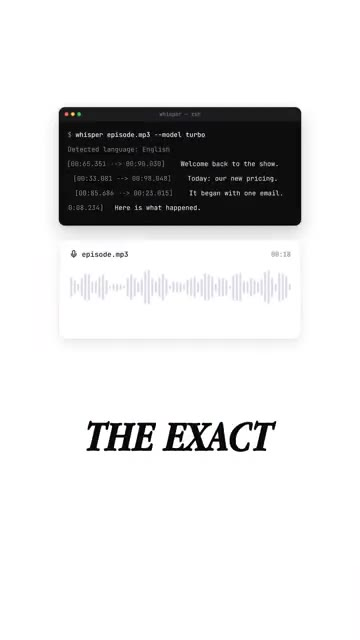
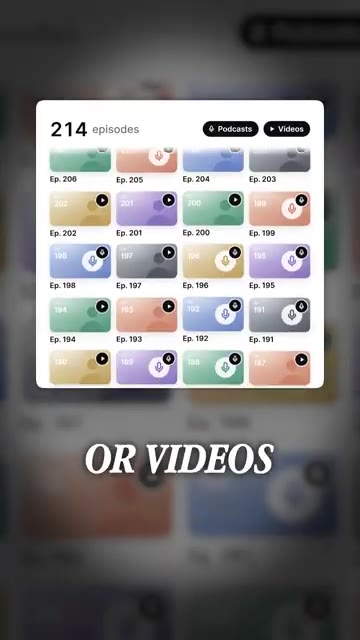

# 🎬 OpenAI's Free GitHub Repo Turns Old Videos Into Searchable Text

> **Chaîne** : [Brock Mesarich | AI for Non Techies](https://www.youtube.com/@BrockMesarich)  
> **Lien YouTube** : [https://www.youtube.com/watch?v=B0iegKVPbTo](https://www.youtube.com/watch?v=B0iegKVPbTo)  
> **Date de publication** : 20261020  
> **Durée** : 00:00:32  
> **Identifiant vidéo** : `B0iegKVPbTo`  
> **Transcription & Analyse** : `whisper-v3-large-turbo+gemini-3.5-flash-lite`  

---

## 📌 Synthèse Exécutive & Outils

### 💡 Résumé

La vidéo de la chaîne de Brock Mesarich met en lumière une solution open-source majeure développée par OpenAI : Whisper. Ce dépôt GitHub gratuit s'attaque à la problématique de la valorisation des archives multimédias en transformant de vracs d'enregistrements audio et vidéo en une base de données textuelle hautement interrogeable, indexée temporellement. En automatisant la transcription phonétique et l'horodatage précis de chaque énoncé, l'outil permet de naviguer à travers des heures de contenu audiovisuel avec la même aisance que dans un document textuel, éliminant ainsi la perte d'information inhérente aux archives non structurées.

Bien que la vidéo ne traite pas directement de trading quantitatif ou de marchés financiers, l'approche méthodologique présentée résonne fortement avec l'ingénierie des données appliquée aux stratégies algorithmiques. Dans le domaine du trading haute fréquence ou de l'analyse fondamentale automatisée, la capacité à ingérer, structurer et interroger rapidement des flux de données non structurées (tels que des webinaires financiers, des earnings calls, des interviews de banquiers centraux ou des flux audio de marchés) constitue un avantage informationnel décisif. L'utilisation d'outils d'intelligence artificielle pour transformer des signaux audio bruts en données exploitables par des modèles de traitement du langage naturel (NLP) s'inscrit directement dans une logique d'automatisation et d'optimisation du *Time-to-Insight*.

En associant Whisper à des écosystèmes d'automatisation et de grands modèles de langage, les créateurs de contenu et les analystes peuvent industrialiser le retraitement de leurs actifs numériques. La traduction multilingue native et la génération automatisée de métadonnées (sous-titres, notes de synthèse, publications) démontrent comment l'IA générative et l'automatisation des flux de travail permettent de maximiser le retour sur investissement d'archives dormantes. Cette approche démontre l'efficacité opérationnelle permise par le couplage d'outils open-source et de pipelines de données intelligents.

### 🛠️ Outils, Modèles & Logiciels Présentés

* **Whisper** : Modèle de reconnaissance vocale open-source d'OpenAI hébergé sur GitHub, conçu pour transcrire et horodater avec précision des flux audio et vidéo tout en prenant en charge la traduction multilingue.
* **ChatGPT** : Modèle conversationnel d'OpenAI susceptible d'être couplé aux transcriptions textuelles pour générer des notes d'émission, des résumés ou du contenu dérivé.
* **Claude** : Assistant IA avancé d'Anthropic pouvant être mobilisé pour l'analyse sémantique approfondie et le traitement des données textuelles issues des transcriptions.
* **Gemini** : Modèle multimodal de Google capable d'analyser et de synthétiser de larges volumes de données textuelles et audiovisuelles.
* **Grok** : Modèle d'intelligence artificielle développé par xAI, utile pour le traitement rapide et la recherche d'informations en temps réel.
* **n8n** : Plateforme d'automatisation de flux de travail (workflow automation) open-source et flexible, idéale pour connecter des scripts de transcription à d'autres applications.
* **Zapier** : Outil d'automatisation no-code permettant de relier facilement les applications cloud entre elles pour déclencher des actions post-transcription.
* **Make** : Plateforme d'intégration visuelle avancée conçue pour concevoir, automatiser et complexifier des pipelines de données sans coder.
* **Prompt Engineering** : Discipline consistant à concevoir et optimiser les instructions textuelles transmises aux modèles d'IA pour affiner la pertinence des résultats générés à partir des transcriptions.

### 🔑 Points Clés & Enseignements Stratégiques

* **Indexation temporelle des flux non structurés** : La capacité à associer chaque mot transcrit à son horodatage exact transforme des fichiers multimédias passifs en bases de données dynamiques et requêtables.
* **Valorisation des actifs numériques dormants** : La transformation d'anciennes archives vidéo et audio en texte permet de réactiver des flux de contenu obsolètes pour générer de nouvelles sources de valeur ou de trafic.
* **Accessibilité et gratuité de l'infrastructure open-source** : L'utilisation d'un dépôt GitHub gratuit comme Whisper démocratise l'accès à des technologies de pointe de transcription vocale sans nécessiter d'investissements logiciels lourds.
* **Capacités de traduction multilingue intégrées** : Au-delà de la simple retranscription, l'outil gère nativement de nombreuses langues et assure leur conversion directe en anglais, élargissant la portée des analyses.
* **Automatisation de la chaîne de production de contenu** : La transcription brute sert de matière première automatisée pour générer instantanément des sous-titres, des notes de synthèse ou des articles de blog.
* **Optimisation de la recherche sémantique** : La possibilité de taper un mot-clé pour sauter immédiatement au moment précis de son énonciation réduit drastiquement le temps de recherche d'information dans de longs enregistrements.
* **Synergie avec l'écosystème d'automatisation no-code** : L'intégration potentielle de ces scripts avec des outils comme n8n, Zapier ou Make permet d'industrialiser l'ensemble du pipeline, de l'ingestion du fichier à sa publication finale.
* **Amélioration du *Time-to-Insight*** : Réduire le temps nécessaire pour fouiller dans des heures de vidéo permet aux analystes et créateurs de capitaliser beaucoup plus rapidement sur leurs connaissances passées.
* **Exploitation des modèles de langage (LLM)** : Les sorties textuelles de Whisper peuvent être injectées dans des modèles comme ChatGPT, Claude, Gemini ou Grok pour effectuer des analyses de sentiment ou des extractions de concepts clés.
* **Application potentielle aux données financières non structurées** : Bien que ciblant les créateurs de contenu, la méthodologie s'applique parfaitement à l'analyse automatisée de flux audio boursiers, de conférences téléphoniques de résultats ou d'interviews économiques.

---

## ⏱️ Chronologie & Transcription Complète Audio & Visuelle (Mot pour Mot)

### ⏱️ `[00:00:00 - 00:00:18]` | Segment #01

**🔊 Audio (Transcription Intégrale Mot pour Mot en Français) :**
> OpenAI a un dépôt GitHub gratuit qui transforme vos anciennes vidéos en texte interrogeable. Il s'appelle Whisper. Il écoute n'importe quel enregistrement et écrit chaque mot, et il marque l'heure exacte où chaque ligne a été prononcée. Donc, si vous avez des centaines de vieux podcasts ou vidéos, vous pouvez les parcourir comme un document. Tapez un sujet, sautez directement au moment où vous l'avez dit.

**👁️ Analyse Visuelle d'Écran (gemini-3.5-flash-lite) :**
**Interface & Outils** : Terminal de commande, interface d'application de gestion de podcasts/vidéos.

**Contenu textuel & Code** : Commande CLI `$ whisper episode.mp3 --model turbo`, détection de langue anglaise, horodatages de transcription (`00:05.351`), graphiques d'onde audio, grille de 214 épisodes.

**Action / Démonstration** : Exécution d'une commande de transcription audio et affichage d'une bibliothèque de podcasts.

*⏱️ 00:00:09 — Interface de terminal montrant l'exécution de la commande whisper avec transcription textuelle et horodatages, ainsi qu'une forme d'onde audio.*

*⏱️ 00:00:14 — Interface montrant une liste de 214 épisodes de podcasts et vidéos avec des vignettes colorées numérotées.*

---

### ⏱️ `[00:00:18 - 00:00:32]` | Segment #02

**🔊 Audio (Transcription Intégrale Mot pour Mot en Français) :**
> Et ça fonctionne dans de nombreuses langues différentes. Ça peut même les traduire en anglais. Ensuite, il peut utiliser cette transcription pour des sous-titres, des notes d'émission ou de nouvelles publications. Vos anciens épisodes arrêtent donc de prendre la poussière. Si vous voulez redonner vie à vos anciennes vidéos, commentez Whisper et je vous enverrai le dépôt.

**👁️ Analyse Visuelle d'Écran (gemini-3.5-flash-lite) :**
**Interface & Outils** : Interface vidéo verticale présentant des animations graphiques de flux de données textuelles et de traduction.

**Contenu textuel & Code** : Schémas d'arborescence textuelle illustrant le traitement de fichiers audio/texte (.txt, .srt, .vtt, .tsv, .json) et la génération de contenu dérivé.

**Action / Démonstration** : Explication visuelle de la traduction multilingue et de la réutilisation des transcriptions pour créer des sous-titres et des notes d'émission.

---

