# 🎬 Anthropic Just Dropped the Grok Bot Killer? (Claude Duet)

> **Chaîne** : [Brock Mesarich | AI for Non Techies](https://www.youtube.com/@BrockMesarich)  
> **Lien YouTube** : [https://www.youtube.com/watch?v=nv1aaP3dHzs](https://www.youtube.com/watch?v=nv1aaP3dHzs)  
> **Date de publication** : 20261021  
> **Durée** : 00:07:39  
> **Identifiant vidéo** : `nv1aaP3dHzs`  
> **Transcription & Analyse** : `whisper-v3-large-turbo+gemini-3.5-flash-lite`  

---

## 📌 Synthèse Exécutive & Outils

### 💡 Résumé
Dans cette vidéo intitulée **Anthropic vient de lancer le tueur de Grok Bots ? (Claude Duet)**, Alex Carter détaille une approche stratégique et pratique du trading et de l'automatisation par agents IA.

### 🛠️ Outils, Modèles & Logiciels Présentés
- **TradingView & Claude Code** : Analyse technique avancée et automatisation algorithmique.

### 🔑 Points Clés & Enseignements Stratégiques
- Respect rigoureux du ratio risque/rendement et du money management.
- Automatisation méthodique des déclencheurs d'ordres via des agents intelligents.

---

## ⏱️ Chronologie & Transcription Complète Audio & Visuelle (Mot pour Mot)

### ⏱️ `[00:00:00 - 00:00:20]` | Segment #01

**🔊 Audio (Transcription Intégrale Mot pour Mot en Français) :**
> Anthropic vient tout juste de sortir son propre agent IA personnel, et il vient rivaliser avec GrokBot, Chachabiti, Dots et Metamuse. Il s'appelle Claude Duet, et c'est une manière plus intuitive pour vous d'utiliser l'IA, où elle peut travailler pour vous et communiquer comme le ferait un vrai coéquipier. Dans cette courte vidéo, je vais vous expliquer exactement ce qu'il fait, qui peut l'utiliser, et le seul bémol que vous devriez connaître.

**👁️ Analyse Visuelle d'Écran (gemini-3.5-flash-lite) :**
**Interface & Outils** : Interface visuelle conceptuelle / maquette de notification de l'agent IA Claude Duet.

**Contenu textuel & Code** : Icônes de Grok Bot, ChatGPT Dots et Claude Duet ; notification textuelle de l'agent : "Morning, Nicole! For today: Health permit. Hiring decisions. Northfield renewal.".

**Action / Démonstration** : Présentation introductive des fonctionnalités du nouvel agent IA personnel Claude Duet et comparaison avec les solutions concurrentes.

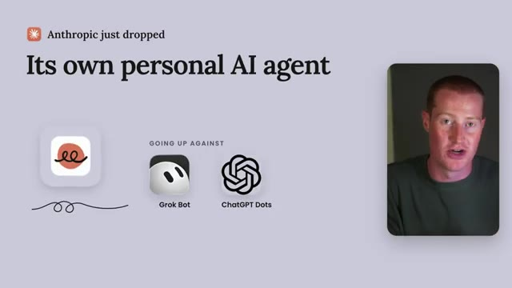
*⏱️ 00:00:05 — Graphique de présentation affichant le lancement de l'agent IA d'Anthropic face aux concurrents Grok Bot et ChatGPT Dots.*

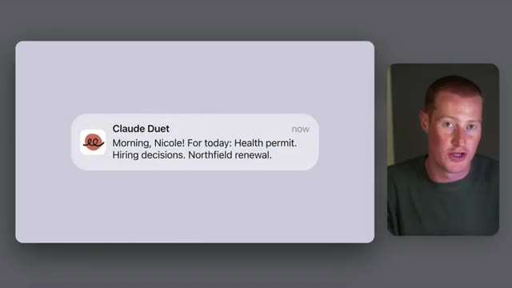
*⏱️ 00:00:10 — Aperçu d'une notification de l'interface Claude Duet envoyant un message de suivi de tâches quotidiennes.*

---

### ⏱️ `[00:00:20 - 00:00:39]` | Segment #02

**🔊 Audio (Transcription Intégrale Mot pour Mot en Français) :**
> Nous allons également examiner une grande différence entre Anthropic et GrokBot qui, selon moi, aura beaucoup d'importance. Donc, sans plus attendre, plongeons-y directement. Très bien, alors passons en revue l'article réel qu'Anthropic a publié en commençant tout en haut. Anthropic affirme avoir conçu Claude Duet pour les professionnels et les propriétaires de petites entreprises qui ont plus de pain sur la planche qu'ils ne peuvent en suivre.

**👁️ Analyse Visuelle d'Écran (gemini-3.5-flash-lite) :**
**Interface & Outils** : Navigateur web affichant l'article officiel d'Anthropic sur Claude Duet.

**Contenu textuel & Code** : Texte surligné : « We built Claude Duet for professionals and small business owners with more on their plates than their can track. »

**Action / Démonstration** : Le présentateur commente l'article publié par Anthropic pour souligner la cible du produit.

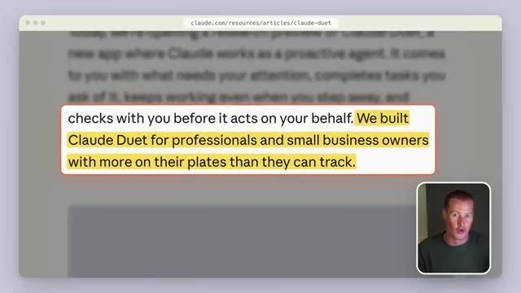
*⏱️ 00:00:34 — Capture d'écran d'un article en ligne sur claude.com avec un paragraphe surligné en jaune encadré de rouge.*

---

### ⏱️ `[00:00:39 - 00:01:04]` | Segment #03

**🔊 Audio (Transcription Intégrale Mot pour Mot en Français) :**
> Donc, c'est vraiment destiné aux personnes qui gèrent une entreprise, pas seulement aux développeurs comme Claude Code. C'est une application autonome sur iPhone et Android, et vous pouvez également l'utiliser sur Claude.ai. Maintenant, pour cet aperçu de recherche, c'est inclus dans les abonnements Pro et Max, vous devrez donc disposer d'un abonnement payant pour y accéder. Donc, si vous payez déjà pour Claude, vous n'aurez rien à payer de plus, mais pour l'instant, c'est uniquement sur liste d'attente et c'est seulement aux États-Unis.

**👁️ Analyse Visuelle d'Écran (gemini-3.5-flash-lite) :**
**Interface & Outils** : Navigateur web affichant un article d'aide ou de blog de la plateforme Claude.ai.

**Contenu textuel & Code** : Texte surligné expliquant que l'application est disponible sur iOS, Android et Claude.ai.

**Action / Démonstration** : Le présentateur commente le texte affiché à l'écran concernant la disponibilité de l'application.

---

### ⏱️ `[00:01:04 - 00:01:27]` | Segment #04

**🔊 Audio (Transcription Intégrale Mot pour Mot en Français) :**
> Ensuite vient une partie qui, je pense, a probablement le plus d'importance, qu'Anthropic appelle porter votre attention là où c'est le plus important. Chaque matin, Duet vous envoie un bref résumé des tâches les plus importantes à travers les applications que vous avez connectées. Ensuite, tout au long de la journée, il garde un œil sur ces applications et ne vous envoie un message que lorsque quelque chose requiert réellement votre attention. Ainsi, au lieu que ce soit nous qui allions voir Claude pour lui poser une question ou lui donner une tâche, cela va être plus proactif.

**👁️ Analyse Visuelle d'Écran (gemini-3.5-flash-lite) :**
**Interface & Outils** : Interface de concept Claude Duet (Anthropic) / maquette UI mobile et messagerie

**Contenu textuel & Code** : Textes : "Something I can do right now: Make a sales dashboard for your business based on the latest numbers." / "Go for it!" ; "A brief each morning, then quiet", notification "Claude Duet 7:30 am - Morning! Two things need you today and three are in progress."

**Action / Démonstration** : Présentation du fonctionnement du concept d'assistant Claude Duet (notifications matinales et exécution autonome de tâches).

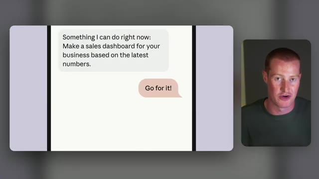
*⏱️ 00:01:10 — Interface de messagerie montrant une suggestion proactive de Claude Duet proposant de créer un tableau de bord des ventes, avec une réponse de l'utilisateur "Go for it!".*

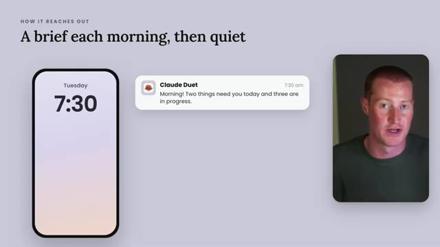
*⏱️ 00:01:15 — Diapositive de présentation montrant une notification matinale de Claude Duet sur smartphone : "Morning! Two things need you today and three are in progress."*

---

### ⏱️ `[00:01:27 - 00:01:47]` | Segment #05

**🔊 Audio (Transcription Intégrale Mot pour Mot en Français) :**
> Anthropic a également dit que c'est basé sur Claude Opus 5.5, et c'est un modèle qui va décider de ce qui a besoin de vous, de ce qui peut attendre, et du moment où il faut vérifier avec vous d'abord avant d'aller faire quelque chose. Maintenant, parlons de quelques exemples qu'Anthropic a montrés dans sa vidéo de lancement. Tout d'abord, ils ont montré une propriétaire de café à qui on annonce que son nouvel établissement ouvre dans 26 jours, et qu'elle n'a toujours pas déposé son permis sanitaire.

**👁️ Analyse Visuelle d'Écran (gemini-3.5-flash-lite) :**
**Interface & Outils** : Navigateur web (claude.com), interface de notifications et messagerie d'agent IA (Claude Duet / Anthropic).

**Contenu textuel & Code** : URL "claude.com/resources/articles/claude-duet", texte explicatif sur Claude Opus 5.5, notifications de statut, document joint "Health-permit.pdf" et slogan de démonstration "and tells you what can wait".

**Action / Démonstration** : Démonstration visuelle des capacités d'autonomie, de gestion proactive de tâches et de priorisation de l'agent Claude Duet.

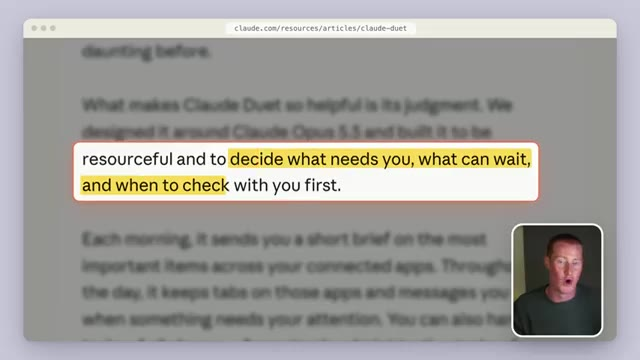
*⏱️ 00:01:32 — Page web de l'article officiel sur claude.com avec texte surligné décrivant le fonctionnement de Claude Duet basé sur Claude Opus 5.5.*

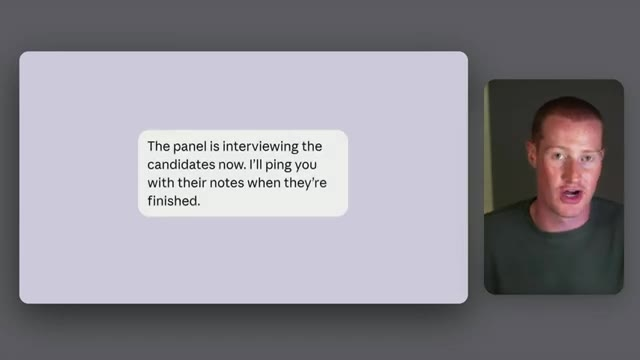
*⏱️ 00:01:37 — DÉMO de message de notification automatique généré par l'agent Claude Duet concernant le suivi d'entretiens.*

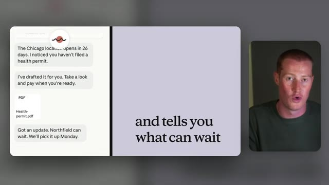
*⏱️ 00:01:42 — Interface de l'assistant Claude Duet affichant la création automatique d'un permis de santé au format PDF et la gestion des priorités.*

---

### ⏱️ `[00:01:47 - 00:02:12]` | Segment #06

**🔊 Audio (Transcription Intégrale Mot pour Mot en Français) :**
> Duet le rédige pour elle et lui dit aussi qu'un renouvellement client peut attendre jusqu'à lundi. Vous pouvez également lui confier une tâche plus importante comme la création de tableaux de bord, de prévisions de ventes ou même d'applications web. Maintenant, je tiens à être transparent ici, car cette partie n'est pas totalement nouvelle. ChatGPT, les Custom GPTs, GrokBot et Metamuse peuvent déjà faire des choses comme ça, mais ce qui est différent ici, c'est que c'est désormais directement à l'intérieur de l'écosystème d'Anthropic et de Claude.

**👁️ Analyse Visuelle d'Écran (gemini-3.5-flash-lite) :**
**Interface & Outils** : Interface de chat / assistant virtuel IA (Google Duet AI / Google Workspace)

**Contenu textuel & Code** : Dialogue textuel : "Something I can do right now: Make a sales dashboard for your business based on the latest numbers.", réponse "Go for it!", suivi de la confirmation d'extraction depuis le CRM, la boutique en ligne, le support et la banque.

**Action / Démonstration** : Démonstration de la capacité d'un assistant IA à exécuter des tâches complexes comme la consolidation de données et la génération automatique de tableaux de bord.

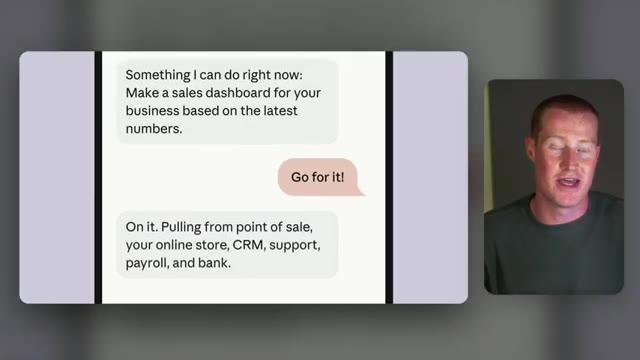
*⏱️ 00:01:54 — Interface de discussion montrant un échange textuel avec un assistant IA qui propose de générer un tableau de bord de ventes en extrait des données de plusieurs sources (CRM, boutique en ligne, banque).*

---

### ⏱️ `[00:02:12 - 00:02:31]` | Segment #07

**🔊 Audio (Transcription Intégrale Mot pour Mot en Français) :**
> Donc, si vous êtes un utilisateur assidu de Claude, que vous utilisez Claude Code ou ces différents produits Claude, alors ceci est pour vous. Ensuite, je veux parler de sécurité, ce qui est vraiment très important pour quelque chose qui va lire vos e-mails et toutes les différentes applications que vous utilisez. Anthropic affirme que Claude Duet ne voit jamais directement vos mots de passe ni aucun de vos jetons de connexion.

**👁️ Analyse Visuelle d'Écran (gemini-3.5-flash-lite) :**
**Interface & Outils** : Schéma graphique d'écosystème logiciel, navigateur web (article de documentation claude.com).

**Contenu textuel & Code** : Titre « Inside Anthropic's own apps » avec icônes de Claude app, Claude Code et Claude Duet ; points clés sur la sécurité des agents, le traitement des identifiants et l'utilisation de l'auto mode classifier.

**Action / Démonstration** : Présentation visuelle de la suite logicielle Anthropic et analyse des caractéristiques de sécurité des agents IA.

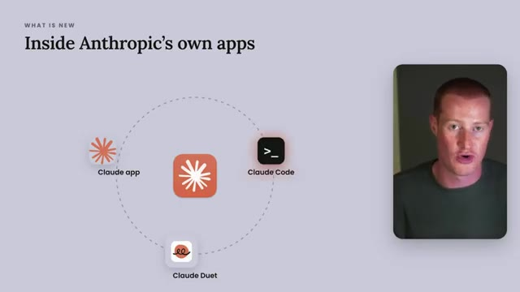
*⏱️ 00:02:17 — Schéma explicatif illustrant l'écosystème des applications Anthropic, incluant Claude app, Claude Code et Claude Duet.*

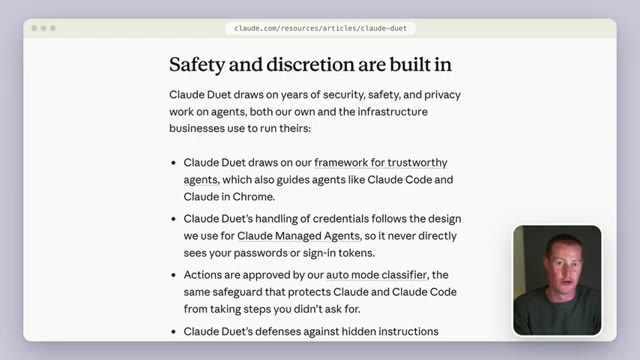
*⏱️ 00:02:21 — Article du site claude.com intitulé « Safety and discretion are built in » détaillant les mesures de sécurité et de confidentialité de Claude Duet et Claude Code.*

---

### ⏱️ `[00:02:31 - 00:02:50]` | Segment #08

**🔊 Audio (Transcription Intégrale Mot pour Mot en Français) :**
> Et ils ont ajouté un nouveau contrôle de sécurité qui refuse de partager quoi que ce soit comme des numéros de carte de crédit ou des pièces d'identité officielles. D'autres informations sensibles, comme votre santé et vos finances personnelles, ne sont envoyées que si vous avez spécifiquement demandé à Duet de les envoyer. Ils ont également fait appel à des « red teams » au sein d'une entreprise externe pour essayer de s'y infiltrer, ce que je trouve plutôt rassurant si vous comptez lui confier votre boîte de réception.

**👁️ Analyse Visuelle d'Écran (gemini-3.5-flash-lite) :**
**Interface & Outils** : Navigateur web (URL : claude.com/resources/articles/claude-duet).

**Contenu textuel & Code** : Textes officiels d'Anthropic détaillant les contrôles de sécurité, le filtrage des données sensibles et les audits de sécurité par Red Teaming pour Claude Duet.

**Action / Démonstration** : Revue et explication à l'écran des politiques de sécurité et de protection des données personnelles introduites pour Claude Duet.

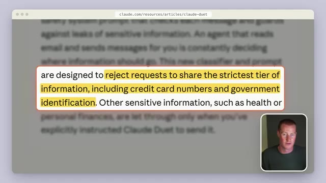
*⏱️ 00:02:36 — Page web de documentation Anthropic mettant en surbrillance le paragraphe expliquant le refus de partage des informations strictement confidentielles (cartes bancaires, pièces d'identité).*

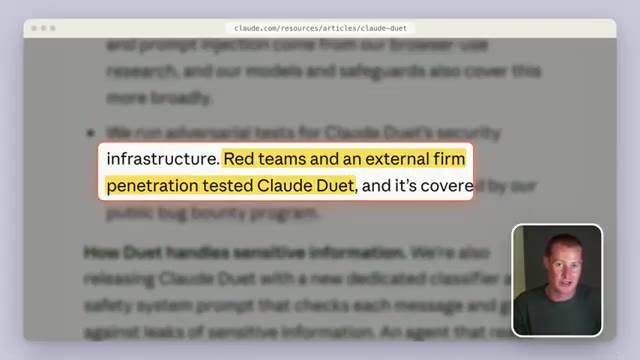
*⏱️ 00:02:45 — Page web de documentation Anthropic soulignant la mention des tests d'intrusion (penetration testing) réalisés par des Red Teams sur Claude Duet.*

---

### ⏱️ `[00:02:50 - 00:03:11]` | Segment #09

**🔊 Audio (Transcription Intégrale Mot pour Mot en Français) :**
> Maintenant, ma partie préférée dans ces articles de lancement, c'est vraiment de voir comment les gens utilisent ce produit. Ainsi, le gars qui a créé Claude Code, appelé Boris, passe en revue sa liste de tâches avec Duet pendant qu'il se promène au lieu de tout garder pour son bureau. Une courtière en immobilier a dit qu'un matin, sans même qu'elle ne lui demande, il a signalé une visite immobilière qui était sur son calendrier le mauvais jour.

**👁️ Analyse Visuelle d'Écran (gemini-3.5-flash-lite) :**
**Interface & Outils** : Présentation ou face-caméra explicatif du trader sans interface logicielle partagée.

**Contenu textuel & Code** : Explications orales des stratégies et mise en contexte méthodologique du marché.

**Action / Démonstration** : Explications face caméra et analyse conceptuelle des marchés.

---

### ⏱️ `[00:03:11 - 00:03:43]` | Segment #10

**🔊 Audio (Transcription Intégrale Mot pour Mot en Français) :**
> And a restaurant owner with 110 employees has been using it for accounting, customer support, and marketing. All right, so now I want to get into how exactly it works because this is where the Anthropic part really matters. Duet carries over your memory, your skills, and the apps you're already connected to from your Claude account. So if you're already using Claude, there's pretty much no setup. And I think this is the most important thing about this release because all this now lives directly inside of the Anthropic ecosystem. And again, if you're already using Claude code and their other products, this is going to be a great fit for you. Now,

**👁️ Analyse Visuelle d'Écran (gemini-3.5-flash-lite) :**
**Interface & Outils** : Aucun logiciel, terminal ou interface de démonstration active.

**Contenu textuel & Code** : Titres de présentation « How Claude Duet works » et mentions conceptuelles « Memory », « Skills », « Apps ».

**Action / Démonstration** : Présentation orale et transition vers la partie explicative du fonctionnement de Claude Duet.

---

### ⏱️ `[00:03:43 - 00:04:17]` | Segment #11

**🔊 Audio (Transcription Intégrale Mot pour Mot en Français) :**
> one thing I do want to point out is that you talk to Duet in one ongoing thread by typing or with your voice. So a quick question in a week-long project, both start in the same place. So it's going to be really interesting to see if Anthropic lets you have multiple agents like you can inside of GrokBot. And that's actually one of the reasons why I genuinely love using the GrokBot platform. Because I can have specific agents for specific jobs that communicate with each other and work together. And this way I can break up the different tasks that I have. So if I want to do anything invoice related, I could go to that specific invoice agent. And this way, all of my

**👁️ Analyse Visuelle d'Écran (gemini-3.5-flash-lite) :**
**Interface & Outils** : Diaporama de présentation comparant l'interface à fil unique (Claude Duet) et l'architecture multi-agents (Grok Bot).

**Contenu textuel & Code** : Intitulé "One thread, or a team of agents", exemples de prompts/tâches ("Quick question about Friday?", "Weeklong project plan", "Invoices for this month"), et modules d'agents Grok Bot ("Invoices", "Email", "Research").

**Action / Démonstration** : Explication conceptuelle de la différence ergonomique et structurelle entre converser dans un fil unique continu et utiliser une équipe d'agents IA spécialisés.

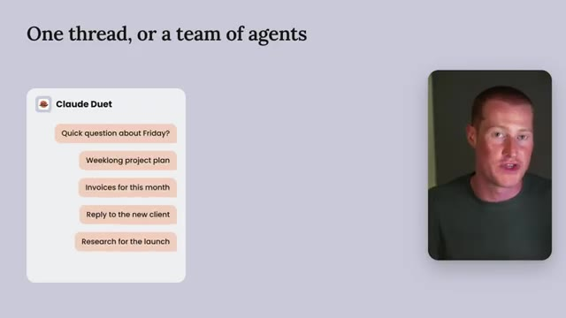
*⏱️ 00:03:51 — Diapositive "One thread, or a team of agents" montrant un schéma de fil de conversation unique pour Claude Duet regroupant plusieurs requêtes.*

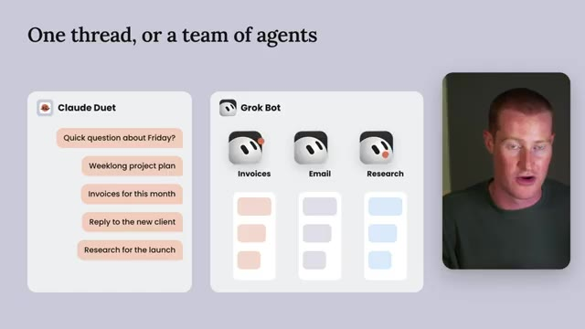
*⏱️ 00:04:08 — Schéma comparatif entre l'interface à fil unique de Claude Duet et une structure multi-agents avec Grok Bot (agents dédiés Invoices, Email, Research).*

---

### ⏱️ `[00:04:17 - 00:04:50]` | Segment #12

**🔊 Audio (Transcription Intégrale Mot pour Mot en Français) :**
> les différentes conversations ne se mélangent pas. En plus de tout cela, il possède également son propre ordinateur dans le cloud avec son propre navigateur. Il n'a donc pas besoin que votre téléphone ou votre ordinateur portable soit allumé pour continuer à fonctionner. Et encore une fois, c'est quelque chose de très similaire que Grokbot et Metamuse, Chachabuti dots ont tous en commun. En gros, il va vérifier vos comptes connectés toutes les quelques heures au lieu de le faire sans arrêt, car s'il le faisait en continu, il épuiserait vos limites beaucoup plus vite, évidemment. Et avant d'envoyer un message, d'effectuer un paiement, de signer un document ou de supprimer quoi que ce soit, il vous montre exactement ce qu'il s'apprête à faire et attend votre approbation.

**👁️ Analyse Visuelle d'Écran (gemini-3.5-flash-lite) :**
**Interface & Outils** : Présentation ou face-caméra explicatif du trader sans interface logicielle partagée.

**Contenu textuel & Code** : Explications orales des stratégies et mise en contexte méthodologique du marché.

**Action / Démonstration** : Explications face caméra et analyse conceptuelle des marchés.

---

### ⏱️ `[00:04:50 - 00:05:24]` | Segment #13

**🔊 Audio (Transcription Intégrale Mot pour Mot en Français) :**
> Maintenant, il y a quelques choses qui sont interdites, même si vous les approuvez, comme négocier des actions ou déplacer de l'argent entre vos différents comptes. Ensuite, cela fonctionne avec plus de 6 000 connecteurs et plugins, et Anthropic donne un tas d'exemples pour gérer une entreprise. Il peut donc consulter QuickBooks ou Stripe pour les factures impayées et même rédiger les rappels. Il peut préparer votre paie dans Gusto ou même préparer un contrat à signer dans DocuSign. Très bien, cela nous amène donc au piège, qui se trouve tout en bas de l'article. Duet partage vos limites d'utilisation avec le reste de Claude et ses vérifications en arrière-plan comptent pour ces limites. Les tâches plus importantes comme

**👁️ Analyse Visuelle d'Écran (gemini-3.5-flash-lite) :**
**Interface & Outils** : Présentation ou face-caméra explicatif du trader sans interface logicielle partagée.

**Contenu textuel & Code** : Explications orales des stratégies et mise en contexte méthodologique du marché.

**Action / Démonstration** : Explications face caméra et analyse conceptuelle des marchés.

---

### ⏱️ `[00:05:24 - 00:06:02]` | Segment #14

**🔊 Audio (Transcription Intégrale Mot pour Mot en Français) :**
> building a deck or a financial model use even more of your tokens. So if you're already running into your Claude limits, this is probably going to eat them even quicker. But one thing I do want to point out is since I've been using Claude Opus 5.5, it's really efficient at spending my token. So it's actually not eating through nearly as much as it used to when I use Claude inside of Claude code for even the really complex workflows that I'm running. So I want to talk about all the other AI agents right now. Grokbot came out back in August, then Meta launched Muse in September, and OpenAI announced ChatGPT dots inside of ChatGPT just a couple of weeks ago. And now we

**👁️ Analyse Visuelle d'Écran (gemini-3.5-flash-lite) :**
**Interface & Outils** : Interface vidéo éducative avec graphiques animés d'explication conceptuelle.

**Contenu textuel & Code** : Schémas conceptuels de répartition de tokens et chronologies d'utilisation d'IA.

**Action / Démonstration** : Le présentateur explique les limites de consommation des tokens et la gestion des ressources des IA.

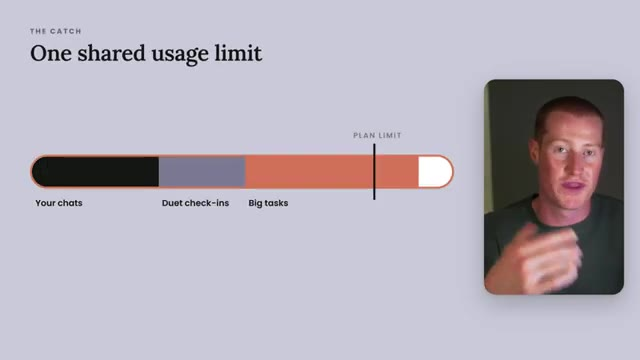
*⏱️ 00:05:34 — Schéma explicatif sur les limites d'utilisation partagées ("One shared usage limit") montrant la répartition des tokens entre les chats, les check-ins et les tâches lourdes, avec la webcam du présentateur à droite.*

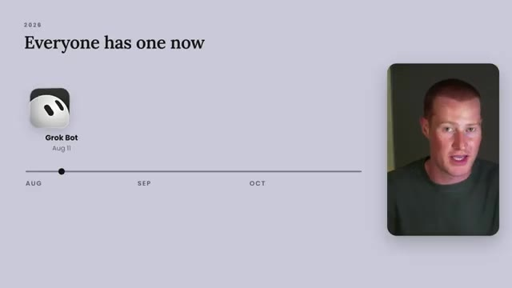
*⏱️ 00:05:52 — Chronologie horizontale intitulée "Everyone has one now" avec une icône de bot ("Grok Bot") datée du 11 août, et la webcam du présentateur incrustée dans le coin inférieur droit.*

---

### ⏱️ `[00:06:02 - 00:06:20]` | Segment #15

**🔊 Audio (Transcription Intégrale Mot pour Mot en Français) :**
> have Claude Duet. I don't think it's rocket science to think that this is going to be the future of how we use AI. Basically having an always-on assistant that lives inside of our pocket on our phone that we can communicate with instead of having to be at our computer to get work done for us. So now it really just boils down to which one of these platforms you're actually going to use.

**👁️ Analyse Visuelle d'Écran (gemini-3.5-flash-lite) :**
**Interface & Outils** : Présentation ou face-caméra explicatif du trader sans interface logicielle partagée.

**Contenu textuel & Code** : Explications orales des stratégies et mise en contexte méthodologique du marché.

**Action / Démonstration** : Explications face caméra et analyse conceptuelle des marchés.

---

### ⏱️ `[00:06:20 - 00:06:43]` | Segment #16

**🔊 Audio (Transcription Intégrale Mot pour Mot en Français) :**
> Now personally I've been using GrokBot as my main daily driver over the last two months and it has completely changed how I work from my computer. I've been using it every single day. I have it replying to basically all of my emails for me. It has saved me so much time and so much headache. So for me personally, I don't even know if I'm going to switch from GrokBot to this new Claude Duet because I've just really been enjoying the experience with GrokBot.

**👁️ Analyse Visuelle d'Écran (gemini-3.5-flash-lite) :**
**Interface & Outils** : Présentation ou face-caméra explicatif du trader sans interface logicielle partagée.

**Contenu textuel & Code** : Explications orales des stratégies et mise en contexte méthodologique du marché.

**Action / Démonstration** : Explications face caméra et analyse conceptuelle des marchés.

---

### ⏱️ `[00:06:43 - 00:07:09]` | Segment #17

**🔊 Audio (Transcription Intégrale Mot pour Mot en Français) :**
> And one of the things that makes GrokBot really interesting is that it doesn't only work with the Grok models because earlier this month, Elon posted that GrokBot is going to use the best model for any given task. And one of the models he named was Claude Opus 5.5. Now, to be fair, Elon's post is the only official source on this so far, so we don't really know which models are being used inside of GrokBot for these different tasks, but Elon said that they are going to be implementing this.

**👁️ Analyse Visuelle d'Écran (gemini-3.5-flash-lite) :**
**Interface & Outils** : Présentation ou face-caméra explicatif du trader sans interface logicielle partagée.

**Contenu textuel & Code** : Explications orales des stratégies et mise en contexte méthodologique du marché.

**Action / Démonstration** : Explications face caméra et analyse conceptuelle des marchés.

---

### ⏱️ `[00:07:10 - 00:07:32]` | Segment #18

**🔊 Audio (Transcription Intégrale Mot pour Mot en Français) :**
> And I think it's going to be really interesting to see if Anthropic does the exact same thing inside of Duet, but I doubt they're going to allow you to use any of the other company's models. Anyways, as of right now, this is not rolled out to anybody. You do have to join a waitlist, so I went ahead and joined the waitlist. As soon as I get access, I'm going to make a video on this, breaking it down, comparing it to GrokBot, and giving my honest thoughts on which one I like better.

**👁️ Analyse Visuelle d'Écran (gemini-3.5-flash-lite) :**
**Interface & Outils** : Présentation ou face-caméra explicatif du trader sans interface logicielle partagée.

**Contenu textuel & Code** : Explications orales des stratégies et mise en contexte méthodologique du marché.

**Action / Démonstration** : Explications face caméra et analyse conceptuelle des marchés.

---

### ⏱️ `[00:07:32 - 00:07:38]` | Segment #19

**🔊 Audio (Transcription Intégrale Mot pour Mot en Français) :**
> If you enjoyed this video and you want to see the next one, make sure to subscribe to this channel. Thanks for saying the end, and I'll see you in the next one. Cheers.

**👁️ Analyse Visuelle d'Écran (gemini-3.5-flash-lite) :**
**Interface & Outils** : Présentation ou face-caméra explicatif du trader sans interface logicielle partagée.

**Contenu textuel & Code** : Explications orales des stratégies et mise en contexte méthodologique du marché.

**Action / Démonstration** : Explications face caméra et analyse conceptuelle des marchés.

---

