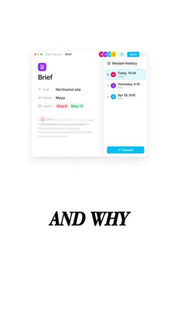

# 🎬 There's a Free Notion Alternative on GitHub You Can Run Yourself

> **Chaîne** : [Brock Mesarich | AI for Non Techies](https://www.youtube.com/@BrockMesarich)  
> **Lien YouTube** : [https://www.youtube.com/watch?v=xllCd9qB_UU](https://www.youtube.com/watch?v=xllCd9qB_UU)  
> **Date de publication** : 20261021  
> **Durée** : 00:00:36  
> **Identifiant vidéo** : `xllCd9qB_UU`  
> **Transcription & Analyse** : `whisper-v3-large-turbo+gemini-3.5-flash-lite`  

---

## 📌 Synthèse Exécutive & Outils

### 💡 Résumé

Cette intervention de la chaîne *Brock Mesarich | AI for Non Techies* met en lumière une alternative open-source majeure à l'écosystème Notion : **AppFlowy**, hébergée sur GitHub et adossée à plus de 60 000 étoiles. Conçue pour s'affranchir des contraintes des serveurs cloud tiers, cette solution offre une souveraineté totale sur les données tout en intégrant des fonctionnalités natives de productivité et d'intelligence artificielle (gestion documentaire, tableaux de tâches, wikis d'équipe et agendas). 

Dans une perspective d'optimisation des flux de travail, l'intégration de l'IA au cœur d'une base de connaissances auto-hébergée change radicalement la donne pour l'automatisation des processus. Qu'il s'agisse de piloter des lancements clients complexes, de centraliser des briefs ou de structurer des prises de décision, l'automatisation par l'IA permet d'interroger instantanément de vastes volumes de données internes ou d'alimenter des matrices décisionnelles sans intervention humaine superflue.

Bien que la vidéo se concentre sur l'organisation et la gestion de projets, la logique d'auto-hébergement, d'automatisation no-code/low-code et d'IA intégrée présente des passerelles directes avec le trading quantitatif. Tout comme les stratégies de trading algorithmique nécessitent un contrôle strict des infrastructures (serveurs dédiés, latence minimale, propriété des données propriétaires), l'utilisation d'outils modulaires et interopérables comme n8n, Make ou de grands modèles de langage (LLM) permet de bâtir des écosystèmes d'analyse de données hautement performants et sécurisés.

### 🛠️ Outils, Modèles & Logiciels Présentés

* **AppFlowy** : Alternative open-source et auto-hébergée à Notion, cumulant plus de 60 000 étoiles sur GitHub, dotée d'une IA intégrée et multi-plateforme (Mac, Windows, Linux, iOS, Android).
* **GitHub** : Plateforme de développement collaborative et d'hébergement de code source permettant de télécharger et auditer des projets open-source.
* **ChatGPT** : Modèle de langage conversationnel d'OpenAI utilisé pour l'assistance textuelle, l'automatisation des prompts et le traitement de données.
* **Claude** : Assistant IA avancé développé par Anthropic, reconnu pour sa précision dans la synthèse documentaire et le traitement de contextes longs.
* **Gemini** : Écosystème d'intelligence artificielle de Google appliqué à l'analyse multimodale et à la recherche d'informations.
* **Grok** : Modèle d'intelligence artificielle conversationnelle développé par xAI, intégré aux flux de données en temps réel.
* **n8n** : Outil d'automatisation de flux de travail (workflow automation) orienté technique et propice à l'auto-hébergement pour connecter des applications entre elles.
* **Zapier** : Plateforme cloud leader d'automatisation sans code permettant de relier rapidement des milliers d'applications logicielles.
* **Make** : Outil visuel d'intégration et d'automatisation (anciennement Integromat) pour concevoir des scénarios complexes multi-applications.
* **Prompt Engineering** : Discipline consistant à concevoir et optimiser les instructions textuelles pour orienter précisément les réponses des modèles d'IA.

### 🔑 Points Clés & Enseignements Stratégiques

* **Souveraineté et confidentialité des données** : L'auto-hébergement d'outils critiques sur ses propres serveurs élimine les risques de fuite de données propriétaires, un impératif absolu tant pour la gestion d'entreprise que pour la protection de stratégies de trading quantitatif confidentielles.
* **Indépendance vis-à-vis des écosystèmes propriétaires** : S'affranchir des solutions SaaS centralisées (comme Notion) protège les structures contre les hausses de tarifs unilatérales, les pannes de serveurs tiers et les modifications soudaines de conditions d'utilisation.
* **IA contextuelle intégrée** : L'intégration d'assistants intelligents directement au sein des bases documentaires permet d'interroger l'historique des projets en langage naturel, transformant des notes brutes en bases de connaissances dynamiques et exploitables.
* **Automatisation des tâches administratives** : Déléguer le remplissage de tableaux, le suivi des matrices de décision et la synthèse des briefs clients à l'IA libère un temps précieux pour se concentrer sur l'analyse à forte valeur ajoutée (recherche alpha, backtesting).
* **Traçabilité et auditabilité des processus** : Centraliser les briefs, les décisions et l'historique des modifications au même endroit garantit une transparence totale et une traçabilité indispensable pour le transfert de compétences ou l'analyse post-mortem d'un projet.
* **Interopérabilité multi-plateforme** : Disposer d'un outil fonctionnant de manière fluide sur postes fixes (Mac, Windows, Linux) comme sur terminaux mobiles (iPhone, Android) assure une continuité opérationnelle et un suivi en temps réel, critique en conditions de marché volatiles.
* **Synergie entre productivité et automatisation** : Combiner des solutions de gestion de données open-source avec des moteurs d'automatisation (n8n, Make) permet de concevoir des pipelines de données robustes, reliant la documentation opérationnelle aux outils de prise de décision.
* **Gestion rigoureuse du cycle de vie des projets** : Structurer l'information autour de cas d'usage précis (comme le lancement de produits ou de clients) favorise la reproductibilité des processus et minimise les erreurs opérationnelles dues à un manque de coordination.
* **Optimisation des flux de travail quantitatifs** : Les méthodologies présentées pour centraliser la recherche et l'exécution s'appliquent directement à la gestion de portefeuilles algorithmiques, où chaque signal, hypothèse de recherche et modification de code doit être rigoureusement documenté.
* **Accessibilité des technologies avancées** : L'adoption d'alternatives open-source et d'interfaces conversationnelles démocratise l'accès à des infrastructures de pointe, permettant à des profils non techniques de piloter des architectures logicielles complexes sans compétences en programmation pure.

---

## ⏱️ Chronologie & Transcription Complète Audio & Visuelle (Mot pour Mot)

### ⏱️ `[00:00:00 - 00:00:21]` | Segment #01

**🔊 Audio (Transcription Intégrale Mot pour Mot en Français) :**
> Il y a une alternative gratuite à Notion sur GitHub et vous pouvez l'exécuter vous-même. Ça s'appelle AppFlowy et ça a plus de 60 000 étoiles. Vous obtenez des documents, des tableaux de tâches, des calendriers et un wiki d'équipe, le tout au même endroit. Vos données restent sur vos propres serveurs, pas sur ceux de quelqu'un d'autre. Et l'IA y est directement intégrée. Posez des questions à travers vos pages ou demandez-lui de remplir vos tableaux pour vous.

**👁️ Analyse Visuelle d'Écran (gemini-3.5-flash-lite) :**
**Interface & Outils** : Interface utilisateur d'AppFlowy et présentation vidéo.

**Contenu textuel & Code** : Logos d'application, interface de gestion de notes/wiki, texte descriptif et illustration de serveur sécurisé.
[DESC_ACTION_1] Présentation du nom de l'application.
[DESC_ACTION_2] Illustration des fonctionnalités de type Notion.
[DESC_ACTION_3] Explication du stockage des données sur serveur personnel.

**Action / Démonstration** : Explications face caméra et analyse conceptuelle des marchés.

---

### ⏱️ `[00:00:21 - 00:00:36]` | Segment #02

**🔊 Audio (Transcription Intégrale Mot pour Mot en Français) :**
> Disons que vous gérez le lancement d'un client. Les briefs, les tâches et les décisions sont tous regroupés au même endroit. Ainsi, la personne suivante peut voir ce qui a changé et pourquoi. Ça fonctionne sur Mac, Windows, Linux, iPhone et Android. Si vous voulez l'essayer, commentez « app flowy » et je vous enverrai le lien.

**👁️ Analyse Visuelle d'Écran (gemini-3.5-flash-lite) :**
**Interface & Outils** : Application de gestion de projet (AppFlowy)

**Contenu textuel & Code** : Tableaux de bord de tâches, sections de brief de projet, historique des versions avec modifications d'utilisateurs.
[DESC_IMAGE_1] et [DESC_IMAGE_2] illustrent l'organisation des tâches et le suivi des modifications de projets clients.

**Action / Démonstration** : Explications face caméra et analyse conceptuelle des marchés.

*⏱️ 00:00:25 — Interface d'un espace de gestion de projet montrant le lancement d'un client avec les sections Brief, Decisions et Tasks, accompagné du présentateur en bas.*

*⏱️ 00:00:28 — Interface d'un document de brief avec un panneau latéral affichant l'historique des versions (Version history).*

---

