# 🎬 I Tested Claude Duet and It’s… Good??

> **Chaîne** : [Brock Mesarich | AI for Non Techies](https://www.youtube.com/@BrockMesarich)  
> **Lien YouTube** : [https://www.youtube.com/watch?v=PkrjD2IOCm4](https://www.youtube.com/watch?v=PkrjD2IOCm4)  
> **Date de publication** : 20261022  
> **Durée** : 00:11:55  
> **Identifiant vidéo** : `PkrjD2IOCm4`  
> **Transcription & Analyse** : `whisper-v3-large-turbo+gemini-3.5-flash-lite`  

---

## 📌 Synthèse Exécutive & Outils

### 💡 Résumé

Dans cette vidéo de la chaîne « Brock Mesarich | AI for Non Techies », l'analyste teste en direct la toute dernière solution d'Anthropic : **Claude Duet**, un assistant IA personnel proactif et multimodal. L'objectif est d'explorer ses capacités d'intégration au quotidien, sa gestion des canaux de discussion (comparables à Slack), son mode vocal à très faible latence, ainsi que sa faculté à récupérer du contexte à travers tout l'écosystème d'Anthropic (Claude Code, Claude Chat, Claude Cowork). L'analyste met à l'épreuve l'agent en lui confiant des requêtes concrètes, comme l'interrogation d'agendas, la génération de tableaux de bord visuels et l'analyse de données issues d'une base de données interne **Supabase**.

Face aux limites natives de l'assistant concernant certains connecteurs métiers (comme l'application de marketing par e-mail **Drip**), la vidéo démontre une stratégie d'ingénierie avancée de contournement. En combinant l'architecture **MCP (Model Context Protocol)** de **Zapier** avec **Claude Code**, Brock Mesarich déploie une passerelle capable d'interconnecter l'IA à plus de 9 000 applications tierces. Cette démonstration met en lumière la puissance de l'automatisation par agent intelligent, permettant d'exécuter des requêtes complexes et d'extraire des métriques marketing directement depuis un terminal mobile.

L'analyse comparative finale positionne Claude Duet face à des outils concurrents comme **GrokBot**, soulignant la pertinence de l'agrégation contextuelle unifiée pour la gestion d'entreprise et l'automatisation des flux de travail. La vidéo s'achève sur une mise en pratique de l'interopérabilité entre les protocoles MCP et les interfaces conversationnelles mobiles, prouvant qu'un écosystème d'IA bien configuré peut centraliser le pilotage de bases de données et d'outils SaaS disparates en un flux de travail fluide et conversationnel.

### 🛠️ Outils, Modèles & Logiciels Présentés

* **Claude Duet** : Nouvel assistant IA personnel et proactif d'Anthropic, conçu pour centraliser les tâches, documents, e-mails, calendriers et canaux de communication de l'utilisateur.
* **Claude Code** : Environnement de développement et d'exécution d'Anthropic permettant d'interagir par code, de structurer des tâches techniques et de configurer des protocoles sous-jacents.
* **Supabase** : Base de données relationnelle open-source utilisée comme source de stockage centrale pour les métriques de contenu, les scripts et les données analytiques.
* **Zapier MCP (Model Context Protocol)** : Protocole de communication standardisé permettant de connecter les agents IA à plus de 9 000 applications et services cloud tiers.
* **Drip** : Plateforme d'automatisation du marketing par e-mail et de gestion des campagnes, connectée à l'agent via le serveur MCP de Zapier.
* **GrokBot** : Assistant IA conversationnel quotidien utilisé par l'analyste pour la gestion opérationnelle et le pilotage de son entreprise.
* **Slack** : Outil de messagerie collaborative par canaux, dont l'ergonomie et la structuration thématique inspirent l'organisation des flux dans Claude Duet.
* **Gemini** : Modèle d'intelligence artificielle conversationnelle de Google mentionné dans l'écosystème global des assistants.
* **ChatGPT / OpenAI** : Modèle d'intelligence artificielle de référence souvent utilisé pour le benchmarking des assistants conversationnels.
* **n8n / Make** : Plateformes d'automatisation de flux de travail sans code (no-code/low-code) fréquemment associées aux architectures d'agents pour le routage de données.

### 🔑 Points Clés & Enseignements Stratégiques

* **Proactivité native des assistants nouvelle génération** : Claude Duet inaugure une approche où l'IA apprend des habitudes de l'utilisateur au fil du temps pour anticiper ses besoins professionnels et personnels avant même qu'une requête explicite ne soit formulée.
* **Segmentation contextuelle par canaux** : À l'instar de Slack, l'utilisation de canaux dédiés (ex: "Vidéos YouTube") permet d'isoler les discussions, les tâches et les fichiers par thématique, évitant la dispersion dans une conversation persistante unique.
* **Interaction vocale à faible latence** : Le mode vocal intégré offre une réactivité quasi instantanée, permettant de piloter des agendas complexes ou d'obtenir des informations de synthèse en situation de mobilité.
* **Exploitation de bases de données relationnelles** : L'agent est capable de s'interroger sur des structures de données distantes (comme Supabase) pour restituer des bilans chiffrés et des indicateurs de performance en temps réel.
* **Génération dynamique d'artefacts visuels** : Claude Duet ne se limite pas au texte brut ; il sait structurer et afficher des tableaux de bord visuels, des cartes d'engagement et des graphiques directement dans l'interface de discussion.
* **Contournement des limites de connecteurs natifs** : Lorsqu'un outil SaaS spécifique (tel que Drip) n'est pas intégré nativement dans l'assistant, l'utilisation de protocoles d'interopérabilité devient indispensable pour combler les lacunes d'intégration.
* **Intégration via le Model Context Protocol (MCP)** : L'utilisation de Zapier MCP sert de pont universel entre les modèles d'IA (Claude, Claude Code, GrokBot, Cursor) et un vaste catalogue d'applications tierces sans nécessiter de développements d'API complexes.
* **Configuration incrémentielle des serveurs MCP** : La mise en place d'un serveur MCP passe par l'exécution de scripts de configuration générés sur-mesure, injectés directement dans l'environnement de développement de l'agent.
* **Granularité des actions sur les applications tierces** : Une fois le connecteur MCP établi (via Zapier), l'IA gagne la capacité d'exécuter des actions ciblées (extraction de statistiques de campagnes, étiquetage d'abonnés, segmentation de listes).
* **Unification de l'écosystème d'entreprise** : La centralisation des artefacts (PDF, CSV, scripts, tableaux de bord) issus de différents modules d'Anthropic (Chat, Code, Cowork, Duet) garantit la persistance et la portabilité totale du contexte de travail.
* **Pilotage omnicanal depuis un terminal mobile** : L'expérimentation démontre la viabilité d'un pilotage d'entreprise entièrement délocalisé, où des requêtes complexes de marketing ou d'analyse de données sont lancées et visualisées depuis un smartphone.

---

## ⏱️ Chronologie & Transcription Complète Audio & Visuelle (Mot pour Mot)

### ⏱️ `[00:00:00 - 00:00:32]` | Segment #01

**🔊 Audio (Transcription Intégrale Mot pour Mot en Français) :**
> Anthropic vient de lancer Claude Duet, leur tout nouvel assistant IA personnel, et je vais être honnête, je ne sais pas encore trop quoi en penser. Je n'ai pas eu d'accès anticipé, mais j'ai enfin obtenu l'accès grâce à la liste d'attente. Donc, dans cette vidéo, je vais le tester en direct, ici même avec vous. Je vais vous expliquer exactement comment il fonctionne, vous montrer certaines choses que j' vraiment adore là-dedans, et d'autres que je n'aime pas du tout. Et ensuite, je vais vous donner mon avis sincère en le comparant à GrokBot, que j'utilise tous les jours depuis deux mois pour m'aider à gérer mon entreprise. Et c'est probablement l'outil d'IA que j'ai préféré utiliser jusqu'à présent.

**👁️ Analyse Visuelle d'Écran (gemini-3.5-flash-lite) :**
**Interface & Outils** : Interface de discussion sur ordinateur portable / application de messagerie.

**Contenu textuel & Code** : Texte de messages de chat et logo 'Meet Grok Bot'.

**Action / Démonstration** : Navigation sur l'application de messagerie et utilisation du clavier de l'ordinateur portable.

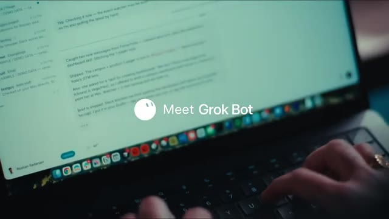
*⏱️ 00:00:24 — Un ordinateur portable affichant une interface de discussion avec un logo et le texte 'Meet Grok Bot' au centre de l'écran.*

---

### ⏱️ `[00:00:32 - 00:01:06]` | Segment #02

**🔊 Audio (Transcription Intégrale Mot pour Mot en Français) :**
> Alors, sans plus attendre, plongeons-nous dedans. Très bien. Donc maintenant, voilà ce que nous allons voir à l'intérieur de notre point. Si je clique sur notre point, il y a plusieurs choses. Donc vous pouvez voir les différentes choses auxquelles il a accès. Nous avons donc des fichiers et nos documents. Nous avons notre courrier. Nous avons notre calendrier, le chat d'équipe, les paiements. On dirait qu'il ne peut pas encore effectuer de paiements, mais nous pouvons en fait ajouter des moyens de paiement ici également. Donc en gros, il est dit : « Hé Brock, bienvenue. C'est notre premier jour de travail ensemble. Je vais t'aider à rester au top de ton travail et de ta vie. Chaque jour, je vais apprendre à te connaître un peu mieux. Au fil du temps, je commencerai à repérer ce dont tu as besoin avant même que tu ne le demandes. »

**👁️ Analyse Visuelle d'Écran (gemini-3.5-flash-lite) :**
**Interface & Outils** : Application mobile Claude sur interface iOS (TestFlight) avec une maquette de smartphone incrustée à l'écran.

**Contenu textuel & Code** : Liste des accès de Claude (« What Claude has access to ») : Files and docs, Mail, Calendar, Team chat, Payments, More apps.

**Action / Démonstration** : Le présentateur présente et détaille les différentes fonctionnalités et autorisations d'accès de l'application Claude sur mobile.

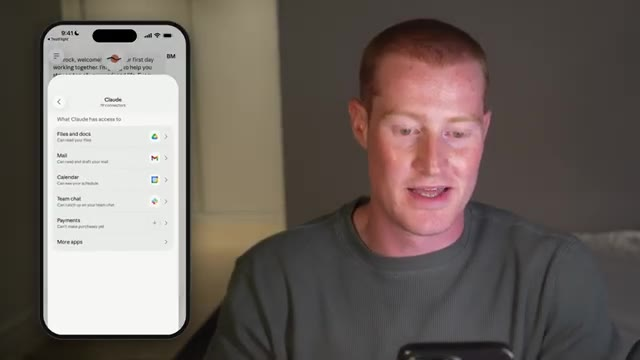
*⏱️ 00:00:41 — Capture d'écran montrant le présentateur à droite et l'interface de l'application Claude sur un smartphone à gauche, affichant les autorisations d'accès aux fichiers, e-mails, calendrier, chat d'équipe et paiements.*

---

### ⏱️ `[00:01:06 - 00:01:26]` | Segment #03

**🔊 Audio (Transcription Intégrale Mot pour Mot en Français) :**
> Et c'est une partie proactive de ce Claude Duet dont ils ont parlé dans l'article de sortie. Donc, comme vous pouvez le remarquer en bas à droite de mon écran, nous avons cette petite icône vocale. Alors, laissez-moi tester ceci et voir comment nous pouvons réellement parler avec notre agent Duet. Hé, quoi de neuf, Duet ? Comment ça va ? Hé, Brock. Je vais très bien, merci. Comment se passe la vidéo sur Claude Duet ?

**👁️ Analyse Visuelle d'Écran (gemini-3.5-flash-lite) :**
**Interface & Outils** : Application mobile Claude Duet sur smartphone.

**Contenu textuel & Code** : Interface de chat avec options de message vocal et texte.

**Action / Démonstration** : Démonstration de l'utilisation de l'assistant vocal Claude Duet sur mobile.

*⏱️ 00:01:11 — Le présentateur présente l'interface mobile de Claude Duet avec une conversation textuelle.*

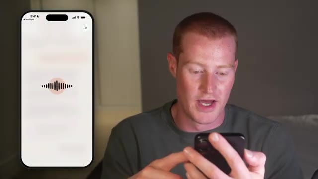
*⏱️ 00:01:21 — L'interface mobile affiche une animation de forme d'onde audio lors de l'utilisation de la fonction vocale.*

---

### ⏱️ `[00:01:26 - 00:01:59]` | Segment #04

**🔊 Audio (Transcription Intégrale Mot pour Mot en Français) :**
> Ça va plutôt bien. Est-ce que tu pourrais me rendre un service très rapidement ? Je veux faire un test dans la vidéo. En gros, je veux voir ce qu'il y a sur mon agenda pour les prochains jours. Est-ce que tu peux regarder dans mon agenda et me dire ? Bien sûr. Laisse-moi vérifier ton agenda. Aujourd'hui et vendredi sont totalement libres, Brock. Samedi, tu rentres chez toi en avion. De Lisbonne à Washington à 12h20, puis de Washington à Dallas à 18h. Parfait. Merci beaucoup. Très bien. Donc ça, c'est le mode vocal. Le son est vraiment bon. En fait, c'est très rapide. La latence est très faible. Et ensuite, je veux faire un tour

**👁️ Analyse Visuelle d'Écran (gemini-3.5-flash-lite) :**
**Interface & Outils** : Application mobile avec assistant vocal.

**Contenu textuel & Code** : Interface d'assistant vocal avec une onde sonore animée au centre de l'écran.

**Action / Démonstration** : Le présentateur utilise l'assistant vocal sur son smartphone pour consulter son agenda.

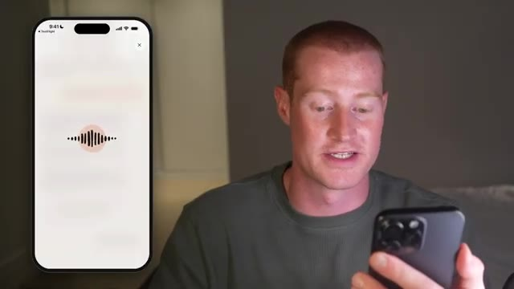
*⏱️ 00:01:34 — Le présentateur discute tout en interagissant avec une application mobile affichant une interface vocale sur smartphone.*

---

### ⏱️ `[00:01:59 - 00:02:28]` | Segment #05

**🔊 Audio (Transcription Intégrale Mot pour Mot en Français) :**
> partout dans le reste de l'interface ici. Donc je vais aller sur les trois petits points juste ici. Donc, en principe, nous pourrions avoir différents canaux et je vais analyser ça tout de suite. Donc, comme vous pouvez le voir juste ici, il est écrit « restez concentré avec les canaux », donnez à chaque sujet sa propre place pour les messages, les tâches et les fichiers. Donc, je suppose que c'est une façon pour nous de segmenter différentes parties de notre vie ou de notre entreprise à l'intérieur de Claude Duet. De cette façon, tout n'est pas regroupé dans une seule conversation persistante, ce qui, je suppose, se transformerait alors en bazar. Donc, juste ici, il est écrit tout.

**👁️ Analyse Visuelle d'Écran (gemini-3.5-flash-lite) :**
**Interface & Outils** : Application mobile sur smartphone (interface de type application de messagerie ou d'intelligence artificielle).

**Contenu textuel & Code** : Texte d'aide "Get focused with channels" et options de gestion de canaux ("Everything", "+ New channel").

**Action / Démonstration** : Présentation des fonctionnalités de l'application mobile et navigation dans les menus de canaux.

---

### ⏱️ `[00:02:28 - 00:03:04]` | Segment #06

**🔊 Audio (Transcription Intégrale Mot pour Mot en Français) :**
> Allons-y et créons un nouveau canal. Je vais appeler celui-ci vidéos YouTube. Et puis pour l'objectif, je vais simplement dire tout ce qui concerne les vidéos YouTube. Je pourrais changer l'icône. Alors allons-y et changeons peut-être ceci en un bouton de lecture, changeons-le en rouge. De cette façon, cela indique que c'est YouTube. Je vais cliquer sur créer. Très bien, c'est parti. Nous avons maintenant notre canal, qui s'appelle vidéos YouTube. Et cela semble très similaire à Slack en fait, en termes d'avoir différents canaux. Il y a le hashtag vidéos YouTube en haut de notre écran, comme vous pouvez le voir juste ici. Et cela m'invite également et me demande si je voulais suggérer des tâches qu'il

**👁️ Analyse Visuelle d'Écran (gemini-3.5-flash-lite) :**
**Interface & Outils** : Application mobile sur smartphone avec affichage du clavier virtuel et écran de création de canal ("New channel").

**Contenu textuel & Code** : Champs de texte "Name" rempli avec "YouTube Videos" et "Purpose" avec "Everything YT video relate".

**Action / Démonstration** : Le présentateur tape du texte sur son smartphone pour configurer le nom et l'objectif d'un nouveau canal.

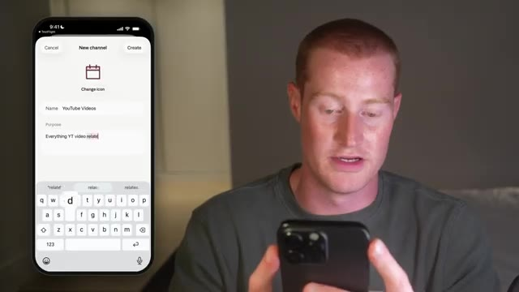
*⏱️ 00:02:37 — Le présentateur utilise son smartphone pour créer un nouveau canal nommé "YouTube Videos", en tapant la description dans le champ "Purpose".*

---

### ⏱️ `[00:03:04 - 00:03:39]` | Segment #07

**🔊 Audio (Transcription Intégrale Mot pour Mot en Français) :**
> peut faire pour moi. Donc je vais juste cliquer sur oui. Et je suis curieux de voir ce que ça va sortir en termes de ce que ça peut faire pour moi. D'accord, donc emballer votre prochaine vidéo, des idées de titres, de vignettes, une accroche et des choix ABC, etc. Donc ce que je vais faire, c'est que je vais en fait lui demander d'aller vérifier mes analyses. Je suis donc curieux de voir s'il est capable de se connecter à la base de données interne de Supabase où je stocke fondamentalement toutes mes vidéos YouTube préexistantes ainsi que certaines de mes idées. Je suis donc curieux de voir s'il va être capable d'aller chercher tout ce contexte à partir de mes conversations précédentes sur le code Cloud et des tâches que j'ai exécutées. Maintenant, c'est plutôt cool. Ça montre que ça fonctionne sur

**👁️ Analyse Visuelle d'Écran (gemini-3.5-flash-lite) :**
**Interface & Outils** : Application mobile de messagerie intelligente avec interface de chat et suggestions de tâches.

**Contenu textuel & Code** : Texte de l'IA proposant de l'aide pour structurer les vidéos (titres, vignettes, accroches) et boutons de sélection rapide ("Package a video", "Check my analytics", "Find trending topics").

**Action / Démonstration** : Le présentateur manipule son téléphone et interagit avec l'application pour tester les fonctionnalités proposées par l'assistant IA.

*⏱️ 00:03:13 — Un présentateur utilise son smartphone sur lequel s'affiche une interface de chat textuel avec de l'intelligence artificielle proposant des idées pour des vidéos YouTube.*

---

### ⏱️ `[00:03:39 - 00:04:04]` | Segment #08

**🔊 Audio (Transcription Intégrale Mot pour Mot en Français) :**
> avec cette petite icône qui tourne ici. Je pourrais cliquer dessus et ensuite, maintenant, ça fait apparaître ceci juste ici. Vous pouvez voir tout ce sur quoi il travaille, toutes les tâches une par une. C'est plutôt cool. Et ensuite, si je clique sur ce bouton des tâches en bas de mon écran, nous pourrions également voir toutes nos tâches actives ainsi que nos tâches à venir également. Donc, pendant qu'il travaille encore sur cette tâche, je veux venir ici et tester ceci là où il est écrit « créer » en bas à droite de mon écran.

**👁️ Analyse Visuelle d'Écran (gemini-3.5-flash-lite) :**
**Interface & Outils** : Application mobile Claude (Interface de chat IA avec suivi des tâches)

**Contenu textuel & Code** : Interface mobile affichant une liste de tâches de l'assistant (« What Claude is doing » : Pull analytics for your recent videos, Spot what's working and what isn't, Suggest what to make next).

**Action / Démonstration** : Le présentateur consulte sur son téléphone l'avancement des tâches en cours exécutées par l'assistant IA Claude.

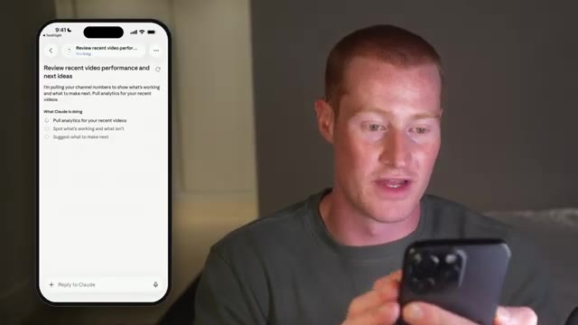
*⏱️ 00:03:45 — Capture d'écran montrant le présentateur manipulant son smartphone et, en incrustation à gauche, l'interface de l'application Claude affichant une liste de tâches en cours.*

---

### ⏱️ `[00:04:04 - 00:04:36]` | Segment #09

**🔊 Audio (Transcription Intégrale Mot pour Mot en Français) :**
> Donc, juste ici, il semble que ce soit l'ensemble des documents dont je dispose. Donc, tous mes artéfacts que j'ai créés, des documents PDF, des fichiers CSV, tous mes documents Claude, absolument tout. Donc, par exemple, si je viens ici, je pourrais consulter le script Claude Duet que j'ai créé pour une vidéo courte sur laquelle je travaillais plus tôt. Et j'ai fait cela à l'intérieur de Claude Code en fait, mais je pourrais voir tous ces petits actifs juste ici. Donc, par exemple, je pourrais réellement afficher toutes ces différentes présentations que j'ai faites avec Claude Presentations. C'est donc plutôt cool que nous puissions accéder à toutes ces informations. Le point principal ici est donc qu'il est capable de regrouper tous ces

**👁️ Analyse Visuelle d'Écran (gemini-3.5-flash-lite) :**
**Interface & Outils** : Application mobile de gestion de documents et de projets (type interface de workspace d'intelligence artificielle).

**Contenu textuel & Code** : Listes de documents (« Documents 36 », « Claude Duet: Short Script », « Dashboards », « Pages », « Presentations »).

**Action / Démonstration** : Le présentateur navigue et présente l'ensemble des fichiers, artéfacts et documents créés dans l'application mobile.

*⏱️ 00:04:12 — Le présentateur montre l'écran de son téléphone affichant l'interface d'une application regroupant divers documents, tableaux de bord et pages.*

---

### ⏱️ `[00:04:36 - 00:05:09]` | Segment #10

**🔊 Audio (Transcription Intégrale Mot pour Mot en Français) :**
> le contexte de nos conversations précédentes sur Cloud, à la fois dans Cloud Code, Cloud Chat, Cloud Cowork, pratiquement tout l'écosystème et toutes les informations de mon compte. Je peux même venir ici, cliquer sur plus, et je peux aller générer n'importe lequel de ces types de médias également. Disons donc que je veux créer un tableau de bord. Je peux simplement venir ici et cliquer sur tableau de bord, puis dire tout simplement, j'ai donc juste dit de créer un tableau de bord pour mes trois dernières vidéos courtes. Et il va aller chercher dans Supabase où sont stockées toutes ces informations. Et il va me générer ceci. Je suis donc curieux de voir à quoi va ressembler le résultat ici. Mais jusqu'à présent,

**👁️ Analyse Visuelle d'Écran (gemini-3.5-flash-lite) :**
**Interface & Outils** : Application mobile (interface de type interface utilisateur d'assistant IA ou gestion de documents).

**Contenu textuel & Code** : Vues d'onglets de documents, tableaux de bord et options de navigation (Chat, Tasks, Make).

**Action / Démonstration** : Présentation de l'interface mobile de l'écosystème d'IA.

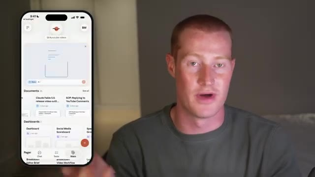
*⏱️ 00:04:44 — Capture d'écran montrant l'interface d'une application mobile affichée à gauche, avec le présentateur parlant à droite.*

---

### ⏱️ `[00:05:09 - 00:05:43]` | Segment #11

**🔊 Audio (Transcription Intégrale Mot pour Mot en Français) :**
> cette expérience est plutôt intuitive et j'apprécie. Très bien. Donc si je retourne dans les tâches, vous pouvez voir là où il est écrit actif, il y a une tâche qui est prête pour révision. Donc j'aime bien la façon dont ça montre cette liste de choses qui nécessitent mon attention, ainsi que des choses sur lesquelles il travaille également. Donc si je clique sur actif, ça va afficher ceci. Donc vous avez eu un gros mois, les 28 derniers jours ont rapporté 1,35 million de vues. Vraiment cool. Donc le point principal ici, c'est que ça peut aller chercher des données dans la base de données que j'ai configurée à l'intérieur de Cloud Code. Et c'est vraiment, vraiment cool et vraiment chouette. Très bien. Donc en retournant sur ce tableau de bord que nous avons créé maintenant à l'intérieur de mon agent

**👁️ Analyse Visuelle d'Écran (gemini-3.5-flash-lite) :**
**Interface & Outils** : Application mobile (interface de gestion de tâches / productivité) affichée sur maquette de smartphone.

**Contenu textuel & Code** : Liste de tâches avec les onglets "Active" et "Up next", affichant "Ready for review" (Review recent video performance and next ideas) et "Working" (Dashboard: Create a dashboard for my previous 3 short videos).

**Action / Démonstration** : Présentation de la liste des tâches actives et des éléments prêts pour révision dans l'application mobile.

*⏱️ 00:05:17 — Capture d'écran montrant le présentateur à droite et l'interface d'une application mobile de gestion de tâches sur smartphone à gauche.*

---

### ⏱️ `[00:05:43 - 00:06:17]` | Segment #12

**🔊 Audio (Transcription Intégrale Mot pour Mot en Français) :**
> juste ici, ça montre cette petite icône. Donc je vais cliquer sur le tableau de bord des shorts et ça a fini par créer ça pour moi. Donc si je clique dessus, ça va l'ouvrir et ça me montre une ventilation visuelle, une disposition visuelle des trois derniers shorts. Donc ça montre ces petites cartes ici avec chaque vidéo, ça montre le nombre de vues, ça montre les j'aime et l'engagement. Je pense que ça a l'air vraiment solide. Le fait que j'aie demandé à Claude de générer ça pour moi automatiquement et qu'il me l'ait envoyé dans le chat. C'est cool. Ça montre ces petites barres juste ici. Je pense que c'est une façon assez intuitive d'interagir avec Claude via Claude Duet. Et maintenant, ce que je pourrais faire, c'est que je pourrais toujours venir

**👁️ Analyse Visuelle d'Écran (gemini-3.5-flash-lite) :**
**Interface & Outils** : Application mobile avec interface de statistiques et tableau de bord analytique.

**Contenu textuel & Code** : Statistiques de vues (7 300 vues), likes (126), commentaires (31), partages (83), taux de rétention (« Stayed to watch » à 42,9 %), et comparaison côte à côte des performances de différents contenus (« Side by side »).

**Action / Démonstration** : Le présentateur commente la ventilation visuelle et la disposition des cartes analytiques pour les derniers shorts générées par l'application.

*⏱️ 00:05:52 — Capture d'écran montrant le présentateur à côté d'un aperçu sur smartphone affichant une interface d'analyse des performances des 3 derniers vidéos Shorts (« Last 3 Shorts »).*

---

### ⏱️ `[00:06:17 - 00:06:41]` | Segment #13

**🔊 Audio (Transcription Intégrale Mot pour Mot en Français) :**
> ici et cliquez sur la section de création et je pouvais toujours voir ces différentes espèces d'artefacts, je suppose que c'est comme ça que je vais les appeler, même si je ne suis pas sûr de ce que Claude veut appeler ces éléments. Je suppose que ce sont des artefacts. Vous pouvez donc voir tous les artefacts ici même, ce qui est vraiment cool. N'importe quel actif qu'il génère, je suis capable de le voir ici même. Et encore une fois, y compris les précédents provenant de l'intérieur de Claude Code ou de Claude précédemment jusqu'à ce point.

**👁️ Analyse Visuelle d'Écran (gemini-3.5-flash-lite) :**
**Interface & Outils** : Application mobile Claude (Interface utilisateur mobile / Artifacts)

**Contenu textuel & Code** : Liste de documents et d'artefacts récents, interface de chat et de création ("Make").

**Action / Démonstration** : Navigation et présentation des sections de création et des documents de l'application Claude.

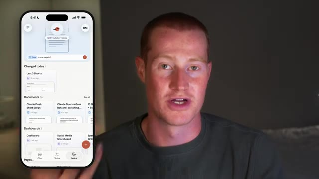
*⏱️ 00:06:23 — Le présentateur présente une application mobile (Claude) affichant des documents et des artefacts générés.*

---

### ⏱️ `[00:06:42 - 00:07:03]` | Segment #14

**🔊 Audio (Transcription Intégrale Mot pour Mot en Français) :**
> Maintenant, une chose que je voulais que Claude Duet soit capable de faire, c'est extraire mes statistiques de marketing par e-mail de Drip, qui est l'application que j'utilise pour exécuter mes campagnes de marketing par e-mail. Donc, par exemple, je veux pouvoir demander comment ma dernière campagne de marketing par e-mail s'est déroulée directement depuis mon téléphone. Mais le problème, c'est que si je viens voir les connecteurs à l'intérieur de Claude et que je cherche Drip, il n'y a pas de connecteur Drip.

**👁️ Analyse Visuelle d'Écran (gemini-3.5-flash-lite) :**
**Interface & Outils** : Navigateur web affichant le site Drip et l'interface de configuration/connecteurs de Claude (Anthropic).

**Contenu textuel & Code** : Page d'accueil de la plateforme d'e-mailing Drip et interface de gestion des connecteurs/intégrations de Claude (section "Customize", "Connectors").

**Action / Démonstration** : Navigation et présentation visuelle des intégrations possibles entre l'outil d'e-mailing Drip et les connecteurs de Claude.

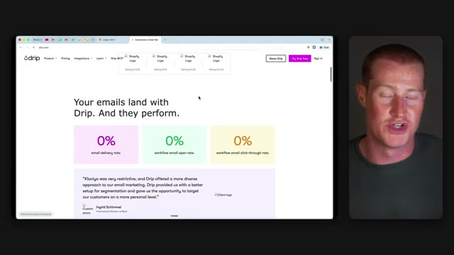
*⏱️ 00:06:47 — Capture d'écran montrant le site web de Drip (drip.com) avec l'en-tête et les statistiques de performance des emails, aux côtés du présentateur.*

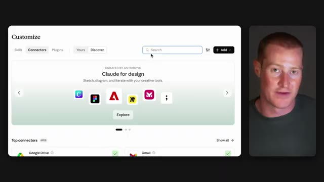
*⏱️ 00:06:58 — Interface de personnalisation de Claude montrant l'onglet "Connectors" avec une barre de recherche et diverses icônes d'applications, aux côtés du présentateur.*

---

### ⏱️ `[00:07:04 - 00:07:24]` | Segment #15

**🔊 Audio (Transcription Intégrale Mot pour Mot en Français) :**
> Et pour l'instant, je ne sais pas s'il y a un moyen d'ajouter des connecteurs directement à l'intérieur de Claude Duet en ce moment, mais il utilise les mêmes connecteurs que possède votre compte Claude. Nous pouvons donc aller les configurer sur notre ordinateur. Alors, pour contourner cela, je vais utiliser le MCP de Zapier, qui permet fondamentalement à Claude ou à n'importe lequel de vos autres agents IA de se connecter à plus de 9 000 connexions d'applications.

**👁️ Analyse Visuelle d'Écran (gemini-3.5-flash-lite) :**
**Interface & Outils** : Application Claude Duet (schéma illustratif)

**Contenu textuel & Code** : Icône « claude duet » et un encadré « + connector » suivi d'un point d'interrogation.

**Action / Démonstration** : Le présentateur explique les limites actuelles des connecteurs dans Claude Duet.

---

### ⏱️ `[00:07:24 - 00:07:44]` | Segment #16

**🔊 Audio (Transcription Intégrale Mot pour Mot en Français) :**
> Donc, afin de faire cela, je vais venir sur Zapier MCP. Et si vous voulez l'utiliser, il y a aura un lien dans la description pour l'utiliser vous-même. Ensuite, sur le côté gauche, une fois que je suis à l'intérieur de mon compte, je vais cliquer sur serveurs MCP, ce qui est l'endroit où nous configurons ceux-ci. Et je vais cliquer sur créer un serveur. Ensuite, il va demander quel outil d'IA nous voulons connecter.

**👁️ Analyse Visuelle d'Écran (gemini-3.5-flash-lite) :**
**Interface & Outils** : Navigateur web affichant l'interface de la plateforme Zapier MCP et le présentateur en incrustation vidéo.

**Contenu textuel & Code** : Page de présentation de Zapier MCP avec options de connexion et panneau de configuration du compte utilisateur incluant les serveurs MCP.

**Action / Démonstration** : Navigation sur le site de Zapier et sélection de l'option des serveurs MCP dans le menu latéral.

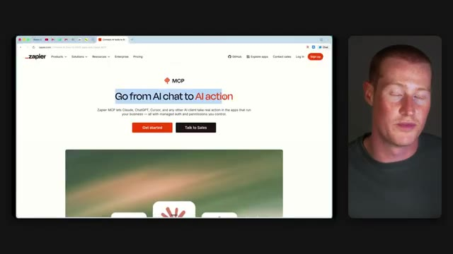
*⏱️ 00:07:29 — Page d'accueil du site Web de Zapier MCP montrant le titre 'Go from AI chat to AI action'.*

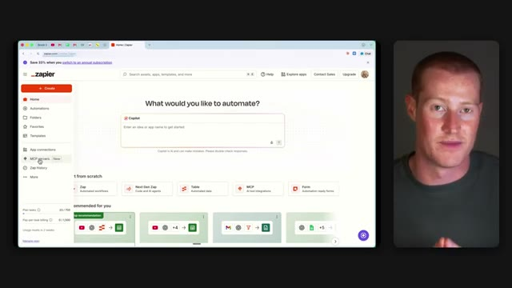
*⏱️ 00:07:34 — Interface de Zapier montrant le menu latéral gauche avec l'option 'MCP servers (New)' mise en surbrillance.*

---

### ⏱️ `[00:07:44 - 00:08:07]` | Segment #17

**🔊 Audio (Transcription Intégrale Mot pour Mot en Français) :**
> Donc vous avez des options comme Claude, Claude Code, Chachabutee, Cursor, et même GrokBot. Donc je vais simplement cliquer sur Claude Code pour cette instance. Et ensuite je vais cliquer sur Terminer la connexion. Ensuite tout ce que j'ai à faire est de copier ce prompt, de le coller à nouveau dans Claude Code, et ça va configurer l'ensemble pour moi. Maintenant, pendant que ça s'exécute, je vais aller dans Applications, qui est l'endroit où nous choisissons les applications que nous voulons que Zapri utilise.

**👁️ Analyse Visuelle d'Écran (gemini-3.5-flash-lite) :**
**Interface & Outils** : Interface web de configuration MCP (Model Context Protocol) avec panneau de gestion des clients et des serveurs.

**Contenu textuel & Code** : Avertissement de migration de client MCP et liste des clients connectés avec leur statut de connexion (Pending).

**Action / Démonstration** : Le présentateur clique pour confirmer le transfert du client vers le serveur et finaliser la configuration de la connexion.

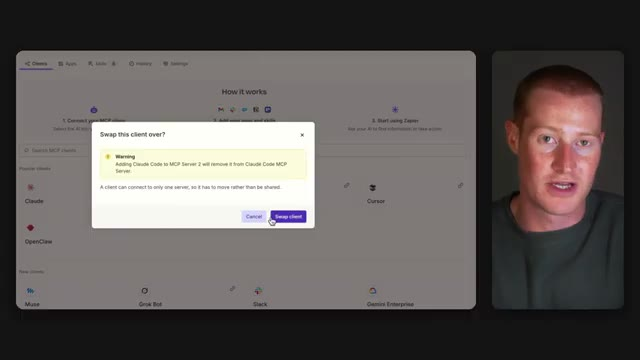
*⏱️ 00:07:49 — Fenêtre contextuelle d'avertissement "Swap this client over?" demandant de confirmer le déplacement du client Claude Code vers le serveur MCP 2.*

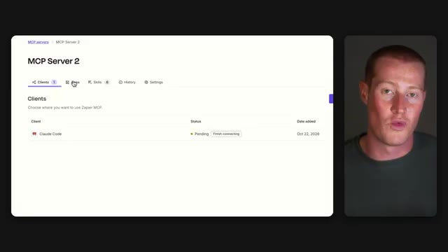
*⏱️ 00:08:01 — Interface du serveur MCP 2 montrant le client "Claude Code" avec un statut "Pending" et un bouton "Finish connecting".*

---

### ⏱️ `[00:08:07 - 00:08:27]` | Segment #18

**🔊 Audio (Transcription Intégrale Mot pour Mot en Français) :**
> Et je vais chercher Drip. Et comme vous pouvez le voir juste ici, Drip propose sept outils différents que Claude peut utiliser, de sorte qu'il peut récupérer mes statistiques et même faire des choses comme étiqueter des abonnés ou ajouter quelqu'un à une campagne. Je vais donc simplement cliquer sur connecter, me connecter à mon compte Drip, et c'est tout. Et c'est à peu près tout aussi facile de faire cela avec n'importe laquelle des autres applications que vous utilisez au jour le jour.

**👁️ Analyse Visuelle d'Écran (gemini-3.5-flash-lite) :**
**Interface & Outils** : Interface web de configuration d'application (Zapier ou similaire).

**Contenu textuel & Code** : Liste des outils Drip disponibles pour l'intégration, incluant des options telles que "Select All Tools", "Trigger event", "Remove Tag From Subscriber", "Subscribe to Campaign", etc.

**Action / Démonstration** : Sélection des outils Drip pour configurer les actions automatisées.

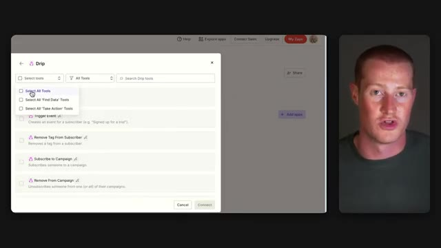
*⏱️ 00:08:12 — Interface montrant une fenêtre de configuration d'outils pour l'application Drip avec plusieurs options de sélection.*

---

### ⏱️ `[00:08:27 - 00:09:00]` | Segment #19

**🔊 Audio (Transcription Intégrale Mot pour Mot en Français) :**
> Alors maintenant, si je viens sur Claude Duet sur mon téléphone, je vais simplement lui demander comment s'est passée ma dernière campagne de marketing par e-mail. Et je vais même lui demander de générer un tableau de bord pour visualiser toutes ces données pour moi également. Je vais venir ici, dans mon fil de marketing par e-mail que je viens de créer dans Claude Duet. Je vais simplement dire, hé, je veux que tu ailles récupérer les détails de ma campagne de marketing par e-mail pour le dernier e-mail que j'ai envoyé. Et je veux que tu transformes réellement cela en un tableau de bord et que tu me montres le résultat ici même. Maintenant, encore une fois, nous pouvons toujours voir la tâche ici même. Donc, si je veux cliquer dessus, cela va alors amener

**👁️ Analyse Visuelle d'Écran (gemini-3.5-flash-lite) :**
**Interface & Outils** : Application mobile de chat IA (Claude Duet / interface de messagerie).

**Contenu textuel & Code** : Interface de discussion mobile avec un canal nommé « #email-marketing » et un message de bienvenue de l'assistant IA.

**Action / Démonstration** : Présentation de l'utilisation d'une application mobile d'intelligence artificielle pour analyser des campagnes marketing.

*⏱️ 00:08:43 — Le présentateur à côté d'une maquette de smartphone affichant l'interface d'une application de chat d'intelligence artificielle.*

---

### ⏱️ `[00:09:00 - 00:09:22]` | Segment #20

**🔊 Audio (Transcription Intégrale Mot pour Mot en Français) :**
> nous amener à notre tâche et cela montre exactement ce que c'est, sur quoi il travaille. Et je pourrais venir cliquer sur les tâches et ça va montrer cela aussi, ainsi que toutes les tâches qui sont à venir, ce qui donne l'impression que nous avons toutes les effacées. Très bien. Et juste comme ça, environ une minute plus tard, nous avons maintenant ce message ici. Il a extrait les statistiques de notre campagne de marketing par e-mail dans Drip via cette application ici sur MCP. Si je clique là-dessus, cela m'amène au tableau de bord qu'il a créé.

**👁️ Analyse Visuelle d'Écran (gemini-3.5-flash-lite) :**
**Interface & Outils** : Application mobile de gestion de tâches.

**Contenu textuel & Code** : Onglets « Active », « Up next », et une tâche intitulée « Dashboard for your last email campaign ».

**Action / Démonstration** : Présentation de l'interface utilisateur de l'application de tâches sur smartphone.

*⏱️ 00:09:05 — Le présentateur montre l'interface d'une application mobile affichant une liste de tâches actives avec le détail d'une tâche de tableau de bord de campagne email.*

---

### ⏱️ `[00:09:23 - 00:09:55]` | Segment #21

**🔊 Audio (Transcription Intégrale Mot pour Mot en Français) :**
> Très bien. Et juste comme ça, nous avons maintenant ce tableau de bord avec toutes les statistiques tirées de notre compte Drip. Il montre le taux d'ouverture, montre le taux de clics, montre le taux de désabonnement, le taux de livraison, et montre même où les spectateurs ou les lecteurs ont décroché. Je trouve ça vraiment génial. Et encore une fois, cela n'aurait pas été possible si nous n'avions pas connecté cela à Drip via le MCP Zapier. Très bien. Donc maintenant que nous avons réellement testé Claude Duet, je veux le comparer à mon expérience avec GrokBot. J'utilise GrokBot tous les jours, et c'est probablement mon outil d'IA préféré parmi tous ceux que j'utilisables. Donc tout d'abord, ce que j'aime vraiment chez GrokBot, c'est que je peux avoir plusieurs

**👁️ Analyse Visuelle d'Écran (gemini-3.5-flash-lite) :**
**Interface & Outils** : Application mobile Drip, interface de messagerie ou de gestion de bots.

**Contenu textuel & Code** : Statistiques d'e-mailing (taux d'ouverture 5 344, taux de livraison 99.92%, désabonnement 0.44%, taux de clics 47) et liste d'agents (Content Bot, Inbox Triage, Invoice Agent).

**Action / Démonstration** : Présentation des métriques d'e-mailing et du tableau de bord marketing de l'application Drip.

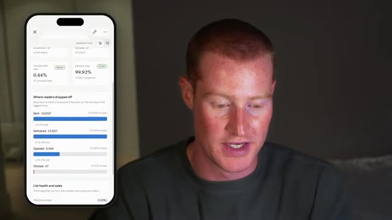
*⏱️ 00:09:31 — Le présentateur à droite, avec à gauche un smartphone affichant un tableau de bord Drip avec les statistiques d'e-mailing (taux d'ouverture, clics, désabonnement).*

---

### ⏱️ `[00:09:55 - 00:10:31]` | Segment #22

**🔊 Audio (Transcription Intégrale Mot pour Mot en Français) :**
> différents agents d'IA qui communiquent réellement entre eux. Par exemple, j'ai mon agent principal à qui je parle la plupart du temps, et il travaille essentiellement avec mes autres agents, comme mon agent de facturation et mon agent YouTube, de sorte qu'il dispose ainsi de tout le contexte de chacun d'eux. Et je peux avoir autant de bots que je veux, ou juste un seul agent principal, donc c'est très simple et ça ne fait pas du tout encombré. Je trouve aussi que l'interface a vraiment l'air cool et simple, comme toutes les différentes couleurs pour chacun de ces différents bots. Et c'est très adapté aux débutants, ce qui explique pourquoi je recommande cet outil à tout le monde. Maintenant, du côté de Claude Duet, un truc que j'aime vraiment, c'est la section de création où je peux voir

**👁️ Analyse Visuelle d'Écran (gemini-3.5-flash-lite) :**
**Interface & Outils** : Schéma explicatif animé / Interface de présentation visuelle.

**Contenu textuel & Code** : Un cercle violet central étiqueté « main » avec une couronne, entouré de quatre autres icônes/formes colorées (vert, bleu, orange) symbolisant différents agents d'IA interconnectés.

**Action / Démonstration** : Le présentateur explique la structure et la communication entre les différents agents d'IA de son système.

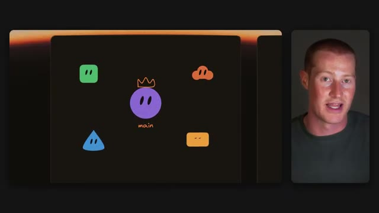
*⏱️ 00:10:04 — Schéma animé montrant un agent principal violet au centre entouré d'autres agents d'IA représentés par des formes colorées, avec le présentateur à droite.*

---

### ⏱️ `[00:10:31 - 00:11:00]` | Segment #23

**🔊 Audio (Transcription Intégrale Mot pour Mot en Français) :**
> chaque artefact qui est généré comme mes présentations et tous mes différents tableaux de bord. Et je pense que c'est très important parce que Claude a été vraiment doué pour créer des artefacts et c'est quelque chose que je n'ai pas vraiment encore vu à l'intérieur de GrokBot. J'aime aussi beaucoup la section des tâches ici même, car je pouvais voir sur quoi il travaille et ce qui arrive ensuite à tout moment. Et cela inclut même des choses que je ne lui ai pas dit de faire. Donc, par exemple, si j'ai un e-mail important qui arrive, il va le voir et l'ajouter à la liste des choses qu'il doit faire pour demain.

**👁️ Analyse Visuelle d'Écran (gemini-3.5-flash-lite) :**
**Interface & Outils** : Interface d'application mobile conceptuelle (maquette de design) et application mobile fonctionnelle.

**Contenu textuel & Code** : Maquettes graphiques d'interface, blocs de contenu (textes, aperçus, graphiques en barres), et liste de tâches structurées.
[DESC_IMAGE_3] Présentation visuelle de la structure d'une application mobile et de ses fonctionnalités de gestion des tâches.

**Action / Démonstration** : Explications face caméra et analyse conceptuelle des marchés.

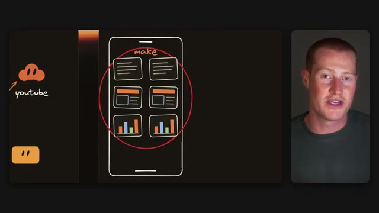
*⏱️ 00:10:38 — Schéma conceptuel d'une application mobile montrant divers types de blocs de contenu, étiquetés « make », avec le présentateur à droite.*

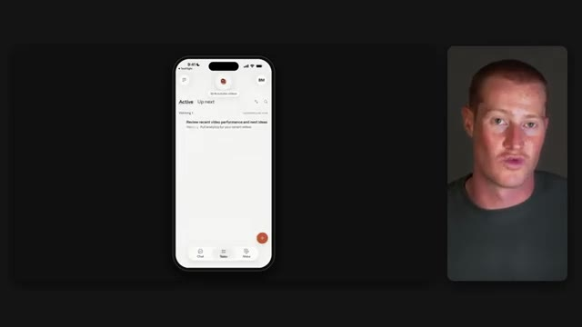
*⏱️ 00:10:46 — Interface mobile réelle (simulant une application de gestion de tâches et de performances YouTube) avec des onglets « Active » et « Up next ».*

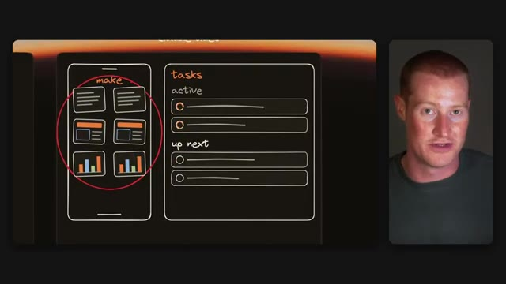
*⏱️ 00:10:53 — Schéma comparatif développé montrant l'application mobile et un panneau latéral de gestion des tâches (« tasks » avec « active » et « up next »).*

---

### ⏱️ `[00:11:01 - 00:11:22]` | Segment #24

**🔊 Audio (Transcription Intégrale Mot pour Mot en Français) :**
> Je trouve vraiment que c’est une touche intéressante pour cette interface, et je pense que cela pourrait être une expérience vraiment sympa à mesure que je l’utilise davantage. Maintenant, les canaux sont intéressants, mais je ne sais pas encore trop quoi en penser. Je pense quand même que je préfère la façon dont GrokBot procède avec des agents séparés. Je trouve juste que c’ens est une expérience plus épurée. Mais encore une fois, je n’ai utilisé ceci que pendant quelques heures, alors j’ai peut-être juste besoin de l’essayer un peu plus avant de me décider.

**👁️ Analyse Visuelle d'Écran (gemini-3.5-flash-lite) :**
**Interface & Outils** : Interface de présentation ou croquis conceptuel.

**Contenu textuel & Code** : Schémas d'une interface mobile et de listes de tâches annotées à la main.

**Action / Démonstration** : Le présentateur commente la conception de l'interface affichée à l'écran.

---

### ⏱️ `[00:11:22 - 00:11:43]` | Segment #25

**🔊 Audio (Transcription Intégrale Mot pour Mot en Français) :**
> Et la dernière chose dont je veux parler, c'est que je n'ai utilisé Claude Duet que sur mon téléphone jusqu'à présent. Je suis donc vraiment curieux de voir comment il fonctionne sur l'ordinateur, car c'est probablement là que je vais l'utiliser la plupart du temps, à moins que je ne sois en déplacement. Très bien. C'est donc mon premier aperçu de Claude Duet et une comparaison avec mon expérience de GrokBot. J'espère que vous avez aimé cette vidéo. À l'heure actuelle, vous pouvez vous inscrire sur la liste d'attente, mais vous devez vous trouver aux États-Unis pour pouvoir y accéder.

**👁️ Analyse Visuelle d'Écran (gemini-3.5-flash-lite) :**
**Interface & Outils** : Aucune interface de trading, de terminal ou de code source affichée.

**Contenu textuel & Code** : Aucun code, prompt ou indicateur technique pertinent.

**Action / Démonstration** : Le présentateur parle à l'écran sans effectuer de démonstration pratique.

---

### ⏱️ `[00:11:43 - 00:11:55]` | Segment #26

**🔊 Audio (Transcription Intégrale Mot pour Mot en Français) :**
> Donc, vous pouvez vous inscrire. Il y a un lien dans la description. Et faites-moi aussi savoir dans les commentaires si vous allez passer de GrokBot à Claude Duet. Je suis vraiment curieux de voir ce que vous allez utiliser. Quoi qu'il en soit, merci d'avoir regardé jusqu'à la fin et je vous vois dans la prochaine vidéo. Salut.

**👁️ Analyse Visuelle d'Écran (gemini-3.5-flash-lite) :**
**Interface & Outils** : Aucune interface logicielle ou graphique affichée.

**Contenu textuel & Code** : Aucun code, indicateur ou donnée chiffrée.

**Action / Démonstration** : Le présentateur s'adresse directement au public pour conclure la vidéo.

---

