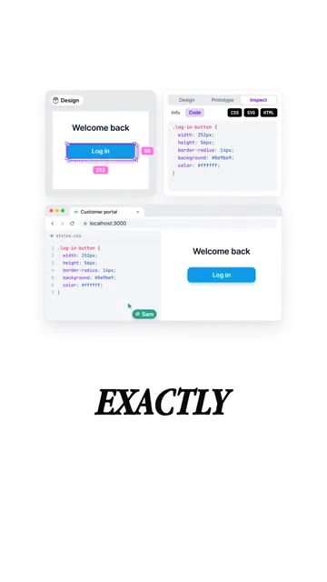
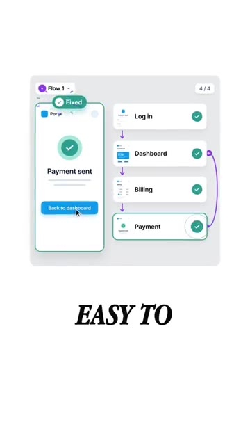

# 🎬 A Free Figma Alternative on GitHub That You Own Forever

> **Chaîne** : [Brock Mesarich | AI for Non Techies](https://www.youtube.com/@BrockMesarich)  
> **Lien YouTube** : [https://www.youtube.com/watch?v=Eug89TdGfEY](https://www.youtube.com/watch?v=Eug89TdGfEY)  
> **Date de publication** : 20261023  
> **Durée** : 00:00:34  
> **Identifiant vidéo** : `Eug89TdGfEY`  
> **Transcription & Analyse** : `whisper-v3-large-turbo+gemini-3.5-flash-lite`  

---

## 📌 Synthèse Exécutive & Outils

### 💡 Résumé
Dans cette vidéo orientée vers l'optimisation des flux de travail technologiques et l'affranchissement des abonnements logiciels, la chaîne *Brock Mesarich | AI for Non Techies* met en lumière Penpot, une alternative open-source majeure à Figma hébergée sur GitHub et cumulant plus de 45 000 étoiles. Conçu pour s'exécuter directement dans le navigateur, cet outil permet de concevoir des interfaces, de structurer des composants réutilisables et de générer des prototypes cliquables collaboratifs. À l'instar d'une stratégie de trading algorithmique robuste où l'opérateur conserve le contrôle total de son infrastructure (évitant ainsi la dépendance à un fournisseur tiers et les coûts récurrents), Penpot offre la possibilité d'un auto-hébergement intégral, garantissant la souveraineté absolue des données de conception.

L'analyse de cette transition méthodologique met en évidence un gain opérationnel considérable, comparable à l'automatisation de pipelines via des orchestrateurs de flux. Là où les solutions propriétaires enferment les utilisateurs dans des écosystèmes fermés, Penpot traduit directement les maquettes en code web standard. Cette transparence structurelle élimine les frictions entre les équipes de design et les développeurs, agissant comme un "backtest" visuel en conditions réelles. En simulant l'expérience utilisateur d'un portail client en amont, les équipes repèrent et corrigent les points de friction ergonomiques avant le déploiement en production, réduisant drastiquement le taux d'erreur et le coût de maintenance ultérieur.

Bien que la vidéo se concentre sur l'écosystème du design d'interface et du développement logiciel, la philosophie sous-jacente résonne fortement avec les logiques d'automatisation avancées (mobilisant des outils d'IA générative et des moteurs d'intégration comme Make, n8n ou Zapier). La capacité à posséder ses propres outils, à manipuler des environnements open-source et à structurer des processus reproductibles sans barrière financière s'inscrit dans une démarche d'optimisation des ressources (efficiency-first), maximisant le retour sur investissement (ROI) technique et organisationnel pour les créateurs et les entreprises.

### 🛠️ Outils, Modèles & Logiciels Présentés
* **Penpot** : Alternative open-source à Figma hébergée sur GitHub, fonctionnant dans le navigateur, axée sur l'auto-hébergement et la conversion des designs en code web standard.
* **GitHub** : Plateforme de développement collaborative et d'hébergement de code source où est répertorié le dépôt officiel du projet Penpot (comptabilisant plus de 45 000 étoiles).
* **Claude** : Modèle de langage avancé d'Anthropic mobilisé dans l'écosystème global de prompt engineering pour l'assistance au développement et à la structuration de projets.
* **Grok** : Modèle d'intelligence artificielle conversationnelle intégré aux flux de données en temps réel, utile pour l'analyse contextuelle et la veille technologique.
* **ChatGPT** : Assistant conversationnel propulsé par OpenAI, employé pour la génération de code, la rédaction de prompts et l'optimisation des processus automatisés.
* **Gemini** : Modèle multimodal de Google utilisé pour le traitement de larges volumes d'informations et l'assistance à la conception technique.
* **Make** : Plateforme d'automatisation visuelle avancée (anciennement Integromat) pour connecter des applications et orchestrer des flux de travail complexes sans code.
* **n8n** : Outil d'automatisation de flux de travail open-source et hautement personnalisable, privilégié pour l'auto-hébergement et la confidentialité des données.
* **Zapier** : Solution logicielle d'automatisation grand public facilitant les connexions rapides et la synchronisation de données entre des centaines d'applications cloud.

### 🔑 Points Clés & Enseignements Stratégiques
* **Souveraineté logicielle et auto-hébergement** : Posséder ses propres outils de conception sur GitHub élimines les risques de dépendance (« vendor lock-in ») et garantit que les actifs créatifs ne seront jamais bloqués par des augmentations de tarifs ou des fermetures de plateformes.
* **Indicateur de popularité communautaire** : Le seuil des 45 000 étoiles sur GitHub sert de signal fort de validation technique, garantissant la pérennité, la sécurité et le dynamisme de la communauté open-source autour de Penpot.
* **Exécution native dans le navigateur** : L'architecture infonuagique et l'accès direct via le navigateur suppriment les contraintes d'installation lourde, favorisant une adoption rapide par l'ensemble des parties prenantes.
* **Traduction directe en code web standard** : Contrairement aux formats propriétaires, Penpot enregistre les conceptions dans un code natif, permettant aux équipes de développement d'implémenter les interfaces avec une fidélité visuelle et structurelle absolue.
* **Prototypage dynamique et cliquable** : La création de parcours utilisateurs interactifs permet de simuler le comportement réel d'une application avant même d'écrire la moindre ligne de code de production.
* **Gestion du risque ergonomique (« User Experience Risk Management »)** : Repérer les étapes déroutantes d'un portail client lors de la phase de maquettage permet de corriger les failles conceptuelles à un stade où le coût de modification est minimal.
* **Collaboration inter-équipes unifiée** : Centraliser designers et développeurs sur une plateforme unique fluidifie la transmission des spécifications techniques et élimine les pertes d'informations en cours de route.
* **Optimisation des coûts opérationnels** : L'utilisation d'une alternative entièrement gratuite et open-source réduit drastiquement les dépenses d'abonnement logiciel, augmentant la rentabilité globale des projets technologiques.
* **Méthodologie de validation itérative** : Tester les parcours utilisateurs par le biais de démos interactives agit comme un filtre d'optimisation, garantissant que chaque composant réutilisable répond à un besoin fonctionnel précis.
* **Synergie avec l'écosystème d'automatisation** : L'intégration conceptuelle de Penpot dans un flux de travail moderne s'aligne sur l'utilisation d'outils d'IA (Claude, ChatGPT, Gemini, Grok) et d'automatisation (Make, n8n, Zapier) pour maximiser l'efficacité opérationnelle globale.

---

## ⏱️ Chronologie & Transcription Complète Audio & Visuelle (Mot pour Mot)

### ⏱️ `[00:00:00 - 00:00:20]` | Segment #01

**🔊 Audio (Transcription Intégrale Mot pour Mot en Français) :**
> Il y a une alternative gratuite à Figma sur GitHub et vous pouvez l'avoir pour toujours. Ça s'appelle Penpot et ça a plus de 45 000 étoiles. Ça fonctionne directement dans votre navigateur, permet de concevoir des écrans, de créer des composants réutilisables et de faire des démos cliquables. Ensuite, vous le partagez avec tous vos développeurs au même endroit. Mais voici la différence. Vous pouvez l'héberger vous-même pour que vos créations ne soient jamais bloquées.

**👁️ Analyse Visuelle d'Écran (gemini-3.5-flash-lite) :**
**Interface & Outils** : GitHub / Interface web

**Contenu textuel & Code** : Logo Penpot, mention du dépôt 'penpot / penpot' avec le badge 'Public', et texte incitatif 'IT HAS'.

**Action / Démonstration** : Présentation de l'outil Penpot et de sa page GitHub.

*⏱️ 00:00:05 — Capture d'écran montrant le logo de Penpot avec la mention du dépôt GitHub penpot/penpot et le texte 'IT HAS' en bas.*

---

### ⏱️ `[00:00:20 - 00:00:34]` | Segment #02

**🔊 Audio (Transcription Intégrale Mot pour Mot en Français) :**
> Et cela enregistre les designs dans du code web normal pour que les développeurs puissent construire à partir de ce qu'ils voient exactement. Disons que vous redesignez un portail client. Construisez d'abord la démo cliquable. Vous repérerez les étapes déroutantes alors qu'elles sont encore faciles à corriger. Si vous voulez essayer ceci, commentez penpot et je vous enverrai le dépôt.

**👁️ Analyse Visuelle d'Écran (gemini-3.5-flash-lite) :**
**Interface & Outils** : Outil de design d'interface et de prototypage (type Figma).

**Contenu textuel & Code** : Propriétés CSS, code source, diagrammes de flux utilisateur, maquettes d'écrans de portail client.

**Action / Démonstration** : Visualisation et inspection de code CSS généré à partir de designs et création de flux de navigation cliquables.

*⏱️ 00:00:23 — Interface de conception montrant un bouton de connexion avec ses propriétés CSS associées et son aperçu web.*

*⏱️ 00:00:27 — Diagramme de flux utilisateur montrant différentes étapes connectées d'un portail client (connexion, tableau de bord, facturation).*

*⏱️ 00:00:31 — Interface de prototypage montrant un parcours utilisateur validé avec des indicateurs de statut pour chaque étape.*

---

